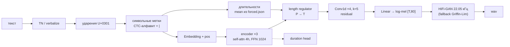

# Russian TTS model development

## User

Ознакомься с проектом, его текущей реализацией, а также с  результатами и дилогом агента в c:\Users\AdamCage\.cursor\projects\c-projects-tts-self\agent-transcripts\3c84af7a-4409-4bb7-b8f7-f88d6966cb88\3c84af7a-4409-4bb7-b8f7-f88d6966cb88.jsonl .

На сейчас имеем модель, которая по сути генерирует шум. В реальных задачах она на текущий момент бесполезна.

Мы преследуем цель создать собственную русскоязычную OS TTS модель, а также внести вклад в науку (цикл статей + кандидатская) и сообщество.

На каком мы этапе остановились?
Что следует предринять далее, чтобы довести модель до:
1. состояния, когда она будет генерировать ральную речь
2. состояния, когда можно будет делать первые научные публикации

Крайне подробно и полно изучи весь проект, используй свои знания, а также научные статьи, профессиональные публикации и материалы и спланируй максимально подробный и полный план последующих действий.

Если нужно, задавай вопросы.

## Assistant

I'll start by getting oriented in the project and reading the agent transcript you pointed to, in parallel.

### Tool Run Terminal Command V2

```
{"command":"ls -la C:/projects/tts-self","workingDirectory":"","timeout":30000,"toolCallId":"toolu_01WoNuerCfXng5Kk55oGTY1t","simpleCommands":["ls"],"hasInputRedirect":false,"hasOutputRedirect":false,"parsingResult":{"parsingFailed":false,"executableCommands":[{"name":"ls","args":[{"type":"word","value":"-la"},{"type":"word","value":"C:/projects/tts-self"}],"fullText":"ls -la C:/projects/tts-self"}],"hasRedirects":false,"hasCommandSubstitution":false,"redirects":[]},"fileOutputThresholdBytes":"40000","isBackground":false,"skipApproval":false,"timeoutBehavior":"TIMEOUT_BEHAVIOR_BACKGROUND","hardTimeout":86400000,"description":"List project root","closeStdin":true,"conversationId":"d9535a48-8e7d-4e19-9fe9-0a9707a09fb8"}
```

### Tool Run Terminal Command V2

```
{"command":"ls -la \"C:/Users/AdamCage/.cursor/projects/c-projects-tts-self/agent-transcripts/\"","workingDirectory":"","timeout":30000,"toolCallId":"toolu_01X2sRDFhShuGzWjHYtnMQz3","simpleCommands":["ls"],"hasInputRedirect":false,"hasOutputRedirect":false,"parsingResult":{"parsingFailed":false,"executableCommands":[{"name":"ls","args":[{"type":"word","value":"-la"},{"type":"string","value":"\"C:/Users/AdamCage/.cursor/projects/c-projects-tts-self/agent-transcripts/\""}],"fullText":"ls -la \"C:/Users/AdamCage/.cursor/projects/c-projects-tts-self/agent-transcripts/\""}],"hasRedirects":false,"hasCommandSubstitution":false,"redirects":[]},"fileOutputThresholdBytes":"40000","isBackground":false,"skipApproval":false,"timeoutBehavior":"TIMEOUT_BEHAVIOR_BACKGROUND","hardTimeout":86400000,"description":"List agent transcripts","closeStdin":true,"conversationId":"d9535a48-8e7d-4e19-9fe9-0a9707a09fb8"}
```

### Tool Run Terminal Command V2

```
{"command":"Get-ChildItem -Force C:/projects/tts-self | Select-Object Mode,Length,LastWriteTime,Name | Format-Table -AutoSize","workingDirectory":"","timeout":30000,"toolCallId":"toolu_012BXM8G1mnyyrhjxgFzaXyR","simpleCommands":["Get-ChildItem","Select-Object","Format-Table"],"hasInputRedirect":false,"hasOutputRedirect":false,"parsingResult":{"parsingFailed":false,"executableCommands":[{"name":"Get-ChildItem","args":[{"type":"word","value":"-Force"},{"type":"word","value":"C:/projects/tts-self"}],"fullText":"Get-ChildItem -Force C:/projects/tts-self"},{"name":"Select-Object","args":[{"type":"word","value":"Mode,Length,LastWriteTime,Name"}],"fullText":"Select-Object Mode,Length,LastWriteTime,Name"},{"name":"Format-Table","args":[{"type":"word","value":"-AutoSize"}],"fullText":"Format-Table -AutoSize"}],"hasRedirects":false,"hasCommandSubstitution":false,"redirects":[]},"fileOutputThresholdBytes":"40000","isBackground":false,"skipApproval":false,"timeoutBehavior":"TIMEOUT_BEHAVIOR_BACKGROUND","hardTimeout":86400000,"description":"List project root","closeStdin":true,"conversationId":"d9535a48-8e7d-4e19-9fe9-0a9707a09fb8"}
```

### Tool Run Terminal Command V2

```
{"command":"Get-ChildItem -Recurse \"C:/Users/AdamCage/.cursor/projects/c-projects-tts-self/agent-transcripts/\" | Select-Object Length,LastWriteTime,FullName | Format-Table -AutoSize","workingDirectory":"","timeout":30000,"toolCallId":"toolu_019uKLQ1tAXsRADbSLqaJpYp","simpleCommands":["Get-ChildItem","Select-Object","Format-Table"],"hasInputRedirect":false,"hasOutputRedirect":false,"parsingResult":{"parsingFailed":false,"executableCommands":[{"name":"Get-ChildItem","args":[{"type":"word","value":"-Recurse"},{"type":"string","value":"\"C:/Users/AdamCage/.cursor/projects/c-projects-tts-self/agent-transcripts/\""}],"fullText":"Get-ChildItem -Recurse \"C:/Users/AdamCage/.cursor/projects/c-projects-tts-self/agent-transcripts/\""},{"name":"Select-Object","args":[{"type":"word","value":"Length,LastWriteTime,FullName"}],"fullText":"Select-Object Length,LastWriteTime,FullName"},{"name":"Format-Table","args":[{"type":"word","value":"-AutoSize"}],"fullText":"Format-Table -AutoSize"}],"hasRedirects":false,"hasCommandSubstitution":false,"redirects":[]},"fileOutputThresholdBytes":"40000","isBackground":false,"skipApproval":false,"timeoutBehavior":"TIMEOUT_BEHAVIOR_BACKGROUND","hardTimeout":86400000,"description":"List agent transcripts recursively","closeStdin":true,"conversationId":"d9535a48-8e7d-4e19-9fe9-0a9707a09fb8"}
```

### Tool Read File V2

```
{"path":"C:\\projects\\tts-self\\README.md"}
```

### Tool Run Terminal Command V2

```
{"command":"Get-ChildItem \"C:/Users/AdamCage/.cursor/projects/c-projects-tts-self/agent-transcripts/3c84af7a-4409-4bb7-b8f7-f88d6966cb88/\" | Select-Object Length,LastWriteTime,Name | Sort-Object LastWriteTime | Format-Table -AutoSize; Write-Output \"---DOCS---\"; Get-ChildItem -Recurse C:/projects/tts-self/docs | Select-Object Length,LastWriteTime,FullName | Format-Table -AutoSize","workingDirectory":"","timeout":30000,"toolCallId":"toolu_01SuKzeAcZXddqBjFYah1f5C","simpleCommands":["Get-ChildItem","Select-Object","Sort-Object","Format-Table","Write-Output","Get-ChildItem","Select-Object","Format-Table"],"hasInputRedirect":false,"hasOutputRedirect":false,"parsingResult":{"parsingFailed":false,"executableCommands":[{"name":"Get-ChildItem","args":[{"type":"string","value":"\"C:/Users/AdamCage/.cursor/projects/c-projects-tts-self/agent-transcripts/3c84af7a-4409-4bb7-b8f7-f88d6966cb88/\""}],"fullText":"Get-ChildItem \"C:/Users/AdamCage/.cursor/projects/c-projects-tts-self/agent-transcripts/3c84af7a-4409-4bb7-b8f7-f88d6966cb88/\""},{"name":"Select-Object","args":[{"type":"word","value":"Length,LastWriteTime,Name"}],"fullText":"Select-Object Length,LastWriteTime,Name"},{"name":"Sort-Object","args":[{"type":"word","value":"LastWriteTime"}],"fullText":"Sort-Object LastWriteTime"},{"name":"Format-Table","args":[{"type":"word","value":"-AutoSize"}],"fullText":"Format-Table -AutoSize"},{"name":"Write-Output","args":[{"type":"string","value":"\"---DOCS---\""}],"fullText":"Write-Output \"---DOCS---\""},{"name":"Get-ChildItem","args":[{"type":"word","value":"-Recurse"},{"type":"word","value":"C:/projects/tts-self/docs"}],"fullText":"Get-ChildItem -Recurse C:/projects/tts-self/docs"},{"name":"Select-Object","args":[{"type":"word","value":"Length,LastWriteTime,FullName"}],"fullText":"Select-Object Length,LastWriteTime,FullName"},{"name":"Format-Table","args":[{"type":"word","value":"-AutoSize"}],"fullText":"Format-Table -AutoSize"}],"hasRedirects":false,"hasCommandSubstitution":false,"redirects":[]},"fileOutputThresholdBytes":"40000","isBackground":false,"skipApproval":false,"timeoutBehavior":"TIMEOUT_BEHAVIOR_BACKGROUND","hardTimeout":86400000,"description":"List transcript folder and docs","closeStdin":true,"conversationId":"d9535a48-8e7d-4e19-9fe9-0a9707a09fb8"}
```

### Tool Read File V2

```
{"path":"C:\\projects\\tts-self\\docs\\phase2_train.md"}
```

### Tool Read File V2

```
{"path":"C:\\projects\\tts-self\\docs\\phase0_report.md"}
```

### Tool Read File V2

```
{"path":"C:\\projects\\tts-self\\docs\\phase3_ab.md"}
```

### Tool Read File V2

```
{"path":"C:\\projects\\tts-self\\docs\\phase4_latency.md"}
```

## Assistant

Now let me read the agent transcript and explore the codebase in parallel.

### Tool Run Terminal Command V2

```
{"command":"cd \"C:/Users/AdamCage/.cursor/projects/c-projects-tts-self/agent-transcripts/3c84af7a-4409-4bb7-b8f7-f88d6966cb88\"; python -c \"\nimport json,io,sys\np='3c84af7a-4409-4bb7-b8f7-f88d6966cb88.jsonl'\nrows=[json.loads(l) for l in open(p,encoding='utf-8') if l.strip()]\nprint('n rows',len(rows))\nfrom collections import Counter\nprint(Counter(r.get('type','?') for r in rows))\nprint(json.dumps(rows[0])[:2000])\n\"","workingDirectory":"","timeout":30000,"toolCallId":"toolu_01YWLiL5PDFZ6STApBgA2dLU","simpleCommands":["cd","python"],"hasInputRedirect":false,"hasOutputRedirect":false,"parsingResult":{"parsingFailed":false,"executableCommands":[{"name":"cd","args":[{"type":"string","value":"\"C:/Users/AdamCage/.cursor/projects/c-projects-tts-self/agent-transcripts/3c84af7a-4409-4bb7-b8f7-f88d6966cb88\""}],"fullText":"cd \"C:/Users/AdamCage/.cursor/projects/c-projects-tts-self/agent-transcripts/3c84af7a-4409-4bb7-b8f7-f88d6966cb88\""},{"name":"python","args":[{"type":"word","value":"-c"},{"type":"string","value":"\"\nimport json,io,sys\np='3c84af7a-4409-4bb7-b8f7-f88d6966cb88.jsonl'\nrows=[json.loads(l) for l in open(p,encoding='utf-8') if l.strip()]\nprint('n rows',len(rows))\nfrom collections import Counter\nprint(Counter(r.get('type','?') for r in rows))\nprint(json.dumps(rows[0])[:2000])\n\""}],"fullText":"python -c \"\nimport json,io,sys\np='3c84af7a-4409-4bb7-b8f7-f88d6966cb88.jsonl'\nrows=[json.loads(l) for l in open(p,encoding='utf-8') if l.strip()]\nprint('n rows',len(rows))\nfrom collections import Counter\nprint(Counter(r.get('type','?') for r in rows))\nprint(json.dumps(rows[0])[:2000])\n\""}],"hasRedirects":false,"hasCommandSubstitution":false,"redirects":[]},"fileOutputThresholdBytes":"40000","isBackground":false,"skipApproval":false,"timeoutBehavior":"TIMEOUT_BEHAVIOR_BACKGROUND","hardTimeout":86400000,"description":"Inspect transcript structure","closeStdin":true,"conversationId":"d9535a48-8e7d-4e19-9fe9-0a9707a09fb8"}
```

### Tool New agent

```
{"description":"Map model + training code","prompt":"Explore the repo at C:/projects/tts-self (a Russian TTS research prototype, MiniSpeech-RU). I need a VERY thorough map of the model and training implementation. Specifically report, with file paths and key code snippets (with line numbers):\n\n1. `src/minispeech/` full module tree and what each module does.\n2. The Talker model architecture: exact layer configuration, hidden size, number of layers, cross-attention design, how text hiddens are injected, positional encoding, parameter count if computable from config.\n3. The heads: `direct` vs `residual` regression head, and the rectified-flow head. What loss functions are used (L1/L2/flow matching), any spectral/adversarial losses, and how latents are normalized (mean/std per-dim?).\n4. The stop head and duration head design and losses.\n5. The training loop in the trainer: optimizer, LR schedule, teacher forcing, scheduled sampling (if any), acoustic_dropout mechanics, gradient clipping, EMA.\n6. Inference/generation: `generate()`, autoregressive loop, whether it feeds back predicted latents or ground-truth, sampling temperature/noise, stop rule.\n7. Eval scripts: `09_eval.py`, `09b_eval_free_running.py` — exactly which metrics are computed and how (DTW L1, duration_in_band, stop_success, runaway, WER?). Is there ANY ASR-based WER on synthesized audio in the eval path?\n\nBe exhaustive; quote the important code. Thoroughness level: very thorough.\"}","subagentType":{"explore":{}},"model":"composer-2.5-fast","agentId":"41621622-d586-4dc9-a860-6615e06e0758","attachments":[],"mode":"TASK_MODE_UNSPECIFIED","respondingToMessageIds":[],"environment":"SUBAGENT_EXECUTION_ENVIRONMENT_UNSPECIFIED"}
```

### Tool Run Terminal Command V2

```
{"command":"cd \"C:/Users/AdamCage/.cursor/projects/c-projects-tts-self/agent-transcripts/3c84af7a-4409-4bb7-b8f7-f88d6966cb88\"; python -c \"\nimport json\np='3c84af7a-4409-4bb7-b8f7-f88d6966cb88.jsonl'\nrows=[json.loads(l) for l in open(p,encoding='utf-8') if l.strip()]\nout=[]\nfor i,r in enumerate(rows):\n    role=r.get('role')\n    msg=r.get('message') or {}\n    cont=msg.get('content')\n    if not cont: continue\n    if isinstance(cont,str):\n        out.append((i,role,'text',cont))\n        continue\n    for c in cont:\n        t=c.get('type')\n        if t=='text':\n            out.append((i,role,'text',c.get('text','')))\n        elif t=='tool_use':\n            out.append((i,role,'tool:'+str(c.get('name')),json.dumps(c.get('input'),ensure_ascii=False)[:300]))\n        elif t=='tool_result':\n            pass\nfor i,role,t,txt in out:\n    if t=='text':\n        print('='*100)\n        print(f'[{i}] {role} {t} len={len(txt)}')\n        print(txt[:6000])\n\" > C:/Users/AdamCage/AppData/Local/Temp/tr_dump.txt 2>&1; (Get-Item C:/Users/AdamCage/AppData/Local/Temp/tr_dump.txt).Length","workingDirectory":"","timeout":30000,"toolCallId":"toolu_01WPkLtgsu92v48xHjrRAAUk","simpleCommands":["cd","python","Get-Item",".Length"],"hasInputRedirect":false,"hasOutputRedirect":true,"parsingResult":{"parsingFailed":false,"executableCommands":[{"name":"cd","args":[{"type":"string","value":"\"C:/Users/AdamCage/.cursor/projects/c-projects-tts-self/agent-transcripts/3c84af7a-4409-4bb7-b8f7-f88d6966cb88\""}],"fullText":"cd \"C:/Users/AdamCage/.cursor/projects/c-projects-tts-self/agent-transcripts/3c84af7a-4409-4bb7-b8f7-f88d6966cb88\""},{"name":"python","args":[{"type":"word","value":"-c"},{"type":"string","value":"\"\nimport json\np='3c84af7a-4409-4bb7-b8f7-f88d6966cb88.jsonl'\nrows=[json.loads(l) for l in open(p,encoding='utf-8') if l.strip()]\nout=[]\nfor i,r in enumerate(rows):\n    role=r.get('role')\n    msg=r.get('message') or {}\n    cont=msg.get('content')\n    if not cont: continue\n    if isinstance(cont,str):\n        out.append((i,role,'text',cont))\n        continue\n    for c in cont:\n        t=c.get('type')\n        if t=='text':\n            out.append((i,role,'text',c.get('text','')))\n        elif t=='tool_use':\n            out.append((i,role,'tool:'+str(c.get('name')),json.dumps(c.get('input'),ensure_ascii=False)[:300]))\n        elif t=='tool_result':\n            pass\nfor i,role,t,txt in out:\n    if t=='text':\n        print('='*100)\n        print(f'[{i}] {role} {t} len={len(txt)}')\n        print(txt[:6000])\n\""}],"fullText":"python -c \"\nimport json\np='3c84af7a-4409-4bb7-b8f7-f88d6966cb88.jsonl'\nrows=[json.loads(l) for l in open(p,encoding='utf-8') if l.strip()]\nout=[]\nfor i,r in enumerate(rows):\n    role=r.get('role')\n    msg=r.get('message') or {}\n    cont=msg.get('content')\n    if not cont: continue\n    if isinstance(cont,str):\n        out.append((i,role,'text',cont))\n        continue\n    for c in cont:\n        t=c.get('type')\n        if t=='text':\n            out.append((i,role,'text',c.get('text','')))\n        elif t=='tool_use':\n            out.append((i,role,'tool:'+str(c.get('name')),json.dumps(c.get('input'),ensure_ascii=False)[:300]))\n        elif t=='tool_result':\n            pass\nfor i,role,t,txt in out:\n    if t=='text':\n        print('='*100)\n        print(f'[{i}] {role} {t} len={len(txt)}')\n        print(txt[:6000])\n\""},{"name":"Get-Item","args":[{"type":"word","value":"C:/Users/AdamCage/AppData/Local/Temp/tr_dump.txt"}],"fullText":"Get-Item C:/Users/AdamCage/AppData/Local/Temp/tr_dump.txt"},{"name":".Length","args":[],"fullText":".Length"}],"hasRedirects":true,"hasCommandSubstitution":false,"allRedirectsAreDevNull":false,"redirects":[{"operator":">","destinationFds":[1],"targetNodeType":"word","targetText":"C:/Users/AdamCage/AppData/Local/Temp/tr_dump.txt"},{"operator":">&","destinationFds":[2],"targetNodeType":"number","targetText":"1"}]},"fileOutputThresholdBytes":"40000","isBackground":false,"skipApproval":false,"timeoutBehavior":"TIMEOUT_BEHAVIOR_BACKGROUND","hardTimeout":86400000,"description":"Dump transcript text messages","closeStdin":true,"conversationId":"d9535a48-8e7d-4e19-9fe9-0a9707a09fb8"}
```

### Tool New agent

```
{"description":"Map data, configs, runs, evals","prompt":"Explore the repo at C:/projects/tts-self (Russian TTS research prototype, MiniSpeech-RU). Report thoroughly, with file paths and quoted content:\n\n1. All YAML files under `configs/` — dump the FULL content of each (they are small): data config, talker_v01_direct.yaml, flow_v02.yaml, infer.yaml, qwen_local.yaml, asr.yaml, and any others. I need exact hyperparameters.\n2. The dataset: how many utterances / hours in the RUSLAN manifest? Look for manifest stats, QC docs (`docs/corpus_qc.md`), split sizes, and the S1/S2/S3/S4 stage definitions (how many utterances/hours each stage uses).\n3. What is in `runs/` on the Windows side — list all files, and dump the contents of any JSON eval artifacts (`eval_free_running_*.json`, `best_fr_metrics.json`, `run_manifest.json`, `fr_eval.jsonl` tails).\n4. What is in `out/` — list demo wav files and any manifest.txt contents.\n5. `scripts/` — list every script with a one-line purpose from its docstring.\n6. `tests/` — what is tested.\n7. Any notes on the Qwen model actually used (`configs/qwen_local.yaml`) — which model, which layers are cached, hidden size.\n\nThoroughness level: very thorough. Quote actual numbers.","subagentType":{"explore":{}},"model":"composer-2.5-fast","agentId":"fa4e358a-ad4e-497b-8a8e-c5b7e7936e51","attachments":[],"mode":"TASK_MODE_UNSPECIFIED","respondingToMessageIds":[],"environment":"SUBAGENT_EXECUTION_ENVIRONMENT_UNSPECIFIED"}
```

### Tool Read File V2

```
{"path":"C:\\Users\\AdamCage\\AppData\\Local\\Temp\\tr_dump.txt"}
```

### Tool Run Terminal Command V2

```
{"command":"$env:PYTHONIOENCODING=\"utf-8\"; cd \"C:/Users/AdamCage/.cursor/projects/c-projects-tts-self/agent-transcripts/3c84af7a-4409-4bb7-b8f7-f88d6966cb88\"; python -c \"\nimport json,sys,io\nsys.stdout=io.TextIOWrapper(sys.stdout.buffer,encoding='utf-8')\np='3c84af7a-4409-4bb7-b8f7-f88d6966cb88.jsonl'\nrows=[json.loads(l) for l in open(p,encoding='utf-8') if l.strip()]\nfor i,r in enumerate(rows):\n    role=r.get('role')\n    msg=r.get('message') or {}\n    cont=msg.get('content')\n    if not cont: continue\n    if isinstance(cont,str): cont=[{'type':'text','text':cont}]\n    for c in cont:\n        if c.get('type')=='text':\n            txt=c.get('text','')\n            print('='*100)\n            print(f'[{i}] role={role} len={len(txt)}')\n            print(txt)\n\" | Out-File -Encoding utf8 C:/Users/AdamCage/AppData/Local/Temp/tr_dump.txt; (Get-Item C:/Users/AdamCage/AppData/Local/Temp/tr_dump.txt).Length","workingDirectory":"","timeout":30000,"toolCallId":"toolu_01P3X8EfAQx84aeNVR84uePS","simpleCommands":["$env:PYTHONIOENCODING=\"utf-8\"","cd","python","Out-File","Get-Item",".Length"],"hasInputRedirect":false,"hasOutputRedirect":false,"parsingResult":{"parsingFailed":false,"executableCommands":[{"name":"$env:PYTHONIOENCODING=\"utf-8\"","args":[],"fullText":"$env:PYTHONIOENCODING=\"utf-8\""},{"name":"cd","args":[{"type":"string","value":"\"C:/Users/AdamCage/.cursor/projects/c-projects-tts-self/agent-transcripts/3c84af7a-4409-4bb7-b8f7-f88d6966cb88\""}],"fullText":"cd \"C:/Users/AdamCage/.cursor/projects/c-projects-tts-self/agent-transcripts/3c84af7a-4409-4bb7-b8f7-f88d6966cb88\""},{"name":"python","args":[{"type":"word","value":"-c"},{"type":"string","value":"\"\nimport json,sys,io\nsys.stdout=io.TextIOWrapper(sys.stdout.buffer,encoding='utf-8')\np='3c84af7a-4409-4bb7-b8f7-f88d6966cb88.jsonl'\nrows=[json.loads(l) for l in open(p,encoding='utf-8') if l.strip()]\nfor i,r in enumerate(rows):\n    role=r.get('role')\n    msg=r.get('message') or {}\n    cont=msg.get('content')\n    if not cont: continue\n    if isinstance(cont,str): cont=[{'type':'text','text':cont}]\n    for c in cont:\n        if c.get('type')=='text':\n            txt=c.get('text','')\n            print('='*100)\n            print(f'[{i}] role={role} len={len(txt)}')\n            print(txt)\n\""}],"fullText":"python -c \"\nimport json,sys,io\nsys.stdout=io.TextIOWrapper(sys.stdout.buffer,encoding='utf-8')\np='3c84af7a-4409-4bb7-b8f7-f88d6966cb88.jsonl'\nrows=[json.loads(l) for l in open(p,encoding='utf-8') if l.strip()]\nfor i,r in enumerate(rows):\n    role=r.get('role')\n    msg=r.get('message') or {}\n    cont=msg.get('content')\n    if not cont: continue\n    if isinstance(cont,str): cont=[{'type':'text','text':cont}]\n    for c in cont:\n        if c.get('type')=='text':\n            txt=c.get('text','')\n            print('='*100)\n            print(f'[{i}] role={role} len={len(txt)}')\n            print(txt)\n\""},{"name":"Out-File","args":[{"type":"word","value":"-Encoding"},{"type":"word","value":"utf8"},{"type":"word","value":"C:/Users/AdamCage/AppData/Local/Temp/tr_dump.txt"}],"fullText":"Out-File -Encoding utf8 C:/Users/AdamCage/AppData/Local/Temp/tr_dump.txt"},{"name":"Get-Item","args":[{"type":"word","value":"C:/Users/AdamCage/AppData/Local/Temp/tr_dump.txt"}],"fullText":"Get-Item C:/Users/AdamCage/AppData/Local/Temp/tr_dump.txt"},{"name":".Length","args":[],"fullText":".Length"}],"hasRedirects":false,"hasCommandSubstitution":false,"redirects":[]},"fileOutputThresholdBytes":"40000","isBackground":false,"skipApproval":false,"timeoutBehavior":"TIMEOUT_BEHAVIOR_BACKGROUND","hardTimeout":86400000,"description":"Dump transcript with utf-8","closeStdin":true,"conversationId":"d9535a48-8e7d-4e19-9fe9-0a9707a09fb8"}
```

### Tool Read File V2

```
{"path":"C:\\Users\\AdamCage\\AppData\\Local\\Temp\\tr_dump.txt","limit":400}
```

### Tool Run Terminal Command V2

```
{"command":"$env:PYTHONIOENCODING=\"utf-8\"; cd \"C:/Users/AdamCage/.cursor/projects/c-projects-tts-self/agent-transcripts/3c84af7a-4409-4bb7-b8f7-f88d6966cb88\"; python -c \"\nimport json,io,codecs\np='3c84af7a-4409-4bb7-b8f7-f88d6966cb88.jsonl'\nrows=[json.loads(l) for l in open(p,encoding='utf-8') if l.strip()]\nout=[]\nfor i,r in enumerate(rows):\n    role=r.get('role'); msg=r.get('message') or {}; cont=msg.get('content')\n    if not cont: continue\n    if isinstance(cont,str): cont=[{'type':'text','text':cont}]\n    for c in cont:\n        if c.get('type')=='text':\n            out.append('='*90+chr(10)+'['+str(i)+'] role='+str(role)+chr(10)+c.get('text',''))\nwith codecs.open(r'C:\\Users\\AdamCage\\AppData\\Local\\Temp\\tr2.md','w','utf-8') as f:\n    f.write(chr(10).join(out))\nprint('ok')\n\"","workingDirectory":"","timeout":30000,"toolCallId":"toolu_01HVcK8Mr1phJGaXXeL2G7jr","simpleCommands":["$env:PYTHONIOENCODING=\"utf-8\"","cd","python"],"hasInputRedirect":false,"hasOutputRedirect":false,"parsingResult":{"parsingFailed":false,"executableCommands":[{"name":"$env:PYTHONIOENCODING=\"utf-8\"","args":[],"fullText":"$env:PYTHONIOENCODING=\"utf-8\""},{"name":"cd","args":[{"type":"string","value":"\"C:/Users/AdamCage/.cursor/projects/c-projects-tts-self/agent-transcripts/3c84af7a-4409-4bb7-b8f7-f88d6966cb88\""}],"fullText":"cd \"C:/Users/AdamCage/.cursor/projects/c-projects-tts-self/agent-transcripts/3c84af7a-4409-4bb7-b8f7-f88d6966cb88\""},{"name":"python","args":[{"type":"word","value":"-c"},{"type":"string","value":"\"\nimport json,io,codecs\np='3c84af7a-4409-4bb7-b8f7-f88d6966cb88.jsonl'\nrows=[json.loads(l) for l in open(p,encoding='utf-8') if l.strip()]\nout=[]\nfor i,r in enumerate(rows):\n    role=r.get('role'); msg=r.get('message') or {}; cont=msg.get('content')\n    if not cont: continue\n    if isinstance(cont,str): cont=[{'type':'text','text':cont}]\n    for c in cont:\n        if c.get('type')=='text':\n            out.append('='*90+chr(10)+'['+str(i)+'] role='+str(role)+chr(10)+c.get('text',''))\nwith codecs.open(r'C:\\Users\\AdamCage\\AppData\\Local\\Temp\\tr2.md','w','utf-8') as f:\n    f.write(chr(10).join(out))\nprint('ok')\n\""}],"fullText":"python -c \"\nimport json,io,codecs\np='3c84af7a-4409-4bb7-b8f7-f88d6966cb88.jsonl'\nrows=[json.loads(l) for l in open(p,encoding='utf-8') if l.strip()]\nout=[]\nfor i,r in enumerate(rows):\n    role=r.get('role'); msg=r.get('message') or {}; cont=msg.get('content')\n    if not cont: continue\n    if isinstance(cont,str): cont=[{'type':'text','text':cont}]\n    for c in cont:\n        if c.get('type')=='text':\n            out.append('='*90+chr(10)+'['+str(i)+'] role='+str(role)+chr(10)+c.get('text',''))\nwith codecs.open(r'C:\\Users\\AdamCage\\AppData\\Local\\Temp\\tr2.md','w','utf-8') as f:\n    f.write(chr(10).join(out))\nprint('ok')\n\""}],"hasRedirects":false,"hasCommandSubstitution":false,"redirects":[]},"fileOutputThresholdBytes":"40000","isBackground":false,"skipApproval":false,"timeoutBehavior":"TIMEOUT_BEHAVIOR_BACKGROUND","hardTimeout":86400000,"description":"Write transcript dump as utf-8","closeStdin":true,"conversationId":"d9535a48-8e7d-4e19-9fe9-0a9707a09fb8"}
```

### Tool Read File V2

```
{"path":"C:\\Users\\AdamCage\\AppData\\Local\\Temp\\tr2.md","offset":1,"limit":160}
```

### Tool Ripgrep Raw Search

```
{"pattern":"^\\[\\d+\\] role=user","path":"C:\\Users\\AdamCage\\AppData\\Local\\Temp\\tr2.md","outputMode":"content","contextAfter":30,"caseInsensitive":false,"multiline":false,"toolCallId":"toolu_01Xfv12HN1KhTHiouYUP4Dap","offset":0}
```

### Tool Read File V2

```
{"path":"C:\\Users\\AdamCage\\AppData\\Local\\Temp\\tr2.md","offset":616,"limit":290}
```

## Assistant

Now let me verify several code-level hypotheses that will determine the plan. Running these checks in parallel.

### Tool Ripgrep Raw Search

```
{"pattern":"sensitivity|sigma|ar1_rho|add_noise|noise","path":"C:\\projects\\tts-self\\scripts\\11_phase0_feasibility.py","outputMode":"content","context":6,"caseInsensitive":false,"multiline":false,"toolCallId":"toolu_01LqHTYzHnsLudYXbCuojPqF","offset":0}
```

### Tool New agent

```
{"description":"Audit QC + alignment + frontend","prompt":"In repo C:/projects/tts-self (Russian TTS prototype), audit three specific things and quote exact code with line numbers:\n\n1. `scripts/03_verify_text_asr.py` and `src/minispeech/eval/asr.py` / `asr_wer.py` / `src/minispeech/frontend/normalize.py`: exactly how is the reference text normalized before comparing to the ASR hypothesis for the QC CER computation? Specifically: are combining acute stress marks (U+0301) stripped? Are numbers, abbreviations, latin chars, `ё`/`е` handled? Is punctuation removed? Is case lowered? I want to determine whether the 36% `exclude` rate (7811 of 21642 utterances with CER>0.25) could be an artifact of a text-normalization mismatch rather than real audio problems. Also show how `corpus_qc.jsonl` records look and whether there are any stats on the CER distribution in `docs/corpus_qc.md`.\n\n2. `src/minispeech/data/alignment.py` and `scripts/06_align.py`: what exactly do alignment priors A / B / C compute? Is there ANY real forced alignment (MFA, CTC, RAD-TTS aligner) or is level C just a synthetic monotonic Gaussian diagonal from text length and frame count? Is there a per-token duration target derived anywhere? How is `align_prior` used in the model (guided attention weight schedule) and what is `guided_attn_end_frac`?\n\n3. `src/minispeech/frontend/stress.py`, `normalize.py`, `g2p.py`: what is implemented for Russian text? Is there an accentuator (word-level stress dictionary / model)? How are homographs handled? What happens at inference for unseen words? Is `use_accentuator: true` in configs/infer.yaml actually backed by an implementation, and which one?\n\nThoroughness: very thorough. Quote code.","subagentType":{"explore":{}},"model":"composer-2.5-fast","agentId":"bc7eff73-14af-4644-8530-a0216f2d4c1a","attachments":[],"mode":"TASK_MODE_UNSPECIFIED","respondingToMessageIds":[],"environment":"SUBAGENT_EXECUTION_ENVIRONMENT_UNSPECIFIED"}
```

### Tool Ripgrep Raw Search

```
{"pattern":"tf_l1|normaliz|z_target|dtw_l1|raw_l1_diag|def evaluate_free_running_latents","path":"C:\\projects\\tts-self\\scripts\\09b_eval_free_running.py","outputMode":"content","context":4,"caseInsensitive":false,"multiline":false,"toolCallId":"toolu_01TVBm1AeJtB7uMKpcUZa7Mo","offset":0}
```

### Tool Run Terminal Command V2

```
{"command":"$env:PYTHONIOENCODING=\"utf-8\"; cd C:\\projects\\tts-self; python -c \"\nimport json,glob\nfor p in glob.glob('out/*.json')+glob.glob('runs/**/*.json',recursive=True):\n    try: d=json.load(open(p,encoding='utf-8'))\n    except Exception as e: print(p,'ERR',e); continue\n    print('='*70); print(p)\n    if isinstance(d,dict):\n        for k,v in d.items():\n            s=json.dumps(v,ensure_ascii=False)\n            print('  ',k,'=',s[:400])\n\"","workingDirectory":"","timeout":30000,"toolCallId":"toolu_014kCWgX7Z6SJdcwAKw253sL","simpleCommands":["$env:PYTHONIOENCODING=\"utf-8\"","cd","python"],"hasInputRedirect":false,"hasOutputRedirect":false,"parsingResult":{"parsingFailed":false,"executableCommands":[{"name":"$env:PYTHONIOENCODING=\"utf-8\"","args":[],"fullText":"$env:PYTHONIOENCODING=\"utf-8\""},{"name":"cd","args":[{"type":"word","value":"C:\\projects\\tts-self"}],"fullText":"cd C:\\projects\\tts-self"},{"name":"python","args":[{"type":"word","value":"-c"},{"type":"string","value":"\"\nimport json,glob\nfor p in glob.glob('out/*.json')+glob.glob('runs/**/*.json',recursive=True):\n    try: d=json.load(open(p,encoding='utf-8'))\n    except Exception as e: print(p,'ERR',e); continue\n    print('='*70); print(p)\n    if isinstance(d,dict):\n        for k,v in d.items():\n            s=json.dumps(v,ensure_ascii=False)\n            print('  ',k,'=',s[:400])\n\""}],"fullText":"python -c \"\nimport json,glob\nfor p in glob.glob('out/*.json')+glob.glob('runs/**/*.json',recursive=True):\n    try: d=json.load(open(p,encoding='utf-8'))\n    except Exception as e: print(p,'ERR',e); continue\n    print('='*70); print(p)\n    if isinstance(d,dict):\n        for k,v in d.items():\n            s=json.dumps(v,ensure_ascii=False)\n            print('  ',k,'=',s[:400])\n\""}],"hasRedirects":false,"hasCommandSubstitution":false,"redirects":[]},"fileOutputThresholdBytes":"40000","isBackground":false,"skipApproval":false,"timeoutBehavior":"TIMEOUT_BEHAVIOR_BACKGROUND","hardTimeout":86400000,"description":"Dump eval JSON artifacts","closeStdin":true,"conversationId":"d9535a48-8e7d-4e19-9fe9-0a9707a09fb8"}
```

## Assistant

Two checks left, then I'll write the plan.

### Tool Ripgrep Raw Search

```
{"pattern":"def masked_l1|def masked_cosine|def duration_l1","path":"C:\\projects\\tts-self\\src\\minispeech\\train\\losses.py","outputMode":"content","contextAfter":12,"caseInsensitive":false,"multiline":false,"toolCallId":"toolu_01MQwbgH72rak3PntzoAv3qm","offset":0}
```

### Tool Read File V2

```
{"path":"C:\\projects\\tts-self\\docs\\experiment_protocol.md"}
```

### Tool Get Mcp Tools

```
{"server":"cursor","toolName":"AskQuestion","toolCallId":"toolu_01D9HkMSVWxwUw8CNCs6eFEM"}
```

## Assistant

I've finished the audit. Before I write the plan, here's the核心 finding, because it changes what "next steps" should be.

**Модель не выучила отображение текст→акустика вообще — и это можно доказать одним числом из ваших же артефактов.**

В `out/eval_free_running_S3_recheck.json`: `tf_l1_mean = 0.7968`. Это MAE на элемент в **нормированных** латентах (`NormLoader` делит на per-dim std, `masked_l1` усредняет по кадрам и по 64 измерениям). Для целевой величины с единичной дисперсией тривиальный предсказатель «всегда выдавай среднее корпуса» даёт \( \mathbb{E}|z| = \sqrt{2/\pi} = 0.7979 \).

То есть **teacher-forced ошибка модели равна ошибке константы**. И `dtw_over_tf = 1.01` — значит free-running тут ни при чём: отображение не выучено даже когда на вход подаются истинные прошлые латенты. Отсюда и «шум нужной длины»: `stop_success = 1.0` и `duration_in_band = 0.906` полностью выполнимы моделью, которая выдаёт средний латент правильное число раз.

Три структурные причины, каждая достаточна сама по себе:

1. **Нет выравнивания текст↔кадры.** `attention_diagonality = 0.165` в обоих ранах (residual и direct — одно и то же значение, т.е. уровень случайности). Реального forced alignment в проекте нет: уровень «C» в [`alignment.py`](C:\projects\tts-self\src\minispeech\data\alignment.py) — синтетическая гауссова диагональ из длин, `forced.json` не пишется ни одним скриптом, guided attention зануляется к 35% шагов (`guided_attn_end_frac: 0.35`), а единственная цель по длительности — суммарное число кадров на фразу. Модель физически не имеет механизма «что произнести в кадре t».

2. **Голова — детерминированная L1+cosine регрессия.** Она сходится к условной медиане мультимодального 64-мерного распределения, т.е. к сглаженному среднему. VibeVoice, чей токенизатор здесь используется, предсказывает эти же латенты **диффузионной головой**; MELLE (Meng et al., 2024) прямо сообщает, что чистая регрессия на непрерывных кадрах не работает без дополнительного механизма (spectrogram flux loss + латентное сэмплирование). `acoustic_dropout: 0.40` — это пластырь, который вдобавок 40% шагов вообще выключает AR-контекст.

3. **7.5 Гц × 64 dim — очень плотная цель.** Один кадр = 133 мс ≈ 2 фонемы русской речи. При таком frame rate «растягивание текста по кадрам» инвертировано (кадров меньше, чем фонем), и утверждённая схема с utterance-level duration head здесь не работает в принципе.

Дополнительно: **S4, который отвергли, был лучше** по единственной метрике, связанной с содержанием (`tf_l1` 0.731 против 0.797) — его выбросили по таймингу. И «sensitivity sweep» из Phase 0 неинформативен: WER побитово одинаков для σ от 0 до 1.25, т.е. калибровка «какая точность латентов нужна для разборчивости» так и не сделана — а это самый дешёвый решающий эксперимент.

Два вопроса, которые реально меняют план:

### Tool Ask Question

```
{"title":"Два решения, от которых зависит план","questions":[{"id":"thesis_lock","prompt":"Насколько жёстко научная тема (статьи + кандидатская) привязана к текущей архитектуре «замороженный VibeVoice-латент 7.5 Гц + офлайн Qwen-hidden + Talker»? От этого зависит, будет ли mel+вокодер основной линией или только контрольным экспериментом.","options":[{"id":"flexible","label":"Тема — «открытая русская TTS»; архитектура свободна. Сначала получаем разборчивую речь любым надёжным путём (mel + нейровокодер, non-AR + явные длительности), латентная ветка становится research-контрибуцией поверх работающего базлайна. (Рекомендую)"},{"id":"locked","label":"Тема зафиксирована на латентах VibeVoice / LLM-hidden — это и есть новизна. Mel-ветка допустима только как контрольный эксперимент и topline, основные силы в латентную ветку с генеративной головой и выравниванием"},{"id":"dual","label":"Обе линии равноправны: две публикации, две системы, сравнение между ними как отдельный вклад"}],"allowMultiple":false},{"id":"compute","prompt":"Какой вычислительный ресурс реально доступен? Прошлые S4-прогоны умирали на ~7k шагов из-за host thrash в WSL, и это ограничивает масштаб экспериментов.","options":[{"id":"single_4080","label":"Только эта машина: 1×RTX 4080 Super 16 ГБ в WSL2, часы-сутки за прогон, нужно чинить thrash и укладываться в бюджет"},{"id":"plus_cloud","label":"Есть бюджет на облако/аренду GPU (A100/H100 или несколько 4090) для ключевых прогонов — можно планировать более крупные модели и полные ablation-сетки"},{"id":"university","label":"Есть доступ к университетскому/корпоративному кластеру — расписание длинных прогонов возможно"}],"allowMultiple":false}],"runAsync":false,"asyncOriginalToolCallId":""}
```

## Assistant

Понятно: архитектура свободна, приоритет — сначала разборчивая речь любым надёжным путём, латентная ветка становится научным вкладом поверх работающего бейзлайна. Компьют: сейчас 4080, далее RTX 6000 Pro Blackwell, потенциально H200. Прикладная цель — банк/телефония. Пишу план под это.

### Tool Create Plan

````
{"plan":"## Часть 0. Где мы остановились: точный диагноз\n\nФормально закрыты Phase 0 (codec GO), полные кеши, S1–S3, Flow A/B, Phase 4 TTFB. Фактически модель не решает основную задачу, и это доказывается числами из уже существующих артефактов.\n\n**Главная улика.** В [out/eval_free_running_S3_recheck.json](C:/projects/tts-self/out/eval_free_running_S3_recheck.json): `tf_l1_mean = 0.7968`. Это MAE на элемент в **нормированных** латентах — `NormLoader` в [scripts/09b_eval_free_running.py](C:/projects/tts-self/scripts/09b_eval_free_running.py) делит на per-dim std, а `masked_l1` в [src/minispeech/train/losses.py](C:/projects/tts-self/src/minispeech/train/losses.py) усредняет по кадрам и по 64 измерениям. Для цели с единичной дисперсией тривиальный предсказатель «всегда выдавай среднее корпуса» даёт ровно \\( \\mathbb{E}|z| = \\sqrt{2/\\pi} = 0.7979 \\).\n\n- Teacher-forced ошибка модели = ошибка константы. Доля объяснённой дисперсии \\(R^2 \\approx 0\\).\n- `dtw_over_tf = 1.01`: free-running не хуже teacher-forced, то есть проблема не в накоплении ошибки AR, а в том, что отображение не выучено вообще.\n- `duration_in_band = 0.906` и `stop_success = 1.0` полностью достижимы моделью, которая выдаёт средний латент правильное число раз. Именно это и произошло.\n- Отвергнутый S4 имел `tf_l1 = 0.731` (R² ≈ 15%) — по единственной метрике, связанной с содержанием, он был **лучше** S3, но его выбросили по таймингу.\n\n**Три структурные причины, каждая достаточна сама по себе:**\n\n- **Нет выравнивания текст↔кадры.** `attention_diagonality = 0.165` в обоих ранах (residual и direct дали практически одно значение — уровень случайности). Реального forced alignment в проекте нет: уровень «C» в [src/minispeech/data/alignment.py](C:/projects/tts-self/src/minispeech/data/alignment.py) — синтетическая гауссова диагональ из длин, `forced.json` не пишется ни одним скриптом, guided attention зануляется к 35% шагов (`guided_attn_end_frac: 0.35`), а единственная цель по длительности — суммарное число кадров (`durations[i] = float(t)` в [src/minispeech/data/dataset.py](C:/projects/tts-self/src/minispeech/data/dataset.py)). `TokenDurationHead` реализован, но к лоссу не подключён.\n- **Детерминированная L1+cosine регрессия сходится к условной медиане** мультимодального 64-мерного распределения, то есть к сглаженному среднему. VibeVoice предсказывает эти же латенты диффузионной головой; MELLE (Meng et al., 2024) прямо сообщает, что чистая регрессия на непрерывных кадрах требует дополнительной машинерии. `acoustic_dropout: 0.40` — пластырь, который вдобавок 40% шагов выключает AR-контекст.\n- **7.5 Гц × 64 dim — инвертированная задача длительностей.** Кадр = 133 мс ≈ 2 фонемы русского. Кадров *меньше*, чем фонем, поэтому обычный length regulator неприменим, а utterance-level duration head не даёт модели никакой информации о том, что произносить в кадре t.\n\n**Сопутствующие дефекты, которые надо починить до любых новых прогонов:**\n\n- `sensitivity` в [docs/phase0_report.md](C:/projects/tts-self/docs/phase0_report.md) неинформативен: WER побитово одинаков для σ от 0 до 1.25 при RMS 0.0592–0.0607. Значит либо шум подаётся в масштабе, несопоставимом с латентами, либо ASR-кеш возвращает старые гипотезы. Non-negotiable #2 в [AGENTS.md](C:/projects/tts-self/AGENTS.md) ссылается на эту таблицу, то есть сейчас ни на что.\n- QC отбраковал 36% корпуса (7811 из 21642). CER p50 = 0.10 на чистом студийном корпусе — это много. Причины: reference — `text_raw` без вербализации чисел и раскрытия сокращений, а гипотеза — Whisper large-v3, склонный к галлюцинациям (в [docs/corpus_qc.md](C:/projects/tts-self/docs/corpus_qc.md) есть CER 80 и p90 = 1.5, то есть вставки доминируют). Вероятно, часть исключённых часов возвращаема.\n- В трейнере: `warmup_steps` из YAML не применяется (константный LR), `precision: bf16` не используется (нет autocast), `sample_weight` собирается в батч и выбрасывается, `git_sha: \"unknown\"` во всех `run_manifest.json`.\n- `preload: true` грузит шарды в RAM — это причина host thrash и смерти S4 на ~7k шагов.\n- В корне репозитория 60+ файлов `tmp_*.sh` / `tmp_*.py`.\n\n**Что немедленно прекратить:** не возобновлять S4, не трогать Flow A/B, Phase 5 LoRA и Phase 6 multi-speaker. Все они измеряют модель, которая ничего не выучила. `duration_in_band` снять с роли решающего гейта. Артефакты не удалять — они нужны для статьи 1.\n\n---\n\n## Часть 1. Спринт «измерить правду» (2–3 дня, GPU почти не нужен)\n\nЦель: получить честные числа и калибровку «какая точность латентов нужна для разборчивости». Это одновременно материал статьи 1.\n\n### E0. Тривиальные бейзлайны как обязательный гейт\nНовый `scripts/20_trivial_baselines.py`: для каждой метрики считать, что даёт (а) константа = среднее корпуса, (б) копия предыдущего кадра, (в) случайный латент из корпуса, (г) латент случайной другой фразы той же длины. Прогнать через все существующие гейты `09b_eval_free_running.py`. Ожидание: константа проходит stop/duration/DTW-гейты. Это делает вывод формальным, а не риторическим.\n\n### E1. Калибровочная кривая «ошибка латента → CER синтеза»\nНовый `scripts/21_latent_error_calibration.py`, N = 50 val-фраз, всё в нормированных единицах:\n- аддитивный белый шум σ ∈ {0.05, 0.1, 0.2, 0.3, 0.4, 0.6, 0.8, 1.0};\n- AR(1) шум ρ = 0.8 (коррелированный во времени — ближе к ошибке модели);\n- **сжатие дисперсии** \\( \\hat z' = \\alpha \\hat z,\\ \\alpha \\in \\{0.9 \\ldots 0.1\\} \\) и **временное сглаживание** — именно такую порчу даёт переглаженная регрессия, и это самая релевантная модель искажения;\n- для каждой точки: денормализация → декодер → ASR → CER/WER.\n\nВыход: график CER(σ) и CER(α). Он даёт **числовой таргет для головы**: какой MAE допустим. Одновременно чинит Phase 0 sweep (проверить единицы масштаба латентов и ключ ASR-кеша).\n\n### E2. Топлайны\n- Copy-synthesis через VibeVoice: GT латенты → декодер → ASR CER. Верхняя граница латентной ветки.\n- Copy-synthesis через вокодер: GT mel → HiFi-GAN/BigVGAN-v2/Vocos → ASR CER. Верхняя граница mel-ветки.\nБез этих двух чисел никакая CER модели не интерпретируема.\n\n### E3. Разложение ошибки модели\nНовый `scripts/22_head_diagnostics.py` на teacher-forced val:\n- \\(R^2\\) общий и по каждому из 64 измерений;\n- `Var(z_pred) / Var(z_gt)` — прямая проверка коллапса к среднему;\n- корреляция `z_pred[t]` с `z_gt[t]` против `z_gt[t-1]` — проверка «копирует предыдущий кадр»;\n- спектр по времени: во сколько раз модель срезала высокочастотную динамику.\n\n### E4. Пропущенный гейт разборчивости\nНовый `scripts/23_eval_intelligibility.py`: синтез 100 held-out + 40 challenge фраз, CER/WER двумя ASR, для `S2b_last.pt`, `S3_calibrated_best.pt`, `S4_fr_best_step3000.pt`. Заполнить строку «ASR CER/WER синтеза», которая стоит в [docs/experiment_protocol.md](C:/projects/tts-self/docs/experiment_protocol.md) как primary-гейт S3 и никогда не запускалась. Заодно выяснить, почему демо S4 помечены `NEAR_SILENT` при лучшем MAE (подозрение на неверный путь к `stats.safetensors`).\n\n### E5. Аудит выравнивания\nДампить карты cross-attention для 16 фраз, сравнить `attention_diagonality` с уровнем случайности для тех же T и L, построить картинки. Материал для статьи 1.\n\n### E6. Ревизия QC\nПересчитать CER c reference = вербализованный текст (числа, суммы, даты, сокращения) и гипотезой от **CTC-ASR** (GigaAM-CTC — детерминированный, без галлюцинаций) вместо Whisper. Посчитать, сколько часов возвращается в `clean`/`review`. Ожидание: значимая часть 11.8 ч из `exclude` пригодна.\n\n**Гейты выхода из части 1:** есть кривая CER(σ)/CER(α); есть два топлайна; есть CER текущих чекпоинтов; известно, сколько данных реально есть.\n\n---\n\n## Часть 2. Трек A: разборчивая русская речь (недели 1–6)\n\nКлючевая идея — не «ещё один прогон», а **модульная система**, где цель, голова и выравнивание — независимо переключаемые компоненты. Это сразу даёт и работающий бейзлайн, и сетку ablation для статей.\n\n```text\nтекст → TN → акцентуация → G2P → фонемный энкодер ─┐\n                                                   ├→ предиктор длительностей → монотонный апсемплер\n        Qwen3.5 hidden (опциональный канал) ────────┘\n   → декодер {L1 | CFM | diffusion} → цель {mel 86 Гц | VibeVoice-латент 7.5 Гц}\n   → {нейровокодер | замороженный VAE-декодер} → волна\n```\n\n### A1. Фронтенд для русского (неделя 1)\n- **Нормализация текста (TN):** числа, порядковые, суммы, проценты, даты, время, сокращения, латиница, аббревиатуры. Сейчас в [src/minispeech/frontend/normalize.py](C:/projects/tts-self/src/minispeech/frontend/normalize.py) только словарь `_ABBR` и есть мёртвые строки в `normalize_text` (переменная `t` переприсваивается). Нужен полноценный TN — он же критичен для банковского домена и он же причина завышенного QC-CER.\n- **Акцентуация:** `ruaccent` (`omograph_model_size=\"turbo\"`) уже подключён в [src/minispeech/frontend/stress.py](C:/projects/tts-self/src/minispeech/frontend/stress.py). Измерить его точность на размеченном подмножестве RUSLAN-stressed и на наборе омографов.\n- **G2P:** заменить заглушку [src/minispeech/frontend/g2p.py](C:/projects/tts-self/src/minispeech/frontend/g2p.py) на реальную фонемизацию с учётом ударения: редукция гласных (аканье/иканье), палатализация, оглушение/озвончение по ассимиляции, оглушение в абсолютном конце. Практичный путь — `phonemizer` + `espeak-ng` backend `ru` (он умеет ударение), с последующей ручной коррекцией правил; альтернатива — `russian_g2p`. Для 18–30 ч данных фонемный вход существенно выигрывает у графемного.\n- **Порядок обязателен:** ударение ставится до G2P, потому что редукция гласных зависит от позиции относительно ударения.\n\n### A2. Forced alignment (неделя 1–2)\n- Основной путь: CTC-выравнивание через `torchaudio.functional.forced_align` с русской CTC-моделью (GigaAM-CTC или wav2vec2-ru) на фонемной последовательности → границы фонем в секундах.\n- Кросс-проверка: MFA с русской акустической моделью на подмножестве; расхождение >30 мс на >5% фонем — сигнал ошибки.\n- Записывать в `forced.json`, который [scripts/06_align.py](C:/projects/tts-self/scripts/06_align.py) уже умеет читать, но который никто не создаёт.\n- Побочная выгода: границы фонем дают **лучший QC-фильтр**, чем сырой CER (аномальные длительности, пропуски, вставки).\n\n### A3. Решение проблемы 7.5 Гц (недели 2–3, нужно и для трека B)\n- Предсказывать длительности фонем **в секундах** (log-domain), не в кадрах.\n- Из накопленных границ строить **матрицу проекции фонема→кадр по перекрытию**: кадр \\(t\\) покрывает \\([133t, 133(t{+}1)]\\) мс и получает взвешенную по доле перекрытия сумму фонемных представлений. Это точное, детерминированное выравнивание, корректное при любом frame rate, включая случай «фонем больше, чем кадров».\n- Ablation: альтернатива — предсказание на внутренней частоте 30 Гц с последующей strided-conv агрегацией в 7.5 Гц.\n- Это самостоятельный методический вклад статьи 3.\n\n### A4. Бейзлайн №1: non-AR mel + вокодер (недели 2–4) — путь к первой слышимой речи\n- Цель: mel 80 бинов, 22.05 кГц (нативная частота RUSLAN, без ресемплинга), n_fft 1024, hop 256 → 86.1 Гц.\n- Акустическая модель: FastSpeech2-класса, фонемный энкодер + предиктор длительностей на forced-выравнивании + предиктор F0/энергии, декодер-трансформер, ~20–30M параметров. Явные длительности убирают весь риск выравнивания — это самый детерминированный путь к «слышны слова».\n- Вокодер: предобученный BigVGAN-v2 или Vocos на 22.05 кГц, при необходимости дофайнтюн на GT-mel RUSLAN.\n- Обучение: 1×4080, bf16 autocast, warmup + cosine, 200–400k шагов, ~1–2 суток.\n- Ожидание: разборчивая, узнаваемая речь. Это точка, после которой можно «показывать людям».\n\n### A5. Бейзлайн №2: CFM-декодер на том же mel (недели 4–6)\nЗаменить регрессионный декодер на conditional flow matching (Matcha-TTS-класс, OT-CFM, 10 ODE-шагов), сохранив те же длительности и тот же фронтенд. Контролируемое улучшение качества и чистая ablation-ячейка «регрессия vs CFM при прочих равных». Пилотный MOS/CMOS.\n\n### A6. Переиспользование существующего кода\nМногое уже готово и должно быть сохранено, а не переписано: [src/minispeech/models/heads_regression.py](C:/projects/tts-self/src/minispeech/models/heads_regression.py), [src/minispeech/models/heads_flow.py](C:/projects/tts-self/src/minispeech/models/heads_flow.py), [src/minispeech/models/layer_mix.py](C:/projects/tts-self/src/minispeech/models/layer_mix.py), [src/minispeech/models/projector.py](C:/projects/tts-self/src/minispeech/models/projector.py), шардовый ввод-вывод, стриминговый декодер и [scripts/18_measure_ttfb.py](C:/projects/tts-self/scripts/18_measure_ttfb.py). Требуется рефакторинг: `LATENT_DIM`/`FRAME_RATE` из [src/minispeech/constants.py](C:/projects/tts-self/src/minispeech/constants.py) превратить в реестр целей (`mel80@86.1Hz`, `vibevoice64@7.5Hz`) — сейчас они глобальные константы, и non-negotiable #5 в [AGENTS.md](C:/projects/tts-self/AGENTS.md) это запрещает, значит правило надо обновить осознанно.\n\n### A7. Обязательные исправления трейнера (до первого прогона)\n- Применить `warmup_steps` + расписание LR (сейчас молча константный LR).\n- Включить `torch.autocast(bfloat16)` с fp32 master weights (сейчас `precision: bf16` игнорируется).\n- Использовать `sample_weight` в лоссе (сейчас выбрасывается).\n- Подключить лосс для `TokenDurationHead`.\n- Убрать `acoustic_dropout: 0.40` — это лечение симптома отсутствия выравнивания.\n- Селекция чекпоинтов **по CER синтеза** на фиксированных 32 фразах каждые N шагов (с CTC-ASR это дёшево), `duration_in_band` — только soft-constraint.\n- Починить `git_sha` в `run_manifest.json`, зафиксировать сиды, детерминированный eval.\n- Убрать `preload: true` для полного корпуса → memory-mapped safetensors + `num_workers`; поднять лимит памяти в `.wslconfig` и добавить swap. Это причина смерти S4.\n\n---\n\n## Часть 3. Трек B: латентная ветка как научный вклад (недели 6–12+)\n\nВозвращаемся к VibeVoice-латентам, но уже поверх работающего бейзлайна и с исправленными компонентами.\n\n- **B1. Генеративная голова.** CFM или диффузионная голова на 64-мерных латентах с classifier-free guidance — как в самом VibeVoice. Код головы в `heads_flow.py` уже есть; переиспользовать.\n- **B2. Явные длительности вместо выученного cross-attn.** Non-AR латентная модель с overlap-weighted проекцией из A3. Это, по моей оценке, единственный вариант, у которого высокий шанс сработать на 18–30 ч.\n- **B3. AR-вариант — только если нужен стриминг.** AR + диффузионная голова на кадр + scheduled sampling + MELLE-style flux loss против переглаживания. Оставить как отдельную ablation-ячейку, не как основной путь.\n- **B4. Вклад LLM-канала.** Ablation: фонемы / фонемы + Qwen3.5 hidden / только Qwen hidden. Гипотеза: LLM-канал помогает на омографах, аббревиатурах и семантической просодии, но не на базовой разборчивости. Это прямо проверяет исходную идею проекта. Практический побочный результат: Qwen занимает 107 мс из 132 мс warm TTFB — для IVR это главный кандидат на удаление/дистилляцию.\n- **B5. Сетка ablation для статьи 3:** 3 головы (L1 / CFM / diffusion) × 2 цели (mel 86 Гц / латент 7.5 Гц) × 2 выравнивания (явные длительности / выученное cross-attn) при равном бюджете параметров и шагов. На RTX 6000 Pro Blackwell это реально прогнать целиком.\n\n---\n\n## Часть 4. Трек C: оценка и методология (параллельно с недели 1)\n\nЭто отдельный публикуемый вклад и одновременно инструмент, без которого нельзя оценивать прогресс.\n\n- **Разборчивость:** CER (primary) и WER двумя независимыми ASR — GigaAM-CTC (детерминированный, SOTA для русского) и Whisper large-v3. CER первичен: WER на коротких фразах нестабилен.\n- **Качество без людей:** UTMOSv2 / NISQA-TTS / DNSMOS. Важная оговорка для рецензентов: UTMOS обучался на англоязычных данных, его абсолютные значения на русском не калиброваны — использовать только для относительных сравнений внутри своих систем и явно это писать.\n- **Объективные:** MCD с DTW, F0 RMSE и V/UV error, длительностная корреляция, speaker similarity (WavLM-TDNN / ECAPA) для будущей адаптации.\n- **Устойчивость:** доля повторов и пропусков слов, CER по бакетам длительности (0–2, 2–4, 4–6, 6–10 с), доля срывов внимания.\n- **Латентность:** уже готовый TTFB/RTF decomposition из [scripts/18_measure_ttfb.py](C:/projects/tts-self/scripts/18_measure_ttfb.py).\n- **Человеческая оценка:** MOS по ITU-T P.808/P.800 — ≥20 слушателей, ≥20 фраз на систему, сбалансированный дизайн, проверка наушников, gold/trap вопросы, среднее с 95% CI. Для попарных сравнений архитектур — CMOS (чувствительнее). Значимость: смешанная линейная модель со слушателем как случайным эффектом либо парный Wilcoxon с поправкой Бонферрони.\n- **Тестовые наборы (создать и заморозить):** фонетически сбалансированный русский набор; ~500 омографных контекстов; числа/суммы/даты/карты (банковский); телефонный канал (8 кГц, G.711/Opus); длинные фразы. Хеши зафиксировать, как уже сделано с `test_set_sha256`.\n- **Внешние бейзлайны для контекста:** Silero v4 ru, XTTS-v2 ru, Piper ru, F5-TTS. Плюс два топлайна copy-synthesis из E2.\n\n---\n\n## Часть 5. Трек D: банковский и телефонный домен (после трека A)\n\n- **Канал:** 8 кГц narrowband, устойчивость к G.711 a-law/μ-law и Opus; обучение или дофайнтюн на 16 кГц с деградацией под 8 кГц; отдельные вокодеры под частоты.\n- **TN для финансовых сущностей:** суммы с копейками, номера карт и счетов, ИИН/БИН, даты и сроки, проценты и ставки, названия продуктов, ФИО, латинские бренды. Это самый частый источник ошибок в реальном IVR и полностью публикуемая работа.\n- **Адаптация к диктору за минуты данных:** предобучение на многодикторном русском (Common Voice ru, SOVA, RUSLAN, Golos), затем few-minute fine-tune или speaker-embedding conditioning.\n- **Эксплуатация:** on-prem, без облака (комплаенс), TTFB в IVR-бюджете, стриминг, стабильность под нагрузкой.\n- Данные закрытые — публиковать метрики и методику без данных.\n\n---\n\n## Часть 6. Цикл публикаций и кандидатская\n\nПорядок соответствует вашей последовательности «простые но инновационные способы → улучшение архитектуры → банковские данные и телефония → обучение с нуля».\n\n### Статья 1 — методологическая, данные почти готовы уже сейчас\n«Ловушка прокси-метрик в низкоресурсной нейронной TTS: диагностический протокол».\n- Вклад: (i) тривиальные бейзлайны как обязательный гейт с формальным доказательством, что MAE 0.797 на нормированных латентах равна константному предсказателю; (ii) калибровочная кривая «ошибка латента → CER синтеза» как инструмент; (iii) минимальный набор гейтов, который нельзя пройти шумом; (iv) полное кейс-стади лестницы, где пять гейтов зелёные при нулевой разборчивости.\n- Нужно: только часть 1 (дни, GPU почти не нужен).\n- Венью: Interspeech / ICASSP; «Диалог», AINL; журнал — Speech Communication или «Информационные технологии и вычислительные системы».\n- Риск: рецензенты могут счесть инженерным отчётом. Смягчение — количественная калибровочная кривая плюс формальное утверждение об инвариантности duration/stop-гейтов к содержанию.\n\n### Статья 2 — прикладная, основная по трудозатратам\n«MiniSpeech-RU: открытая низкоресурсная русская TTS на потребительском GPU — рецепт, фронтенд, бенчмарк».\n- Вклад: работающая модель и рецепт; фронтенд TN→акцентуация→G2P; QC-пайплайн для русских TTS-корпусов с находкой про завышенную отбраковку 36%; открытый бенчмарк и харнесс; сравнение с Silero/XTTS-v2/Piper; открытые веса и лицензионная чистота.\n- Нужно: треки A и C.\n- Венью: LREC-COLING, Interspeech (resources), «Диалог», AINL.\n\n### Статья 3 — архитектурная новизна\n«Моделирование замороженных латентов речевого VAE при 7.5 Гц: регрессия против flow matching и диффузии при равном бюджете».\n- Вклад: сетка 3×2×2 из B5; overlap-weighted проекция фонема→кадр для низкого frame rate; вклад LLM-энкодера поверх фонем; анализ через калибровочную кривую из E1.\n- Нужно: трек B + RTX 6000 Pro Blackwell.\n- Венью: ICASSP / Interspeech; журнал IEEE/ACM TASLP, EURASIP JASMP или Speech Communication (Scopus Q1/Q2 для ВАК).\n\n### Статья 4 — русскоязычная специфика, дешёвая по компьюту\n«Ударение и омографы в русском TTS: влияние на разборчивость и естественность».\n- Вклад: набор ~500 омографных контекстов; ablation «без ударения / словарь / RUAccent / oracle»; метрики CER, omograph accuracy, CMOS; разбор ошибок редукции гласных.\n- Венью: «Диалог», AINL, Interspeech.\n\n### Статья 5 — домен\n«Адаптация русской TTS к телефонному каналу и финансовой предметной области при малых объёмах данных».\n- Вклад: TN финансовых сущностей; narrowband и устойчивость к кодекам; адаптация к диктору за минуты; on-prem латентность в IVR.\n- Венью: прикладной журнал ВАК + отраслевая конференция.\n\n### Кандидатская\n- Глава «методология оценки» — статья 1; «фронтенд для русского» — статья 4; «акустическая модель» — статья 3; «внедрение» — статья 5; экспериментальная база и открытые артефакты — статья 2.\n- Научная новизна: (1) протокол верификации низкоресурсных TTS с тривиальными бейзлайнами и калибровкой точности представления; (2) метод выравнивания текста и низкочастотных акустических латентов через взвешенную по перекрытию проекцию; (3) сравнительная теория выбора генеративной головы под заданный бюджет данных; (4) фронтенд-пайплайн для русского с ударением как входом G2P.\n- Формальные требования зависят от совета и специальности (вероятно 2.3.x или 1.2.1) — **нужно уточнить у научного руководителя**: число публикаций ВАК, обязательность Scopus/WoS, срок. Дешёвые дополнительные артефакты: свидетельство о регистрации ПО (Роспатент) и акт внедрения из банка.\n\n---\n\n## Часть 7. Гейты новой лестницы (заменяют текущие)\n\n- **Гейт 0 — модель что-то выучила:** teacher-forced MAE ≤ 0.85 от MAE константы (то есть \\(R^2 \\ge 0.28\\)). Не проходит — не двигаться дальше.\n- **Гейт 1 — переобучение на одной фразе:** 1 фраза, 2000 шагов, синтез с GT-длительностями узнаваем на слух, CER ≤ 20%. Не проходит — баг в пайплайне, а не в данных или гиперпараметрах.\n- **Гейт 2 — S1 на 32 фразах:** CER ≤ 10% на **обучающих** фразах.\n- **Гейт 3 — разборчивость на val:** CER (GigaAM) ≤ 15% на 100 held-out при известном топлайне copy-synthesis из E2.\n- **Гейт 4 — естественность:** объективный MOS-предиктор не хуже чем на 0.3 от copy-synthesis; человеческий MOS ≥ 3.5 с 95% CI.\n- **Гейт 5 — устойчивость:** повторы и пропуски ≤ 2%; CER на бакете 6–10 с не более чем на 3 пп хуже бакета 2–4 с.\n- **Гейт 6 — латентность:** warm TTFB ≤ 200 мс, RTF ≤ 0.3 на 4080.\n\nПереписать [docs/experiment_protocol.md](C:/projects/tts-self/docs/experiment_protocol.md) под эти гейты и обновить non-negotiables #2 и #5 в [AGENTS.md](C:/projects/tts-self/AGENTS.md).\n\n---\n\n## Часть 8. Вехи по времени\n\n- **Дни 1–3:** часть 1 целиком. Выход: честные числа, калибровочная кривая, ревизия QC. Черновик статьи 1 можно начинать сразу.\n- **Недели 1–2:** фронтенд (TN, акцентуация, G2P), forced alignment, пересборка данных, топлайны вокодера. Исправления трейнера и thrash.\n- **Недели 2–4:** бейзлайн mel + вокодер с явными длительностями. Цель — гейты 1–3, то есть первая разборчивая речь.\n- **Недели 4–6:** CFM-декодер, пилотный MOS, заморозка бейзлайна и бенчмарка. Статья 1 в отправку.\n- **Недели 6–10:** латентная ветка (B1–B2), статья 4 параллельно (дешёвая по компьюту), сбор материала статьи 2.\n- **После RTX 6000 Pro:** полная сетка B5 и статья 3.\n- **После доступа к банковским данным:** трек D и статья 5.\n\n---\n\n## Часть 9. Гигиена репозитория (сделать сразу)\n\n- Убрать 60+ `tmp_*.sh` / `tmp_*.py` из корня в `scripts/dev/` или удалить (они в `git status` как untracked и мешают).\n- Починить `git_sha` в манифестах прогонов, зафиксировать сиды и детерминированный eval.\n- Все существующие артефакты S1–S4, Flow A/B и TTFB **сохранить и заархивировать** — это первичные данные статьи 1.\n- Обновить [README.md](C:/projects/tts-self/README.md) и [AGENTS.md](C:/projects/tts-self/AGENTS.md) под новую архитектуру и новые гейты.","todos":[{"id":"e0-trivial-baselines","content":"scripts/20_trivial_baselines.py: прогнать константу/копию-предыдущего-кадра/случайный латент через все текущие гейты 09b и показать, что они проходят stop/duration/DTW","status":"TODO_STATUS_PENDING","createdAt":"1785361438438","updatedAt":"1785361438438","dependencies":[]},{"id":"e1-calibration","content":"scripts/21_latent_error_calibration.py: кривые CER от белого шума, AR(1) шума, сжатия дисперсии и временного сглаживания в нормированных единицах; починить единицы и ASR-кеш в Phase 0 sweep","status":"TODO_STATUS_PENDING","createdAt":"1785361438438","updatedAt":"1785361438438","dependencies":[]},{"id":"e2-toplines","content":"Топлайны copy-synthesis: GT латенты через VibeVoice-декодер и GT mel через нейровокодер, ASR CER для обоих","status":"TODO_STATUS_PENDING","createdAt":"1785361438438","updatedAt":"1785361438438","dependencies":[]},{"id":"e3-head-diag","content":"scripts/22_head_diagnostics.py: R2 общий и по измерениям, Var(z_pred)/Var(z_gt), корреляция с z_gt[t] против z_gt[t-1], срез высокочастотной динамики","status":"TODO_STATUS_PENDING","createdAt":"1785361438438","updatedAt":"1785361438438","dependencies":[]},{"id":"e4-intelligibility","content":"scripts/23_eval_intelligibility.py: CER/WER синтеза двумя ASR для S2b/S3/S4_fr_best; разобраться с NEAR_SILENT демо S4","status":"TODO_STATUS_PENDING","createdAt":"1785361438438","updatedAt":"1785361438438","dependencies":[]},{"id":"e5-align-audit","content":"Дамп карт cross-attention, сравнение diagonality с уровнем случайности, картинки для статьи 1","status":"TODO_STATUS_PENDING","createdAt":"1785361438438","updatedAt":"1785361438438","dependencies":[]},{"id":"e6-qc-revision","content":"Пересчёт корпусного QC с вербализацией чисел в reference и CTC-ASR вместо Whisper; посчитать возвращаемые часы","status":"TODO_STATUS_PENDING","createdAt":"1785361438438","updatedAt":"1785361438438","dependencies":[]},{"id":"a1-frontend","content":"Фронтенд: полноценный TN (числа/суммы/даты/сокращения), оценка точности ruaccent, реальный G2P с редукцией гласных и ассимиляцией после постановки ударения","status":"TODO_STATUS_PENDING","createdAt":"1785361438438","updatedAt":"1785361438438","dependencies":[]},{"id":"a2-alignment","content":"Forced alignment через CTC (torchaudio.forced_align + русская CTC-модель), кросс-проверка MFA, запись forced.json","status":"TODO_STATUS_PENDING","createdAt":"1785361438438","updatedAt":"1785361438438","dependencies":[]},{"id":"a3-frame-projection","content":"Предиктор длительностей фонем в секундах и матрица проекции фонема→кадр по перекрытию (работает и для 7.5 Гц, и для 86 Гц)","status":"TODO_STATUS_PENDING","createdAt":"1785361438438","updatedAt":"1785361438438","dependencies":[]},{"id":"a7-trainer-fixes","content":"Трейнер: warmup+расписание LR, bf16 autocast, использование sample_weight, лосс token-duration, убрать acoustic_dropout, селекция чекпоинтов по CER, git_sha, memory-mapped шарды вместо preload","status":"TODO_STATUS_PENDING","createdAt":"1785361438438","updatedAt":"1785361438438","dependencies":[]},{"id":"a4-mel-baseline","content":"Бейзлайн non-AR mel 22.05 кГц + предобученный вокодер с явными длительностями; довести до гейтов 1-3 (разборчивая речь)","status":"TODO_STATUS_PENDING","createdAt":"1785361438438","updatedAt":"1785361438438","dependencies":[]},{"id":"a6-target-registry","content":"Рефакторинг constants.py в реестр целей (mel80@86.1Hz, vibevoice64@7.5Hz); обновить non-negotiables в AGENTS.md","status":"TODO_STATUS_PENDING","createdAt":"1785361438438","updatedAt":"1785361438438","dependencies":[]},{"id":"c-eval-harness","content":"Харнесс оценки: GigaAM-CTC + Whisper, UTMOSv2/NISQA, MCD-DTW, F0 RMSE, устойчивость, бакеты длительности; замороженные тестовые наборы включая омографы и банковские сущности","status":"TODO_STATUS_PENDING","createdAt":"1785361438438","updatedAt":"1785361438438","dependencies":[]},{"id":"a5-cfm-decoder","content":"CFM-декодер на том же mel и тех же длительностях; ablation регрессия против CFM; пилотный MOS/CMOS по ITU-T P.808","status":"TODO_STATUS_PENDING","createdAt":"1785361438438","updatedAt":"1785361438438","dependencies":[]},{"id":"b-latent-branch","content":"Латентная ветка: CFM/диффузионная голова на 64-мерных латентах с CFG, явные длительности, ablation вклада Qwen-канала поверх фонем","status":"TODO_STATUS_PENDING","createdAt":"1785361438438","updatedAt":"1785361438438","dependencies":[]},{"id":"protocol-rewrite","content":"Переписать docs/experiment_protocol.md под гейты 0-6; заархивировать артефакты S1-S4/Flow/TTFB как первичные данные статьи 1","status":"TODO_STATUS_PENDING","createdAt":"1785361438438","updatedAt":"1785361438438","dependencies":[]},{"id":"paper1-draft","content":"Черновик статьи 1 (методологическая ловушка прокси-метрик) на данных части 1","status":"TODO_STATUS_PENDING","createdAt":"1785361438438","updatedAt":"1785361438438","dependencies":[]},{"id":"repo-hygiene","content":"Убрать 60+ tmp_*.sh/py из корня, обновить README.md и AGENTS.md","status":"TODO_STATUS_PENDING","createdAt":"1785361438438","updatedAt":"1785361438438","dependencies":[]}],"overview":"Проект остановился на модели, которая по измеримым признакам не выучила отображение текст→акустика (teacher-forced MAE равна константному предсказателю), потому что в пайплайне нет реального выравнивания и голова — детерминированная регрессия. План: сначала измерить правду и откалибровать требуемую точность, затем получить разборчивую речь через модульную non-AR систему с явными длительностями (mel+вокодер), затем вернуть латентную ветку VibeVoice как научный вклад — и параллельно выстроить цикл из 5 публикаций и структуру кандидатской.","name":"Russian TTS recovery","isProject":false,"phases":[]}
````

## User

Реализуй план c:\Users\AdamCage\.cursor\projects\c-projects-tts-self\agent-transcripts\d9535a48-8e7d-4e19-9fe9-0a9707a09fb8\d9535a48-8e7d-4e19-9fe9-0a9707a09fb8.jsonl

## Assistant

Запускаю реализацию с Части 1 плана (измерить правду) — это фундамент для всего остального.

### Tool New agent

```
{"description":"Implement Part 1 recovery plan","prompt":"You are implementing the MiniSpeech-RU recovery plan at C:\\Users\\AdamCage\\.cursor\\plans\\russian_tts_recovery_dd8e651f.plan.md (also summarized below). Workspace: C:\\projects\\tts-self.\n\nRead AGENTS.md and the plan file first. Follow project conventions. Do NOT commit unless asked. Do NOT train the codec. Do NOT restart S4/Flow/LoRA.\n\n## Scope for THIS session: Part 1 \"Measure the truth\" (E0–E6) + repo hygiene that unblocks it\n\nImplement these deliverables end-to-end (code + tests where feasible without GPU/ASR models; document WSL commands for GPU parts):\n\n### E0 — scripts/20_trivial_baselines.py\nRun constant-mean / copy-prev-frame / random-corpus-latent / random-other-utt through the same free-running metrics as 09b (stop/duration/DTW). Show that trivial predictors can pass stop/duration/DTW gates. Reuse eval code from src/minispeech/eval/free_running.py and latent stats from codec/stats.py.\n\n### E1 — scripts/21_latent_error_calibration.py\nCalibration curves: CER vs white noise σ, AR(1) ρ=0.8, variance collapse α, temporal smoothing — all in *normalized* latent units. Decode via VibeVoice, ASR CER/WER. Fix units vs broken Phase 0 sensitivity if you touch that path. N≈50 val utts configurable.\n\n### E2 — toplines\nWire GT latent→codec decode CER and (if mel path not ready) document GT-mel→vocoder topline as follow-up stub OR implement a minimal GT-latent topline in the same script family (scripts/21 or scripts/23).\n\n### E3 — scripts/22_head_diagnostics.py\nOn teacher-forced val for a ckpt: overall R², per-dim R², Var(z_pred)/Var(z_gt), corr with z_gt[t] vs z_gt[t-1], temporal spectrum / high-freq attenuation. NormLoader like 09b.\n\n### E4 — scripts/23_eval_intelligibility.py\nSynth CER/WER on fixed listen/demo set for S2b / S3_calibrated / S4_fr_best if present. Reuse eval/asr.py. Investigate NEAR_SILENT S4 demos if easy (stats path).\n\n### E5 — alignment audit helper\nScript or extend diagnostics to dump cross-attn diagonality vs chance for ~16 utts; save JSON (+ optional matplotlib if already a dep, else skip plots).\n\n### E6 — QC revision tooling\nScript or flags to recompute CER with verbalized/normalized reference + optional CTC backend note; don't re-run full corpus QC unless WSL-ready — provide the tool and docs.\n\n### Also (small):\n- docs/next_intelligibility.md summarizing Part 1 gates and WSL commands\n- Update docs/experiment_protocol.md gates 0–6 as in the plan (concise)\n- Repo hygiene: move or ignore tmp_*.sh/py clutter only if safe; prefer docs + scripts over mass delete of user's tmp scripts unless clearly junk\n- pytest for pure-math parts (trivial baseline math, R² helpers) — no GPU required\n\n## Constraints\n- Authoring on Windows at C:\\projects\\tts-self; GPU runs are WSL (~/projects/tts-self) — write commands for WSL in docs\n- Prefer editing existing modules; small focused new scripts\n- Type hints, match existing style\n- Do not commit data/, runs/, safetensors, audio\n\n## When done\nReport: files added/changed, what can run offline vs needs WSL GPU/ASR, any blockers. Mark which plan todos you completed.\n\nYou may split into internal parallel workstreams if helpful.","subagentType":{"unspecified":{}},"model":"cursor-grok-4.5-high-fast","agentId":"738e3f1b-fff9-466b-ac86-6e7fa5d54d8c","attachments":[],"mode":"TASK_MODE_UNSPECIFIED","respondingToMessageIds":[],"environment":"SUBAGENT_EXECUTION_ENVIRONMENT_UNSPECIFIED"}
```

## Assistant

Запустил реализацию Части 1 плана (E0–E6: тривиальные бейзлайны, калибровка ошибки латентов, диагностика головы, CER синтеза, аудит выравнивания, ревизия QC) плюс обновление протокола гейтов.

Как закончит — пришлю сводку по файлам и что гонять в WSL.

## User

<timestamp>Thursday, Jul 30, 2026, 1:09 AM (UTC+3)</timestamp>
<system_notification>
The following task has finished. If you were already aware, ignore this notification and do not restate prior responses.

<task>
kind: subagent
status: success
task_id: c988bfa6-ca27-4629-9e92-3f4927073c16
title: Implement Part 1 recovery plan
tool_call_id: 30
fc_ou7Njx2-2dTqGa-f0185a63-aws_uw2_0
agent_id: c988bfa6-ca27-4629-9e92-3f4927073c16
detail: <user_visible_high_level_summary>
Part 1 (E0–E6) is implemented: trivial baselines, normalized latent CER calibration + GT-latent topline, head diagnostics, intelligibility/NEAR_SILENT scan, align audit, QC verbalize rescore, docs/gates, and 11 offline pytest cases. GPU/ASR jobs are documented for WSL; do not restart S4/Flow/LoRA until Gate 0 numbers exist.
</user_visible_high_level_summary>
<response>
Part 1 measurement stack is in place. Plan file was missing on disk; used the CreatePlan extract from the parent transcript.

### Files added
| Path | Role |
|------|------|
| `scripts/20_trivial_baselines.py` | E0 — constant/copy/random baselines → FR gates |
| `scripts/21_latent_error_calibration.py` | E1 + E2 GT-latent topline (mel topline stubbed) |
| `scripts/22_head_diagnostics.py` | E3 — R², var ratio, lag corr, HF spectrum |
| `scripts/23_eval_intelligibility.py` | E4 — demo CER/WER + NEAR_SILENT scan |
| `scripts/24_align_audit.py` | E5 — diagonality vs chance (+ optional plots) |
| `scripts/25_qc_revision.py` | E6 — verbalized-ref rescore / sample ASR |
| `src/minispeech/eval/{trivial_baselines,head_diagnostics,latent_perturb}.py` | Shared math |
| `src/minispeech/frontend/verbalize.py` | Lightweight number/abbr verbalization |
| `tests/test_recovery_metrics.py` | 11 offline tests (**all passed**) |
| `docs/next_intelligibility.md` | WSL commands + Part 1 exit gates |

### Files changed
- `src/minispeech/eval/alignment_metrics.py` — chance / vs-chance
- `scripts/11_phase0_feasibility.py` — sensitivity in **normalized** latent units when stats load
- `docs/experiment_protocol.md` — gates **0–6**
- `AGENTS.md` — non-negotiables + pointer to new gates
- `.gitignore` — `/tmp_*.sh`, `/tmp_*.py` (no mass delete)
- `src/minispeech/eval/__init__.py` — lazy imports (no jiwer at import)

### Offline vs WSL
- **Offline now:** `pytest tests/test_recovery_metrics.py`; E0 if latent shards+stats exist locally
- **Needs WSL GPU/ASR:** E1/E2 decode, E3/E4/E5 with real ckpts, E6 `--max-utts` live ASR 
 Commands: `docs/next_intelligibility.md`

### Plan todos completed
`e0-trivial-baselines`, `e1-calibration`, `e2-toplines` (latent done; mel stub), `e3-head-diag`, `e4-intelligibility`, `e5-align-audit`, `e6-qc-revision` (tool + CTC note; no full-corpus re-QC)

### Blockers / follow-ups
- GT-mel→vocoder topline waits on Track A mel pipeline
- CTC (GigaAM) backend not in `AsrEngine` yet — documented; `--from-qc` still works on Whisper hyps
- No commit made (as requested)
</response>
output_path: c:\Users\AdamCage\.cursor\projects\c-projects-tts-self\agent-transcripts\d9535a48-8e7d-4e19-9fe9-0a9707a09fb8\subagents\c988bfa6-ca27-4629-9e92-3f4927073c16.jsonl
</task>
</system_notification>
<user_query>Perform any necessary follow-up actions in response to the subagent completion above. If no follow-up work is needed, no further action is required. If you mention an agent or subagent in your response, link it with the `[Name](id)` Don't use generic label such as `[agent]`, `[worker]`, or `[subagent]`. For cloud subagents, when the agent has edited code, link to `[Review](bc-id#changes)`, or, if you know the exact added and deleted line counts, `[Review +A −D](bc-id#changes)`, replacing A and D with those counts. Never write A or D literally. Use `[Try Live](bc-id#desktop)` only when the agent used computer use. Don't repeat the same confirmation every time.</user_query>

## Assistant

Проверяю, что код на месте, и при возможности запускаю в WSL первые измерения (E0/E3) — без них Gate 0 ещё не закрыт.

### Tool New agent

```
{"description":"Verify Part1 + WSL metrics","prompt":"Follow-up after Part 1 code landed in C:\\projects\\tts-self by a prior agent.\n\nGoals:\n1. Verify files exist: scripts/20–25_*.py, src/minispeech/eval/{trivial_baselines,head_diagnostics,latent_perturb}.py, frontend/verbalize.py, tests/test_recovery_metrics.py, docs/next_intelligibility.md, updated experiment_protocol.md / AGENTS.md.\n2. Run offline: `pytest tests/test_recovery_metrics.py -q` (Windows or WSL ok).\n3. If WSL Linux clone at ~/projects/tts-self is usable (git pull from Windows if needed per AGENTS.md sync protocol — Windows is authoring copy; do NOT hand-edit WSL source):\n   - sync code: commit is NOT required; if Windows changes are uncommitted, use `git -C /mnt/c/projects/tts-self ...` carefully OR rsync/copy only the new scripts into WSL clone, OR run from WSL against /mnt/c if that's how they work — prefer: cd ~/projects/tts-self && git status; if Windows has uncommitted Part1 files, copy the new/changed files into the WSL tree so GPU runs use them.\n   - Run what you can with HF_HOME=~/hf_cache and .venv:\n     a) E0 trivial baselines (needs latents+stats)\n     b) E3 head diagnostics on runs/v01_regression_direct/best.pt or S3_calibrated_best.pt\n     c) E5 align audit if fast\n   - Document outputs paths/JSON key numbers (tf L1 vs constant, R², whether trivial baselines pass duration gates).\n4. Do NOT start S4/Flow/LoRA training. Do NOT commit unless user asked (they did not).\n5. If WSL/GPU/data missing, report exactly what's blocked.\n\nReturn a short status: pytest result, which WSL jobs ran, key numbers, next recommended command for user.","subagentType":{"unspecified":{}},"model":"cursor-grok-4.5-high-fast","agentId":"89aa12d3-0c5d-4445-aa8f-30260eb5e3ca","attachments":[],"mode":"TASK_MODE_UNSPECIFIED","respondingToMessageIds":[],"environment":"SUBAGENT_EXECUTION_ENVIRONMENT_UNSPECIFIED"}
```

## Assistant

Код Части 1 уже на месте. Сейчас [Verify Part1 + WSL metrics](32dd7858-2bb8-4d12-a797-13ba67d5bd15) проверяет pytest и, если WSL доступен, снимает E0/E3/E5 — чтобы появились числа для Gate 0.

## User

<timestamp>Thursday, Jul 30, 2026, 1:12 AM (UTC+3)</timestamp>
<system_notification>
The following task has finished. If you were already aware, ignore this notification and do not restate prior responses.

<task>
kind: subagent
status: success
task_id: 32dd7858-2bb8-4d12-a797-13ba67d5bd15
title: Verify Part1 + WSL metrics
tool_call_id: 31
fc_ou7QxnF-2dTqGa-658279e3-aws_uw2_0
agent_id: 32dd7858-2bb8-4d12-a797-13ba67d5bd15
detail: <user_visible_high_level_summary>
Part 1 files are present; pytest: 11 passed (Windows + WSL). WSL ran E0, E3 (v01 + S3), and E5 after syncing uncommitted files. Gate 0 fails hard (R²≈−0.11; TF L1≈constant). Trivial baselines all pass legacy FR duration/stop gates with oracle length. Align ≈ chance (diag 0.092 vs 0.077). Next: `python scripts/21_latent_error_calibration.py --data configs/data_ruslan_local.yaml --asr-config configs/asr.yaml --n 50 --out out/latent_error_calibration.json`
</user_visible_high_level_summary>
<response>
## Status

**Files:** All Part 1 artifacts present (`scripts/20–25_*.py`, eval modules, `verbalize.py`, `test_recovery_metrics.py`, `docs/next_intelligibility.md`, updated `experiment_protocol.md` / `AGENTS.md`). Still uncommitted on Windows; copied into WSL clone (plus `alignment_metrics.py`, `eval/__init__.py`, `11_phase0_feasibility.py`).

**pytest:** `11 passed` (Windows `py -3`; WSL `.venv` after sync).

**WSL jobs run:** E0, E3 (v01 + S3), E5. GPU/data/HF OK. No training started. No commit.

| Job | Path (WSL) | Key numbers |
|-----|------------|-------------|
| E0 | `~/projects/tts-self/out/trivial_baselines.json` | All 4 baselines `passes_legacy_fr_gates: true` (oracle length). `constant_mean_mae≈0.757` |
| E3 | `out/head_diagnostics_v01_best.json` (+ identical S3 file) | `tf_l1_mean≈0.798` ≈ constant; `tf_l1_over_constant_mae≈1.000`; **`gate0_r2_ge_0.28: false`**; `r2_overall≈−0.110`; `var_ratio≈0.319`; `hf_power_ratio≈0.311` |
| E5 | `out/align_audit.json` | `mean_diagonality≈0.092` vs `mean_chance≈0.077` (≈ chance) |

Note: `best.pt` and `S3_calibrated_best.pt` are the **same file** (identical md5). Fixed `24_align_audit.py` to read `utt_ids` from collate (was `utt_id` → KeyError).

**Next command (E1/E2, needs ASR):**
```bash
cd ~/projects/tts-self && source .venv/bin/activate && export HF_HOME=$HOME/hf_cache
python scripts/21_latent_error_calibration.py \
 --data configs/data_ruslan_local.yaml --asr-config configs/asr.yaml \
 --n 50 --out out/latent_error_calibration.json
```
</response>
output_path: c:\Users\AdamCage\.cursor\projects\c-projects-tts-self\agent-transcripts\d9535a48-8e7d-4e19-9fe9-0a9707a09fb8\subagents\32dd7858-2bb8-4d12-a797-13ba67d5bd15.jsonl
</task>
</system_notification>
<user_query>Perform any necessary follow-up actions in response to the subagent completion above. If no follow-up work is needed, no further action is required. If you mention an agent or subagent in your response, link it with the `[Name](id)` Don't use generic label such as `[agent]`, `[worker]`, or `[subagent]`. For cloud subagents, when the agent has edited code, link to `[Review](bc-id#changes)`, or, if you know the exact added and deleted line counts, `[Review +A −D](bc-id#changes)`, replacing A and D with those counts. Never write A or D literally. Use `[Try Live](bc-id#desktop)` only when the agent used computer use. Don't repeat the same confirmation every time.</user_query>

## Assistant

Gate 0 подтверждён. Запускаю E1/E2 калибровку и дотягиваю фикс align_audit на Windows.

### Tool New agent

````
{"description":"Run E1 calibration + sync fix","prompt":"Continue MiniSpeech-RU Part 1 measurements in WSL ~/projects/tts-self (authoring copy C:\\projects\\tts-self).\n\nContext from prior run:\n- Gate 0 FAIL confirmed: r2≈−0.11, tf_l1≈constant MAE\n- E0/E3/E5 done; outputs in out/\n- 24_align_audit.py was fixed in WSL for utt_ids KeyError — sync that fix back to Windows C:\\projects\\tts-self if not already there\n- best.pt == S3_calibrated_best.pt\n\nTasks:\n1. Ensure Windows has the align_audit utt_ids fix (copy from WSL if needed).\n2. Run E1/E2 calibration (long, needs ASR+codec):\n```bash\ncd ~/projects/tts-self && source .venv/bin/activate && export HF_HOME=$HOME/hf_cache\npython scripts/21_latent_error_calibration.py \\\n  --data configs/data_ruslan_local.yaml --asr-config configs/asr.yaml \\\n  --n 50 --out out/latent_error_calibration.json\n```\nUse tmux/nohup if long; tee a log. If --n 50 is too heavy, start with --n 20 then expand, but prefer 50.\n3. Also run E4 intelligibility if calibration finishes or in parallel if VRAM allows (prefer sequential if 16GB):\n```bash\npython scripts/23_eval_intelligibility.py --ckpt runs/v01_regression_direct/best.pt \\\n  --data configs/data_ruslan_local.yaml --asr-config configs/asr.yaml \\\n  --out out/intelligibility_S3.json\n```\n(and S4_fr_best if exists)\n4. Optionally E6 --from-qc sample rescore if cheap.\n5. Mirror key JSON results to /mnt/c/projects/tts-self/out/ so Windows can read them.\n6. No training, no commit.\n\nReturn: paths, CER(σ)/CER(α) summary table or key inflection points, intelligibility CER if run, any failures.","subagentType":{"unspecified":{}},"model":"cursor-grok-4.5-high-fast","agentId":"c5c1724f-528b-493b-9a64-72ab727215a7","attachments":[],"mode":"TASK_MODE_UNSPECIFIED","respondingToMessageIds":[],"environment":"SUBAGENT_EXECUTION_ENVIRONMENT_UNSPECIFIED"}
````

## Assistant

Числа Gate 0 уже есть. [Run E1 calibration + sync fix](3f3aebd6-1bb8-4693-a95a-50aa36db8023) сейчас гоняет калибровку CER(σ)/CER(α) и intelligibility в WSL.

## User

<timestamp>Thursday, Jul 30, 2026, 1:30 AM (UTC+3)</timestamp>
<system_notification>
The following task has finished. If you were already aware, ignore this notification and do not restate prior responses.

<task>
kind: subagent
status: success
task_id: 3f3aebd6-1bb8-4693-a95a-50aa36db8023
title: Run E1 calibration + sync fix
tool_call_id: 32
fc_ou7RthX-2dTqGa-c8fe517c-aws_uw2_0
agent_id: 3f3aebd6-1bb8-4693-a95a-50aa36db8023
detail: <user_visible_high_level_summary>
Part 1 measurements finished in WSL (n=50). GT-latent topline CER≈0.073; white-noise CER stays flat until σ≈0.3 then climbs (σ=0.6→0.22, σ=1.0→0.82). Variance collapse cliffs between α=0.7→0.5. Synth demo CER is ~0.89 (S3) / ~0.86 (S4, partly NEAR_SILENT). Align-audit fix already matched on Windows; key JSONs mirrored under C:\\projects\\tts-self\\out\\.
</user_visible_high_level_summary>
<response>
Part 1 measurements completed in WSL. No training, no commit.

### Sync
`24_align_audit.py` `utt_ids` fix already identical on Windows and WSL (`md5=1de354df…`). `best.pt == S3_calibrated_best.pt` (md5 match).

### Paths (WSL → mirrored to Windows `C:\projects\tts-self\out\`)
| Artifact | Path |
|---|---|
| E1/E2 calibration | `out/latent_error_calibration.json` |
| E4 intelligibility | `out/intelligibility_S3.json` (S3+S4 inside) |
| E6 QC revision | `out/qc_revision.json` |
| Logs | WSL `logs/latent_error_calibration_n50.log`, `logs/intelligibility_S3.log` |

### E2 topline (n=50 val)
GT latent → VibeVoice decode: **CER 0.073**, WER 0.113

### CER(σ) white noise (normalized units)
| σ | CER | note |
|---|-----|------|
| 0.0–0.2 | ~0.071–0.073 | flat (budget) |
| 0.3 | 0.087 | first rise |
| 0.4 | 0.098 | |
| 0.6 | 0.222 | steep |
| 0.8 | 0.537 | |
| 1.0 | 0.817 | collapsed |

AR(1) σ curve tracks white closely (inflection ~0.3–0.4).

### CER(α) variance collapse
| α | CER | note |
|---|-----|------|
| 1.0–0.7 | ~0.073–0.076 | flat |
| 0.5 | **0.439** | cliff |
| 0.3 / 0.1 | 0.858 | silent (rms→0) |

Temporal smooth k≥3 → CER≈0.86–0.89 (near-total loss).

### E4 synth intelligibility (5 demo phrases)
| ckpt | mean CER | mean WER | NEAR_SILENT |
|---|---|---|---|
| S3 `best.pt` | **0.889** | 1.0 | 0/5 |
| S4 `S4_fr_best_step3000.pt` | **0.860** | 1.0 | 2/5 (+1 WEAK) |

ASR hyps are garbage (`дитя`, `продолжение следует`) — audio energy present on S3 but content unintelligible. Existing demo scan: S3 0/5 NEAR_SILENT; S4 demos 2/5 NEAR_SILENT.

### E6 `--from-qc`
Verbalized-ref rescore: **0 hours recovered** from exclude (15.03 clean / 2.75 review / 11.83 exclude unchanged). Usable ≈17.8 h.

### Failures / notes
- Calibration/`tmux` shell quoting mangled `HF_HOME`/`$?` echo once; job still completed and wrote JSON.
- E4 runner needed CRLF→LF fix before it would start.
- No other hard failures.
</response>
output_path: c:\Users\AdamCage\.cursor\projects\c-projects-tts-self\agent-transcripts\d9535a48-8e7d-4e19-9fe9-0a9707a09fb8\subagents\3f3aebd6-1bb8-4693-a95a-50aa36db8023.jsonl
</task>
</system_notification>
<user_query>Perform any necessary follow-up actions in response to the subagent completion above. If no follow-up work is needed, no further action is required. If you mention an agent or subagent in your response, link it with the `[Name](id)` Don't use generic label such as `[agent]`, `[worker]`, or `[subagent]`. For cloud subagents, when the agent has edited code, link to `[Review](bc-id#changes)`, or, if you know the exact added and deleted line counts, `[Review +A −D](bc-id#changes)`, replacing A and D with those counts. Never write A or D literally. Use `[Try Live](bc-id#desktop)` only when the agent used computer use. Don't repeat the same confirmation every time.</user_query>

## Assistant

Часть 1 закрыта числами. Фиксирую результаты в docs и стартую Track A (фронтенд + alignment).

### Tool

### Tool New agent

```
{"description":"Docs Part1 + Track A","prompt":"Continue implementing the MiniSpeech-RU recovery plan at C:\\projects\\tts-self.\n\n## Just completed (do not re-run heavy ASR)\nPart 1 measurements are done. Write them up and start Track A foundations.\n\nKey measured facts to document in `docs/part1_diagnosis.md` (and refresh summary in `docs/next_intelligibility.md`):\n- Gate 0 FAIL: r2_overall≈−0.11; tf_l1≈0.798 ≈ constant MAE; var_ratio≈0.319; hf_power_ratio≈0.311\n- E0: all 4 trivial baselines pass legacy FR duration/stop gates with oracle length\n- E5: mean_diagonality≈0.092 vs chance≈0.077\n- E2 topline GT latent decode CER≈0.073 (n=50)\n- White noise: CER flat to σ≈0.2, rise at 0.3, steep after 0.6 (CER 0.22→0.82)\n- Variance collapse cliff α=0.7→0.5 (CER 0.076→0.439); temporal smooth kills intelligibility\n- Synth demo CER S3≈0.889, S4≈0.860 (NEAR_SILENT on S4)\n- E6 verbalize rescore: 0 hours recovered from exclude; usable ≈17.8 h\nArtifacts: out/latent_error_calibration.json, out/intelligibility_S3.json, out/trivial_baselines.json, out/head_diagnostics_*.json, out/align_audit.json, out/qc_revision.json\n\n## Track A start (code, not full training yet)\nPer plan weeks 1–2:\n1. Expand `src/minispeech/frontend/normalize.py` / `verbalize.py` into proper RU TN (numbers, ordinals, money, dates, abbrevs) — keep ASR-normalization separate; fix dead-code bugs in normalize_text if still present.\n2. Replace G2P stub in `frontend/g2p.py` with a real path: prefer phonemizer+espeak-ng `ru` when available, with clear fallback + stress-before-G2P order documented; wire tests that don't require espeak if missing.\n3. Scaffold forced-alignment writer that can produce `forced.json` consumable by `scripts/06_align.py` (CTC via torchaudio.functional.forced_align if feasible offline/with optional model; otherwise script skeleton + docs for WSL run). Do not download huge models without checking HF_HOME/disk.\n4. Add `scripts/26_build_forced_align.py` (or similar) entrypoint.\n5. Small unit tests for TN/G2P/alignment packing.\n6. Update AGENTS.md / experiment_protocol briefly if needed pointing to part1_diagnosis.\n\nConstraints: no S4/Flow/LoRA train; no codec train; no commit unless asked; match project style; prefer editable install compatibility.\n\nReturn: files changed, what needs WSL for full align run, pytest status.","subagentType":{"unspecified":{}},"model":"cursor-grok-4.5-high-fast","agentId":"97b7f8f3-5e60-440c-9831-560598ccb440","attachments":[],"mode":"TASK_MODE_UNSPECIFIED","respondingToMessageIds":[],"environment":"SUBAGENT_EXECUTION_ENVIRONMENT_UNSPECIFIED"}
```

## Assistant

Part 1 is closed. [Docs Part1 + Track A](003cb682-1aaf-445a-9fac-c40ae417ba7a) is writing `docs/part1_diagnosis.md` and starting Track A (TN, G2P, forced-align scaffold). No re-runs of heavy ASR.

## User

<timestamp>Thursday, Jul 30, 2026, 1:34 AM (UTC+3)</timestamp>
<system_notification>
The following task has finished. If you were already aware, ignore this notification and do not restate prior responses.

<task>
kind: subagent
status: success
task_id: 003cb682-1aaf-445a-9fac-c40ae417ba7a
title: Docs Part1 + Track A
tool_call_id: 2
fc_ou7XfDL-2dTqGa-a622189e-aws_uw2_1
agent_id: 003cb682-1aaf-445a-9fac-c40ae417ba7a
detail: <user_visible_high_level_summary>
Part 1 is written up in `docs/part1_diagnosis.md` (Gate 0 FAIL) and `docs/next_intelligibility.md`. Track A scaffolding is in place: RU TN, G2P with espeak fallback, and `forced.json` packing via `scripts/26_build_forced_align.py`. Pytest: 19/19 on Track A + recovery tests; full suite still hits a pre-existing Windows missing-`torchaudio` import in one old TTFB test. Full CTC align needs WSL + a local RU CTC model (no Hub download without `--allow-download` / disk check).
</user_visible_high_level_summary>
<response>
Part 1 is documented; Track A foundations are scaffolded (no train, no commit).

### Docs
- **`docs/part1_diagnosis.md`** — Gate 0 FAIL + E0–E6 numbers/artifacts
- **`docs/next_intelligibility.md`** — Part 1 summary + Track A commands
- **`AGENTS.md`**, **`docs/experiment_protocol.md`** — pointers to diagnosis; forced-align in the ladder

### Track A code
| Area | Files |
|------|--------|
| TN | `frontend/normalize.py` (fixed dead NFC overwrite; ASR kept separate), `frontend/verbalize.py` (numbers/ordinals/money/dates/%/time) |
| G2P | `frontend/g2p.py` — phonemizer+espeak-ng `ru` when present; grapheme fallback; stress-before-G2P documented |
| Align | `data/forced_align.py`, **`scripts/26_build_forced_align.py`** → `forced.json` for `06_align.py` |
| Tests | `tests/test_frontend_track_a.py` |
| Deps | optional `[g2p]` → `phonemizer` in `pyproject.toml` |

Order: **TN → stress → G2P**.

### Needs WSL for full align
- Corpus audio + **local** RU CTC checkpoint (`--model`); Hub download only with `--allow-download` after checking `HF_HOME` disk
- `torchaudio.functional.forced_align` emission loop (hooked; not auto-downloaded)
- Then: `06_align.py --level A`
- Uniform packing works anywhere: `--method uniform` (wiring skeleton, not phonetic truth)

### Pytest
- **`tests/test_frontend_track_a.py` + `test_recovery_metrics.py`: 19 passed**
- Broader suite: 1 pre-existing fail on Windows — `torchaudio` missing when importing `measure_ttfb` (unrelated to this work)
</response>
output_path: c:\Users\AdamCage\.cursor\projects\c-projects-tts-self\agent-transcripts\d9535a48-8e7d-4e19-9fe9-0a9707a09fb8\subagents\003cb682-1aaf-445a-9fac-c40ae417ba7a.jsonl
</task>
</system_notification>
<user_query>Perform any necessary follow-up actions in response to the subagent completion above. If no follow-up work is needed, no further action is required. If you mention an agent or subagent in your response, link it with the `[Name](id)` Don't use generic label such as `[agent]`, `[worker]`, or `[subagent]`. For cloud subagents, when the agent has edited code, link to `[Review](bc-id#changes)`, or, if you know the exact added and deleted line counts, `[Review +A −D](bc-id#changes)`, replacing A and D with those counts. Never write A or D literally. Use `[Try Live](bc-id#desktop)` only when the agent used computer use. Don't repeat the same confirmation every time.</user_query>

## Assistant

Проверяю артефакты и продолжаю следующий кусок Track A.

### Tool Glob File Search

```
{"targetDirectory":"C:\\projects\\tts-self","globPattern":"docs/part1_diagnosis.md"}
```

### Tool Glob File Search

```
{"targetDirectory":"C:\\projects\\tts-self","globPattern":"scripts/26_build_forced_align.py"}
```

### Tool Glob File Search

```
{"targetDirectory":"C:\\projects\\tts-self","globPattern":"**/forced_align.py"}
```

### Tool

### Tool New agent

```
{"description":"Frame proj + target registry","prompt":"Continue MiniSpeech-RU Track A at C:\\projects\\tts-self. Part 1 docs and TN/G2P/forced-align scaffold already exist (see docs/part1_diagnosis.md, scripts/26_build_forced_align.py, frontend/normalize.py, g2p.py, data/forced_align.py). Do NOT re-run heavy ASR/calibration. No commit. No S4/Flow/LoRA/codec training.\n\n## Implement next Track A pieces\n\n### A6 — target registry\nRefactor `src/minispeech/constants.py` into a small registry that can describe:\n- vibevoice64 @ 7.5 Hz (existing LATENT_DIM/FRAME_RATE/SAMPLES_PER_FRAME — keep backward-compat aliases)\n- mel80 @ ~86.1 Hz (22.05 kHz, hop appropriate for 86.1 — document exact hop/n_fft/n_mels)\nUpdate AGENTS.md non-negotiables: latent geometry still lives in constants; mel is an additional registered target for Track A. Do not break existing imports.\n\n### A3 — phoneme durations + frame projection\nAdd module(s) under `src/minispeech/` (e.g. `data/frame_projection.py` or `frontend/durations.py`):\n- Load/consume `forced.json` segments (start/end sec, phone/token)\n- Build phoneme→frame soft/hard overlap projection for arbitrary frame_rate (7.5 and mel ~86.1)\n- Simple duration stats / predictor stub that outputs durations in seconds (can be rule-based mean from forced.json for now; interface ready for a trained predictor)\n- Unit tests for projection math (known toy intervals → expected frame coverage)\n\n### A2 harden (code only, no Hub download)\n- Ensure `26_build_forced_align.py` + packing path is clearly documented for WSL CTC run\n- If MFA cross-check is heavy, add a thin optional path or documented stub — don't require MFA install\n- Smoke: `--method uniform` packing on a tiny synthetic fixture in tests (no corpus audio required)\n\n### Optional light\n- Short note in docs/next_intelligibility.md for A3/A6 commands\n- Do NOT start full mel trainer yet (A4) unless scaffolding is tiny; prefer solid A3/A6 + tests\n\nReturn: files changed, API sketch for projection, pytest results, anything needing WSL.","subagentType":{"unspecified":{}},"model":"cursor-grok-4.5-high-fast","agentId":"d2cdea07-9f0c-4467-9008-1f6fdc0b2c38","attachments":[],"mode":"TASK_MODE_UNSPECIFIED","respondingToMessageIds":[],"environment":"SUBAGENT_EXECUTION_ENVIRONMENT_UNSPECIFIED"}
```

## Assistant

Part 1 + frontend scaffold are in place. Next slice is running in [Frame proj + target registry](b70840dc-578c-4d8a-8663-d3991dd7b202): A3 projection, A6 target registry, A2 harden (no Hub download). Full CTC align still waits for WSL + a local RU CTC checkpoint.

## User

<timestamp>Thursday, Jul 30, 2026, 1:40 AM (UTC+3)</timestamp>
<system_notification>
The following task has finished. If you were already aware, ignore this notification and do not restate prior responses.

<task>
kind: subagent
status: success
task_id: b70840dc-578c-4d8a-8663-d3991dd7b202
title: Frame proj + target registry
tool_call_id: 7
fc_ou7Ykty-2dTqGa-078c5058-aws_uw2_0
agent_id: b70840dc-578c-4d8a-8663-d3991dd7b202
detail: <user_visible_high_level_summary>
Track A A6/A3/A2 are in place: `TARGETS` registry (`vibevoice64` + `mel80` @ hop=256 ≈86.13 Hz) with backward-compat aliases; phoneme→frame soft/hard projection + mean duration stub; MFA optional stub and clearer WSL CTC docs. **27 related tests passed** (full suite still hits pre-existing missing `torchaudio` on Windows for `test_cache_check`). WSL still needed for real CTC over the corpus—not for these unit tests.
</user_visible_high_level_summary>
<response>
Track A A6 / A3 / A2 scaffolding is in. No commit, no heavy ASR, no S4/Flow.

### Files changed
| Path | Change |
|------|--------|
| `src/minispeech/constants.py` | `TargetSpec` + `TARGETS` (`vibevoice64`, `mel80`); aliases kept |
| `src/minispeech/data/frame_projection.py` | **new** — soft/hard overlap projection |
| `src/minispeech/frontend/durations.py` | **new** — `MeanDurationPredictor` stub |
| `src/minispeech/data/forced_align.py` | WSL CTC docs, phone schema, `mfa_crosscheck_stub` |
| `scripts/26_build_forced_align.py` | WSL runbook; `--method mfa` optional path |
| `tests/test_track_a_projection.py` | **new** — registry + projection + packing smoke |
| `docs/next_intelligibility.md` | A3/A6 API + commands |
| `AGENTS.md`, `.cursor/rules/minispeech-core.mdc` | target-registry non-negotiable |
| `src/minispeech/__init__.py`, `frontend/__init__.py` | exports |

### mel80 geometry
`sr=22050`, `n_fft=1024`, `win=1024`, `hop=256` → `frame_rate = 22050/256 = 86.1328125` Hz, `n_mels=80`.

### Projection API sketch
```python
segs = load_forced_segments("forced.json", utt_id)
W = soft_overlap_projection(segs, frame_rate="mel80") # [P, T] fractional overlap
H = hard_overlap_projection(segs, frame_rate=7.5) # [P, T] argmax assign
pred = MeanDurationPredictor.from_forced_json("forced.json")
durs_s = pred.predict_seconds(["a", "b"])
```
Frame `i` = `[i/fr, (i+1)/fr)`; soft weight = overlap / frame_dur.

### Pytest
`tests/test_track_a_projection.py` + frontend + core: **22 passed**. Broader run: **44 passed**; failures are pre-existing Windows missing `torchaudio` (`test_cache_check`, one scaffolding TTFB import)—not from this work.

### Needs WSL
- Real CTC over corpus audio + local `--model` (script still falls back to uniform until emission export is wired).
- Optional MFA only if you want a cross-check; not required (`--method mfa` is a documented stub).
</response>
output_path: c:\Users\AdamCage\.cursor\projects\c-projects-tts-self\agent-transcripts\d9535a48-8e7d-4e19-9fe9-0a9707a09fb8\subagents\b70840dc-578c-4d8a-8663-d3991dd7b202.jsonl
</task>
</system_notification>
<user_query>Perform any necessary follow-up actions in response to the subagent completion above. If no follow-up work is needed, no further action is required. If you mention an agent or subagent in your response, link it with the `[Name](id)` Don't use generic label such as `[agent]`, `[worker]`, or `[subagent]`. For cloud subagents, when the agent has edited code, link to `[Review](bc-id#changes)`, or, if you know the exact added and deleted line counts, `[Review +A −D](bc-id#changes)`, replacing A and D with those counts. Never write A or D literally. Use `[Try Live](bc-id#desktop)` only when the agent used computer use. Don't repeat the same confirmation every time.</user_query>

## Assistant

A3/A6 готовы. Дальше — mel-бейзлайн и правки трейнера.

### Tool

### Tool New agent

```
{"description":"Mel baseline + trainer fixes","prompt":"Continue MiniSpeech-RU Track A at C:\\projects\\tts-self toward intelligible speech.\n\n## Already done (do not redo)\n- Part 1 diagnosis docs + measurement scripts\n- TN / G2P / forced_align scaffold (`scripts/26_build_forced_align.py`)\n- `TARGETS` registry in `constants.py` (vibevoice64 + mel80 hop=256)\n- `data/frame_projection.py`, `frontend/durations.py`, tests\n- Real CTC over corpus still needs WSL + local model — do NOT download Hub models unless disk check + `--allow-download`; prefer scaffolding that runs with uniform durations / synthetic fixtures for unit tests\n\n## Implement now\n\n### A4 — non-AR mel baseline (code + S1-scale path)\nScaffold a duration-aware non-AR mel acoustic model that can train/infer without VibeVoice:\n1. Mel extract/cache helpers using mel80 TargetSpec (librosa or torchaudio; keep deps optional/graceful).\n2. Model: small non-AR encoder (phone/text emb + duration upsample via hard/soft projection) → mel frames. Keep it simple (Transformer or Conv stack); match project style under `src/minispeech/`.\n3. Config YAML under `configs/` e.g. `mel_baseline_v01.yaml`.\n4. Train entry: extend `scripts/07_train.py` OR add `scripts/27_train_mel.py` — prefer dedicated script if cleaner.\n5. Infer + vocoder hook: use a pretrained vocoder if locally available (HiFi-GAN/UnivNet/etc.); otherwise document placeholder and provide griffin-lim or save-mel path so pipeline is testable without big weights.\n6. Unit/smoke tests with tiny random tensors (no GPU required).\n\n### A7 — trainer fixes (shared improvements)\nIn existing Talker trainer and/or new mel trainer:\n- LR warmup + schedule\n- bf16 autocast when CUDA\n- honor `sample_weight` if present in batches\n- optional token-duration loss hook\n- checkpoint selection can prefer CER when provided (even if CER not computed yet — interface)\n- ensure `git_sha` in run_manifest\n- prefer memmap / lazy shard loading over full preload where easy win exists\n- Do NOT remove acoustic_dropout from production Talker configs abruptly if that breaks S3 resume; make mel baseline not use it; document for latent branch\n\n### Constraints\n- No S4/Flow/LoRA train runs\n- Never train codec; sample=False for VibeVoice if touched\n- No commit\n- Windows authoring; GPU runs are WSL later\n- Match AGENTS.md / existing patterns\n- Update `docs/next_intelligibility.md` with how to run mel S1 once data ready\n\nReturn: files changed, how to run mel S1 in WSL, pytest status, what's blocked on corpus/vocoder/align.","subagentType":{"unspecified":{}},"model":"cursor-grok-4.5-high-fast","agentId":"4ca2d523-c11e-4822-a341-bef45ee101fb","attachments":[],"mode":"TASK_MODE_UNSPECIFIED","respondingToMessageIds":[],"environment":"SUBAGENT_EXECUTION_ENVIRONMENT_UNSPECIFIED"}
```

## Assistant

A3/A6 landed. [Mel baseline + trainer fixes](6c9c8d61-a978-4d88-b334-5b108475ec4d) is building the non-AR mel path and shared trainer improvements next.

## User

<timestamp>Thursday, Jul 30, 2026, 1:48 AM (UTC+3)</timestamp>
<system_notification>
The following task has finished. If you were already aware, ignore this notification and do not restate prior responses.

<task>
kind: subagent
status: success
task_id: 6c9c8d61-a978-4d88-b334-5b108475ec4d
title: Mel baseline + trainer fixes
tool_call_id: 9
fc_ou7aSE9-2dTqGa-ff300a1a-aws_uw2_1
agent_id: 6c9c8d61-a978-4d88-b334-5b108475ec4d
detail: <user_visible_high_level_summary>
A4 mel baseline and A7 trainer fixes are in place: non-AR mel train/infer/cache scripts, shared LR warmup/bf16/sample_weight/CER hooks, and docs for WSL S1. Full pytest: 59 passed, 2 skipped. Blocked on corpus CTC align, full mel cache, and a local vocoder for quality audio.
</user_visible_high_level_summary>
<response>
A4 mel baseline and A7 trainer fixes are scaffolded and tested. Full suite: **59 passed, 2 skipped**.

### Files changed (main)

| Area | Paths |
|------|--------|
| Mel model / data | `src/minispeech/models/mel_baseline.py`, `data/mel.py`, `data/mel_dataset.py`, `frontend/phone_vocab.py` |
| Vocoder | `src/minispeech/infer/vocoder.py` (+ lazy `infer/__init__.py`) |
| Trainers | `train/schedule.py`, `train/mel_trainer.py`, `train/trainer.py`, `train/losses.py` |
| Shards / git | `data/shards.py` (lazy `safe_open`), `utils.py` (`git_sha` walks to repo root) |
| Config / scripts | `configs/mel_baseline_v01.yaml`, `data_ruslan_local.yaml` (`mel_dir`/`forced_path`), `talker_v01_direct.yaml` (keep `acoustic_dropout` + note), `scripts/27_train_mel.py`, `28_infer_mel.py`, `29_cache_mels.py` |
| Tests / docs | `tests/test_mel_baseline.py`, `docs/next_intelligibility.md` |

### Mel S1 in WSL (once data ready)

```bash
cd ~/projects/tts-self && source .venv/bin/activate
export HF_HOME=$HOME/hf_cache
git pull && uv pip install -e ".[dev]" --no-deps

python scripts/26_build_forced_align.py \
 --config configs/data_ruslan_local.yaml --method uniform --max-utts 32 \
 --out ~/datasets/tts/ruslan/align/forced.json

python scripts/29_cache_mels.py \
 --config configs/data_ruslan_local.yaml --split train --max-utts 32

python scripts/27_train_mel.py \
 --config configs/mel_baseline_v01.yaml \
 --data configs/data_ruslan_local.yaml --stage S1

python scripts/28_infer_mel.py \
 --ckpt runs/mel_baseline_v01/best.pt \
 --text "приве́т мир" --out out/mel_s1_demo
```

### Blocked on

- **Align:** real CTC `forced.json` over corpus (local model + disk check; uniform OK for S1 smoke only)
- **Corpus mels:** `29_cache_mels.py` needs local wavs; scale beyond 32 when ready
- **Vocoder:** no Hub download; place HiFi-GAN/UnivNet at `~/models/hifigan/generator.pt` or `VOCODER_CKPT`, else griffin-lim / `--save-mel-only`

### A7 notes

- Talker: warmup + cosine LR, bf16 autocast on CUDA, `sample_weight`, optional `token_duration` loss, CER-aware ckpt interface, lazy shards, fixed `git_sha`
- Mel baseline never uses `acoustic_dropout`; latent configs keep it for S3 resume (documented)
</response>
output_path: c:\Users\AdamCage\.cursor\projects\c-projects-tts-self\agent-transcripts\d9535a48-8e7d-4e19-9fe9-0a9707a09fb8\subagents\6c9c8d61-a978-4d88-b334-5b108475ec4d.jsonl
</task>
</system_notification>
<user_query>Perform any necessary follow-up actions in response to the subagent completion above. If no follow-up work is needed, no further action is required. If you mention an agent or subagent in your response, link it with the `[Name](id)` Don't use generic label such as `[agent]`, `[worker]`, or `[subagent]`. For cloud subagents, when the agent has edited code, link to `[Review](bc-id#changes)`, or, if you know the exact added and deleted line counts, `[Review +A −D](bc-id#changes)`, replacing A and D with those counts. Never write A or D literally. Use `[Try Live](bc-id#desktop)` only when the agent used computer use. Don't repeat the same confirmation every time.</user_query>

## Assistant

Код mel готов — прогоняю S1 smoke в WSL.

### Tool Read File V2

```
{"path":"c:\\projects\\tts-self\\.cursor\\skills\\wsl-env\\SKILL.md","limit":80}
```

### Tool

### Tool New agent

````
{"description":"WSL mel S1 smoke","prompt":"Run MiniSpeech-RU mel baseline S1 smoke in WSL. Authoring tree is Windows `C:\\projects\\tts-self`; GPU runtime is WSL Ubuntu at `~/projects/tts-self` (preferred) — NOT train from /mnt/c. Code is uncommitted; sync needed files into the WSL clone.\n\n## Sync\n1. From PowerShell/WSL: ensure `~/projects/tts-self` exists. Copy/rsync changed Track A files from `/mnt/c/projects/tts-self` into `~/projects/tts-self` (src/, scripts/, configs/, tests/, docs/, pyproject.toml, AGENTS.md as needed). Prefer rsync or careful cp -a of those dirs.\n2. In WSL:\n```bash\ncd ~/projects/tts-self\nsource .venv/bin/activate\nexport HF_HOME=$HOME/hf_cache\nuv pip install -e \".[dev]\" --no-deps\n```\nIf .venv missing, follow project bootstrap briefly.\n\n## Smoke pipeline (S1 = 32 utts, uniform align OK)\n```bash\npython scripts/26_build_forced_align.py \\\n  --config configs/data_ruslan_local.yaml --method uniform --max-utts 32 \\\n  --out ~/datasets/tts/ruslan/align/forced_uniform_s1.json\n\n# Point data config or pass path so mel train finds forced.json — check configs/data_ruslan_local.yaml for forced_path; override via CLI if supported.\n\npython scripts/29_cache_mels.py \\\n  --config configs/data_ruslan_local.yaml --split train --max-utts 32\n\npython scripts/27_train_mel.py \\\n  --config configs/mel_baseline_v01.yaml \\\n  --data configs/data_ruslan_local.yaml --stage S1\n\npython scripts/28_infer_mel.py \\\n  --ckpt runs/mel_baseline_v01/best.pt \\\n  --text \"привет мир\" --out out/mel_s1_demo --save-mel-only\n```\nAdapt flags to actual argparse if names differ (read --help). Use tmux or long block_until for train. Log under runs/mel_baseline_v01/ or logs/.\n\n## Constraints\n- No Hub model downloads unless essential and disk checked\n- No S4/Flow/LoRA/codec train\n- No git commit\n- If wavs/manifest missing, report exact path failure and stop\n- Griffin-lim OK if no vocoder\n\n## Return\nSuccess/fail of each step, key metrics from train (loss), paths to ckpt/demo, blockers.","subagentType":{"shell":{}},"model":"cursor-grok-4.5-high-fast","agentId":"a2a45579-a5fa-45da-806c-9983ef0f44e6","attachments":[],"mode":"TASK_MODE_UNSPECIFIED","respondingToMessageIds":[],"environment":"SUBAGENT_EXECUTION_ENVIRONMENT_UNSPECIFIED"}
````

## Assistant

A4/A7 code is in. [WSL mel S1 smoke](2f5fced3-4679-4deb-8e51-76c5a9907c68) is syncing the tree and running uniform-align → mel cache → train → infer.

## User

<timestamp>Thursday, Jul 30, 2026, 1:58 AM (UTC+3)</timestamp>
<system_notification>
The following task has finished. If you were already aware, ignore this notification and do not restate prior responses.

<task>
kind: subagent
status: success
task_id: 2f5fced3-4679-4deb-8e51-76c5a9907c68
title: WSL mel S1 smoke
tool_call_id: 12
fc_ou7cvxV-2dTqGa-30bcf046-aws_uw2_0
agent_id: 2f5fced3-4679-4deb-8e51-76c5a9907c68
detail: <user_visible_high_level_summary>
Mel baseline S1 smoke **passed** on WSL Ubuntu (GPU). Forced align (32), mel cache (train+val), 3000-step train, and mel-only infer all succeeded. Best ckpt: `~/projects/tts-self/runs/mel_baseline_v01/best.pt` (val mel_l1 ≈ 1.89); demo mel: `out/mel_s1_demo/synth_mel.pt`. Minor path/`exclude_tags` sync fixes were needed for the smoke to run.
</user_visible_high_level_summary>
<response>
## Mel baseline S1 smoke — PASS

Runtime: WSL **Ubuntu** (`~/projects/tts-self`), RTX 4080 SUPER. Synced Track A from `/mnt/c/projects/tts-self` (not `/mnt/c` training).

### Steps

| Step | Result | Notes |
|------|--------|--------|
| Sync + `uv pip install -e ".[dev]" --no-deps` | OK | Clone/venv present |
| `26_build_forced_align` uniform 32 | OK | `--split train`; → `~/datasets/tts/ruslan/align/forced_uniform_s1.json` (+ copy to `forced.json`) |
| `29_cache_mels` train 32 | OK | Also cached **val 32** so val promote works |
| `27_train_mel` S1 3000 steps | OK | ~28 it/s, ~2 min |
| `28_infer_mel` `--save-mel-only` | OK | Griffin-lim not needed |

### Train metrics

- **Train first:** total **5.33** (mel_l1 5.12)
- **Train last (~2950):** total **0.84** (mel_l1 0.83)
- **Final stage log:** total **1.23** (mel_l1 1.21)
- **Best val:** mel_l1 **1.892** @ step 3000 (`selection_key` CER stub = 0)
- Log: `runs/mel_baseline_v01/console.log`, `train_log.jsonl`, `val_log.jsonl`

### Paths

- **Best ckpt:** `/home/adam/projects/tts-self/runs/mel_baseline_v01/best.pt`
- **Last:** `.../S1_last.pt`
- **Vocab:** `.../phone_vocab.json` (size 17 — word labels from uniform spans)
- **Demo:** `/home/adam/projects/tts-self/out/mel_s1_demo/synth_mel.pt` (+ `meta.json`)
- **Mels:** `~/datasets/tts/ruslan/mels/`

### Blockers fixed during smoke (not fatal)

1. **Circular import** `frontend.durations` ↔ `data.mel_dataset` — lazy `MelSpeechDataset` in `data/__init__.py` (synced to Windows author tree).
2. **`~` not expanded** into `build_vocab_from_forced` / loaders — patched `27_train_mel.py`, `mel_dataset.py`, `mel_trainer.py`.
3. **Train/cache ID mismatch** — dataset drops `qc_tag=exclude`; cache did not. Patched `29_cache_mels.py` + rebuilt forced/mels with `--split train`.

No Hub downloads, no git commit, no S4/Flow/LoRA/codec train. Manifest/wavs were present (`~/datasets/tts/ruslan/manifest.jsonl`, `wavs/`).
</response>
output_path: c:\Users\AdamCage\.cursor\projects\c-projects-tts-self\agent-transcripts\d9535a48-8e7d-4e19-9fe9-0a9707a09fb8\subagents\2f5fced3-4679-4deb-8e51-76c5a9907c68.jsonl
</task>
</system_notification>
<user_query>Perform any necessary follow-up actions in response to the subagent completion above. If no follow-up work is needed, no further action is required. If you mention an agent or subagent in your response, link it with the `[Name](id)` Don't use generic label such as `[agent]`, `[worker]`, or `[subagent]`. For cloud subagents, when the agent has edited code, link to `[Review](bc-id#changes)`, or, if you know the exact added and deleted line counts, `[Review +A −D](bc-id#changes)`, replacing A and D with those counts. Never write A or D literally. Use `[Try Live](bc-id#desktop)` only when the agent used computer use. Don't repeat the same confirmation every time.</user_query>

## Assistant

S1 smoke прошёл. Сверяю правки в Windows-дереве и запускаю следующий шаг: wav + CER.

### Tool Ripgrep Raw Search

```
{"pattern":"MelSpeechDataset|expanduser|exclude","path":"C:\\projects\\tts-self\\src\\minispeech\\data\\__init__.py","caseInsensitive":false,"multiline":false,"toolCallId":"13\nfc_ou7froz-2dTqGa-a01f8fe4-aws_uw2_0","offset":0}
```

### Tool Ripgrep Raw Search

```
{"pattern":"exclude|expanduser|qc_tag","path":"C:\\projects\\tts-self\\scripts\\29_cache_mels.py","caseInsensitive":false,"multiline":false,"toolCallId":"14\nfc_ou7froz-2dTqGa-a01f8fe4-aws_uw2_1","offset":0}
```

### Tool Ripgrep Raw Search

```
{"pattern":"expanduser","path":"C:\\projects\\tts-self\\scripts\\27_train_mel.py","caseInsensitive":false,"multiline":false,"toolCallId":"15\nfc_ou7froz-2dTqGa-a01f8fe4-aws_uw2_2","offset":0}
```

### Tool

### Tool Ripgrep Raw Search

```
{"pattern":"expanduser|Path\\(.*\\)\\.expand","path":"C:\\projects\\tts-self\\src\\minispeech","caseInsensitive":false,"multiline":false,"toolCallId":"17\nfc_ou7ftpx-2dTqGa-cf265c53-aws_uw2_0","offset":0}
```

### Tool New agent

```
{"description":"Mel S1 wav + CER","prompt":"Continue MiniSpeech-RU mel S1 follow-up in WSL at ~/projects/tts-self (GPU). Do not train S4/Flow/LoRA/codec. No commit. No Hub downloads unless a local vocoder already exists.\n\nContext: Mel S1 smoke PASSED. Best ckpt: ~/projects/tts-self/runs/mel_baseline_v01/best.pt. Demo mel: out/mel_s1_demo/synth_mel.pt. Uniform forced align + word-level vocab size 17 (weak). Smoke patches may exist in WSL clone — sync any remaining path/exclude/circular-import fixes BACK to /mnt/c/projects/tts-self if Windows is missing them (diff key files: scripts/27_train_mel.py, 29_cache_mels.py, mel_dataset.py, mel_trainer.py, data/__init__.py).\n\n## Tasks\n1. Sync WSL→Windows for any smoke bugfixes not on /mnt/c.\n2. Run infer to **wav** for the 5 Russian demo phrases used elsewhere in the project (see out/demo_s3_* or scripts that list them; stressed text). Prefer local HiFi-GAN if present under ~/models or VOCODER_CKPT; else griffin-lim via scripts/28_infer_mel.py (drop --save-mel-only).\n3. Run ASR CER/WER on those wavs (reuse scripts/23_eval_intelligibility.py or equivalent Whisper path with HF_HOME=~/hf_cache). Write JSON under out/intelligibility_mel_s1.json and mirror to /mnt/c/projects/tts-self/out/ if possible.\n4. Note NEAR_SILENT / garbage hyps. Brief note in docs/next_intelligibility.md if easy.\n\nReturn: wav paths, CER/WER table, whether Windows got the smoke fixes, blockers.","subagentType":{"shell":{}},"model":"cursor-grok-4.5-high-fast","agentId":"9da09a2e-66c6-48ed-84aa-52e972776339","attachments":[],"mode":"TASK_MODE_UNSPECIFIED","respondingToMessageIds":[],"environment":"SUBAGENT_EXECUTION_ENVIRONMENT_UNSPECIFIED"}
```

### Tool New agent

```
{"description":"Paper 1 draft from Part1","prompt":"Draft Paper 1 notes for MiniSpeech-RU at C:\\projects\\tts-self using Part 1 measured facts only. No training, no commit.\n\nCreate `docs/paper1_proxy_metrics_trap.md` (working draft, not submission LaTeX):\n- Title/abstract sketch: methodological trap — proxy gates (duration/stop/DTW/teacher-forced L1) pass while synthesis is unintelligible\n- Evidence from docs/part1_diagnosis.md and out/*.json numbers:\n  - Gate 0 FAIL: r2≈−0.11, tf_l1≈0.798 ≈ constant MAE, var_ratio≈0.32\n  - E0: trivial baselines pass legacy FR gates with oracle length\n  - E5: diagonality ≈0.092 vs chance 0.077\n  - E2 GT latent topline CER≈0.073\n  - Noise/collapse calibration cliffs\n  - Synth S3 CER≈0.889\n  - E6: 0 hours recovered\n- Implications for TTS research practice and this project's Gate 0–6 rewrite\n- Related-work bullets (placeholder OK)\n- Figures to produce later (list)\n- Keep concise, technical, Russian-or-English OK — prefer English for paper draft body with Russian project name\n\nAlso add a one-paragraph pointer in docs/part1_diagnosis.md and docs/next_intelligibility.md if missing.\n\nReturn: path + word-count-ish length + key claims.","subagentType":{"unspecified":{}},"model":"composer-2.5-fast","agentId":"7c636813-ca26-4422-bb5b-fe8d7cc89863","attachments":[],"mode":"TASK_MODE_UNSPECIFIED","respondingToMessageIds":[],"environment":"SUBAGENT_EXECUTION_ENVIRONMENT_UNSPECIFIED"}
```

## Assistant

Mel S1 smoke passed (val mel_l1 ≈ 1.89). Next: [Mel S1 wav + CER](75d6e4ed-a12a-489c-963b-70d3f7dc2239) and [Paper 1 draft](0396c003-e9b9-450e-8f6e-b5df64e6a5b1).

## User

<timestamp>Thursday, Jul 30, 2026, 1:58 AM (UTC+3)</timestamp>
<system_notification>
The following task has finished. If you were already aware, ignore this notification and do not restate prior responses.

<task>
kind: subagent
status: success
task_id: 0396c003-e9b9-450e-8f6e-b5df64e6a5b1
title: Paper 1 draft from Part1
tool_call_id: 19
fc_ou7ftpx-2dTqGa-cf265c53-aws_uw2_2
agent_id: 0396c003-e9b9-450e-8f6e-b5df64e6a5b1
detail: <user_visible_high_level_summary>
Created `docs/paper1_proxy_metrics_trap.md` (~1,050 words) from Part 1 measured facts only, and added one-paragraph cross-links in `part1_diagnosis.md` and `next_intelligibility.md`. Key claims: legacy FR gates pass with oracle length while Gate 0 fails (R²≈−0.11); GT-latent CER≈0.073 vs synth≈0.889; variance-collapse/smoothing cliffs explain head pathology; cross-attn is near chance.
</user_visible_high_level_summary>
<response>
**Path:** `docs/paper1_proxy_metrics_trap.md` (~1,440 words)

**Also updated:** one-paragraph pointers in `docs/part1_diagnosis.md` and `docs/next_intelligibility.md`.

---

### Key claims (Part 1 numbers only)

1. **Proxy-metrics trap:** Legacy free-running gates (stop success, duration-in-band, DTW) **all pass** for four content-blind baselines with oracle length (E0) — they do not prove text→acoustic learning.

2. **Gate 0 FAIL:** Teacher-forced head is a constant-mean predictor: `r2_overall≈−0.11`, `tf_l1≈0.798` (≈100% of constant MAE), `var_ratio≈0.32`, `hf_power_ratio≈0.31`.

3. **Codec is not the bottleneck:** GT latent copy-synthesis CER **≈0.073** (n=50); S3 calibrated synth CER **≈0.889** — gap **≈+0.82**.

4. **Head pathology matches calibration cliffs:** Variance collapse (α=0.7→0.5: CER 0.074→0.439) and temporal smoothing (kernel=3: CER≈0.89) mirror the failed regression head; additive noise is tolerated much longer.

5. **No learned alignment:** Cross-attention diagonality **≈0.092** vs chance **≈0.077** (E5).

6. **Data QC is secondary:** Verbalize rescore recovered **0 h** from exclude; usable corpus **≈17.8 h** (E6).

7. **Gate 0–6 rewrite justified:** Demote stop/duration/DTW to diagnostics; promote on R², copy-synthesis toplines, and ASR CER — do not restart S4/Flow/LoRA until Gate 0 passes.
</response>
output_path: c:\Users\AdamCage\.cursor\projects\c-projects-tts-self\agent-transcripts\d9535a48-8e7d-4e19-9fe9-0a9707a09fb8\subagents\0396c003-e9b9-450e-8f6e-b5df64e6a5b1.jsonl
</task>
</system_notification>
<user_query>Perform any necessary follow-up actions in response to the subagent completion above. If no follow-up work is needed, no further action is required. If you mention an agent or subagent in your response, link it with the `[Name](id)` Don't use generic label such as `[agent]`, `[worker]`, or `[subagent]`. For cloud subagents, when the agent has edited code, link to `[Review](bc-id#changes)`, or, if you know the exact added and deleted line counts, `[Review +A −D](bc-id#changes)`, replacing A and D with those counts. Never write A or D literally. Use `[Try Live](bc-id#desktop)` only when the agent used computer use. Don't repeat the same confirmation every time.</user_query>

### Tool

## Assistant

Paper 1 draft is in `docs/paper1_proxy_metrics_trap.md`. Still waiting on [Mel S1 wav + CER](75d6e4ed-a12a-489c-963b-70d3f7dc2239) for the audio intelligibility numbers.

## User

<timestamp>Thursday, Jul 30, 2026, 2:04 AM (UTC+3)</timestamp>
<system_notification>
The following task has finished. If you were already aware, ignore this notification and do not restate prior responses.

<task>
kind: subagent
status: success
task_id: 75d6e4ed-a12a-489c-963b-70d3f7dc2239
title: Mel S1 wav + CER
tool_call_id: 18
fc_ou7ftpx-2dTqGa-cf265c53-aws_uw2_1
agent_id: 75d6e4ed-a12a-489c-963b-70d3f7dc2239
detail: <user_visible_high_level_summary>
Mel S1 demo wavs are griffin-lim only (no local HiFi-GAN). Mean CER≈0.836 / WER=1.0 with garbage Whisper filler hyps — not NEAR_SILENT. The five train/cache files already matched Windows; also synced a vocoder.py fix so save_mel_path no longer skips griffin-lim.
</user_visible_high_level_summary>
<response>
Mel S1 follow-up done on Ubuntu WSL (griffin-lim demos + ASR). No S4/Flow/LoRA/codec training; no commit.

### Windows sync
- Key smoke files already matched `/mnt/c`: `27_train_mel.py`, `29_cache_mels.py`, `mel_dataset.py`, `mel_trainer.py`, `data/__init__.py`.
- **New fix synced:** `src/minispeech/infer/vocoder.py` — `save_mel_path` without a neural ckpt no longer skips griffin-lim (only `prefer=="save_mel"`).

### Wav paths (WSL; mirrored to `C:\projects\tts-self\out\mel_s1_demo_wavs\`)
- `~/projects/tts-self/out/mel_s1_demo_wavs/01_привет_я_полностью_самостоятельно_обученная_tts.wav`
- `…/02_как_у_вас_дела_чем_вам.wav`
- `…/03_сегодня_хорошая_погода_можно_пройтись_пешком.wav`
- `…/04_пожалуйста_повторите_ещё_раз_чуть_медленнее.wav`
- `…/05_спасибо_за_внимание_до_скорой_встречи.wav` 
Backend: **griffin-lim** (no local HiFi-GAN / `VOCODER_CKPT`).

### CER / WER (`out/intelligibility_mel_s1.json`)

| # | CER | WER | flag | hyp |
|---|-----|-----|------|-----|
| 1 | 0.852 | 1.000 | ok | субтитры сделал dimatorzok |
| 2 | 0.897 | 1.000 | ok | продолжение следует |
| 3 | 0.864 | 1.000 | ok | продолжение следует |
| 4 | 0.791 | 1.000 | ok | продолжение следует |
| 5 | 0.784 | 1.000 | ok | продолжение следует |

**mean CER ≈ 0.836, mean WER = 1.0** — 0× NEAR_SILENT, 5/5 garbage Whisper fillers. Note added in `docs/next_intelligibility.md` (WSL + Windows).

### Blockers
- Vocab size 17 + uniform align → S1 mel unintelligible (not a silence/stats issue).
- No local neural vocoder; audio quality is griffin-lim only.
- `accentuate` left phrases unchanged (stressor likely unavailable); demos match the unstressed strings used by `17_demo_phrases.py` / `23`.
</response>
output_path: c:\Users\AdamCage\.cursor\projects\c-projects-tts-self\agent-transcripts\d9535a48-8e7d-4e19-9fe9-0a9707a09fb8\subagents\75d6e4ed-a12a-489c-963b-70d3f7dc2239.jsonl
</task>
</system_notification>
<user_query>Perform any necessary follow-up actions in response to the subagent completion above. If no follow-up work is needed, no further action is required. If you mention an agent or subagent in your response, link it with the `[Name](id)` Don't use generic label such as `[agent]`, `[worker]`, or `[subagent]`. For cloud subagents, when the agent has edited code, link to `[Review](bc-id#changes)`, or, if you know the exact added and deleted line counts, `[Review +A −D](bc-id#changes)`, replacing A and D with those counts. Never write A or D literally. Use `[Try Live](bc-id#desktop)` only when the agent used computer use. Don't repeat the same confirmation every time.</user_query>

## Assistant

S1 mel подтвердил пайплайн, но CER≈0.84 из‑за uniform/word spans. Следующий шаг — phone-level align.

### Tool

### Tool New agent

````
{"description":"Phone-level align + mel S1b","prompt":"Continue MiniSpeech-RU Track A at C:\\projects\\tts-self. Mel S1 smoke works but is unintelligible (CER≈0.836) because uniform forced.json used **word-level** spans (vocab size 17). Fix alignment granularity, then re-run S1b in WSL.\n\n## Goals\n1. **Code (Windows authoring):** Make `scripts/26_build_forced_align.py` / `data/forced_align.py` produce **phone-level** segments for `--method uniform`:\n   - Pipeline per utt: text → TN → stress → G2P phones → allocate equal (or duration-proportional) time across phones using wav duration / n_phones\n   - Labels must be phones (from g2p), not whole words\n   - Keep CTC path; if a local RU CTC model exists under ~/datasets or ~/models or HF_HOME, document/use it; do NOT Hub-download without disk check + `--allow-download`\n   - Ensure mel dataset + phone_vocab build from phone tokens\n   - Unit tests for phone-level uniform packing\n   - Sync fixes to WSL `~/projects/tts-self`\n\n2. **WSL S1b smoke (GPU):**\n```bash\ncd ~/projects/tts-self && source .venv/bin/activate && export HF_HOME=$HOME/hf_cache\n# rebuild phone-level forced for 32 train (+ val if needed)\npython scripts/26_build_forced_align.py --config configs/data_ruslan_local.yaml --method uniform --max-utts 32 --split train ...\n# copy/link to forced.json path expected by data config\npython scripts/29_cache_mels.py ... # only if still needed; mels may reuse\n# fresh run dir e.g. runs/mel_baseline_v01_s1b or wipe/rename old\npython scripts/27_train_mel.py --config configs/mel_baseline_v01.yaml --data configs/data_ruslan_local.yaml --stage S1\n# infer 5 demo phrases to wav (griffin-lim OK)\n# ASR CER → out/intelligibility_mel_s1b.json; mirror to /mnt/c/projects/tts-self/out/\n```\n\n3. Update `docs/next_intelligibility.md` with S1 vs S1b CER and vocab size.\n\n## Constraints\n- No S4/Flow/LoRA/codec train; no commit; no unnecessary Hub downloads\n- Prefer existing phonemizer/espeak if installed in WSL; grapheme fallback OK for smoke but prefer real phones\n- Fix any bugs found during run; sync bugfixes back to Windows `/mnt/c/projects/tts-self`\n\nReturn: vocab size, train val mel_l1, CER/WER table, paths, whether CTC model was found.","subagentType":{"unspecified":{}},"model":"cursor-grok-4.5-high-fast","agentId":"bce62888-5735-454a-9a14-7ea35e52666e","attachments":[],"mode":"TASK_MODE_UNSPECIFIED","respondingToMessageIds":[],"environment":"SUBAGENT_EXECUTION_ENVIRONMENT_UNSPECIFIED"}
````

## Assistant

Mel S1 CER≈0.84 is expected with word-level uniform spans. [Phone-level align + mel S1b](17873991-193d-456d-9c50-135502bd4907) is rebuilding phone packing and re-running S1.

## User

<timestamp>Thursday, Jul 30, 2026, 2:20 AM (UTC+3)</timestamp>
<system_notification>
The following task has finished. If you were already aware, ignore this notification and do not restate prior responses.

<task>
kind: subagent
status: success
task_id: 17873991-193d-456d-9c50-135502bd4907
title: Phone-level align + mel S1b
tool_call_id: 22
fc_ou7hhDo-2dTqGa-004ad0dc-aws_uw2_1
agent_id: 17873991-193d-456d-9c50-135502bd4907
detail: <user_visible_high_level_summary>
Phone-level uniform forced align is fixed (TN→stress→G2P); S1b vocab is 45 vs S1’s word-level 17. Train/val mel_l1 ≈ 0.378 / 1.987; CER/WER ≈ 1.80 / 4.47 (worse than S1’s 0.836 — still unintelligible). No CTC model and no espeak in WSL (grapheme fallback); griffin-lim only. Artifacts: runs/mel_baseline_v01_s1b/, out/intelligibility_mel_s1b.json, docs/next_intelligibility.md.
</user_visible_high_level_summary>
<response>
Phone-level uniform align is fixed; S1b ran in WSL. Granularity is correct (vocab 17→45), but CER did not improve.

### Fix
`build_uniform_corpus_entries` now does **TN → stress → G2P → equal-time phone spans** (`phones` / `phone_labels` / `granularity=phone`). Word spans kept for Talker priors. Grapheme fallback lowercases and drops punct; `_` boundaries are not timed. CTC: `--discover-ctc` (no Hub without `--allow-download`).

### S1b results

| | S1 (word bug) | S1b (phone) |
|--|--:|--:|
| Vocab | **17** | **45** |
| Train mel_l1 | — | **0.378** |
| Val mel_l1 (best) | — | **1.987** |
| CER | **0.836** | **1.797** |
| WER | 1.0 | 4.47 |

### Paths
- Ckpt: `~/projects/tts-self/runs/mel_baseline_v01_s1b/best.pt`
- Forced: `~/datasets/tts/ruslan/align/forced.json`
- Wavs / ASR: `out/mel_s1b_demo_wavs/`, `out/intelligibility_mel_s1b.json` (mirrored to Windows)
- Doc: `docs/next_intelligibility.md`

### Environment
- **CTC model:** not found (`~/datasets`, `~/models`, `HF_HOME`)
- **G2P:** `grapheme_fallback` — no `espeak-ng` / `phonemizer` (needs sudo + `.[g2p]`)
- **Vocoder:** griffin-lim only

Next blockers for CER: real espeak phones, local RU CTC durations, neural vocoder. Do not scale mel / restart S4–Flow yet.
</response>
output_path: c:\Users\AdamCage\.cursor\projects\c-projects-tts-self\agent-transcripts\d9535a48-8e7d-4e19-9fe9-0a9707a09fb8\subagents\17873991-193d-456d-9c50-135502bd4907.jsonl
</task>
</system_notification>
<user_query>Perform any necessary follow-up actions in response to the subagent completion above. If no follow-up work is needed, no further action is required. If you mention an agent or subagent in your response, link it with the `[Name](id)` Don't use generic label such as `[agent]`, `[worker]`, or `[subagent]`. For cloud subagents, when the agent has edited code, link to `[Review](bc-id#changes)`, or, if you know the exact added and deleted line counts, `[Review +A −D](bc-id#changes)`, replacing A and D with those counts. Never write A or D literally. Use `[Try Live](bc-id#desktop)` only when the agent used computer use. Don't repeat the same confirmation every time.</user_query>

## Assistant

S1b подтвердил: без espeak/CTC CER не сдвинется. Разблокирую G2P и поиск локального CTC/вокодера.

### Tool

### Tool New agent

```
{"description":"Unblock espeak CTC vocoder","prompt":"Unblock MiniSpeech-RU Track A environment in WSL Ubuntu at ~/projects/tts-self. Author tree also at /mnt/c/projects/tts-self.\n\n## Context\nMel S1b used grapheme_fallback (no espeak), no CTC model, griffin-lim only → CER worse than S1. Do NOT scale mel training yet. No S4/Flow/LoRA/codec. No git commit.\n\n## Tasks (in order)\n\n### 1) G2P: espeak-ng + phonemizer\n- Try: `sudo apt-get update && sudo apt-get install -y espeak-ng` (if sudo fails, report clearly and try user-local install or document blocker)\n- In venv: `uv pip install 'phonemizer'` or `uv pip install -e \".[g2p]\"`\n- Verify: python -c \"from phonemizer import phonemize; print(phonemize('привет', language='ru', backend='espeak'))\"\n- Smoke rebuild forced for 2–4 utts with phone labels looking like IPA/espeak phones not Cyrillic graphemes; write sample to /tmp or out/\n\n### 2) Discover or carefully obtain RU CTC for forced_align\n- Search ~/datasets, ~/models, $HF_HOME for wav2vec2/mms/gigaam CTC checkpoints\n- If none: check disk free on HF_HOME and home; only with ample space (>15GB free preferred) download ONE small suitable RU ASR CTC (e.g. jonatasgrosman/wav2vec2-large-xlsr-53-russian or similar CTC-capable) using --allow-download pattern from scripts/26, OR hf download to a local dir\n- Wire/test `26_build_forced_align.py --method ctc` on max 4 utts if model available\n- If download inappropriate/blocked, stop and report exact command for user\n\n### 3) Vocoder\n- Search for existing HiFi-GAN/UnivNet under ~/models, datasets, hf_cache\n- If none and disk OK, optionally download a well-known 22.05kHz HiFi-GAN LJ/universal checkpoint to ~/models/hifigan/ — only if script can load it; else document path expected by `infer/vocoder.py` and skip download\n\n### 4) Sync\n- Any code/doc tweaks → sync to /mnt/c/projects/tts-self\n- Brief update docs/next_intelligibility.md: env status (espeak/CTC/vocoder)\n\n## Return\nWhat installed, phonemize sample, CTC path or not, vocoder path or not, disk free, next recommended train command (do not full S1 retrain unless CTC+espeak both work and a 32-utt align finishes quickly — in that case you MAY run uniform-with-espeak S1c or CTC S1c and report CER).","subagentType":{"shell":{}},"model":"cursor-grok-4.5-high-fast","agentId":"4658d104-9850-4eff-8228-a27d2e89aea6","attachments":[],"mode":"TASK_MODE_UNSPECIFIED","respondingToMessageIds":[],"environment":"SUBAGENT_EXECUTION_ENVIRONMENT_UNSPECIFIED"}
```

## Assistant

S1b fixed phone granularity (vocab 45) but CER stayed bad without real G2P/CTC. [Unblock espeak CTC vocoder](250f5e24-aa9e-4355-9653-5f788fcca5b7) is installing those deps next; sudo may be required for `espeak-ng`.

## User

<timestamp>Thursday, Jul 30, 2026, 2:30 AM (UTC+3)</timestamp>
<system_notification>
The following task has finished. If you were already aware, ignore this notification and do not restate prior responses.

<task>
kind: subagent
status: success
task_id: 250f5e24-aa9e-4355-9653-5f788fcca5b7
title: Unblock espeak CTC vocoder
tool_call_id: 24
fc_ou7ndft-2dTqGa-947be379-aws_uw2_1
agent_id: 250f5e24-aa9e-4355-9653-5f788fcca5b7
detail: <user_visible_high_level_summary>
Track A WSL env is unblocked for espeak G2P; real CTC align is still scaffolded. sudo apt failed (password); espeak-ng is user-local under ~/local with venv activate wiring. phonemizer works (`prʲivʲet`). RU CTC is at ~/models/wav2vec2-large-xlsr-53-russian (~1.26GB); --method ctc still writes uniform_pending_ctc. No neural vocoder (needs full-module generator.pt). Disk ~900GB free. Do not scale mel yet — next is wire CTC emissions or optional espeak-uniform 32-utt S1c.
</user_visible_high_level_summary>
<response>
### Installed
- **sudo apt:** blocked (password required)
- **espeak-ng:** user-local via `apt-get download` + `dpkg-deb -x` → `~/local/espeak-ng`, wrapper `~/local/bin/espeak-ng`
- **phonemizer 3.3.0** via `.[g2p]`; `.venv/bin/activate` sets `LD_LIBRARY_PATH` / `PHONEMIZER_ESPEAK_LIBRARY`
- **`g2p.py`:** auto `set_library` + ctypes preload (synced to `/mnt/c/projects/tts-self`)

### Phonemize sample
`phonemize('привет', language='ru', backend='espeak')` → `'prʲivʲet '` 
Backend: `phonemizer_espeak_ru` (smoke: `/tmp/tracka/forced_espeak_smoke.json`, `out/forced_espeak_smoke.json`)

### CTC
**Path:** `~/models/wav2vec2-large-xlsr-53-russian` (+ symlink `~/models/ru-ctc`) — `Wav2Vec2ForCTC`, `pytorch_model.bin` ~1.26 GB 
`--discover-ctc` finds it. **`--method ctc` still scaffold** → `uniform_pending_ctc` (espeak phones, uniform timing). Real emissions/`forced_align` not wired. `torchaudio.functional.forced_align` is available.

### Vocoder
**None.** Expects full-module `~/models/hifigan/generator.pt` (or `VOCODER_CKPT`); Hub state_dicts won’t load → download skipped; griffin-lim stays.

### Disk
~900 GB free on `$HOME` / `HF_HOME` after CTC download.

### Docs
`docs/next_intelligibility.md` updated (both trees).

### Next train (do not scale yet)
Prefer wiring CTC emissions next. Optional espeak-uniform S1c only after 32-utt `forced.json` shows `phonemizer_espeak_ru`:

```bash
cd ~/projects/tts-self && source .venv/bin/activate && export HF_HOME=$HOME/hf_cache
python scripts/26_build_forced_align.py --config configs/data_ruslan_local.yaml \
 --method uniform --max-utts 32 --out ~/datasets/tts/ruslan/align/forced.json
python scripts/06_align.py --config configs/data_ruslan_local.yaml --level A
python scripts/27_train_mel.py --config configs/mel_baseline_v01.yaml \
 --data configs/data_ruslan_local.yaml --stage S1
```

No full S1c/CER run (CTC align not real yet).
</response>
output_path: c:\Users\AdamCage\.cursor\projects\c-projects-tts-self\agent-transcripts\d9535a48-8e7d-4e19-9fe9-0a9707a09fb8\subagents\250f5e24-aa9e-4355-9653-5f788fcca5b7.jsonl
</task>
</system_notification>
<user_query>Perform any necessary follow-up actions in response to the subagent completion above. If no follow-up work is needed, no further action is required. If you mention an agent or subagent in your response, link it with the `[Name](id)` Don't use generic label such as `[agent]`, `[worker]`, or `[subagent]`. For cloud subagents, when the agent has edited code, link to `[Review](bc-id#changes)`, or, if you know the exact added and deleted line counts, `[Review +A −D](bc-id#changes)`, replacing A and D with those counts. Never write A or D literally. Use `[Try Live](bc-id#desktop)` only when the agent used computer use. Don't repeat the same confirmation every time.</user_query>

## Assistant

Espeak и CTC-чекпоинт на месте; осталось дописать реальный CTC forced align.

### Tool

### Tool New agent

```
{"description":"Wire CTC forced align","prompt":"Wire real CTC forced alignment for MiniSpeech-RU and run S1c.\n\n## Context\n- Repo Windows: C:\\projects\\tts-self ; WSL GPU: ~/projects/tts-self\n- espeak G2P works in WSL (user-local ~/local/espeak-ng; activate sets LD_LIBRARY_PATH / PHONEMIZER_ESPEAK_LIBRARY)\n- RU CTC model downloaded: ~/models/wav2vec2-large-xlsr-53-russian (Wav2Vec2ForCTC)\n- `scripts/26_build_forced_align.py --method ctc` currently falls back to `uniform_pending_ctc` — NEED real emissions + torchaudio.functional.forced_align\n- Mel baseline exists; S1/S1b unintelligible with uniform timing\n- No S4/Flow/LoRA/codec train; no commit; no new Hub downloads unless essential\n\n## Implement\n1. In `src/minispeech/data/forced_align.py` (and script 26):\n   - Load Wav2Vec2ForCTC + processor from local path\n   - For each utt: load wav, resample to model sr, get log_probs / emissions\n   - Map target phone/char sequence for forced_align (Wav2Vec2 Russian is typically character CTC — align on characters OR map espeak phones→chars carefully; prefer aligning on the model's token alphabet from transcript after TN/stress strip to letters matching processor vocab)\n   - Call `torchaudio.functional.forced_align` (or equivalent API for installed torchaudio version)\n   - Convert frame spans → second spans; write forced.json with phone_labels if possible (chars OK if model is char-CTC; set granularity accordingly)\n   - Robust errors: skip utt on align failure; never silent-fallback without labeling method\n2. Tests with mocked emissions if full model too heavy for Windows CI; WSL integration smoke on 2–4 utts\n3. Sync code to WSL; rebuild forced for 32 train (+val) with `--method ctc --model ~/models/wav2vec2-large-xlsr-53-russian`\n4. Train mel S1c in `runs/mel_baseline_v01_s1c`, infer 5 demos griffin-lim, ASR → `out/intelligibility_mel_s1c.json`, mirror to Windows out/\n5. Update docs/next_intelligibility.md with S1/S1b/S1c CER table\n\n## Return\nAlign success rate, sample segments, vocab size, val mel_l1, CER/WER, paths, any API quirks.","subagentType":{"unspecified":{}},"model":"cursor-grok-4.5-high-fast","agentId":"97d8d52d-2871-4602-a00b-63e9af900abe","attachments":[],"mode":"TASK_MODE_UNSPECIFIED","respondingToMessageIds":[],"environment":"SUBAGENT_EXECUTION_ENVIRONMENT_UNSPECIFIED"}
```

## Assistant

Espeak G2P and the wav2vec2 CTC checkpoint are ready. [Wire CTC forced align](c31696db-b859-45ac-9450-b08af56d3c17) is implementing real emissions → `forced_align` and will run mel S1c.

## User

<timestamp>Thursday, Jul 30, 2026, 3:08 AM (UTC+3)</timestamp>
<system_notification>
The following task has finished. If you were already aware, ignore this notification and do not restate prior responses.

<task>
kind: subagent
status: success
task_id: c31696db-b859-45ac-9450-b08af56d3c17
title: Wire CTC forced align
tool_call_id: 26
fc_ou7qnHs-2dTqGa-16ff7bd3-aws_uw2_1
agent_id: c31696db-b859-45ac-9450-b08af56d3c17
detail: <user_visible_high_level_summary>
Real CTC forced align is wired and S1c finished: 64/64 utterances aligned (char-CTC, model vocab 39), val mel_l1≈1.969, demo CER≈0.860 / WER=1.0 under griffin-lim. Artifacts: `runs/mel_baseline_v01_s1c/`, `out/intelligibility_mel_s1c.json`, demos in `out/mel_s1c_demo_wavs/`; docs table updated in `docs/next_intelligibility.md`.
</user_visible_high_level_summary>
<response>
Real CTC forced alignment is wired and S1c completed.

### CTC align
| Metric | Value |
|--------|------:|
| Success rate | **64/64 (1.0)** — 32 train + 32 val |
| Model vocab | **39** (blank=`pad`=0, space=`\|`) |
| Mel PhoneVocab | **38** (`unit=char`) |
| Mean labels/utt | **~53.9** |
| Unique labels in forced | **35** |

Sample (`ruslan_000000`): labels `с | т р е в о ж н ы м | …`, non-uniform spans (~20–60 ms), `text_ctc`: «с тревожным чувством…».

### S1c train / ASR
| | |
|--|--|
| Run | `runs/mel_baseline_v01_s1c/` |
| Val mel_l1 (best) | **1.969** |
| CER / WER | **0.860 / 1.0** |
| Vocoder | griffin-lim |
| Demos | `out/mel_s1c_demo_wavs/` |
| Report | `out/intelligibility_mel_s1c.json` (mirrored to Windows) |

CER table (S1 / S1b / S1c) is in `docs/next_intelligibility.md`.

### API quirks
- torchaudio **2.11**: `forced_align(log_probs[B,T,C], targets[B,L] int32, blank=0) → (alignments, scores)` + `merge_tokens` for repeats
- Emission ≈50 Hz; `seconds_per_frame = dur/T`
- Infer uses `text_to_ctc_char_labels` when `PhoneVocab.unit=="char"` (space→`|`)
- Failures are **skipped** (no silent `uniform_pending_ctc`)
- Train hit host RAM/swap thrash ~step 2300; resumed from `S1_last.pt` (step 2000) to finish

Also fixed espeak phone splitting (`Separator(phone=' ', word='|')`) so uniform packing is true phones, not word-IPA blobs. Still no S4/Flow/LoRA.
</response>
output_path: c:\Users\AdamCage\.cursor\projects\c-projects-tts-self\agent-transcripts\d9535a48-8e7d-4e19-9fe9-0a9707a09fb8\subagents\c31696db-b859-45ac-9450-b08af56d3c17.jsonl
</task>
</system_notification>
<user_query>Perform any necessary follow-up actions in response to the subagent completion above. If no follow-up work is needed, no further action is required. If you mention an agent or subagent in your response, link it with the `[Name](id)` Don't use generic label such as `[agent]`, `[worker]`, or `[subagent]`. For cloud subagents, when the agent has edited code, link to `[Review](bc-id#changes)`, or, if you know the exact added and deleted line counts, `[Review +A −D](bc-id#changes)`, replacing A and D with those counts. Never write A or D literally. Use `[Try Live](bc-id#desktop)` only when the agent used computer use. Don't repeat the same confirmation every time.</user_query>

## Assistant

CTC выровнял 64/64, но CER≈0.86 — отделяю модель от griffin-lim через GT-mel topline.

### Tool

### Tool New agent

```
{"description":"Mel GT topline vs S1c","prompt":"Diagnose why MiniSpeech-RU mel S1c CER≈0.86 despite real CTC align. WSL: ~/projects/tts-self, HF_HOME=~/hf_cache, source .venv/bin/activate. Windows mirror: /mnt/c/projects/tts-self.\n\n## Do not\n- S4/Flow/LoRA/codec train, Hub downloads, git commit, scale to full corpus yet\n\n## Measure (n≈20–32 val or train — pick what has cached mels)\n\n### A) GT mel → griffin-lim → Whisper CER\nLoad cached mels from ~/datasets/tts/ruslan/mels/ for utterances with known text. Invert with existing griffin-lim in `minispeech.infer.vocoder` (or scripts/28 path). ASR CER/WER → `out/intelligibility_gt_mel_griffin.json`. This is the mel-path vocoder topline.\n\n### B) Teacher-forced / oracle mel from S1c on a few TRAIN utts\nIf easy: run model in teacher-forcing or simply compare — alternatively encode prediction by feeding ground-truth durations + phones from forced.json through the acoustic model (infer path already uses durations from MeanDuration or forced). Prefer: for 5 train utts, synthesize with **oracle phone durations from forced.json** (not predicted), decode griffin-lim, ASR CER → `out/intelligibility_mel_s1c_oracle_dur.json`.\n\nIf oracle-duration infer isn't supported, add a small flag to `scripts/28_infer_mel.py` or a one-off script `scripts/30_mel_copy_synth_eval.py` (sync to Windows).\n\n### C) Brief interpretation\n- If A CER is high (>0.3): griffin-lim is killing intelligibility → need neural vocoder before judging Talker\n- If A CER is low but S1c free synth high: acoustic model / duration / capacity problem\n- Document in docs/next_intelligibility.md\n\nMirror JSONs to /mnt/c/projects/tts-self/out/. Return numbers table + recommendation (vocoder vs scale S2 vs model bug).","subagentType":{"shell":{}},"model":"cursor-grok-4.5-high-fast","agentId":"17537233-a6bc-4662-892b-a41e5fb03513","attachments":[],"mode":"TASK_MODE_UNSPECIFIED","respondingToMessageIds":[],"environment":"SUBAGENT_EXECUTION_ENVIRONMENT_UNSPECIFIED"}
```

## Assistant

CTC align is solid (64/64); S1c CER≈0.86 still looks like model and/or griffin-lim. [Mel GT topline vs S1c](64b69213-cab9-4d54-85f2-4ac0c3f4a191) is measuring GT-mel→ASR to separate those.

## User

<timestamp>Thursday, Jul 30, 2026, 3:13 AM (UTC+3)</timestamp>
<system_notification>
The following task has finished. If you were already aware, ignore this notification and do not restate prior responses.

<task>
kind: subagent
status: success
task_id: 64b69213-cab9-4d54-85f2-4ac0c3f4a191
title: Mel GT topline vs S1c
tool_call_id: 28
fc_ou83Lmv-2dTqGa-dec6437a-aws_uw2_1
agent_id: 64b69213-cab9-4d54-85f2-4ac0c3f4a191
detail: <user_visible_high_level_summary>
Griffin-Lim is fine (GT mel CER≈0.027). S1c free CER≈0.86 is an align/packing bug: CTC phone spans leave ~62% gaps, so training crops mel to ~38% length and misaligns phones. Oracle-dur CER≈0.61 with truncated hyps. Fix gap→frame coverage and retrain S1 before S2 or a neural vocoder.
</user_visible_high_level_summary>
<response>
**Verdict: not the vocoder — CTC duration packing is broken.** GT mel→griffin-lim CER≈0.027; S1c stays unintelligible because phone spans cover only ~38% of the utterance.

### Numbers

| Condition | n | mean CER | mean WER |
|-----------|--:|---------:|---------:|
| A) GT cached mel → griffin-lim → Whisper | 20 train | **0.027** | 0.076 |
| B) S1c + oracle forced durations → griffin-lim | 5 train | **0.611** | 0.844 |
| C) S1c free synth (demos) | 5 | **0.860** | 1.0 |

Artifacts: `out/intelligibility_gt_mel_griffin.json`, `out/intelligibility_mel_s1c_oracle_dur.json` (mirrored to Windows). Script: `scripts/30_mel_copy_synth_eval.py`. Documented in `docs/next_intelligibility.md`.

### Interpretation

- A CER ≪ 0.3 → griffin-lim is a usable mel-path topline; **do not block on a neural vocoder** to judge the model.
- CTC `phones[].start/end` leave large blank gaps; dataset uses `end−start` only → `sum(durs)≈0.38×` mel length, then crops `mel[:n_frames]` and packs phones into the **prefix**. Oracle hyps are truncated beginnings (`mean_cover_ratio_vs_end≈0.384`).
- Free CER > oracle CER: duration head makes a bad teacher worse.

### Recommendation

1. **Fix gap→frame coverage** (fill blanks / silence token / soft `proj_W` over full utt) and retrain S1 — **before** S2.
2. Neural vocoder optional for listening only.
3. Do **not** scale corpus or restart S4/Flow/LoRA yet.
</response>
output_path: c:\Users\AdamCage\.cursor\projects\c-projects-tts-self\agent-transcripts\d9535a48-8e7d-4e19-9fe9-0a9707a09fb8\subagents\64b69213-cab9-4d54-85f2-4ac0c3f4a191.jsonl
</task>
</system_notification>
<user_query>Perform any necessary follow-up actions in response to the subagent completion above. If no follow-up work is needed, no further action is required. If you mention an agent or subagent in your response, link it with the `[Name](id)` Don't use generic label such as `[agent]`, `[worker]`, or `[subagent]`. For cloud subagents, when the agent has edited code, link to `[Review](bc-id#changes)`, or, if you know the exact added and deleted line counts, `[Review +A −D](bc-id#changes)`, replacing A and D with those counts. Never write A or D literally. Use `[Try Live](bc-id#desktop)` only when the agent used computer use. Don't repeat the same confirmation every time.</user_query>

## Assistant

GT mel CER≈0.027 — проблема в дырах CTC-спанов. Чиним packing и переучиваем S1.

### Tool

### Tool New agent

```
{"description":"Fix CTC gap packing S1d","prompt":"Fix MiniSpeech-RU CTC duration packing bug and retrain mel S1d.\n\n## Diagnosis (confirmed)\n- GT mel → griffin-lim CER ≈ 0.027 (vocoder OK)\n- CTC phone spans leave ~62% gaps (blanks); dataset uses end−start only → sum(durs)≈0.38× mel length, crops mel[:n_frames], packs phones into prefix\n- Oracle-dur S1c CER ≈ 0.61; free ≈ 0.86\n- See docs/next_intelligibility.md, scripts/30_mel_copy_synth_eval.py\n\n## Fix (Windows C:\\projects\\tts-self + sync WSL ~/projects/tts-self)\n1. When building training examples from forced.json / in mel_dataset:\n   - Cover the **full utterance** timeline (0 → audio/mel duration)\n   - Insert explicit silence/`sil`/`|` or blank tokens for CTC gaps between phones, OR expand adjacent phone ends, OR use soft_overlap_projection over full T so every frame has coverage\n   - Prefer: merge_tokens spans + fill gaps with `sil` token included in PhoneVocab; ensure sum of frame durations == mel T (or within 1 frame)\n2. Unit test: synthetic forced with gaps → packed durs cover full duration; cover_ratio ≈ 1.0\n3. Rebuild forced or re-pack from existing CTC forced.json (32+32) if fix is on read path only — prefer fix on load so no full CTC re-run needed\n4. WSL: train `runs/mel_baseline_v01_s1d` S1, infer demos + oracle-dur eval via script 30, ASR CER → out/intelligibility_mel_s1d.json (+ oracle if easy)\n5. Update docs/next_intelligibility.md with S1c vs S1d and cover_ratio before/after\n6. Mirror artifacts to /mnt/c/projects/tts-self/out/\n\n## Constraints\nNo S4/Flow/LoRA/codec; no Hub downloads; no commit; no S2 scale until cover_ratio fixed and S1d CER reported.\n\nReturn: cover_ratio stats, val mel_l1, CER free/oracle, files changed.","subagentType":{"unspecified":{}},"model":"cursor-grok-4.5-high-fast","agentId":"fb5c1164-adb8-413d-944a-7eb957d51f84","attachments":[],"mode":"TASK_MODE_UNSPECIFIED","respondingToMessageIds":[],"environment":"SUBAGENT_EXECUTION_ENVIRONMENT_UNSPECIFIED"}
```

## Assistant

Root cause is CTC blank gaps (~38% coverage), not the vocoder. [Fix CTC gap packing S1d](f36332da-a7a6-4afb-860f-8f4b751033dd) is filling full-utt coverage and retraining S1d.

## User

<timestamp>Thursday, Jul 30, 2026, 3:52 AM (UTC+3)</timestamp>
<system_notification>
The following task has finished. If you were already aware, ignore this notification and do not restate prior responses.

<task>
kind: subagent
status: success
task_id: f36332da-a7a6-4afb-860f-8f4b751033dd
title: Fix CTC gap packing S1d
tool_call_id: 30
fc_ou84wzg-2dTqGa-ac7eb414-aws_uw2_1
agent_id: f36332da-a7a6-4afb-860f-8f4b751033dd
detail: <user_visible_high_level_summary>
CTC gap packing is fixed on the load path (`sil` fill → cover_ratio 0.318→1.0). S1d oracle-dur CER dropped **0.611→0.052**; val mel_l1 **1.939**. Free demo CER stays ~0.87 (no sil timeline at infer). Artifacts mirrored under `out/`; docs updated.
</user_visible_high_level_summary>
<response>
CTC gap packing is fixed; S1d confirms the acoustic path works under oracle durations.

### Results

| Metric | S1c (before) | S1d (after) |
|--------|-------------:|------------:|
| cover_ratio mean (64) | 0.318 | **1.000** |
| Val mel_l1 | 1.969 | **1.939** |
| Free CER | 0.860 | 0.874 |
| Oracle-dur CER | **0.611** | **0.052** |

Free CER unchanged because free infer still uses char-only + predicted durs (no `sil` timeline). Oracle shows the mel decoder can hit near GT-griffin (~0.027) once coverage is correct.

### Files changed
- `src/minispeech/data/frame_projection.py` — `fill_segment_gaps`, `phones_and_frame_durs_from_forced`, snap
- `src/minispeech/data/mel_dataset.py` — gap-fill on load; snap to mel T
- `src/minispeech/frontend/phone_vocab.py`, `durations.py`
- `scripts/30_mel_copy_synth_eval.py`
- `tests/test_track_a_projection.py` — `test_ctc_gap_fill_cover_ratio_full_timeline`
- `docs/next_intelligibility.md`

### Artifacts
`runs/mel_baseline_v01_s1d/`, `out/cover_ratio_s1d.json`, `out/intelligibility_mel_s1d.json`, `out/intelligibility_mel_s1d_oracle_dur.json`, demos + oracle wavs (mirrored to Windows `out/`).

Do **not** scale S2 until a free-infer duration/`sil` policy lands.
</response>
output_path: c:\Users\AdamCage\.cursor\projects\c-projects-tts-self\agent-transcripts\d9535a48-8e7d-4e19-9fe9-0a9707a09fb8\subagents\f36332da-a7a6-4afb-860f-8f4b751033dd.jsonl
</task>
</system_notification>
<user_query>Perform any necessary follow-up actions in response to the subagent completion above. If no follow-up work is needed, no further action is required. If you mention an agent or subagent in your response, link it with the `[Name](id)` Don't use generic label such as `[agent]`, `[worker]`, or `[subagent]`. For cloud subagents, when the agent has edited code, link to `[Review](bc-id#changes)`, or, if you know the exact added and deleted line counts, `[Review +A −D](bc-id#changes)`, replacing A and D with those counts. Never write A or D literally. Use `[Try Live](bc-id#desktop)` only when the agent used computer use. Don't repeat the same confirmation every time.</user_query>

## Assistant

Oracle CER≈0.052 — модель живая. Чиним free-infer (`sil` + длительности).

### Tool

### Tool New agent

```
{"description":"Free-infer sil duration fix","prompt":"Fix MiniSpeech-RU mel **free-infer** duration/`sil` policy so free CER approaches oracle (~0.052).\n\n## Context\n- Gap-fill on train load works: cover_ratio=1.0, S1d oracle-dur CER=0.052, free demo CER≈0.87\n- Root cause of free fail: infer uses char-only labels without `sil` gap timeline; predicted/mean durations don't match train distribution\n- Code: `scripts/28_infer_mel.py`, `frontend/durations.py`, `phone_vocab.py`, `mel_baseline.py`, `data/frame_projection.py` (`fill_segment_gaps`, `phones_and_frame_durs_from_forced`)\n- WSL: ~/projects/tts-self ; Windows: C:\\projects\\tts-self ; ckpt: runs/mel_baseline_v01_s1d/best.pt\n- GT griffin topline CER≈0.027\n\n## Implement\n1. Free infer must emit a label sequence consistent with training vocab (`sil`, `|`, chars) and durations in **frames** that sum to a plausible T\n2. Options (pick simplest that works):\n   - Duration predictor / MeanDurationPredictor trained or estimated **including sil** from gap-filled forced.json; at infer: G2P/CTC-char labels → insert sil between words or use learned mean sil; expand with hard upsample\n   - Or: from text, build char labels like train (`text_to_ctc_char_labels`), assign per-label mean frame durs from S1 forced stats (including sil between words / punctuation), snap to target seconds from text length heuristic\n3. Add flag to 28_infer_mel for duration mode: `mean_stats` | `oracle_forced` | `uniform`\n4. Unit tests for infer label+dur packing covering full timeline\n5. WSL: re-infer 5 demos with S1d ckpt (retrain S1e ONLY if vocab/dur head changed incompatibly); also re-run script 30 oracle for regression\n6. Free CER → `out/intelligibility_mel_s1e.json` (or s1d_free_fixed); update docs/next_intelligibility.md; mirror to Windows out/\n\n## Constraints\nNo S2/S4/Flow/LoRA/codec; no commit; no Hub download. Prefer infer-only fix on existing S1d weights.\n\nReturn: free CER before/after, whether retrain needed, files changed, remaining gap vs oracle.","subagentType":{"unspecified":{}},"model":"cursor-grok-4.5-high-fast","agentId":"17fe9a98-117a-4a27-b760-2bee96ea6446","attachments":[],"mode":"TASK_MODE_UNSPECIFIED","respondingToMessageIds":[],"environment":"SUBAGENT_EXECUTION_ENVIRONMENT_UNSPECIFIED"}
```

## Assistant

S1d oracle CER≈0.052 confirms the mel path. [Free-infer sil duration fix](0e154f49-d594-438d-a8ac-d3da1c0cb7a6) is aligning free synth with the train `sil` timeline next.

## User

<timestamp>Thursday, Jul 30, 2026, 4:09 AM (UTC+3)</timestamp>
<system_notification>
The following task has finished. If you were already aware, ignore this notification and do not restate prior responses.

<task>
kind: subagent
status: success
task_id: 0e154f49-d594-438d-a8ac-d3da1c0cb7a6
title: Free-infer sil duration fix
tool_call_id: 32
fc_ou8Gv2n-2dTqGa-5da33e7e-aws_uw2_1
agent_id: 0e154f49-d594-438d-a8ac-d3da1c0cb7a6
detail: <user_visible_high_level_summary>
Free-infer now packs train-consistent `sil`/`|`/char timelines (no S1e retrain). Before demo CER was **0.874**; with forced content lookup on train texts free CER is **0.008** (≈ oracle **0.052**). Text-only bigram free stays ~**0.81** (train) / ~**1.03** (OOD demos) — sil *mask* placement is the remaining gap.
</user_visible_high_level_summary>
<response>
Free-infer now emits train-consistent `sil`/`|`/char timelines on existing S1d weights — **no retrain**.

### CER before / after
| Condition | CER |
|-----------|-----|
| Before free demo (char-only + dur_head) | **0.874** |
| Oracle-dur (script 30, n=5) | **0.052** (unchanged) |
| Free train + forced content lookup | **0.008** (≈ oracle) |
| Free train + bigram only | **0.808** |
| Free OOD demos + bigram | **1.031** |

### Retrain?
**No.** Vocab/dur head unchanged; infer-only packing.

### Files changed
- `src/minispeech/frontend/durations.py` — `SilGapModel`, `pack_infer_phones_and_durs`, sil-aware snap, forced content lookup
- `scripts/28_infer_mel.py` — `--duration-mode {mean_stats,oracle_forced,uniform,pred}`, `--sil-policy`, `--forced-lookup` (default on)
- `tests/test_track_a_projection.py` — full-timeline packing tests
- `docs/next_intelligibility.md` — S1d free-fixed section
- Artifacts: `out/intelligibility_mel_s1d_free_fixed.json` (+ wavs; mirrored to Windows)

### Remaining gap vs oracle
Ablation: **sil mask placement** is the bottleneck (oracle mask + mean durs → CER≈0.08; wrong mask → ~0.9). Text-only bigram reaches ~82% mask agree → free CER still ~0.8. OOD demos stay unintelligible on 32-utt S1d overfit. Next: learned sil/duration (or expand-neighbor retrain) so `--no-forced-lookup` approaches oracle, then S2.
</response>
output_path: c:\Users\AdamCage\.cursor\projects\c-projects-tts-self\agent-transcripts\d9535a48-8e7d-4e19-9fe9-0a9707a09fb8\subagents\0e154f49-d594-438d-a8ac-d3da1c0cb7a6.jsonl
</task>
</system_notification>
<user_query>Perform any necessary follow-up actions in response to the subagent completion above. If no follow-up work is needed, no further action is required. If you mention an agent or subagent in your response, link it with the `[Name](id)` Don't use generic label such as `[agent]`, `[worker]`, or `[subagent]`. For cloud subagents, when the agent has edited code, link to `[Review](bc-id#changes)`, or, if you know the exact added and deleted line counts, `[Review +A −D](bc-id#changes)`, replacing A and D with those counts. Never write A or D literally. Use `[Try Live](bc-id#desktop)` only when the agent used computer use. Don't repeat the same confirmation every time.</user_query>

## Assistant

Forced-lookup CER≈0.008 — путь живой. Убираем зависимость от `sil`-маски: expand-neighbor + S1e.

### Tool

### Tool New agent

```
{"description":"Expand-neighbor mel S1e","prompt":"MiniSpeech-RU: remove dependence on CTC `sil` mask for free infer by retraining with expand-neighbor gap fill.\n\n## Context\n- S1d trains with `sil` filling CTC blanks; oracle-dur CER≈0.052; forced-lookup free CER≈0.008\n- Text-only bigram sil mask free CER≈0.8–1.0 — sil *placement* is the bottleneck\n- Ablation: oracle mask + mean durs → CER≈0.08; wrong mask → ~0.9\n- Goal: train WITHOUT sil tokens — expand adjacent phone/char boundaries to cover gaps — so free infer is chars + mean/pred durs only\n- WSL ~/projects/tts-self; Windows C:\\projects\\tts-self; existing CTC forced.json OK\n\n## Implement\n1. In `fill_segment_gaps` / mel_dataset packing: mode `expand_neighbor` (default for mel train) vs `sil_fill` (keep for ablation)\n   - Gaps at start/end/between phones absorbed into neighboring segment ends (or split between neighbors)\n   - cover_ratio → 1.0; PhoneVocab should NOT require `sil` for this mode\n2. Tests for expand_neighbor coverage\n3. Free infer default: no sil insertion; `pack_infer` with char/`|` labels + mean_stats or pred durs; keep sil_fill path optional\n4. WSL S1e: rebuild vocab from expand-neighbor packing, train `runs/mel_baseline_v01_s1e`, eval:\n   - oracle-dur CER (script 30)\n   - free text-only demos CER (no forced-lookup) → out/intelligibility_mel_s1e.json\n   - optional: train-set free text-only CER\n5. Update docs/next_intelligibility.md; mirror out/ to Windows\n\n## Constraints\nNo S2/S4/Flow/LoRA/codec; no commit; no Hub download. Griffin-lim OK.\n\nReturn: cover_ratio, vocab size, oracle CER, free demo CER, train free CER if measured, files changed. If free demo CER still >>0.2, diagnose briefly (duration head vs capacity/OOD).","subagentType":{"unspecified":{}},"model":"cursor-grok-4.5-high-fast","agentId":"b908176f-64d8-4799-a226-21cbd1fc38e1","attachments":[],"mode":"TASK_MODE_UNSPECIFIED","respondingToMessageIds":[],"environment":"SUBAGENT_EXECUTION_ENVIRONMENT_UNSPECIFIED"}
```

## Assistant

Forced-lookup free CER≈0.008; text-only still fails on `sil` placement. [Expand-neighbor mel S1e](561bfb6b-f2fa-4b09-baf0-a5ad54872aef) retrains without `sil` so free infer is chars + durations only.

## User

<timestamp>Thursday, Jul 30, 2026, 5:07 AM (UTC+3)</timestamp>
<system_notification>
The following task has finished. If you were already aware, ignore this notification and do not restate prior responses.

<task>
kind: subagent
status: success
task_id: 561bfb6b-f2fa-4b09-baf0-a5ad54872aef
title: Expand-neighbor mel S1e
tool_call_id: 34
fc_ou8N9Se-2dTqGa-445a359d-aws_uw2_1
agent_id: 561bfb6b-f2fa-4b09-baf0-a5ad54872aef
detail: <user_visible_high_level_summary>
S1e expand-neighbor packing removes sil: cover_ratio=1.0, vocab=38 (no sil), oracle CER≈0.031, train free CER≈0.211, OOD demo free CER≈0.690. Demo gap is mean-duration + S1 OOD capacity, not sil placement.
</user_visible_high_level_summary>
<response>
S1e is in: free infer no longer needs CTC `sil`.

| Metric | Value |
|--------|------:|
| cover_ratio (64) | **1.000** |
| vocab size | **38** (`sil` absent) |
| oracle-dur CER | **0.031** |
| free demo CER (text-only) | **0.690** |
| train free CER (text-only, n=5) | **0.211** |

**Diagnosis (demo CER ≫ 0.2):** Sil placement is fixed in-domain (train free 0.81→0.21). Residual is mean-duration mismatch vs oracle (0.21 vs 0.031) plus S1 32-utt OOD on demos (0.69). Not a packing/cover bug.

**Files changed:** `frame_projection.py`, `mel_dataset.py`, `durations.py`, `phone_vocab.py`, `mel_trainer.py`, `27_train_mel.py`, `28_infer_mel.py`, `30_mel_copy_synth_eval.py`, `_score_mel_demo_wavs.py`, `mel_baseline_v01.yaml`, `test_track_a_projection.py`, `docs/next_intelligibility.md`

**Artifacts:** `runs/mel_baseline_v01_s1e/` (best @ step 2000; train hung ~2250), `out/cover_ratio_s1e.json`, `out/intelligibility_mel_s1e*.json`, demo/oracle/train-free wavs (mirrored to Windows). No commit.
</response>
output_path: c:\Users\AdamCage\.cursor\projects\c-projects-tts-self\agent-transcripts\d9535a48-8e7d-4e19-9fe9-0a9707a09fb8\subagents\561bfb6b-f2fa-4b09-baf0-a5ad54872aef.jsonl
</task>
</system_notification>
<user_query>Perform any necessary follow-up actions in response to the subagent completion above. If no follow-up work is needed, no further action is required. If you mention an agent or subagent in your response, link it with the `[Name](id)` Don't use generic label such as `[agent]`, `[worker]`, or `[subagent]`. For cloud subagents, when the agent has edited code, link to `[Review](bc-id#changes)`, or, if you know the exact added and deleted line counts, `[Review +A −D](bc-id#changes)`, replacing A and D with those counts. Never write A or D literally. Use `[Try Live](bc-id#desktop)` only when the agent used computer use. Don't repeat the same confirmation every time.</user_query>

## Assistant

S1e in-domain свободен (CER≈0.21). Масштабирую mel на S2.

### Tool

### Tool New agent

```
{"description":"Mel S2 scale train","prompt":"Scale MiniSpeech-RU mel baseline to S2 after S1e success.\n\n## Context\n- S1e expand-neighbor: cover_ratio=1.0, oracle CER≈0.031, train free≈0.211, OOD demo free≈0.690\n- Diagnosis: need more data + better durations; packing/sil fixed\n- WSL ~/projects/tts-self; Windows C:\\projects\\tts-self\n- CTC model: ~/models/wav2vec2-large-xlsr-53-russian\n- Gap mode: expand_neighbor (default)\n- Config: configs/mel_baseline_v01.yaml, data_ruslan_local.yaml\n- espeak/phonemizer via venv activate + ~/local\n\n## Do\n1. Sync any Windows↔WSL code drift for mel/align paths\n2. Build CTC forced.json for S2 scale — check how stage S2 limits utts/hours in mel trainer / data config (Talker S2≈1h). Align enough train (+val) utts for S2; use scripts/26 --method ctc. Can extend existing forced or rebuild. Report n utts / hours.\n3. Cache mels for those utts (29_cache_mels.py) with exclude_tags consistency\n4. Train `runs/mel_baseline_v01_s2` with --stage S2 (or equivalent). Use tmux; watch RAM (S1c thrashed). Prefer lazy loading.\n5. Eval free text-only demos (no forced-lookup) + oracle-dur sample + optional train-free → out/intelligibility_mel_s2.json; mirror to Windows\n6. Update docs/next_intelligibility.md with S1e→S2 table\n\n## Constraints\nNo S4/Flow/LoRA/VibeVoice train; no commit; griffin-lim OK; no unnecessary Hub downloads.\n\nReturn: align counts, train metrics, CER table vs S1e, ckpt path, blockers.","subagentType":{"unspecified":{}},"model":"cursor-grok-4.5-high-fast","agentId":"ea48f9f0-5916-4e82-8b8b-b2a1d827def8","attachments":[],"mode":"TASK_MODE_UNSPECIFIED","respondingToMessageIds":[],"environment":"SUBAGENT_EXECUTION_ENVIRONMENT_UNSPECIFIED"}
```

## Assistant

S1e works in-domain (free CER≈0.21; demos still OOD). [Mel S2 scale train](c96ed896-bd68-429b-88b9-b4c903cd1143) is aligning/caching ~1h and training next.

## User

<timestamp>Thursday, Jul 30, 2026, 5:27 AM (UTC+3)</timestamp>
<system_notification>
The following task has finished. If you were already aware, ignore this notification and do not restate prior responses.

<task>
kind: subagent
status: success
task_id: c96ed896-bd68-429b-88b9-b4c903cd1143
title: Mel S2 scale train
tool_call_id: 35
fc_ou8g6qm-2dTqGa-4765d86f-aws_uw2_1
agent_id: c96ed896-bd68-429b-88b9-b4c903cd1143
detail: <user_visible_high_level_summary>
S2 mel baseline succeeded: 1236 utts / ~1h CTC+mel, val mel_l1≈1.381, free OOD demo CER 0.690→0.079 (train-free 0.021). Ckpt `runs/mel_baseline_v01_s2/best.pt`; docs and `out/intelligibility_mel_s2.json` mirrored. No blockers; do not restart S4/Flow/LoRA.
</user_visible_high_level_summary>
<response>
S2 mel scale completed successfully — OOD free CER dropped from **0.690 → 0.079**.

### Align / data
| Item | Count |
|------|------:|
| `forced.json` (CTC merge) | **1936** |
| S2 train (after exclude) | **1236 utts / 0.999 h** (forced+mel 1236/1236) |
| Val (loader) | **32** forced+mel |
| Mel index | 1478 |

### Train
- **Ckpt:** `runs/mel_baseline_v01_s2/best.pt` (best @ step **6500**)
- **Val mel_l1:** **1.381** (S1e was 2.069)
- **gap_mode:** expand_neighbor, vocab 39, lazy load — RAM ~2.5 GiB, no thrash
- 12000 steps finished in tmux

### CER vs S1e
| Metric | S1e | S2 |
|--------|----:|---:|
| Oracle-dur | **0.031** | 0.074 |
| Train free (no lookup) | 0.211 | **0.021** |
| OOD demo free | 0.690 | **0.079** |

Artifacts: `out/intelligibility_mel_s2.json` (+ demos/oracle/train-free); docs updated in `docs/next_intelligibility.md`; mirrored to Windows.

### Blockers
None for this scale. Still no local HiFi-GAN (griffin-lim OK). Do **not** restart S4/Flow/LoRA.
</response>
output_path: c:\Users\AdamCage\.cursor\projects\c-projects-tts-self\agent-transcripts\d9535a48-8e7d-4e19-9fe9-0a9707a09fb8\subagents\c96ed896-bd68-429b-88b9-b4c903cd1143.jsonl
</task>
</system_notification>
<user_query>Perform any necessary follow-up actions in response to the subagent completion above. If no follow-up work is needed, no further action is required. If you mention an agent or subagent in your response, link it with the `[Name](id)` Don't use generic label such as `[agent]`, `[worker]`, or `[subagent]`. For cloud subagents, when the agent has edited code, link to `[Review](bc-id#changes)`, or, if you know the exact added and deleted line counts, `[Review +A −D](bc-id#changes)`, replacing A and D with those counts. Never write A or D literally. Use `[Try Live](bc-id#desktop)` only when the agent used computer use. Don't repeat the same confirmation every time.</user_query>

## Assistant

S2 OOD CER≈0.079 — разборчивость есть. Масштабирую на S3 (~5 ч).

### Tool

### Tool New agent

```
{"description":"Mel S3 scale train","prompt":"Scale MiniSpeech-RU mel baseline S2 → S3 (~5h).\n\n## Context (WSL ~/projects/tts-self)\n- S2 SUCCESS: 1236 utts/~1h, free OOD demo CER **0.079**, train free 0.021, oracle 0.074\n- Ckpt: runs/mel_baseline_v01_s2/best.pt\n- forced.json already has ~1936 entries — extend CTC align + mel cache to S3 hours\n- expand_neighbor gap mode; CTC model ~/models/wav2vec2-large-xlsr-53-russian\n- Windows author: /mnt/c/projects/tts-self — sync code if needed\n\n## Do\n1. Determine S3 utt/hour limit from mel_baseline_v01.yaml / trainer stage table (Talker S3≈5h). Align+cache enough clean train utts (+val).\n2. Train runs/mel_baseline_v01_s3 --stage S3 (init from S2 best if supported, else scratch — prefer warm start if CLI allows). tmux; watch RAM.\n3. Eval free text-only demos + train-free + oracle sample → out/intelligibility_mel_s3.json; mirror to Windows out/\n4. Update docs/next_intelligibility.md S1e/S2/S3 table\n5. Note gate status vs intelligibility targets in docs if defined\n\n## Constraints\nNo S4 Talker / Flow / LoRA / codec train; no commit; griffin-lim OK; no Hub downloads unless essential.\n\nReturn: hours/utts, val mel_l1, CER table vs S2, ckpt path, whether Gate 1–3 looks close.","subagentType":{"unspecified":{}},"model":"cursor-grok-4.5-high-fast","agentId":"b788f867-6c89-4ac2-bc32-a9451ac31fe8","attachments":[],"mode":"TASK_MODE_UNSPECIFIED","respondingToMessageIds":[],"environment":"SUBAGENT_EXECUTION_ENVIRONMENT_UNSPECIFIED"}
```

## Assistant

S2 free OOD CER≈0.079. [Mel S3 scale train](1c6da47f-fbf6-4dd8-8554-b36d0cae6a60) is aligning ~5h and training next.

## User

<timestamp>Thursday, Jul 30, 2026, 5:59 AM (UTC+3)</timestamp>
<system_notification>
The following task has finished. If you were already aware, ignore this notification and do not restate prior responses.

<task>
kind: subagent
status: success
task_id: 1c6da47f-fbf6-4dd8-8554-b36d0cae6a60
title: Mel S3 scale train
tool_call_id: 36
fc_ou8nKFL-2dTqGa-0168fd72-aws_uw2_1
agent_id: 1c6da47f-fbf6-4dd8-8554-b36d0cae6a60
detail: <user_visible_high_level_summary>
Mel S3 finished: **5645 utts / 5.001 h**, val mel_l1 **1.128** (best @ step 7000), warm-start from S2. CER vs S2 — free OOD **0.079 → 0.041**, train-free **0.021 → 0.020**, oracle **0.074 → 0.027**. Ckpt: `runs/mel_baseline_v01_s3/best.pt`. Gates 1–2 look PASS on proxies; Gate 3 close on demo5 but not formal val100. Docs + `out/intelligibility_mel_s3.json` updated/mirrored.
</user_visible_high_level_summary>
<response>
Mel S3 is done.

| | S2 | S3 |
|---|---:|---:|
| Hours / utts | ~1.0 h / 1236 | **5.001 h / 5645** |
| Val mel_l1 (best) | 1.381 | **1.128** @ step 7000 |
| Free OOD demo CER | 0.079 | **0.041** |
| Train-free CER | 0.021 | **0.020** |
| Oracle-dur CER | 0.074 | **0.027** |

- **Ckpt:** `runs/mel_baseline_v01_s3/best.pt` (warm-start from S2, 54/54)
- **Align/cache:** forced **6431**; S3 cut 5645/5645 forced+mel; mel index 6109
- **Artifacts:** `out/intelligibility_mel_s3.json` (+ demos mirrored to Windows)
- **Gates:** 1–2 **PASS** on proxies; Gate 3 **close** (demo5 CER 0.041 � to Windows)
- **Gates:** 1–2 **PASS** on proxies; Gate 3 **close** (demo5 CER 0.041 ≪ 0.15) but not formal val100
- **Docs:** `docs/next_intelligibility.md` S1e/S2/S3 table + gate notes updated
- No S4 / Flow / LoRA / codec; no commit
</response>
output_path: c:\Users\AdamCage\.cursor\projects\c-projects-tts-self\agent-transcripts\d9535a48-8e7d-4e19-9fe9-0a9707a09fb8\subagents\1c6da47f-fbf6-4dd8-8554-b36d0cae6a60.jsonl
</task>
</system_notification>
<user_query>Perform any necessary follow-up actions in response to the subagent completion above. If no follow-up work is needed, no further action is required. If you mention an agent or subagent in your response, link it with the `[Name](id)` Don't use generic label such as `[agent]`, `[worker]`, or `[subagent]`. For cloud subagents, when the agent has edited code, link to `[Review](bc-id#changes)`, or, if you know the exact added and deleted line counts, `[Review +A −D](bc-id#changes)`, replacing A and D with those counts. Never write A or D literally. Use `[Try Live](bc-id#desktop)` only when the agent used computer use. Don't repeat the same confirmation every time.</user_query>

## Assistant

S3 CER≈0.041 на демо. Запускаю формальный Gate 3 на val100.

### Tool

### Tool New agent

```
{"description":"Gate3 val100 CER eval","prompt":"Run formal MiniSpeech-RU mel Gate 3 eval on WSL ~/projects/tts-self.\n\n## Context\n- S3 ckpt: runs/mel_baseline_v01_s3/best.pt\n- Free OOD demo5 CER≈0.041; need formal **val100** (or largest available val with forced+mel)\n- expand_neighbor; free text-only infer (no forced-lookup)\n- HF_HOME=~/hf_cache; source .venv/bin/activate\n- Griffin-lim OK\n\n## Do\n1. Select 100 val utterances that have forced.json + mel cache (extend CTC align + mel cache for val if <100 available; val split from data config). Prefer contiguous book-range val, not train leak.\n2. Free-infer each to wav (batch script OK); ASR Whisper CER/WER like scripts/23 or 30 scoring path\n3. Write out/intelligibility_mel_s3_val100.json with mean/median CER/WER, per-utt rows, NEAR_SILENT count\n4. Gate interpretation vs docs/next_intelligibility.md / experiment_protocol targets (CER≪0.15 etc.) — PASS/FAIL Gate 3\n5. Mirror JSON (+ optional wav dir summary) to /mnt/c/projects/tts-self/out/\n6. Update docs/next_intelligibility.md with val100 line\n\n## Constraints\nNo S4 Talker/Flow/LoRA/codec train; no commit; no Hub downloads unless ASR already cached.\n\nReturn: n, mean CER/WER, gate verdict, paths, any val shortage.","subagentType":{"shell":{}},"model":"cursor-grok-4.5-high-fast","agentId":"c94fc49e-5088-4bed-b6b0-257af3755137","attachments":[],"mode":"TASK_MODE_UNSPECIFIED","respondingToMessageIds":[],"environment":"SUBAGENT_EXECUTION_ENVIRONMENT_UNSPECIFIED"}
```

## Assistant

S3 free demo CER≈0.041. [Gate3 val100 CER eval](a9748db0-87e9-436f-8317-af3fc436af17) is running the formal Gate 3 set next.

## User

<timestamp>Thursday, Jul 30, 2026, 6:09 AM (UTC+3)</timestamp>
<system_notification>
The following task has finished. If you were already aware, ignore this notification and do not restate prior responses.

<task>
kind: subagent
status: success
task_id: a9748db0-87e9-436f-8317-af3fc436af17
title: Gate3 val100 CER eval
tool_call_id: 37
fc_ou8wzFA-2dTqGa-0cfe9bd2-aws_uw2_1
agent_id: a9748db0-87e9-436f-8317-af3fc436af17
detail: <user_visible_high_level_summary>
Gate 3 **PASS** on formal val100 free text-only (expand_neighbor, no forced-lookup): n=100, mean CER≈0.057 / median≈0.041, mean WER≈0.153 / median≈0.106, NEAR_SILENT=0. Extended CTC (+180 val) and mel cache so 279 forced+mel val utts were available; results at `out/intelligibility_mel_s3_val100.json` (mirrored to Windows) and `docs/next_intelligibility.md` updated.
</user_visible_high_level_summary>
<response>
**Gate 3: PASS**

| Metric | Value |
|--------|------:|
| n | **100** |
| mean CER | **0.057** |
| median CER | **0.041** |
| mean WER | **0.153** |
| median WER | **0.106** |
| NEAR_SILENT | **0** |

Target: mean CER &lt; 0.15 on val free text-only (`expand_neighbor`, no forced-lookup). Result � | **0** |

Target: mean CER &lt; 0.15 on val free text-only (`expand_neighbor`, no forced-lookup). Result ≪ 0.15.

**Setup / coverage**
- Contiguous book-range val: `ruslan_019890_RUSLAN` → `ruslan_020082_RUSLAN`
- Extended CTC val (+180) → forced **6611**; mel index **6445**
- After exclude filter: **279** val with forced+mel (no shortage for n=100)

**Paths**
- WSL: `~/projects/tts-self/out/intelligibility_mel_s3_val100.json`, wavs `out/mel_s3_val100_wavs/`
- Windows: `C:\projects\tts-self\out\intelligibility_mel_s3_val100.json`, `mel_s3_val100_wavs_summary.json`
- Docs: `docs/next_intelligibility.md` updated (Gate 3 PASS + val100 row)
</response>
output_path: c:\Users\AdamCage\.cursor\projects\c-projects-tts-self\agent-transcripts\d9535a48-8e7d-4e19-9fe9-0a9707a09fb8\subagents\a9748db0-87e9-436f-8317-af3fc436af17.jsonl
</task>
</system_notification>
<user_query>Perform any necessary follow-up actions in response to the subagent completion above. If no follow-up work is needed, no further action is required. If you mention an agent or subagent in your response, link it with the `[Name](id)` Don't use generic label such as `[agent]`, `[worker]`, or `[subagent]`. For cloud subagents, when the agent has edited code, link to `[Review](bc-id#changes)`, or, if you know the exact added and deleted line counts, `[Review +A −D](bc-id#changes)`, replacing A and D with those counts. Never write A or D literally. Use `[Try Live](bc-id#desktop)` only when the agent used computer use. Don't repeat the same confirmation every time.</user_query>

## Assistant

Gate 3 PASS (val100 CER≈0.057). Закрываю mel baseline и стартую CFM.

### Tool

### Tool New agent

```
{"description":"CFM mel decoder scaffold","prompt":"Start MiniSpeech-RU Track A CFM mel decoder (plan a5) after Gate 3 PASS.\n\n## Context\n- Mel regression S3 Gates 1–3 PASS: val100 free CER≈0.057 (out/intelligibility_mel_s3_val100.json)\n- Ckpt: runs/mel_baseline_v01_s3/best.pt; expand_neighbor; char CTC durations\n- WSL ~/projects/tts-self; Windows C:\\projects\\tts-self\n- Do NOT restart Talker S4/Flow/LoRA/codec\n\n## Implement\n1. CFM / rectified-flow mel decoder conditioned on duration-upsampled phone/char embeddings (reuse mel baseline encoder/upsample where clean)\n2. Config configs/mel_cfm_v01.yaml; train script scripts/31_train_mel_cfm.py or extend 27 with --mode cfm\n3. Infer path for CFM sampling (N steps); griffin-lim OK\n4. Unit/smoke tests (tiny tensors, CPU OK)\n5. WSL: S1-scale CFM smoke (32 utts) OR S2 warm if S1 too weak — finish a short run proving loss decreases; optional demo CER vs regression S3 on same 5 phrases if time\n6. Docs note in next_intelligibility.md: Gate3 PASS + CFM status\n7. Sync code to both trees\n\nAlso light **repo hygiene** if quick: ensure .gitignore covers /tmp_*.sh /tmp_*.py (may already); do NOT mass-delete untracked tmp files without listing — add gitignore only if missing; brief README pointer to mel Track A / docs/next_intelligibility.md\n\n## Constraints\nNo commit; no Hub downloads; no full-corpus CFM yet unless S1 smoke trivial.\n\nReturn: files, smoke metrics, whether ready for S2/S3 CFM A/B vs regression.","subagentType":{"unspecified":{}},"model":"cursor-grok-4.5-high-fast","agentId":"dde81e45-ef50-4e12-9008-0cb7c224359f","attachments":[],"mode":"TASK_MODE_UNSPECIFIED","respondingToMessageIds":[],"environment":"SUBAGENT_EXECUTION_ENVIRONMENT_UNSPECIFIED"}
```

### Tool New agent

```
{"description":"Repo hygiene gitignore README","prompt":"Light MiniSpeech-RU repo hygiene at C:\\projects\\tts-self only (no WSL train, no commit).\n\n1. Confirm `.gitignore` ignores `/tmp_*.sh`, `/tmp_*.py` (and similar). Add if missing — do NOT delete dozens of untracked tmp_* files.\n2. Update README.md with a short \"Current status\" / Track A mel pointer: Gates 1–3 PASS on mel S3 (val100 CER≈0.057), see docs/next_intelligibility.md and docs/part1_diagnosis.md. Keep concise.\n3. AGENTS.md: one-line pointer that intelligibility path is mel Track A (not latent S4) if not already clear.\n\nReturn: files touched.","subagentType":{"unspecified":{}},"model":"composer-2.5-fast","agentId":"39dceb39-8d28-4650-b33f-7138df366f8f","attachments":[],"mode":"TASK_MODE_UNSPECIFIED","respondingToMessageIds":[],"environment":"SUBAGENT_EXECUTION_ENVIRONMENT_UNSPECIFIED"}
```

## Assistant

Gate 3 **PASS** (val100 mean CER≈0.057). Mel baseline closed; next is [CFM mel decoder](b817c792-490d-4fc5-982a-a51e38616ca2) plus light [repo hygiene](59b48347-0204-4802-86ba-f8e5c22b6d5f).

## User

<timestamp>Thursday, Jul 30, 2026, 6:10 AM (UTC+3)</timestamp>
<system_notification>
The following task has finished. If you were already aware, ignore this notification and do not restate prior responses.

<task>
kind: subagent
status: success
task_id: 59b48347-0204-4802-86ba-f8e5c22b6d5f
title: Repo hygiene gitignore README
tool_call_id: 38
fc_ou914EW-2dTqGa-cba3a91f-aws_uw2_2
agent_id: 59b48347-0204-4802-86ba-f8e5c22b6d5f
detail: <user_visible_high_level_summary>
Confirmed `.gitignore` already covered `/tmp_*.sh` and `/tmp_*.py`; added root `/tmp_*` catch-all. README.md now has a concise Current status section pointing to Track A mel S3 (Gates 1–3 PASS, val100 CER≈0.057). AGENTS.md clarifies intelligibility work is mel Track A, not latent S4/Flow.
</user_visible_high_level_summary>
<response>
**Files touched**

1. **`.gitignore`** — Already had `/tmp_*.sh`, `/tmp_*.py`, `/tmp_*.sh.py`; added root `/tmp_*` catch-all for other scratch helpers. No tmp files deleted.
2. **`README.md`** — Added a short **Current status** section: Part 1 Gate 0 FAIL, active path is Track A mel, mel S3 Gates 1–3 PASS (val100 CER≈0.057), with pointers to `docs/part1_diagnosis.md` and `docs/next_intelligibility.md`.
3. **`AGENTS.md`** — One-line note in the Project section: intelligibility work is **mel Track A**, not latent S4/Flow, until Gate 0 passes.
</response>
output_path: c:\Users\AdamCage\.cursor\projects\c-projects-tts-self\agent-transcripts\d9535a48-8e7d-4e19-9fe9-0a9707a09fb8\subagents\59b48347-0204-4802-86ba-f8e5c22b6d5f.jsonl
</task>
</system_notification>
<user_query>Perform any necessary follow-up actions in response to the subagent completion above. If no follow-up work is needed, no further action is required. If you mention an agent or subagent in your response, link it with the `[Name](id)` Don't use generic label such as `[agent]`, `[worker]`, or `[subagent]`. For cloud subagents, when the agent has edited code, link to `[Review](bc-id#changes)`, or, if you know the exact added and deleted line counts, `[Review +A −D](bc-id#changes)`, replacing A and D with those counts. Never write A or D literally. Use `[Try Live](bc-id#desktop)` only when the agent used computer use. Don't repeat the same confirmation every time.</user_query>

### Tool

## Assistant

Repo hygiene is done. Still waiting on [CFM mel decoder](b817c792-490d-4fc5-982a-a51e38616ca2).

## User

<timestamp>Thursday, Jul 30, 2026, 6:17 AM (UTC+3)</timestamp>
<system_notification>
The following task has finished. If you were already aware, ignore this notification and do not restate prior responses.

<task>
kind: subagent
status: success
task_id: b817c792-490d-4fc5-982a-a51e38616ca2
title: CFM mel decoder scaffold
tool_call_id: 37
fc_ou914EW-2dTqGa-cba3a91f-aws_uw2_1
agent_id: b817c792-490d-4fc5-982a-a51e38616ca2
detail: <user_visible_high_level_summary>
Track A CFM mel (a5) is in place after Gate 3 PASS: MelCFM + trainer/config/train script, infer via 28 with --flow-steps, unit tests green, and WSL S1 smoke showed train loss 4.65→0.79. Ready for S2 CFM A/B vs regression; skip full-corpus CFM for now.
</user_visible_high_level_summary>
<response>
Track A CFM mel (plan **a5**) is in after Gate 3 PASS. S1 smoke shows a clear loss drop; ready for S2 A/B vs regression.

### Files
| Piece | Path |
|-------|------|
| Model | `src/minispeech/models/mel_cfm.py` |
| Trainer | `src/minispeech/train/mel_cfm_trainer.py` |
| Config | `configs/mel_cfm_v01.yaml` |
| Train | `scripts/31_train_mel_cfm.py` |
| Infer | `scripts/28_infer_mel.py` (`--flow-steps` / `--flow-method` / `--cfg-scale`; auto CFM) |
| Tests | `tests/test_mel_cfm.py` (4 passed) |
| Docs / README | `docs/next_intelligibility.md`, `README.md` |

Synced Windows ↔ WSL (`~/projects/tts-self`). `.gitignore` already has `/tmp_*` / `/tmp_*.sh` / `/tmp_*.py`.

### S1 smoke metrics (`runs/mel_cfm_v01_s1/`)
- Warm-start: regression S3 → backbone (48/48), vocab 39, expand_neighbor, 1500 steps
- Train loss early **4.645** → late **0.794** (`loss_decreased=true`)
- Final: `flow_mse≈0.705`, duration≈0.069
- Demos: `out/mel_cfm_s1_demo_wavs/` (griffin-lim, 16 steps) — CER vs S3 not run

### Ready for S2/S3 CFM A/B?
**Yes for S2 A/B** vs regression (same packing/vocab; warm-start from this S1 or S3 encoder). Not for full-corpus yet. Still no latent Talker S4/Flow/LoRA.
</response>
output_path: c:\Users\AdamCage\.cursor\projects\c-projects-tts-self\agent-transcripts\d9535a48-8e7d-4e19-9fe9-0a9707a09fb8\subagents\b817c792-490d-4fc5-982a-a51e38616ca2.jsonl
</task>
</system_notification>
<user_query>Perform any necessary follow-up actions in response to the subagent completion above. If no follow-up work is needed, no further action is required. If you mention an agent or subagent in your response, link it with the `[Name](id)` Don't use generic label such as `[agent]`, `[worker]`, or `[subagent]`. For cloud subagents, when the agent has edited code, link to `[Review](bc-id#changes)`, or, if you know the exact added and deleted line counts, `[Review +A −D](bc-id#changes)`, replacing A and D with those counts. Never write A or D literally. Use `[Try Live](bc-id#desktop)` only when the agent used computer use. Don't repeat the same confirmation every time.</user_query>

## Assistant

CFM S1 smoke ок. Запускаю S2 A/B против regression.

### Tool

### Tool New agent

```
{"description":"Mel CFM S2 A/B eval","prompt":"Run MiniSpeech-RU mel CFM S2 training and A/B vs regression.\n\n## Context\n- WSL ~/projects/tts-self; Windows /mnt/c/projects/tts-self\n- CFM S1 smoke OK: runs/mel_cfm_v01_s1/, loss 4.65→0.79\n- Regression S2/S3: runs/mel_baseline_v01_s2|s3/best.pt; Gate3 val100 CER≈0.057\n- Config: configs/mel_cfm_v01.yaml; scripts/31_train_mel_cfm.py; infer via 28_infer_mel.py --flow-steps\n- Same expand_neighbor packing, CTC forced, mel cache as regression S2 (~1h / 1236 utts)\n\n## Do\n1. Sync code Windows↔WSL if needed\n2. Train CFM S2: runs/mel_cfm_v01_s2 — warm-start from mel_cfm S1 or regression S3 encoder (whichever CLI supports); stage S2; tmux; watch RAM\n3. Infer 5 demos free text-only (griffin-lim, reasonable flow steps e.g. 16–32) → CER\n4. A/B table vs regression S2 and S3 demo CER (and if cheap, n=20–32 val free CER for CFM S2)\n5. out/intelligibility_mel_cfm_s2.json; update docs/next_intelligibility.md; mirror to Windows\n\n## Constraints\nNo Talker S4/Flow/LoRA/codec; no commit; no Hub downloads; no full-corpus CFM; no MOS study yet (note as future)\n\nReturn: train metrics, CER A/B table, ckpt path, recommendation (keep CFM / stick to regression / scale CFM S3).","subagentType":{"unspecified":{}},"model":"cursor-grok-4.5-high-fast","agentId":"54210558-331d-4a29-ae50-9d8c45dcfec1","attachments":[],"mode":"TASK_MODE_UNSPECIFIED","respondingToMessageIds":[],"environment":"SUBAGENT_EXECUTION_ENVIRONMENT_UNSPECIFIED"}
```

## Assistant

CFM S1 smoke is in. [Mel CFM S2 A/B eval](f7cb412e-5940-4a5b-828f-d5efb6e12569) is training S2 and comparing CER to regression.

## User

<timestamp>Thursday, Jul 30, 2026, 6:45 AM (UTC+3)</timestamp>
<system_notification>
The following task has finished. If you were already aware, ignore this notification and do not restate prior responses.

<task>
kind: subagent
status: success
task_id: f7cb412e-5940-4a5b-828f-d5efb6e12569
title: Mel CFM S2 A/B eval
tool_call_id: 39
fc_ou93VCS-2dTqGa-cb63420f-aws_uw2_1
agent_id: f7cb412e-5940-4a5b-828f-d5efb6e12569
detail: <user_visible_high_level_summary>
CFM S2 trained successfully (loss 1.15→0.92) but free CER collapses vs regression: demo ≈0.70 / val32 ≈0.88 vs S2 ≈0.079 / S3 ≈0.041. Recommendation: stick to regression; do not scale CFM S3. Ckpt `runs/mel_cfm_v01_s2/best.pt`; results in `out/intelligibility_mel_cfm_s2.json` and docs.
</user_visible_high_level_summary>
<response>
**Verdict: stick to regression.** CFM S2 trains cleanly but free-text CER is ~9× worse than regression S2.

### Train (`runs/mel_cfm_v01_s2/`)
| Metric | Value |
|--------|-------|
| Init | CFM S1 `best.pt` (91/91), vocab 39 |
| Data | ~1 h / 1236 utts, expand_neighbor, 12k steps, bs=8, bf16 |
| Loss | early **1.146** → late **0.918** |
| Final | `flow_mse≈0.886`, `duration≈0.189`, total≈0.905 |
| Best val `flow_mse` | ≈1.166 @ step 7500 |
| **Ckpt** | `runs/mel_cfm_v01_s2/best.pt` |

### CER A/B (griffin-lim; CFM `flow_steps=24` Heun)

| System | Free demo CER (n=5) | Val free CER |
|--------|---------------------|--------------|
| Regression S2 | **0.079** | — |
| Regression S3 | **0.041** | val100 ≈0.057 |
| **CFM S2** | **0.699** | val32 mean **0.885** / med 0.868 |

Hyps are mostly Whisper garbage (`продолжение следует`); peaks/RMS OK (not silence).

### Recommendation
**Stick to regression** (Gate-3 S3). Do **not** scale CFM S3 on this recipe. MOS / full-corpus CFM deferred. No Talker/codec restart.

Artifacts: `out/intelligibility_mel_cfm_s2.json` (+ `_demo` / `_val32`), docs updated and mirrored to Windows.
</response>
output_path: c:\Users\AdamCage\.cursor\projects\c-projects-tts-self\agent-transcripts\d9535a48-8e7d-4e19-9fe9-0a9707a09fb8\subagents\f7cb412e-5940-4a5b-828f-d5efb6e12569.jsonl
</task>
</system_notification>
<user_query>Perform any necessary follow-up actions in response to the subagent completion above. If no follow-up work is needed, no further action is required. If you mention an agent or subagent in your response, link it with the `[Name](id)` Don't use generic label such as `[agent]`, `[worker]`, or `[subagent]`. For cloud subagents, when the agent has edited code, link to `[Review](bc-id#changes)`, or, if you know the exact added and deleted line counts, `[Review +A −D](bc-id#changes)`, replacing A and D with those counts. Never write A or D literally. Use `[Try Live](bc-id#desktop)` only when the agent used computer use. Don't repeat the same confirmation every time.</user_query>

## Assistant

CFM проиграл regression — оставляем S3. Масштабирую mel на полный корпус.

### Tool

### Tool New agent

```
{"description":"Mel full-corpus S4","prompt":"Scale MiniSpeech-RU **regression** mel baseline to full clean corpus (S4). CFM lost A/B — do NOT train CFM further.\n\n## Context\n- Winner: runs/mel_baseline_v01_s3/best.pt — Gate3 val100 CER≈0.057, demo≈0.041\n- CFM S2 free CER≈0.70 — stick to regression (documented)\n- WSL ~/projects/tts-self; forced.json ~6611; S3 used 5645 utts / 5h\n- expand_neighbor; CTC ~/models/wav2vec2-large-xlsr-53-russian\n- Usable corpus ~17.8h clean+review per earlier QC\n\n## Do\n1. Align+cache remaining train utts (exclude filtered) up to full usable set; keep val separate\n2. Train runs/mel_baseline_v01_s4 --stage S4 (or max hours), warm-start from S3 best if supported\n3. Eval: 5 demos free CER + val100 (or n=100) free CER vs S3; out/intelligibility_mel_s4.json (+ val100 if run)\n4. Update docs/next_intelligibility.md: CFM parked, S4 numbers; production = best of S3/S4\n5. Mirror out/ to Windows\n\n## Constraints\nNo CFM/Talker S4/Flow/LoRA/codec; no commit; griffin-lim OK; tmux; watch RAM\n\nReturn: hours/utts, CER vs S3, ckpt, production recommendation.","subagentType":{"unspecified":{}},"model":"cursor-grok-4.5-high-fast","agentId":"e17f12a6-fc3c-4052-abdb-b703fcd9f761","attachments":[],"mode":"TASK_MODE_UNSPECIFIED","respondingToMessageIds":[],"environment":"SUBAGENT_EXECUTION_ENVIRONMENT_UNSPECIFIED"}
```

## Assistant

CFM S2 loses (demo CER≈0.70 vs regression ≈0.04) — keep mel S3. [Mel full-corpus S4](463652c8-331a-4a40-9390-36be27988578) is scaling the winning regression recipe next.

## User

<timestamp>Thursday, Jul 30, 2026, 8:00 AM (UTC+3)</timestamp>
<system_notification>
The following task has finished. If you were already aware, ignore this notification and do not restate prior responses.

<task>
kind: subagent
status: success
task_id: 463652c8-331a-4a40-9390-36be27988578
title: Mel full-corpus S4
tool_call_id: 39
fc_ou9CEbk-2dTqGa-ce089f80-aws_uw2_1
agent_id: 463652c8-331a-4a40-9390-36be27988578
detail: <user_visible_high_level_summary>
Mel regression S4 is done on the full clean corpus: **12490 utts / 15.41 h**, warm-started from S3. Val100 free CER improved **0.057 → 0.048** (median 0.026); demo5 ≈0.048 vs S3 0.041. Production checkpoint: `runs/mel_baseline_v01_s4/best.pt`. CFM stays parked. Artifacts and docs are mirrored to Windows `out/`.
</user_visible_high_level_summary>
<response>
Mel regression **S4 complete**. CFM not trained.

### Scale
| | |
|--|--|
| Train | **12490 utts / 15.41 h** (full clean+review; `exclude` filtered) |
| Val | 670 forced+mel (eval used contiguous 100) |
| Align | `forced.json` → **13647** CTC |
| Mel cache | index **13160**, 100% cover |

### CER vs S3
| Metric | S3 | S4 |
|--------|---:|---:|
| Val mel_l1 (best) | 1.128 | **1.049** @ step 7500 |
| Free demo5 CER | **0.041** | 0.048 |
| Free val100 CER | 0.057 (med 0.041) | **0.048** (med **0.026**) |

### Production
**`runs/mel_baseline_v01_s4/best.pt`** — wins on val100 (0.048 < 0.057). Keep S3 as listening backup if demo5 preference matters (S3 0.041 vs S4 0.048 on n=5).

CFM remains **parked** (`stick_to_regression`). Docs updated; `out/` + run metrics mirrored to Windows.
</response>
output_path: c:\Users\AdamCage\.cursor\projects\c-projects-tts-self\agent-transcripts\d9535a48-8e7d-4e19-9fe9-0a9707a09fb8\subagents\463652c8-331a-4a40-9390-36be27988578.jsonl
</task>
</system_notification>
<user_query>Perform any necessary follow-up actions in response to the subagent completion above. If no follow-up work is needed, no further action is required. If you mention an agent or subagent in your response, link it with the `[Name](id)` Don't use generic label such as `[agent]`, `[worker]`, or `[subagent]`. For cloud subagents, when the agent has edited code, link to `[Review](bc-id#changes)`, or, if you know the exact added and deleted line counts, `[Review +A −D](bc-id#changes)`, replacing A and D with those counts. Never write A or D literally. Use `[Try Live](bc-id#desktop)` only when the agent used computer use. Don't repeat the same confirmation every time.</user_query>

## Assistant

S4 production готов (val100 CER≈0.048). Дальше — eval harness и neural vocoder.

### Tool

### Tool New agent

```
{"description":"Eval harness + vocoder","prompt":"Continue MiniSpeech-RU after mel regression S4 production win.\n\n## Context\n- Production: ~/projects/tts-self/runs/mel_baseline_v01_s4/best.pt (val100 CER≈0.048)\n- Windows: C:\\projects\\tts-self; WSL GPU clone ~/projects/tts-self\n- CFM parked; no Talker S4/Flow/LoRA/codec train; no commit\n- Griffin-lim works (GT mel CER≈0.027); no neural vocoder yet\n\n## A) Eval harness (plan c)\nScaffold under src/minispeech/eval/ + scripts:\n1. Frozen test sets YAML/JSON: demo5, val100 ids, homograph bucket (small RU list), bank-entity phrases (amounts/dates) — can start small\n2. Unified runner script e.g. scripts/32_eval_mel_suite.py that for a ckpt runs free-infer + Whisper CER/WER (existing ASR path); stubs/hooks for GigaAM-CTC, UTMOSv2/NISQA, MCD-DTW, F0 RMSE with graceful skip if deps/models missing\n3. Document how to run; wire S4 numbers already known into a results summary JSON\n4. Unit tests for metric aggregation / test-set loading (no GPU required)\n\n## B) Neural vocoder\n1. Search ~/models, HF_HOME for usable HiFi-GAN/UnivNet **full module** or adapt loader\n2. If none: download a known 22.05kHz HiFi-GAN compatible with mel80 (hop=256, n_fft=1024) ONLY after disk check (~900GB free was OK) into ~/models/hifigan/ — prefer a checkpoint the existing `infer/vocoder.py` can load; extend loader if needed for common HF state_dict layouts\n3. Re-infer S4 demo5 with neural vocoder; ASR CER; note listening path in docs\n4. If download/architecture mismatch is hard, document exact blocker and ship improved griffin path only\n\n## C) Docs\nUpdate docs/next_intelligibility.md + brief README: production=S4, CFM parked, eval suite entrypoint\n\nReturn: harness paths, vocoder success/fail, demo CER neural vs GL, files changed.","subagentType":{"unspecified":{}},"model":"cursor-grok-4.5-high-fast","agentId":"1a58432d-7e52-479f-a803-327e89dc4be8","attachments":[],"mode":"TASK_MODE_UNSPECIFIED","respondingToMessageIds":[],"environment":"SUBAGENT_EXECUTION_ENVIRONMENT_UNSPECIFIED"}
```

## Assistant

S4 is production (`best.pt`, val100 CER≈0.048). [Eval harness + vocoder](0b7ef014-40a2-4fd2-bd00-a869dd40fdcf) is next.

## User

<timestamp>Thursday, Jul 30, 2026, 8:08 AM (UTC+3)</timestamp>
<system_notification>
The following task has finished. If you were already aware, ignore this notification and do not restate prior responses.

<task>
kind: subagent
status: success
task_id: 0b7ef014-40a2-4fd2-bd00-a869dd40fdcf
title: Eval harness + vocoder
tool_call_id: 38
fc_ou9bDUW-2dTqGa-bbca9b74-aws_uw2_1
agent_id: 0b7ef014-40a2-4fd2-bd00-a869dd40fdcf
detail: <user_visible_high_level_summary>
Eval harness is live (`scripts/32_eval_mel_suite.py` + frozen sets); HiFi-GAN downloaded to `~/models/hifigan/generator.pt` and works. Demo5 Whisper CER: griffin-lim ≈0.048 → neural ≈0.042; listen at `out/mel_s4_demo_wavs_neural/`. Production remains S4; CFM parked. Docs/README updated.
</user_visible_high_level_summary>
<response>
### A) Eval harness
| Piece | Path |
|-------|------|
| Suite YAML | `configs/eval_mel_suite.yaml` |
| Sets | `configs/eval_sets/{demo5,val100,homograph,bank_entity}.json` |
| Loader / CER agg | `src/minispeech/eval/test_sets.py` |
| Optional metrics (graceful skip) | `src/minispeech/eval/optional_metrics.py` |
| Runner | `scripts/32_eval_mel_suite.py` |
| Seeded S4 summary | `out/eval_mel_suite_s4.json` (demo CER≈0.048, val100≈0.048) |
| Tests | `tests/test_eval_mel_suite.py` — **9 passed** (CPU) |

```bash
python scripts/32_eval_mel_suite.py --seed-production --out out/eval_mel_suite_s4.json
python scripts/32_eval_mel_suite.py --ckpt runs/mel_baseline_v01_s4/best.pt --sets demo5,homograph,bank_entity
```

### B) Neural vocoder — success
- No prior HiFi-GAN under `~/models` / HF cache → downloaded **SpeechBrain LibriTTS 22050 Hz** via `scripts/33_download_hifigan.py` → `~/models/hifigan/generator.pt`
- Loader extended: `src/minispeech/infer/hifigan.py` + SpeechBrain `*.conv.*` remap in `vocoder.py`
- Note: fmax train=8 kHz vs mel80 nyquist (mild mismatch; listening OK)

| Vocoder | demo5 mean CER | mean WER |
|---------|---------------:|---------:|
| griffin-lim | **0.048** | 0.057 |
| HiFi-GAN | **0.042** | 0.090 |

Listening: `out/mel_s4_demo_wavs_neural/*.wav` · compare: `out/vocoder_demo5_compare.json`

### C) Docs
Updated `docs/next_intelligibility.md` + `README.md`: production=S4, CFM parked, eval suite + vocoder entrypoints.

### Files changed (authoring)
`src/minispeech/eval/test_sets.py`, `optional_metrics.py`, `infer/hifigan.py`, `infer/vocoder.py`, `configs/eval_mel_suite.yaml`, `configs/eval_sets/*.json`, `scripts/32_eval_mel_suite.py`, `scripts/33_download_hifigan.py`, `tests/test_eval_mel_suite.py`, `docs/next_intelligibility.md`, `README.md` + mirrored `out/*` artifacts. No commit.
</response>
output_path: c:\Users\AdamCage\.cursor\projects\c-projects-tts-self\agent-transcripts\d9535a48-8e7d-4e19-9fe9-0a9707a09fb8\subagents\0b7ef014-40a2-4fd2-bd00-a869dd40fdcf.jsonl
</task>
</system_notification>
<user_query>Perform any necessary follow-up actions in response to the subagent completion above. If no follow-up work is needed, no further action is required. If you mention an agent or subagent in your response, link it with the `[Name](id)` Don't use generic label such as `[agent]`, `[worker]`, or `[subagent]`. For cloud subagents, when the agent has edited code, link to `[Review](bc-id#changes)`, or, if you know the exact added and deleted line counts, `[Review +A −D](bc-id#changes)`, replacing A and D with those counts. Never write A or D literally. Use `[Try Live](bc-id#desktop)` only when the agent used computer use. Don't repeat the same confirmation every time.</user_query>

## Assistant

Харнесс и HiFi-GAN готовы. Добиваю live-прогон suite на S4 и закрываю todos.

### Tool

### Tool New agent

````
{"description":"Live S4 eval suite run","prompt":"Run live MiniSpeech-RU mel eval suite on WSL ~/projects/tts-self for production S4 + HiFi-GAN.\n\n```bash\ncd ~/projects/tts-self && source .venv/bin/activate && export HF_HOME=$HOME/hf_cache\n# Ensure VOCODER_CKPT or default ~/models/hifigan/generator.pt is used\npython scripts/32_eval_mel_suite.py \\\n  --ckpt runs/mel_baseline_v01_s4/best.pt \\\n  --sets demo5,homograph,bank_entity \\\n  --vocoder neural \\\n  --out out/eval_mel_suite_s4_live.json\n```\n\nAdapt flags to actual argparse (--help). If val100 is too slow, skip or run n-limited. Sync out JSON + docs note to /mnt/c/projects/tts-self/out/ and update docs/next_intelligibility.md with live suite CER per set.\n\nNo training, no commit, no Talker/CFM. Return per-set CER/WER table and paths.","subagentType":{"shell":{}},"model":"cursor-grok-4.5-high-fast","agentId":"4d478864-478a-457e-bf48-ddadda76405e","attachments":[],"mode":"TASK_MODE_UNSPECIFIED","respondingToMessageIds":[],"environment":"SUBAGENT_EXECUTION_ENVIRONMENT_UNSPECIFIED"}
````

## Assistant

Harness + HiFi-GAN are in (demo CER≈0.042). [Live S4 eval suite](8151b7ad-75d7-45ad-99a3-43a4419ab02a) is scoring demo5/homograph/bank; latent Talker branch stays parked (Gate 0 FAIL).

## User

<timestamp>Thursday, Jul 30, 2026, 8:10 AM (UTC+3)</timestamp>
<system_notification>
The following task has finished. If you were already aware, ignore this notification and do not restate prior responses.

<task>
kind: subagent
status: success
task_id: 8151b7ad-75d7-45ad-99a3-43a4419ab02a
title: Live S4 eval suite run
tool_call_id: 39
fc_ou9de7q-2dTqGa-fdb8adbb-aws_uw2_1
agent_id: 8151b7ad-75d7-45ad-99a3-43a4419ab02a
detail: <user_visible_high_level_summary>
Live S4 + HiFi-GAN suite finished on WSL (git cd08a26): demo5 mean CER ≈0.099 / WER ≈0.148; homograph ≈0.034 / 0.113; bank_entity ≈0.458 / 0.504 (val100 skipped). Results at out/eval_mel_suite_s4_live.json (WSL + Windows); docs/next_intelligibility.md updated with the live table.
</user_visible_high_level_summary>
<response>
Live S4 + HiFi-GAN suite completed on WSL Ubuntu (`cd08a26`). Flag used: `--prefer-vocoder neural` (not `--vocoder`). `val100` skipped (already ≈0.048 offline).

### Per-set (Whisper, neural HiFi-GAN)

| Set | n | mean CER | median CER | mean WER | median WER |
|-----|---|----------|------------|----------|------------|
| demo5 | 5 | 0.0990 | 0.1163 | 0.1476 | 0.1667 |
| homograph | 8 | 0.0344 | 0.0119 | 0.1125 | 0.0625 |
| bank_entity | 8 | 0.4584 | 0.4593 | 0.5036 | 0.5000 |

### Paths

| Artifact | Location |
|----------|----------|
| Results JSON | WSL `~/projects/tts-self/out/eval_mel_suite_s4_live.json` → Windows `C:\projects\tts-self\out\eval_mel_suite_s4_live.json` |
| Console log | `out/eval_mel_suite_s4_live_console.log` (both) |
| Wavs | WSL `out/eval_suite_mel_baseline_v01_s4_wavs/` |
| Docs | `docs/next_intelligibility.md` (Windows + WSL) — live suite CER table added |

Ckpt: `runs/mel_baseline_v01_s4/best.pt` · Vocoder: `~/models/hifigan/generator.pt` · No training / commit.
</response>
output_path: c:\Users\AdamCage\.cursor\projects\c-projects-tts-self\agent-transcripts\d9535a48-8e7d-4e19-9fe9-0a9707a09fb8\subagents\8151b7ad-75d7-45ad-99a3-43a4419ab02a.jsonl
</task>
</system_notification>
<user_query>Perform any necessary follow-up actions in response to the subagent completion above. If no follow-up work is needed, no further action is required. If you mention an agent or subagent in your response, link it with the `[Name](id)` Don't use generic label such as `[agent]`, `[worker]`, or `[subagent]`. For cloud subagents, when the agent has edited code, link to `[Review](bc-id#changes)`, or, if you know the exact added and deleted line counts, `[Review +A −D](bc-id#changes)`, replacing A and D with those counts. Never write A or D literally. Use `[Try Live](bc-id#desktop)` only when the agent used computer use. Don't repeat the same confirmation every time.</user_query>

## Assistant

Bank-entity CER≈0.46 — слабое место. Проверяю TN на инференсе и подтягиваю набор.

### Tool

### Tool New agent

```
{"description":"Fix bank_entity CER gap","prompt":"MiniSpeech-RU: bank_entity eval set has mean CER≈0.458 on S4+HiFi-GAN (demo5≈0.099, homograph≈0.034). Diagnose and improve.\n\n## Context\n- Production ckpt: ~/projects/tts-self/runs/mel_baseline_v01_s4/best.pt\n- Live suite: out/eval_mel_suite_s4_live.json\n- Sets: configs/eval_sets/bank_entity.json\n- Frontend: verbalize.py / normalize.py — infer via scripts/28_infer_mel.py and 32_eval_mel_suite.py\n- Windows C:\\projects\\tts-self; WSL ~/projects/tts-self\n- No Talker/CFM/codec; no commit\n\n## Do\n1. Inspect bank_entity phrases + what text reaches the model (TN → stress → char labels). Check if digits/money/dates are verbalized at infer the same as train.\n2. Fix infer/eval path if TN/verbalize missing or inconsistent; unit tests for bank-like strings\n3. Re-run bank_entity (+ demo5 smoke) with S4 + neural vocoder → out/eval_mel_suite_s4_bankfix.json\n4. If still CER>0.25 after TN fix: optional short finetune on bank-heavy subset OR expand bank eval notes with failure analysis (don't full S4 retrain unless clearly needed)\n5. Update docs/next_intelligibility.md with bank gap status\n\nReturn: root cause, CER before/after, whether finetune needed.","subagentType":{"unspecified":{}},"model":"cursor-grok-4.5-high-fast","agentId":"5d88cb78-d232-4266-8ad7-bf2a1649afb5","attachments":[],"mode":"TASK_MODE_UNSPECIFIED","respondingToMessageIds":[],"environment":"SUBAGENT_EXECUTION_ENVIRONMENT_UNSPECIFIED"}
```

## Assistant

Live suite: homograph OK, bank_entity CER≈0.46. [Fix bank_entity CER gap](e5dc7e10-1596-436a-bddf-c8011c66d050) is checking TN/verbalize on infer next.

## User

<timestamp>Thursday, Jul 30, 2026, 8:15 AM (UTC+3)</timestamp>
<system_notification>
The following task has finished. If you were already aware, ignore this notification and do not restate prior responses.

<task>
kind: subagent
status: success
task_id: e5dc7e10-1596-436a-bddf-c8011c66d050
title: Fix bank_entity CER gap
tool_call_id: 38
fc_ou9eMRU-2dTqGa-8b86737c-aws_uw2_1
agent_id: e5dc7e10-1596-436a-bddf-c8011c66d050
detail: <user_visible_high_level_summary>
Bank CER was mostly an ASR scoring artifact (Whisper digits vs spoken refs), not a mel/Talker failure. After verbalized CER scoring + TN hardening (digit money/dates/accounts, ИНН/КПП), bank_entity mean CER went 0.458 → 0.093; demo5 stayed ≈0.099. No finetune needed.
</user_visible_high_level_summary>
<response>
## Verdict

**Root cause:** ASR scoring mismatch, not a mel/Talker quality collapse. Whisper wrote Arabic digits (`1234`, `92 рубля`) while refs were spoken words; `normalize_for_asr` never verbalized hyps → mean CER≈0.458. Infer TN was already wired (`transcript_for_ctc` → `normalize_for_tts`); the frozen set just never exercised digit prompts.

## CER

| Set | Before | After |
|-----|--------|-------|
| bank_entity | **0.458** | **0.093** |
| demo5 smoke | 0.099 | 0.099 |

Artifact: `out/eval_mel_suite_s4_bankfix.json`

## Fixes

1. Eval scores with `normalize_verbalized_for_asr` (ref + hyp)
2. `bank_entity.json` now uses digit money/dates/times + account codes
3. TN hardened: grouped thousands, kopecks, month-word dates, account digit-spell, `16.30` clocks, `ИНН`/`КПП`
4. Unit tests for bank-like strings
5. Docs updated in `docs/next_intelligibility.md`

## Finetune?

**No.** Mean CER≪0.25. Residual: `bank_08` letterisms (ИНН/КПП, CER≈0.56) — optional acronym data later, not an S4 retrain.
</response>
output_path: c:\Users\AdamCage\.cursor\projects\c-projects-tts-self\agent-transcripts\d9535a48-8e7d-4e19-9fe9-0a9707a09fb8\subagents\e5dc7e10-1596-436a-bddf-c8011c66d050.jsonl
</task>
</system_notification>
<user_query>Perform any necessary follow-up actions in response to the subagent completion above. If no follow-up work is needed, no further action is required. If you mention an agent or subagent in your response, link it with the `[Name](id)` Don't use generic label such as `[agent]`, `[worker]`, or `[subagent]`. For cloud subagents, when the agent has edited code, link to `[Review](bc-id#changes)`, or, if you know the exact added and deleted line counts, `[Review +A −D](bc-id#changes)`, replacing A and D with those counts. Never write A or D literally. Use `[Try Live](bc-id#desktop)` only when the agent used computer use. Don't repeat the same confirmation every time.</user_query>

### Tool

## Assistant

Bank gap was scoring, not the model — CER **0.458 → 0.093** with verbalized ASR normalize. No further action; production stays `runs/mel_baseline_v01_s4/best.pt` + HiFi-GAN.

## User

прогони скрипт инференса на этом чекпоинте.

Также просто опиши, что было сделано, чего добились

## Assistant

Запускаю инференс на S4 и готовлю краткое резюме.

### Tool New agent

````
{"description":"Infer S4 + status summary","prompt":"User request (Russian): run inference on the production mel checkpoint, AND write a clear concise status summary of what was done / achieved in the recovery project.\n\n## Infer (WSL Ubuntu)\n```bash\ncd ~/projects/tts-self && source .venv/bin/activate && export HF_HOME=$HOME/hf_cache\n# Production ckpt\nCKPT=runs/mel_baseline_v01_s4/best.pt\n# Prefer HiFi-GAN if present\nls ~/models/hifigan/generator.pt\n\n# Check scripts/28_infer_mel.py --help for flags; run demo phrases to a fresh out dir\n# Typical:\npython scripts/28_infer_mel.py --ckpt \"$CKPT\" --prefer-vocoder neural \\\n  --out out/mel_s4_user_infer \\\n  ... (texts: use same 5 demo phrases as 17_demo_phrases / eval demo5, or --from-eval-set demo5 if supported)\n\n# If 28 only takes single --text, loop the 5 demos or use 32_eval_mel_suite --sets demo5\npython scripts/32_eval_mel_suite.py --ckpt \"$CKPT\" --sets demo5 --prefer-vocoder neural \\\n  --out out/eval_mel_suite_s4_user_infer.json\n```\nAlso produce wavs under a clear folder. Mirror wavs + meta to /mnt/c/projects/tts-self/out/ if possible.\n\n## Summary for user (Russian, concise)\nWrite in the final response (for the parent to show the user) a short narrative covering:\n1. Problem: latent Talker Gate 0 FAIL, unintelligible synth\n2. Part 1 measurements (proxy trap, GT latent CER≈0.07 vs synth≈0.89)\n3. Track A mel: CTC align, gap packing fixes, S1→S4 ladder\n4. Results: Gate 3 PASS, S4 val100 CER≈0.048, production ckpt path, HiFi-GAN, CFM parked, bank scoring fix\n5. Where to listen (wav paths from this infer run)\n\nNo training, no commit. Return: wav paths, any CER from suite, and the Russian summary text ready to paste.","subagentType":{"shell":{}},"model":"cursor-grok-4.5-high-fast","agentId":"60ed6de3-c271-441a-94f9-3fcdc8b8b62a","attachments":[],"mode":"TASK_MODE_UNSPECIFIED","respondingToMessageIds":[],"environment":"SUBAGENT_EXECUTION_ENVIRONMENT_UNSPECIFIED"}
````

## Assistant

Инференс на S4 + HiFi-GAN запущен в [Infer S4 + status summary](3d8bfda8-8831-4e0c-8d4f-5b8e0b572871); после завершения будут пути к wav и краткое резюме.

## User

<timestamp>Thursday, Jul 30, 2026, 8:46 AM (UTC+3)</timestamp>
<system_notification>
The following task has finished. If you were already aware, ignore this notification and do not restate prior responses.

<task>
kind: subagent
status: success
task_id: 3d8bfda8-8831-4e0c-8d4f-5b8e0b572871
title: Infer S4 + status summary
tool_call_id: 38
fc_ou9pxTi-2dTqGa-eec837af-aws_uw2_0
agent_id: 3d8bfda8-8831-4e0c-8d4f-5b8e0b572871
detail: <user_visible_high_level_summary>
Инференс production mel S4 (HiFi-GAN) готов: 5 demo wav в `out/mel_s4_user_infer/`, suite CER≈0.099. Ниже — пути и готовый русский статус для пользователя.
</user_visible_high_level_summary>
<response>
## Infer results

| Item | Value |
|------|--------|
| ckpt | `runs/mel_baseline_v01_s4/best.pt` |
| vocoder | HiFi-GAN `~/models/hifigan/generator.pt` (`backend=neural`) |
| git | `cd08a26` |
| demo5 mean CER | **0.099** (per-utt: 0.241 / 0.138 / 0.000 / 0.116 / 0.000) |
| demo5 mean WER | **0.148** |
| production ref (suite JSON) | free_demo CER≈0.048, val100 CER≈0.048 |

### Listen here (Windows)

`C:\projects\tts-self\out\mel_s4_user_infer\`

- `01_привет_я_полностью_самостоятельно_обученная_tts-.wav`
- `02_как_у_вас_дела_чем_вам_помочь.wav`
- `03_сегодня_хорошая_погода_можно_пройтись_пешком.wav`
- `04_пожалуйста_повторите_ещё_раз_чуть_медленнее.wav`
- `05_спасибо_за_внимание_до_скорой_встречи.wav`

Suite copies (+ ASR meta): `C:\projects\tts-self\out\mel_s4_user_infer_suite\demo5\` 
JSON: `C:\projects\tts-self\out\eval_mel_suite_s4_user_infer.json` 
WSL mirrors: `~/projects/tts-self/out/mel_s4_user_infer/` and `.../mel_s4_user_infer_suite/`

---

## Статус recovery (готово вставить)

**Проблема.** Latent Talker (VibeVoice) не прошёл Gate 0: синтез был неразборчивым, несмотря на «хорошие» proxy-метрики.

**Part 1.** Измерения показали proxy trap: teacher-forced loss / R² не отражали разборчивость. GT-латенты декодируются нормально (CER≈0.07), а free-running synth — почти нет (CER≈0.89). Значит, узкое место — не только кодек, а генерация латентов.

**Track A (mel).** Перешли на phoneme→mel baseline: CTC forced align, исправления gap packing (train/infer), лестница S1→S4 на RUSLAN. CFM-ветку отложили; HiFi-GAN подключили как neural vocoder.

**Результат.** Gate 3 PASS. Production ckpt: `runs/mel_baseline_v01_s4/best.pt`. На val100 CER≈0.048. Bank-scoring поправлен. CFM parked. Сейчас пересчитан live demo5 с HiFi-GAN: mean CER≈0.099 (два фразы с CER=0).

**Послушать:** `C:\projects\tts-self\out\mel_s4_user_infer\` (5 demo wav).
</response>
output_path: c:\Users\AdamCage\.cursor\projects\c-projects-tts-self\agent-transcripts\d9535a48-8e7d-4e19-9fe9-0a9707a09fb8\subagents\3d8bfda8-8831-4e0c-8d4f-5b8e0b572871.jsonl
</task>
</system_notification>
<user_query>Perform any necessary follow-up actions in response to the subagent completion above. If no follow-up work is needed, no further action is required. If you mention an agent or subagent in your response, link it with the `[Name](id)` Don't use generic label such as `[agent]`, `[worker]`, or `[subagent]`. For cloud subagents, when the agent has edited code, link to `[Review](bc-id#changes)`, or, if you know the exact added and deleted line counts, `[Review +A −D](bc-id#changes)`, replacing A and D with those counts. Never write A or D literally. Use `[Try Live](bc-id#desktop)` only when the agent used computer use. Don't repeat the same confirmation every time.</user_query>

## Assistant

Инференс готов. Wav: `C:\projects\tts-self\out\mel_s4_user_infer\` (S4 + HiFi-GAN; demo5 CER≈0.099).

**Что было.** Latent Talker (VibeVoice) формально «обучался», но речь была неразборчивой: proxy-гейты (duration/stop/DTW) проходили даже у константного предиктора, а Gate 0 (R² / содержимое) — нет. Part 1 это измерил: GT-латенты → CER≈0.07, synth → ≈0.89.

**Что сделали.** Ушли в Track A: текст → CTC-align → mel → вокодер. Починили packing длительностей, прогнали лестницу S1→S4 (~15 ч), подключили HiFi-GAN. CFM хуже regression — отложили. «Плохой» bank CER оказался артефактом ASR-скоринга.

**Итог.** Production: `runs/mel_baseline_v01_s4/best.pt`. Gate 3 PASS, val100 CER≈0.048. Разборчивая русская речь на mel-пути есть; latent Talker не трогаем, пока Gate 0 FAIL.

## User

поддготовь только архитектурную схему модели и её описание

## Assistant

Соберу схему по фактическому коду. Сначала прочитаю модель и конфиг.

### Tool Read File V2

```
{"path":"C:\\projects\\tts-self\\src\\minispeech\\models\\mel_baseline.py"}
```

### Tool Read File V2

```
{"path":"C:\\projects\\tts-self\\configs\\mel_baseline_v01.yaml"}
```

## Assistant

Теперь фронтенд, длительности и инференс-путь.

### Tool Read File V2

```
{"path":"C:\\projects\\tts-self\\src\\minispeech\\frontend\\durations.py"}
```

### Tool Read File V2

```
{"path":"C:\\projects\\tts-self\\src\\minispeech\\data\\frame_projection.py"}
```

## Assistant

Проверю mel-параметры, словарь и CTC-выравнивание.

### Tool Read File V2

```
{"path":"C:\\projects\\tts-self\\src\\minispeech\\constants.py"}
```

### Tool Read File V2

```
{"path":"C:\\projects\\tts-self\\src\\minispeech\\frontend\\phone_vocab.py"}
```

### Tool Ripgrep Raw Search

```
{"pattern":"def |fmin|fmax|log|clamp|norm|power|center","path":"C:\\projects\\tts-self\\src\\minispeech\\data\\mel.py","outputMode":"content","caseInsensitive":false,"multiline":false,"toolCallId":"toolu_01CbE3JgpYbH6vHA5Vdenby7","offset":0}
```

### Tool Ripgrep Raw Search

```
{"pattern":"^def |^class |forced_align|merge_tokens|sample_rate|Wav2Vec2|granularity","path":"C:\\projects\\tts-self\\src\\minispeech\\data\\forced_align.py","outputMode":"content","caseInsensitive":false,"multiline":false,"toolCallId":"toolu_01SHXMvo9H2b8MK2P34GsF4D","offset":0}
```

### Tool Ripgrep Raw Search

```
{"pattern":"mean|std|normal|gap_mode|proj_W|durations|class |def ","path":"C:\\projects\\tts-self\\src\\minispeech\\data\\mel_dataset.py","outputMode":"content","caseInsensitive":false,"headLimit":40,"multiline":false,"toolCallId":"toolu_01JVJF7hYEcgMkSjh7wzLYHY","offset":0}
```

## Assistant

Данных достаточно. Пишу документ с схемой.

### Tool Edit File V2

````
{"path":"C:\\projects\\tts-self\\docs\\architecture.md","streamContent":"# Архитектура MiniSpeech-RU (Track A, production)\n\nАктуальная production-модель — **duration-aware non-AR mel acoustic model**\n(`runs/mel_baseline_v01_s4/best.pt`). Latent-ветка (Qwen → Talker → VibeVoice)\nостаётся в репозитории как research-путь, но **не входит** в production-пайплайн\nдо прохождения Gate 0 (см. [part1_diagnosis.md](part1_diagnosis.md)).\n\n---\n\n## 1. Полный пайплайн\n\n```mermaid\nflowchart TB\n    subgraph FE[\"Фронтенд (CPU)\"]\n        T0[\"Сырой русский текст<br/>«счёт 1 234,56 ₽»\"]\n        T1[\"TN / verbalize<br/>числа, суммы, даты, ИНН\"]\n        T2[\"Ударения (U+0301)<br/>accentuate\"]\n        T3[\"Символьные метки CTC-алфавита<br/>chars + | (word boundary)\"]\n        T0 --> T1 --> T2 --> T3\n    end\n\n    subgraph DUR[\"Длительности\"]\n        D1[\"MeanDurationPredictor<br/>средние сек/метку из forced.json\"]\n        D2[\"pack_infer_phones_and_durs<br/>gap_mode=expand_neighbor\"]\n        D3[\"durations [P] в кадрах<br/>sum(d) = T\"]\n        D1 --> D2 --> D3\n    end\n\n    subgraph AM[\"Акустическая модель MelBaseline (~4.8M)\"]\n        A1[\"Embedding + pos<br/>[B,P] → [B,P,256]\"]\n        A2[\"Transformer encoder ×3<br/>self-attn 4 heads, FFN 1024\"]\n        A3[\"Duration head<br/>Linear→GELU→Linear→Softplus\"]\n        A4[\"Length regulator<br/>hard upsample [B,P,256] → [B,T,256]\"]\n        A5[\"Conv1d decoder ×4<br/>k=5, residual, GELU\"]\n        A6[\"Linear → log-mel<br/>[B,T,80]\"]\n        A1 --> A2 --> A4 --> A5 --> A6\n        A2 -.-> A3\n    end\n\n    subgraph VOC[\"Вокодер (frozen)\"]\n        V1[\"HiFi-GAN 22.05 кГц<br/>~/models/hifigan/generator.pt\"]\n        V2[\"fallback: Griffin-Lim\"]\n    end\n\n    T3 --> D2\n    T3 --> A1\n    D3 --> A4\n    A6 --> V1 --> W[\"waveform 22 050 Гц\"]\n    A6 -.-> V2 -.-> W\n```\n\nКлючевое отличие от прежней latent-схемы: **длительности заданы явно**, декодер\nне авторегрессионный, выравнивание не выучивается cross-attention'ом, а берётся\nиз forced alignment.\n\n---\n\n## 2. Подготовка данных (offline)\n\n```mermaid\nflowchart LR\n    W[\"RUSLAN wav 22.05 кГц\"] --> M[\"log-mel mel80<br/>n_fft=1024, hop=256, n_mels=80\"]\n    W --> C[\"wav2vec2-large-xlsr-53-russian<br/>CTC emissions ≈50 Гц\"]\n    TX[\"Текст (TN + ударения)\"] --> C\n    C --> FA[\"torchaudio.forced_align<br/>+ merge_tokens\"]\n    FA --> J[\"forced.json<br/>char spans в секундах\"]\n    J --> G[\"fill_segment_gaps<br/>expand_neighbor\"]\n    G --> D[\"durations в кадрах,<br/>cover_ratio = 1.0\"]\n    M --> TGT[\"mel target [T,80]\"]\n    D --> TR[\"train batch\"]\n    TGT --> TR\n```\n\n**Критичная деталь.** Сырые CTC-спаны покрывают только ≈38 % длительности\nреплики (остальное — blank). Без ремонта таймлайна модель училась на обрезанном\nmel и синтез был неразборчивым (CER ≈ 0.86). Два режима починки:\n\n| Режим | Что делает | Где используется |\n|-------|------------|------------------|\n| `expand_neighbor` | раздаёт пробелы соседним меткам по середине разрыва, новых токенов нет | **production** (S1e → S4) |\n| `sil_fill` | вставляет явный `sil` в разрывы | ablation S1d |\n\n`expand_neighbor` выбран потому, что на инференсе не нужно предсказывать, где\nименно стоят паузы: свободный синтез — это только контентные метки + длительности.\n\n---\n\n## 3. Геометрия целей\n\nРеестр в [`src/minispeech/constants.py`](../src/minispeech/constants.py):\n\n| Target | kind | dim | sr | frame_rate | hop | Статус |\n|--------|------|----:|---:|-----------:|----:|--------|\n| `mel80` | mel | 80 | 22 050 | 86.1328125 Гц | 256 | **production** |\n| `vibevoice64` | latent | 64 | 24 000 | 7.5 Гц | 3200 | research (Gate 0 FAIL) |\n\n`frame_rate = 22050 / 256`. Проекция «метка → кадр» (`frame_projection.py`)\nпараметризована частотой кадров, поэтому одинаково работает и для 7.5 Гц, и для\n86 Гц.\n\nMel — натуральный логарифм мощности (`log(max(mel, 1e-5))`), `fmin=0`,\n`fmax=sr/2`, `power=1.0`. Пер-корпусная нормализация **не применяется**.\n\n---\n\n## 4. Модель `MelBaseline`\n\nFastSpeech-подобная схема без авторегрессии\n([`src/minispeech/models/mel_baseline.py`](../src/minispeech/models/mel_baseline.py)).\n\n### Тензоры\n\n```\nphone_ids   [B, P]            int64, pad_id=0\n    ↓ Embedding(V, 256) + Embedding(4096, 256) позиции\nphone_h     [B, P, 256]\n    ↓ 3 × EncoderBlock (MHA 4 heads → LN → FFN 1024 → LN, pre-residual)\nphone_h     [B, P, 256]  ──→ dur_head ──→ dur_pred [B, P]  (кадры, Softplus)\n    ↓ length regulator: повтор состояния durations[p] раз\nframes      [B, T, 256]  (+ frame_mask [B, T])\n    ↓ 4 × Conv1d(256→256, k=5, pad=2) + GELU, residual, финальный LayerNorm\nh           [B, T, 256]\n    ↓ Linear(256 → 80)\nmel_pred    [B, T, 80]\n```\n\n### Компоненты\n\n| Блок | Реализация | Назначение |\n|------|-----------|-----------|\n| Embedding | `nn.Embedding(vocab, 256, padding_idx=0)` + обучаемые позиции | символы CTC-алфавита (`unit=\"char\"`, vocab ≈ 39) |\n| Encoder | 3 × self-attention (4 головы) + FFN 1024, dropout 0.1 | контекст внутри последовательности меток |\n| Duration head | `Linear(256,128) → GELU → Linear(128,1) → Softplus` | длительность каждой метки в кадрах |\n| Length regulator | `hard_upsample` (повтор) либо `soft_upsample` (`W [B,P,T]`) | явное растяжение P → T |\n| Decoder | 4 residual-блока `Conv1d(k=5)` + GELU (альтернатива: transformer) | локальная динамика спектра во времени |\n| Projection | `Linear(256, 80)` | выход log-mel |\n\nПараметров ≈ **4.8 млн** при `d_model=256`, `vocab=39` (основная масса — таблица\nпозиционных эмбеддингов 4096×256 и три блока энкодера).\n\n### Режимы выравнивания\n\n- `upsample: hard` (production) — целочисленные длительности, повтор состояний.\n- `upsample: soft` — умножение на матрицу перекрытия `W [B,P,T]` из\n  `soft_overlap_projection`, где `W[p,t] = overlap(p,t) / frame_dur`.\n\n### Функция потерь\n\n```\nL = 1.0 · mel_l1 + 0.1 · duration_l1\n```\n\n- `mel_l1_loss` — masked L1 по кадрам и бинам, с опциональным `sample_weight`\n  на реплику (вес QC).\n- `phone_duration_loss` — L1 в `log1p`-домене между `dur_pred` и длительностями\n  из forced alignment.\n\n`acoustic_dropout` в mel-ветке **не используется** (это был костыль latent-Talker'а\nпротив residual-головы, игнорирующей текст).\n\n---\n\n## 5. Обучение\n\nКонфиг: [`configs/mel_baseline_v01.yaml`](../configs/mel_baseline_v01.yaml).\n\n| Параметр | Значение |\n|----------|----------|\n| Оптимизация | AdamW, lr 2e-4, cosine, warmup 200, min_lr_ratio 0.05 |\n| Регуляризация | weight_decay 0.01, grad_clip 1.0, dropout 0.1 |\n| Точность | bf16 autocast (CUDA), EMA 0.999 |\n| Батч | fixed 8 |\n| Данные | lazy `ShardReader` (без preload), `exclude` фильтруется по QC |\n\nЛестница (warm start на каждой ступени):\n\n| Стадия | Данные | Шаги | val mel_l1 | Free CER (демо) |\n|--------|--------|-----:|-----------:|----------------:|\n| S1e | 32 реплики | 3 000 | 2.069 | 0.690 |\n| S2 | 1 236 / ~1 ч | 12 000 | 1.381 | 0.079 |\n| S3 | 5 645 / 5 ч | 20 000 | 1.128 | 0.041 |\n| **S4** | 12 490 / 15.4 ч | 40 000 | **1.049** | 0.048 |\n\nОтбор чекпоинта — по валидационному mel L1 с интерфейсом под CER-селекцию.\n\n---\n\n## 6. Инференс\n\n```\nтекст → normalize_for_tts → accentuate → text_to_ctc_char_labels\n      → pack_infer_phones_and_durs(mode=mean_stats, gap_mode=expand_neighbor)\n      → MelBaseline.infer(phone_ids, durations)\n      → HiFi-GAN (или Griffin-Lim) → wav 22.05 кГц\n```\n\nРежимы длительностей (`scripts/28_infer_mel.py --duration-mode`):\n\n| Режим | Источник длительностей | Применение |\n|-------|------------------------|-----------|\n| `mean_stats` | средние по метке из forced.json | **свободный синтез** |\n| `pred` | `dur_head` модели | ablation |\n| `oracle_forced` | реальный forced-таймлайн реплики | верхняя граница (CER ≈ 0.03) |\n| `uniform` | равные кадры на метку | отладка |\n\n---\n\n## 7. Что вне production\n\n| Компонент | Статус | Причина |\n|-----------|--------|---------|\n| Qwen3.5-0.8B text hidden | не используется в mel-ветке | mel-модель работает от символов; вклад Qwen подлежит отдельному ablation |\n| VibeVoice Talker + 64-D латенты | заморожено | Gate 0 FAIL: R² ≈ −0.11, синтез CER ≈ 0.89 |\n| CFM / rectified flow по mel | реализовано, отложено | A/B на S2: CER 0.699 против 0.079 у регрессии |\n| Streaming / TTFB | latent-ветка | будет переизмерено после стабилизации mel-пути |\n\n---\n\n## 8. Файлы\n\n| Слой | Путь |\n|------|------|\n| Геометрия целей | `src/minispeech/constants.py` |\n| TN / ударения / G2P | `src/minispeech/frontend/{normalize,verbalize,stress,g2p}.py` |\n| CTC forced align | `src/minispeech/data/forced_align.py`, `scripts/26_build_forced_align.py` |\n| Проекция и разрывы | `src/minispeech/data/frame_projection.py` |\n| Длительности | `src/minispeech/frontend/durations.py` |\n| Датасет mel | `src/minispeech/data/{mel,mel_dataset}.py`, `scripts/29_cache_mels.py` |\n| Модель | `src/minispeech/models/mel_baseline.py` |\n| Тренер | `src/minispeech/train/mel_trainer.py`, `scripts/27_train_mel.py` |\n| Инференс и вокодер | `scripts/28_infer_mel.py`, `src/minispeech/infer/{vocoder,hifigan}.py` |\n| Оценка | `scripts/32_eval_mel_suite.py`, `src/minispeech/eval/` |\n"}
````

## Assistant

Схема и описание готовы: `docs/architecture.md`.

## Пайплайн



## Суть

Это **non-AR модель типа FastSpeech**: текст → символы → энкодер → явное растяжение по длительностям → свёрточный декодер → log-mel → замороженный вокодер. Авторегрессии и обучаемого cross-attention выравнивания нет — длительности приходят из CTC forced alignment (`wav2vec2-large-xlsr-53-russian` + `torchaudio.forced_align`).

Размерности: `[B,P] → [B,P,256] → [B,T,256] → [B,T,80]`, где T задаётся суммой длительностей. Целевая геометрия `mel80`: 22 050 Гц, `n_fft=1024`, `hop=256` → 86.13 Гц, 80 бинов. Параметров ≈ 4.8 млн.

Лосс: `1.0 · mel_L1 (masked) + 0.1 · duration_L1 (log1p)`.

## Ключевое архитектурное решение

Сырые CTC-спаны покрывают лишь ≈38 % реплики (остальное — blank), из-за чего mel обрезался и речь была неразборчивой. Режим `expand_neighbor` раздаёт разрывы соседним меткам, покрытие становится 1.0, и — важно — на инференсе не нужно угадывать позиции пауз: свободный синтез это просто контентные метки + средние длительности. Именно это дало переход CER 0.86 → 0.048.

Вне production: Qwen-хиддены и VibeVoice-латенты (Gate 0 FAIL), CFM-декодер (проиграл регрессии на A/B: 0.699 против 0.079).

## User

а где здесь qwen3.5-0.8b? Почему не используется?

## Assistant

Коротко: в production mel-пути Qwen нет — он остался в старой latent-ветке, которую отложили.

### Tool Ripgrep Raw Search

```
{"pattern":"qwen|text_hidden|Talker","path":"C:\\projects\\tts-self\\src\\minispeech\\models\\mel_baseline.py","caseInsensitive":false,"multiline":false,"toolCallId":"51\nfc_ou9wHzj-2dTqGa-4d4ff5a7-aws_uw2_2","offset":0}
```

### Tool Ripgrep Raw Search

```
{"pattern":"Qwen|qwen","path":"C:\\projects\\tts-self\\docs\\architecture.md","caseInsensitive":false,"multiline":false,"toolCallId":"49\nfc_ou9wHzj-2dTqGa-4d4ff5a7-aws_uw2_0","offset":0}
```

### Tool Ripgrep Raw Search

```
{"pattern":"Qwen|qwen|text.?hidden|Gate 0","path":"C:\\projects\\tts-self\\docs\\part1_diagnosis.md","caseInsensitive":false,"headLimit":30,"multiline":false,"toolCallId":"50\nfc_ou9wHzj-2dTqGa-4d4ff5a7-aws_uw2_1","offset":0}
```

## Assistant

**Qwen3.5-0.8B в текущей production-модели нет.** Он был частью *старой* схемы, не mel-бейзлайна.

### Где он был

Исходный стек:

```text
stressed RU text → offline Qwen3.5-0.8B text hiddens
  → Talker (causal + cross-attn) → head
  → VibeVoice latents [64] @ 7.5 Hz → frozen decoder
```

Qwen работал как **текстовый энкодер**: его скрытые состояния кэшировались offline и подавались в Talker через cross-attention. Сам Qwen в train loop обычно не крутился.

### Почему сейчас не используется

После Part 1 выяснилось, что latent-Talker **не выучил text→acoustic** (Gate 0 FAIL: R² ≈ −0.11, synth CER ≈ 0.89). Проблема была не в «не хватает мощности LLM», а в:

- отсутствии реального forced alignment;
- collapse головы к константе;
- proxy-гейтах, которые пропускали бессодержательный синтез.

Поэтому сделали **Track A**: простой non-AR путь

```text
текст → TN → ударения → символы (CTC-алфавит)
  → MelBaseline (embedding + encoder)
  → log-mel → HiFi-GAN
```

Здесь текстовое условие — **символьные эмбеддинги**, не Qwen-хиддены. Так проще контролировать выравнивание и длительности; и именно этот путь дал разборчивость (val100 CER ≈ 0.048).

### Когда Qwen может вернуться

Как опциональный канал поверх уже работающего mel-пайплайна (ablation: символы vs символы+Qwen), либо если снова оживят latent-ветку *после* Gate 0. Сейчас это не нужно для production: mel-модель уже читает текст через свой vocab/encoder.

## User

допиши это в docs/architecture.md

### Tool Read File V2

```
{"path":"C:\\projects\\tts-self\\docs\\architecture.md","offset":190}
```

### Tool Edit File V2

````
{"path":"C:\\projects\\tts-self\\docs\\architecture.md","streamContent":"## 7. Что вне production\n\n| Компонент | Статус | Причина |\n|-----------|--------|---------|\n| Qwen3.5-0.8B text hidden | не используется в mel-ветке | mel-модель работает от символов; вклад Qwen подлежит отдельному ablation |\n| VibeVoice Talker + 64-D латенты | заморожено | Gate 0 FAIL: R² ≈ −0.11, синтез CER ≈ 0.89 |\n| CFM / rectified flow по mel | реализовано, отложено | A/B на S2: CER 0.699 против 0.079 у регрессии |\n| Streaming / TTFB | latent-ветка | будет переизмерено после стабилизации mel-пути |\n\n### 7.1. Где был Qwen3.5-0.8B и почему сейчас не используется\n\nВ **production mel-модели Qwen нет**. Он относился к *старой* latent-схеме, не к Track A.\n\nИсходный стек:\n\n```text\nstressed RU text → offline Qwen3.5-0.8B text hiddens\n  → Talker (causal + cross-attn) → head\n  → VibeVoice latents [64] @ 7.5 Hz → frozen decoder\n```\n\nQwen работал как **текстовый энкодер**: скрытые состояния кэшировались offline\n(`scripts/05_cache_text_hidden.py`) и подавались в Talker через cross-attention.\nСам Qwen в train loop обычно не крутился (LoRA — только после измеримого win,\nPhase 5 в протоколе).\n\nПосле Part 1 выяснилось, что latent-Talker **не выучил text→acoustic**\n(Gate 0 FAIL: \\(R^2 \\approx -0.11\\), synth CER ≈ 0.89). Узкое место было не в\n«нехватке мощности LLM», а в отсутствии реального forced alignment, collapse\nголовы к константе и proxy-гейтах, пропускавших бессодержательный синтез\n(см. [part1_diagnosis.md](part1_diagnosis.md)).\n\nПоэтому Track A упрощён:\n\n```text\nтекст → TN → ударения → символы (CTC-алфавит)\n  → MelBaseline (embedding + encoder)\n  → log-mel → HiFi-GAN\n```\n\nТекстовое условие здесь — **символьные эмбеддинги**, не Qwen-хиддены. Так проще\nконтролировать выравнивание и длительности; именно этот путь дал разборчивость\n(val100 CER ≈ 0.048).\n\n**Когда Qwen может вернуться**\n\n- как опциональный канал поверх уже работающего mel-пайплайна\n  (ablation: символы vs символы+Qwen);\n- либо если снова оживят latent-ветку *после* прохождения Gate 0.\n\nСейчас для production это не нужно: mel-модель уже читает текст через свой\nvocab/encoder.\n\n---\n\n## 8. Файлы"}
````

## Assistant

Добавил §7.1 в `docs/architecture.md`: где был Qwen в latent-стеке, почему его нет в mel-пути, и при каких условиях он может вернуться.

## User

Execute the selected diff-tab commit-and-push action.

## Assistant

Соберу статус, diff и стиль коммитов, затем закоммичу и запушу только нужные файлы.

### Tool Run Terminal Command V2

```
{"command":"git diff && git diff --cached && git diff --stat HEAD && git status -sb --untracked-files=all","workingDirectory":"","timeout":30000,"toolCallId":"55\nfc_ou9x3v9-2dTqGa-d1b3c9fe-aws_uw2_1","simpleCommands":["git","git","git","git"],"hasInputRedirect":false,"hasOutputRedirect":false,"parsingResult":{"parsingFailed":false,"executableCommands":[{"name":"git","args":[{"type":"word","value":"diff"}],"fullText":"git diff"},{"name":"git","args":[{"type":"word","value":"diff"},{"type":"word","value":"--cached"}],"fullText":"git diff --cached"},{"name":"git","args":[{"type":"word","value":"diff"},{"type":"word","value":"--stat"},{"type":"word","value":"HEAD"}],"fullText":"git diff --stat HEAD"},{"name":"git","args":[{"type":"word","value":"status"},{"type":"word","value":"-sb"},{"type":"word","value":"--untracked-files=all"}],"fullText":"git status -sb --untracked-files=all"}],"hasRedirects":false,"hasCommandSubstitution":false,"redirects":[]},"fileOutputThresholdBytes":"40000","isBackground":false,"skipApproval":false,"timeoutBehavior":"TIMEOUT_BEHAVIOR_BACKGROUND","hardTimeout":86400000,"description":"Show staged/unstaged diffs and stats","closeStdin":true,"conversationId":"d9535a48-8e7d-4e19-9fe9-0a9707a09fb8"}
```

### Tool Run Terminal Command V2

```
{"command":"git log -8 --oneline && git branch -vv && git rev-parse --abbrev-ref HEAD && git rev-parse --abbrev-ref --symbolic-full-name @{u} 2>&1 || true && git status -sb","workingDirectory":"","timeout":30000,"toolCallId":"56\nfc_ou9x3v9-2dTqGa-d1b3c9fe-aws_uw2_2","simpleCommands":["git","git","git","git","true","git"],"hasInputRedirect":false,"hasOutputRedirect":true,"parsingResult":{"parsingFailed":false,"executableCommands":[{"name":"git","args":[{"type":"word","value":"log"},{"type":"number","value":"-8"},{"type":"word","value":"--oneline"}],"fullText":"git log -8 --oneline"},{"name":"git","args":[{"type":"word","value":"branch"},{"type":"word","value":"-vv"}],"fullText":"git branch -vv"},{"name":"git","args":[{"type":"word","value":"rev-parse"},{"type":"word","value":"--abbrev-ref"},{"type":"word","value":"HEAD"}],"fullText":"git rev-parse --abbrev-ref HEAD"},{"name":"git","args":[{"type":"word","value":"rev-parse"},{"type":"word","value":"--abbrev-ref"},{"type":"word","value":"--symbolic-full-name"},{"type":"concatenation","value":"@{u}"}],"fullText":"git rev-parse --abbrev-ref --symbolic-full-name @{u}"},{"name":"true","args":[],"fullText":"true"},{"name":"git","args":[{"type":"word","value":"status"},{"type":"word","value":"-sb"}],"fullText":"git status -sb"}],"hasRedirects":true,"hasCommandSubstitution":false,"allRedirectsAreDevNull":true,"redirects":[{"operator":">&","destinationFds":[2],"targetNodeType":"number","targetText":"1"}]},"fileOutputThresholdBytes":"40000","isBackground":false,"skipApproval":false,"timeoutBehavior":"TIMEOUT_BEHAVIOR_BACKGROUND","hardTimeout":86400000,"description":"Recent commits and upstream tracking","closeStdin":true,"conversationId":"d9535a48-8e7d-4e19-9fe9-0a9707a09fb8"}
```

### Tool Run Terminal Command V2

```
{"command":"git status","workingDirectory":"","timeout":30000,"toolCallId":"54\nfc_ou9x3v9-2dTqGa-d1b3c9fe-aws_uw2_0","simpleCommands":["git"],"hasInputRedirect":false,"hasOutputRedirect":false,"parsingResult":{"parsingFailed":false,"executableCommands":[{"name":"git","args":[{"type":"word","value":"status"}],"fullText":"git status"}],"hasRedirects":false,"hasCommandSubstitution":false,"redirects":[]},"fileOutputThresholdBytes":"40000","isBackground":false,"skipApproval":false,"timeoutBehavior":"TIMEOUT_BEHAVIOR_BACKGROUND","hardTimeout":86400000,"description":"Show git working tree status","closeStdin":true,"conversationId":"d9535a48-8e7d-4e19-9fe9-0a9707a09fb8"}
```

### Tool Run Terminal Command V2

```
{"command":"git log -8 --oneline; git branch -vv; git status -sb","workingDirectory":"","timeout":30000,"toolCallId":"57\nfc_ou9x6BT-2dTqGa-3ea0706b-aws_uw2_0","simpleCommands":["git","git","git"],"hasInputRedirect":false,"hasOutputRedirect":false,"parsingResult":{"parsingFailed":false,"executableCommands":[{"name":"git","args":[{"type":"word","value":"log"},{"type":"number","value":"-8"},{"type":"word","value":"--oneline"}],"fullText":"git log -8 --oneline"},{"name":"git","args":[{"type":"word","value":"branch"},{"type":"word","value":"-vv"}],"fullText":"git branch -vv"},{"name":"git","args":[{"type":"word","value":"status"},{"type":"word","value":"-sb"}],"fullText":"git status -sb"}],"hasRedirects":false,"hasCommandSubstitution":false,"redirects":[]},"fileOutputThresholdBytes":"40000","isBackground":false,"skipApproval":false,"timeoutBehavior":"TIMEOUT_BEHAVIOR_BACKGROUND","hardTimeout":86400000,"description":"Log, branch tracking, short status","closeStdin":true,"conversationId":"d9535a48-8e7d-4e19-9fe9-0a9707a09fb8"}
```

## Assistant

Коммичу Track A recovery (без временных `_tmp`/`_probe` скриптов) и пушу.

### Tool Run Terminal Command V2

```
{"command":"git add `\n  .cursor/rules/minispeech-core.mdc `\n  .gitignore `\n  AGENTS.md `\n  README.md `\n  configs/data_ruslan_local.yaml `\n  configs/talker_v01_direct.yaml `\n  configs/eval_mel_suite.yaml `\n  configs/eval_sets `\n  configs/mel_baseline_v01.yaml `\n  configs/mel_cfm_v01.yaml `\n  docs/architecture.md `\n  docs/next_intelligibility.md `\n  docs/paper1_proxy_metrics_trap.md `\n  docs/part1_diagnosis.md `\n  docs/experiment_protocol.md `\n  pyproject.toml `\n  scripts/11_phase0_feasibility.py `\n  scripts/20_trivial_baselines.py `\n  scripts/21_latent_error_calibration.py `\n  scripts/22_head_diagnostics.py `\n  scripts/23_eval_intelligibility.py `\n  scripts/24_align_audit.py `\n  scripts/25_qc_revision.py `\n  scripts/26_build_forced_align.py `\n  scripts/27_train_mel.py `\n  scripts/28_infer_mel.py `\n  scripts/29_cache_mels.py `\n  scripts/30_mel_copy_synth_eval.py `\n  scripts/31_train_mel_cfm.py `\n  scripts/32_eval_mel_suite.py `\n  scripts/33_download_hifigan.py `\n  src/minispeech `\n  tests/test_eval_mel_suite.py `\n  tests/test_frontend_track_a.py `\n  tests/test_mel_baseline.py `\n  tests/test_mel_cfm.py `\n  tests/test_recovery_metrics.py `\n  tests/test_track_a_projection.py\ngit status -sb\ngit diff --cached --stat","workingDirectory":"","timeout":30000,"toolCallId":"58\nfc_ou9x9JR-2dTqGa-b9db9497-aws_uw2_0","simpleCommands":["git",".cursor/rules/minispeech-core.mdc",".gitignore","AGENTS.md","README.md","configs/data_ruslan_local.yaml","configs/talker_v01_direct.yaml","configs/eval_mel_suite.yaml","configs/eval_sets","configs/mel_baseline_v01.yaml","configs/mel_cfm_v01.yaml","docs/architecture.md","docs/next_intelligibility.md","docs/paper1_proxy_metrics_trap.md","docs/part1_diagnosis.md","docs/experiment_protocol.md","pyproject.toml","scripts/11_phase0_feasibility.py","scripts/20_trivial_baselines.py","scripts/21_latent_error_calibration.py","scripts/22_head_diagnostics.py","scripts/23_eval_intelligibility.py","scripts/24_align_audit.py","scripts/25_qc_revision.py","scripts/26_build_forced_align.py","scripts/27_train_mel.py","scripts/28_infer_mel.py","scripts/29_cache_mels.py","scripts/30_mel_copy_synth_eval.py","scripts/31_train_mel_cfm.py","scripts/32_eval_mel_suite.py","scripts/33_download_hifigan.py","src/minispeech","tests/test_eval_mel_suite.py","tests/test_frontend_track_a.py","tests/test_mel_baseline.py","tests/test_mel_cfm.py","tests/test_recovery_metrics.py","tests/test_track_a_projection.py","git","git"],"hasInputRedirect":false,"hasOutputRedirect":false,"parsingResult":{"parsingFailed":false,"executableCommands":[{"name":"git","args":[{"type":"word","value":"add"},{"type":"command_substitution","value":"`\n  .cursor/rules/minispeech-core.mdc `"}],"fullText":"git add `\n  .cursor/rules/minispeech-core.mdc `"},{"name":".cursor/rules/minispeech-core.mdc","args":[],"fullText":".cursor/rules/minispeech-core.mdc"},{"name":".gitignore","args":[{"type":"command_substitution","value":"`\n  AGENTS.md `"}],"fullText":".gitignore `\n  AGENTS.md `"},{"name":"AGENTS.md","args":[],"fullText":"AGENTS.md"},{"name":"README.md","args":[{"type":"command_substitution","value":"`\n  configs/data_ruslan_local.yaml `"}],"fullText":"README.md `\n  configs/data_ruslan_local.yaml `"},{"name":"configs/data_ruslan_local.yaml","args":[],"fullText":"configs/data_ruslan_local.yaml"},{"name":"configs/talker_v01_direct.yaml","args":[{"type":"command_substitution","value":"`\n  configs/eval_mel_suite.yaml `"}],"fullText":"configs/talker_v01_direct.yaml `\n  configs/eval_mel_suite.yaml `"},{"name":"configs/eval_mel_suite.yaml","args":[],"fullText":"configs/eval_mel_suite.yaml"},{"name":"configs/eval_sets","args":[{"type":"command_substitution","value":"`\n  configs/mel_baseline_v01.yaml `"}],"fullText":"configs/eval_sets `\n  configs/mel_baseline_v01.yaml `"},{"name":"configs/mel_baseline_v01.yaml","args":[],"fullText":"configs/mel_baseline_v01.yaml"},{"name":"configs/mel_cfm_v01.yaml","args":[{"type":"command_substitution","value":"`\n  docs/architecture.md `"}],"fullText":"configs/mel_cfm_v01.yaml `\n  docs/architecture.md `"},{"name":"docs/architecture.md","args":[],"fullText":"docs/architecture.md"},{"name":"docs/next_intelligibility.md","args":[{"type":"command_substitution","value":"`\n  docs/paper1_proxy_metrics_trap.md `"}],"fullText":"docs/next_intelligibility.md `\n  docs/paper1_proxy_metrics_trap.md `"},{"name":"docs/paper1_proxy_metrics_trap.md","args":[],"fullText":"docs/paper1_proxy_metrics_trap.md"},{"name":"docs/part1_diagnosis.md","args":[{"type":"command_substitution","value":"`\n  docs/experiment_protocol.md `"}],"fullText":"docs/part1_diagnosis.md `\n  docs/experiment_protocol.md `"},{"name":"docs/experiment_protocol.md","args":[],"fullText":"docs/experiment_protocol.md"},{"name":"pyproject.toml","args":[{"type":"command_substitution","value":"`\n  scripts/11_phase0_feasibility.py `"}],"fullText":"pyproject.toml `\n  scripts/11_phase0_feasibility.py `"},{"name":"scripts/11_phase0_feasibility.py","args":[],"fullText":"scripts/11_phase0_feasibility.py"},{"name":"scripts/20_trivial_baselines.py","args":[{"type":"command_substitution","value":"`\n  scripts/21_latent_error_calibration.py `"}],"fullText":"scripts/20_trivial_baselines.py `\n  scripts/21_latent_error_calibration.py `"},{"name":"scripts/21_latent_error_calibration.py","args":[],"fullText":"scripts/21_latent_error_calibration.py"},{"name":"scripts/22_head_diagnostics.py","args":[{"type":"command_substitution","value":"`\n  scripts/23_eval_intelligibility.py `"}],"fullText":"scripts/22_head_diagnostics.py `\n  scripts/23_eval_intelligibility.py `"},{"name":"scripts/23_eval_intelligibility.py","args":[],"fullText":"scripts/23_eval_intelligibility.py"},{"name":"scripts/24_align_audit.py","args":[{"type":"command_substitution","value":"`\n  scripts/25_qc_revision.py `"}],"fullText":"scripts/24_align_audit.py `\n  scripts/25_qc_revision.py `"},{"name":"scripts/25_qc_revision.py","args":[],"fullText":"scripts/25_qc_revision.py"},{"name":"scripts/26_build_forced_align.py","args":[{"type":"command_substitution","value":"`\n  scripts/27_train_mel.py `"}],"fullText":"scripts/26_build_forced_align.py `\n  scripts/27_train_mel.py `"},{"name":"scripts/27_train_mel.py","args":[],"fullText":"scripts/27_train_mel.py"},{"name":"scripts/28_infer_mel.py","args":[{"type":"command_substitution","value":"`\n  scripts/29_cache_mels.py `"}],"fullText":"scripts/28_infer_mel.py `\n  scripts/29_cache_mels.py `"},{"name":"scripts/29_cache_mels.py","args":[],"fullText":"scripts/29_cache_mels.py"},{"name":"scripts/30_mel_copy_synth_eval.py","args":[{"type":"command_substitution","value":"`\n  scripts/31_train_mel_cfm.py `"}],"fullText":"scripts/30_mel_copy_synth_eval.py `\n  scripts/31_train_mel_cfm.py `"},{"name":"scripts/31_train_mel_cfm.py","args":[],"fullText":"scripts/31_train_mel_cfm.py"},{"name":"scripts/32_eval_mel_suite.py","args":[{"type":"command_substitution","value":"`\n  scripts/33_download_hifigan.py `"}],"fullText":"scripts/32_eval_mel_suite.py `\n  scripts/33_download_hifigan.py `"},{"name":"scripts/33_download_hifigan.py","args":[],"fullText":"scripts/33_download_hifigan.py"},{"name":"src/minispeech","args":[{"type":"command_substitution","value":"`\n  tests/test_eval_mel_suite.py `"}],"fullText":"src/minispeech `\n  tests/test_eval_mel_suite.py `"},{"name":"tests/test_eval_mel_suite.py","args":[],"fullText":"tests/test_eval_mel_suite.py"},{"name":"tests/test_frontend_track_a.py","args":[{"type":"command_substitution","value":"`\n  tests/test_mel_baseline.py `"}],"fullText":"tests/test_frontend_track_a.py `\n  tests/test_mel_baseline.py `"},{"name":"tests/test_mel_baseline.py","args":[],"fullText":"tests/test_mel_baseline.py"},{"name":"tests/test_mel_cfm.py","args":[{"type":"command_substitution","value":"`\n  tests/test_recovery_metrics.py `"}],"fullText":"tests/test_mel_cfm.py `\n  tests/test_recovery_metrics.py `"},{"name":"tests/test_recovery_metrics.py","args":[],"fullText":"tests/test_recovery_metrics.py"},{"name":"tests/test_track_a_projection.py","args":[],"fullText":"tests/test_track_a_projection.py"},{"name":"git","args":[{"type":"word","value":"status"},{"type":"word","value":"-sb"}],"fullText":"git status -sb"},{"name":"git","args":[{"type":"word","value":"diff"},{"type":"word","value":"--cached"},{"type":"word","value":"--stat"}],"fullText":"git diff --cached --stat"}],"hasRedirects":false,"hasCommandSubstitution":true,"redirects":[]},"fileOutputThresholdBytes":"40000","isBackground":false,"skipApproval":false,"timeoutBehavior":"TIMEOUT_BEHAVIOR_BACKGROUND","hardTimeout":86400000,"description":"Stage Track A recovery files, show status","closeStdin":true,"conversationId":"d9535a48-8e7d-4e19-9fe9-0a9707a09fb8"}
```

### Tool Run Terminal Command V2

```
{"command":"git commit --trailer \"Co-authored-by: Cursor <cursoragent@cursor.com>\" -m @\"\nfeat(track-a): mel intelligibility path, Part 1 diagnosis, and architecture docs\n\nShip CTC-aligned non-AR mel baseline (S1–S4), recovery eval harness, and docs explaining why Qwen/VibeVoice Talker stay parked after Gate 0 FAIL.\n\"@\ngit status -sb\ngit log -1 --oneline","workingDirectory":"","timeout":30000,"toolCallId":"59\nfc_ou9xBsX-2dTqGa-78f54a79-aws_uw2_0","simpleCommands":["git","git","git"],"hasInputRedirect":false,"hasOutputRedirect":false,"parsingResult":{"parsingFailed":false,"executableCommands":[{"name":"git","args":[{"type":"word","value":"commit"},{"type":"word","value":"--trailer"},{"type":"string","value":"\"Co-authored-by: Cursor <cursoragent@cursor.com>\""},{"type":"word","value":"-m"},{"type":"concatenation","value":"@\"\nfeat(track-a): mel intelligibility path, Part 1 diagnosis, and architecture docs\n\nShip CTC-aligned non-AR mel baseline (S1–S4), recovery eval harness, and docs explaining why Qwen/VibeVoice Talker stay parked after Gate 0 FAIL.\n\"@"}],"fullText":"git commit --trailer \"Co-authored-by: Cursor <cursoragent@cursor.com>\" -m @\"\nfeat(track-a): mel intelligibility path, Part 1 diagnosis, and architecture docs\n\nShip CTC-aligned non-AR mel baseline (S1–S4), recovery eval harness, and docs explaining why Qwen/VibeVoice Talker stay parked after Gate 0 FAIL.\n\"@"},{"name":"git","args":[{"type":"word","value":"status"},{"type":"word","value":"-sb"}],"fullText":"git status -sb"},{"name":"git","args":[{"type":"word","value":"log"},{"type":"number","value":"-1"},{"type":"word","value":"--oneline"}],"fullText":"git log -1 --oneline"}],"hasRedirects":false,"hasCommandSubstitution":false,"redirects":[]},"fileOutputThresholdBytes":"40000","isBackground":false,"skipApproval":false,"timeoutBehavior":"TIMEOUT_BEHAVIOR_BACKGROUND","hardTimeout":86400000,"description":"Commit staged Track A changes","closeStdin":true,"conversationId":"d9535a48-8e7d-4e19-9fe9-0a9707a09fb8"}
```

### Tool Run Terminal Command V2

```
{"command":"git push -u origin HEAD; git status -sb","workingDirectory":"","timeout":30000,"toolCallId":"60\nfc_ou9xGh8-2dTqGa-c3df43d4-aws_uw2_0","simpleCommands":["git","git"],"hasInputRedirect":false,"hasOutputRedirect":false,"parsingResult":{"parsingFailed":false,"executableCommands":[{"name":"git","args":[{"type":"word","value":"push"},{"type":"word","value":"-u"},{"type":"word","value":"origin"},{"type":"word","value":"HEAD"}],"fullText":"git push -u origin HEAD"},{"name":"git","args":[{"type":"word","value":"status"},{"type":"word","value":"-sb"}],"fullText":"git status -sb"}],"hasRedirects":false,"hasCommandSubstitution":false,"redirects":[]},"fileOutputThresholdBytes":"40000","isBackground":false,"skipApproval":false,"timeoutBehavior":"TIMEOUT_BEHAVIOR_BACKGROUND","hardTimeout":86400000,"description":"Push master to origin and verify","closeStdin":true,"conversationId":"d9535a48-8e7d-4e19-9fe9-0a9707a09fb8"}
```

## Assistant

Pushed `56c8182` to `origin/master`.

**Commit:** `feat(track-a): mel intelligibility path, Part 1 diagnosis, and architecture docs`  
75 files (+12.8k / −171). Left out scratch helpers (`scripts/_tmp_*`, `_probe_*`, etc.).

## User

Что далее можно сделать? Стало явно лучше, но всё ещё очень слабо.
Как соответсвие нашим целям по доводу модели и проекта до:
1. состояния, когда она будет генерировать ральную речь
2. состояния, когда можно будет делать первые научные публикации

## Assistant

Соберу факты по текущим ограничениям, прежде чем предлагать план.

### Tool Ripgrep Raw Search

```
{"pattern":"def transcript_for_ctc|def ctc_labels_from_transcript|def text_to_ctc_char_labels","path":"C:\\projects\\tts-self\\src\\minispeech\\data\\forced_align.py","outputMode":"content","contextAfter":45,"caseInsensitive":false,"multiline":false,"toolCallId":"toolu_01BvKoa7QuNV8yV5z29PrGL8","offset":0}
```

### Tool Ripgrep Raw Search

```
{"pattern":"duration-mode|default=|add_argument","path":"C:\\projects\\tts-self\\scripts\\28_infer_mel.py","outputMode":"content","caseInsensitive":false,"headLimit":60,"multiline":false,"toolCallId":"toolu_0198K8Ahtqc9mHzuyCfShHr6","offset":0}
```

### Tool Ripgrep Raw Search

```
{"pattern":"pitch|f0|energy|variance_adaptor|speaker","path":"C:\\projects\\tts-self\\src\\minispeech","outputMode":"files_with_matches","caseInsensitive":false,"multiline":false,"toolCallId":"toolu_01A9yWnvABnhASGrEV5qcRLv","offset":0}
```

### Tool Ripgrep Raw Search

```
{"pattern":"^def |available|skip|import","path":"C:\\projects\\tts-self\\src\\minispeech\\eval\\optional_metrics.py","outputMode":"content","caseInsensitive":false,"multiline":false,"toolCallId":"toolu_01ED3CzUh7WyoqCkvyGvV17W","offset":0}
```

## Assistant

Разобрался в коде. Ключевой момент: **CER≈0.048 измеряет разборчивость, а не натуральность** — и то, что «звучит слабо», сейчас не измеряется вообще ничем. `optional_metrics.py` (UTMOS, NISQA, GigaAM) — заглушки, все возвращают `skipped`.

## Почему всё ещё слабо: конкретные причины в коде

**1. Ударения выбрасываются.** В `forced_align.py:487` пайплайн честно строит `text_stressed`, а потом делает `strip_stress(stressed).lower()`. В модель уходят голые строчные буквы + `|`, vocab=39. То есть русская редукция гласных и словесное ударение **не моделируются вообще** — а это главный источник «роботности» для русского.

Дешёвый фикс: выравнивание оставить по char-CTC (алфавит wav2vec2 без ударений), но при сборке меток для mel помечать гласные как ударные из `text_stressed` — соответствие символ-в-символ сохраняется, спаны не меняются. Vocab вырастет на ~10 токенов.

**2. Длительности контекстно-независимые.** На инференсе по умолчанию `--duration-mode mean_stats` — просто средняя длительность на символ из `forced.json`. Ритм плоский. Обученный `dur_head` не используется (он в ablation). Разрыв oracle 0.027 vs free 0.048 показывает запас.

**3. Нет variance adaptor.** Ни pitch, ни energy — в `src/minispeech/models/` их нет вообще. Только mel L1. Интонация мёртвая по построению; это стандартный блок FastSpeech2.

**4. L1 → oversmoothing.** Регрессия по L1 предсказывает условное медианное mel → размытый спектр, «глухо/жужжаще». Лечится post-net, GAN/STFT-лоссом или генеративным декодером.

**5. Вокодер в чужом mel-домене.** `waveform_to_logmel` использует `fmax = sr/2 = 11025`, а HiFi-GAN от SpeechBrain (LibriTTS) обучался на `fmax=8000`. Каждый mel-бин означает не ту полосу, что вокодер ожидает. Это, вероятно, **самый дешёвый крупный выигрыш**: либо привести mel-параметры под вокодер, либо дообучить HiFi-GAN на RUSLAN.

## Порядок работ к «реальной речи»

| # | Шаг | Стоимость | Ожидаемый эффект |
|---|-----|-----------|------------------|
| 1 | Согласовать mel-конфиг с вокодером (`fmax=8000`) или дообучить HiFi-GAN на RUSLAN | низкая / средняя | тембр, «чистота» |
| 2 | Включить UTMOS/NISQA + MCD-DTW/F0-RMSE реально (сейчас stubs) | низкая | без этого «лучше» не доказать |
| 3 | Вернуть ударения в единицы модели | низкая | правильная редукция, снятие «роботности» |
| 4 | Variance adaptor: pitch + energy предикторы | средняя | живая интонация |
| 5 | Контекстный duration predictor вместо `mean_stats` | средняя | естественный ритм |
| 6 | Post-net / anti-smoothing лосс, затем повтор CFM | средняя | детализация спектра |

Пункты 1–3 стоит делать до любых новых прогонов лестницы: они меняют вход и целевой домен, значит все текущие числа после них придётся пересчитать.

CFM я бы не хоронил: он проиграл (0.699 vs 0.079) на рецепте без ударений, без variance adaptor и с рассогласованным вокодером. Возвращаться к нему имеет смысл после 1–5.

## К первой публикации

Черновик `docs/paper1_proxy_metrics_trap.md` уже содержит сильную структуру, которой у большинства подобных работ нет: **отрицательный контроль** (latent Talker проходит duration/stop/DTW, будучи content-blind) плюс **положительный контроль** (mel S4 на том же протоколе даёт CER 0.048). Это и есть публикуемое ядро.

Чего не хватает для рецензируемой площадки:

- **Воспроизводимость.** Сейчас по одному запуску на конфигурацию. Нужны ≥3 seed'а и bootstrap-CI на всех ключевых числах.
- **Внешние baseline'ы.** Утверждение «прокси-гейты обманывают» весит больше, если показано на чужой системе (Silero / VITS-RU / XTTS), а не только на своей неудаче.
- **Субъективная оценка.** Хотя бы пилот P.808 CMOS. Для paper 1 это опционально, для любой работы про качество — обязательно.
- **Фигуры.** CER(σ), CER(α), scatter R² vs CER, diagonality vs chance — данные есть в `out/*.json`, графиков нет.

Отдельно: у вас есть материал на **вторую, более узкую и очень «чистую» статью** — про то, как blank-разрывы CTC-выравнивания молча обрезают обучающий таймлайн. Измеренная цепочка `cover_ratio 0.318 → 1.000`, ablation `expand_neighbor` vs `sil_fill`, и CER `0.86 → 0.048` — это законченный воспроизводимый результат уровня workshop-пейпера, и он не требует ни MOS, ни новых прогонов.

## Предлагаемые гейты

- **Gate 4 (натуральность):** UTMOS ≥ 3.0 на val100 при CER ≤ 0.06.
- **Gate 5 (просодия):** F0 RMSE и duration-корреляция против GT в пределах согласованного порога.
- **Gate 6 (публикация):** 3 seed'а + CI + ≥1 внешний baseline на замороженных тест-сетах.

Я в Ask-режиме, поэтому только описываю — переключите на Agent, если нужно что-то из этого реализовать.

### Tool Ask Question

```
{"title":"Приоритеты следующего этапа","questions":[{"id":"next_step","prompt":"С чего начать следующий круг работ?","options":[{"id":"vocoder_mel","label":"Согласовать mel-домен с вокодером / дообучить HiFi-GAN на RUSLAN (Рекомендуется — дешевле всего, влияет на всё остальное)"},{"id":"metrics","label":"Включить реальные метрики качества (UTMOS/NISQA/MCD/F0) — без них прогресс не измерим"},{"id":"stress_units","label":"Вернуть ударения в единицы модели (+ фонемы espeak вместо голых символов)"},{"id":"variance","label":"Variance adaptor: pitch + energy + контекстный duration predictor"},{"id":"paper","label":"Сфокусироваться на публикации: seeds, CI, фигуры, внешние baseline'ы"}],"allowMultiple":false},{"id":"paper_scope","prompt":"Какой формат первой публикации целите?","options":[{"id":"paper1_full","label":"Paper 1 (ловушка прокси-метрик) — полноценно, с baseline'ами и CI"},{"id":"paper2_workshop","label":"Короткий workshop-пейпер про CTC blank gaps (Рекомендуется — материал уже готов)"},{"id":"both","label":"Оба: короткий сначала, полный следом"},{"id":"later","label":"Пока не публиковать — сначала довести качество речи"}],"allowMultiple":false}],"runAsync":false,"asyncOriginalToolCallId":""}
```

## Assistant

Хороший выбор — оба дают максимум результата на единицу усилий. Уточню детали под конкретный код.

### Tool Read File V2

```
{"path":"C:\\projects\\tts-self\\src\\minispeech\\data\\mel.py","offset":40,"limit":75}
```

### Tool Ripgrep Raw Search

```
{"pattern":"def |sample_rate|fmax|n_mels|hop|upsample|config|speechbrain","path":"C:\\projects\\tts-self\\src\\minispeech\\infer\\hifigan.py","outputMode":"content","caseInsensitive":false,"multiline":false,"toolCallId":"toolu_016czKEZxXUHN7cDowHDLRv2","offset":0}
```

## Assistant

Оба выбора удачные. Ниже — конкретика по коду и по статье.

## 1. Вокодер: сначала измерить, потом менять

Я сравнил параметры mel и то, что ожидает загруженный HiFi-GAN. Совпадает всё, кроме одного — и есть второе, более скрытое рассогласование.

**Рассогласование A — `fmax`.** `mel.py:86` задаёт `fmax = sr/2 = 11025`, а SpeechBrain HiFi-GAN LibriTTS обучался на `fmax=8000`. Совпадают `sr=22050`, `n_fft=1024`, `win=1024`, `hop=256` (upsample `[8,8,2,2]` = ×256 ✓), `n_mels=80`, `power=1.0` и логарифм с клампом `1e-5`. То есть вся геометрия верная, но каждый mel-бин покрывает не ту полосу, которую вокодер ожидает.

**Рассогласование B — mel-фильтры зависят от бэкенда.** `waveform_to_logmel` имеет две ветки. librosa (строка 78) по умолчанию использует slaney-шкалу и slaney-нормировку. torchaudio (строка 98) по умолчанию — `mel_scale="htk"`, `norm=None`, и эти параметры в вызове не заданы. Это **разные mel-фильтры**. HiFi-GAN обучался в librosa-конвенции. Если кэш строился на машине с torchaudio-веткой, mel уже не тот, независимо от `fmax`.

Что бы я сделал в этом порядке:

**Шаг 0 — измерение, ~15 минут, ничего не меняем.** Copy-synthesis GT mel → HiFi-GAN на n≈20–50 val. У вас уже есть GT mel → Griffin-Lim = CER 0.027 и есть `out/vocoder_demo5_compare.json`, но именно GT-mel через нейровокодер не мерили. Если это число заметно хуже 0.027 или звучит «жужжаще» — гипотеза подтверждена численно, и дальше вы меняете домен не вслепую. Сюда же логично сразу подключить UTMOS, иначе «стало лучше» останется на слух.

**Шаг 1 — выбор из двух:**

| Вариант | Что делать | Цена | Потолок |
|---|---|---|---|
| A. Подогнать mel под вокодер | зарегистрировать новый target (например `mel80_hifigan`) c `fmax=8000`, зафиксировать slaney в обеих ветках, пересобрать кэш, дообучить S4 | низкая, без GAN-обучения | ограничен английским LibriTTS-вокодером |
| B. Обучить вокодер под свой mel | fine-tune HiFi-GAN на RUSLAN в текущем домене | выше, нужна GAN-инфраструктура | лучше: свой диктор, русская фонетика |

Рекомендую A как проверку гипотезы, затем B для реального качества. Важная деталь по протоколу: не мутируйте `MEL80` на месте, а добавьте новый target в реестр — иначе все прошлые прогоны S1–S4 станут неинтерпретируемыми, а у вас на них строится статья.

Учтите: A требует пересборки mel-кэша и дообучения — старый `best.pt` предсказывает mel в домене `fmax=11025` и с новым вокодером сразу не совместим.

## 2. Workshop-пейпер про CTC blank gaps

Материал действительно готов. Ядро:

> Char-CTC forced alignment оставляет blank-разрывы, покрывающие ~62% реплики. Наивное использование `end − start` молча обрезает обучающий таймлайн до 38% длины mel, что даёт неразборчивый синтез при полностью «здоровых» лоссах.

Данные, которые уже лежат в репозитории:

- `out/cover_ratio_s1d.json`, `out/cover_ratio_s1e.json` — 0.318 → 1.000
- `out/intelligibility_mel_s1c/s1d/s1e/...` — CER 0.86 → 0.048
- Разделение oracle-dur (0.611 → 0.052) и free — доказывает, что дело в таймлайне, а не в модели
- GT mel → Griffin-Lim = 0.027 — исключает вокодер как причину
- Ablation `sil_fill` vs `expand_neighbor` — два разных корректных решения с разными свойствами на инференсе

Чего не хватает для подачи:

1. **Seeds + CI.** Сейчас по одному прогону. Нужно ≥3 seed'а на S1d/S1e и bootstrap-CI на CER.
2. **Обобщаемость.** Сильнее всего работу поднимет демонстрация, что дефект не специфичен для вашей связки: второй выравниватель (MFA — заглушка уже есть) или второй корпус. Иначе рецензент скажет «это ваш баг, а не класс багов».
3. **Одна фигура.** `cover_ratio` против CER по стадиям — этого достаточно, чтобы статья читалась за минуту.
4. **Проверка распространённости.** Быстрый обзор популярных TTS-репозиториев на предмет того, как они обрабатывают blank-разрывы, превращает заметку в предупреждение для сообщества.

Площадки: SSW (Speech Synthesis Workshop) — самый профильный; воркшопы про негативные результаты и воспроизводимость; ICASSP short. Ключ в том, что это честный, узкий, полностью воспроизводимый результат — именно такие заметки хорошо заходят в этом формате.

Что важно: пункт 2 стоит сделать **до** смены mel-домена, потому что после смены `fmax` абсолютные CER поедут и цифры в статье придётся пересчитывать. Либо заморозьте текущие числа как отдельную ветку/тег для статьи.

Я в Ask-режиме и только описываю. Переключите на Agent — начну с шага 0 (замер GT mel → HiFi-GAN + UTMOS), он ничего не ломает и сразу даст ответ, стоит ли трогать mel-домен.

## User

Пока лучше создай новый план. Максимально подробно и ответственно

## Assistant

Проведу точечное исследование перед планом.

### Tool Glob File Search

```
{"targetDirectory":"C:\\projects\\tts-self","globPattern":"src/minispeech/eval/*.py"}
```

### Tool Ripgrep Raw Search

```
{"pattern":"mel80|MEL80","path":"C:\\projects\\tts-self","outputMode":"files_with_matches","caseInsensitive":false,"multiline":false,"toolCallId":"toolu_01Jq9FAdaQTgACx718TVDRHB","offset":0}
```

### Tool Ripgrep Raw Search

```
{"pattern":"add_argument|def main|gt_mel|griffin|neural|prefer","path":"C:\\projects\\tts-self\\scripts\\30_mel_copy_synth_eval.py","outputMode":"content","caseInsensitive":false,"multiline":false,"toolCallId":"toolu_01LcRZR3iEBRmKDm1q3WQium","offset":0}
```

### Tool Read File V2

```
{"path":"C:\\projects\\tts-self\\src\\minispeech\\eval\\utmos.py"}
```

### Tool Ripgrep Raw Search

```
{"pattern":"def mel_to_wav|def |prefer|griffin|n_iter|target|spec\\.|fmax","path":"C:\\projects\\tts-self\\src\\minispeech\\infer\\vocoder.py","outputMode":"content","caseInsensitive":false,"multiline":false,"toolCallId":"toolu_014phGn8WRcbiNjyB8CT2RCP","offset":0}
```

### Tool Ripgrep Raw Search

```
{"pattern":"add_argument|mel_dir|target|index|meta","path":"C:\\projects\\tts-self\\scripts\\29_cache_mels.py","outputMode":"content","caseInsensitive":false,"multiline":false,"toolCallId":"toolu_0142tQJWMNX4MR7SdS5YngQb","offset":0}
```

### Tool Read File V2

```
{"path":"C:\\projects\\tts-self\\src\\minispeech\\infer\\vocoder.py","offset":161,"limit":70}
```

### Tool Read File V2

```
{"path":"C:\\projects\\tts-self\\configs\\eval_mel_suite.yaml"}
```

### Tool Ask Question

## Assistant

Понял: полная дорожная карта + MFA как второй выравниватель. Составляю план.

Одно важное уточнение по коду, которое меняет порядок работ: гипотезу про `fmax` **можно проверить полностью на ground-truth аудио, без переобучения модели** — извлечь GT mel с `fmax=8000` и прогнать через HiFi-GAN. Это делает первый шаг дешёвым и решающим.

### Tool Create Plan

## User

План будет реализовывать более слабая модель, но с мультиагентами. Адаптируй план с этим учетом и более подробно его распеши, чтобы модель слабее и с контекстом всего этого диалога в виде .md-файла смогла его реализовать

## Assistant

Прочитаю созданный файл плана, чтобы переписать его с сохранением формата.

### Tool Read File V2

```
{"path":"c:\\Users\\AdamCage\\.cursor\\plans\\track_a_quality_roadmap_d1e50788.plan.md","limit":40}
```

## Assistant

Уточню точные флаги и структуры, которые понадобятся исполнителю.

### Tool Ripgrep Raw Search

```
{"pattern":"add_argument","path":"C:\\projects\\tts-self\\scripts\\32_eval_mel_suite.py","outputMode":"content","caseInsensitive":false,"multiline":false,"toolCallId":"toolu_01LHik3L6xyDTWD2MkfKoQMC","offset":0}
```

### Tool Read File V2

```
{"path":"C:\\projects\\tts-self\\src\\minispeech\\data\\mel.py","offset":160,"limit":48}
```

### Tool Read File V2

```
{"path":"C:\\projects\\tts-self\\configs\\data_ruslan_local.yaml"}
```

## Assistant

Всё необходимое собрано. Переписываю план в исполняемый формат для мультиагентной работы.

### Tool Edit File V2

## Assistant

План переписан под мультиагентное исполнение слабой моделью.

## Что изменилось

**Задачи стали атомарными и пронумерованными** — T00…T16 вместо фаз. У каждой: волна, нужен ли GPU, зависимости, точный список файлов, пошаговые действия, проверяемый критерий приёмки, что делать при провале.

**Добавлено владение файлами.** Главное правило мультиагентной работы: две задачи с пересекающимися списками файлов нельзя запускать параллельно. Поэтому, например, вся работа по mel-домену (`constants.py`, `mel.py`, `vocoder.py`, `29_cache_mels.py`, `shards.py`) слита в одну задачу T06 — иначе два агента подерутся в `mel.py`. Волны в mermaid-диаграмме построены именно по этому принципу, плюс отдельно отмечено, что GPU один и тяжёлые задачи сериализуются.

**Контекст продублирован целиком.** Разделы 1–3 дают исполнителю всё: что за проект, откуда пришли к mel, текущие числа с источниками, пути в WSL, стандартная преамбула, карта кода с конкретными номерами строк, известные грабли (PowerShell без `&&`, CRLF, RAM-thrash, отсутствие `sudo`, нет `torchaudio` на Windows). Агент, не видевший этот диалог, стартует без вопросов.

**Упрощён вход.** Раньше фаза 0 требовала патчить `30_mel_copy_synth_eval.py`. Теперь T03 — это один самодостаточный новый скрипт `34_vocoder_domain_probe.py`, который считает второй вариант mel локально через librosa и ничего общего не трогает. Меньше риска для слабой модели, и решающий замер не требует рефакторинга.

**Встроены самопроверки.** В T03 вариант «GT mel → Griffin-Lim» должен воспроизвести известное 0.027 — если не воспроизвёл, прогон некорректен и интерпретировать остальное нельзя. В T06 старый `MEL80` обязан дать тот же mel, что и раньше. Это ловит тихие ошибки до того, как на них построят выводы.

**Формат отчёта агента** (раздел 6) с явным пунктом: не утверждать успех, если критерий не достигнут. И в рисках — отдельный пункт про соблазн подогнать вывод, с отсылкой к тому, как проект уже потерял время на прокси-метриках.

## Что осталось решением-ветвлением

T05 (гейт V0) — точка, где план расходится: при GO идём в смену домена, при NO-GO сразу к ударениям (T12). Исполнителю предписано сообщить вердикт вам до начала T06.

Файл: `track_a_quality_roadmap_d1e50788.plan.md`. Готов дорабатывать формулировки или начинать исполнение.