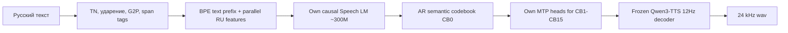

# 03 — Целевая архитектура Track N

## Критический путь: D1 (дискретный Speech LM)

```text
русский текст
 → фронтенд: TN → вербализация → ударение → омографы → критические спаны
 → BPE text prefix (stressed natural Russian)  +  parallel RU features (после text-only base)
 → собственный causal Speech LM ~300M
 → AR semantic codebook CB0
 → собственные MTP heads → CB1…CB15
 → frozen Qwen3-TTS Tokenizer-12Hz decoder → 24 kHz wav
```



Ключевое отличие от Track A: между текстом и волной стоит **обучаемый языковой
приор по дискретным speech tokens**, а не mel-регрессия ~10M. Ключевое отличие
от архивного continuous N2: голова предсказывает **discrete multi-codebook
tokens** (CE), а не непрерывные VAE-латенты через DDPM.

## Контракт D1 (нормативный)

| Правило | Содержание |
|---------|------------|
| Trainable | Speech LM (~250–400M, дефолт ~300M), semantic/MTP heads, speaker-ID embeddings, RU conditioning |
| Frozen | Qwen3-TTS Tokenizer-12Hz (encode/decode); веса не обучаются |
| Text packing | Полный текст как **prefix** перед акустической последовательностью (streaming dual-track — после content gates) |
| Codebooks | CB0 — авторегрессия; CB1–CB15 — параллельный MTP, обусловленный hidden state и текущим CB0 |
| Text-init | Текстовые блоки **разрешено** инициализировать из Qwen3-0.6B; speech embeddings, adapters, MTP, heads — **всегда с нуля**; coverage mapping в манифесте |
| RU features | phoneme / stress / word-phrase bounds / critical-span type — только после PASS text-only base; в Qwen BPE — stressed natural Russian, **не** phoneme string |
| Speaker | Обучаемые speaker-ID embeddings; zero-shot cloning / имперсонация **вне этапа** |
| Не смешивать loss | Continuous VibeVoice latents, DDPM/DDIM N2, Track A flow/CFM, F5-style mel — только baselines, не в основном CE |
| Геометрия | Только через `src/minispeech/constants.py` (`TARGETS`); параллельных констант не заводить |

## Архив: continuous next-token diffusion (не product)

Исторический референс (VibeVoice / LatentLM) и наш пилот `n2_first_execution`:

```text
текст → LLM-бэкбон → h_i → DDPM diffusion-голова → непрерывные VAE-латенты
 → декодер VibeVoice → волна
```

| Компонент (референс) | Параметры | Статус у нас |
|----------------------|----------:|--------------|
| LLM-бэкбон | 0.5B / 1.5B / 7B | Пилот N2 — FAIL content |
| Акустический σ-VAE | ~340M+340M | VibeVoice frozen; E2 CER 0.073 (якорь) |
| Diffusion-голова | ~40–123M | S1 FR R² **−6.64** → Gate N2 FAIL |
| Семантический токенизатор | ~340M | Не доведён до product |

**Вердикт.** Continuous N2/DDPM — **архивированный отрицательный контроль**.
Код и паттерны можно держать как reference; в product path и в основной loss D1
не возвращаем. Подробности: `.cursor/results/n2_first_execution/RESULTS.md`.

## Референсная декомпозиция (историческая)

Из технического отчёта VibeVoice (arXiv 2508.19205) — структура оригинала.
Полезно как контекст, **не** как текущий план реализации.

Стадийность в оригинале: токенизаторы отдельно → freeze → LLM + diffusion head
→ curriculum по длине. Для D1 аналог: **чужой кодек уже pretrained и frozen** →
обучаем только свой Speech LM + heads на дискретных кодах.

## Собственный кодек — будущий путь независимости

Не блокирует D1. После GO по content-гейтам (и при юридической необходимости
суверенности) возвращаемся к обучению своего акустического кодека:

- непрерывный σ-VAE (бывший план T0–T3) **или** свой discrete codec;
- критерий приёмки — Phase 0 / copy-synth не хуже рабочих якорей на том же
  наборе и ASR;
- T0-скелет `runs/tokenizer_t0_small/` (CER ≈ 0.84 на ~1 ч) — не продукт.

Детали — [04_tokenizers.md](04_tokenizers.md).

## Где мы отходим от чужих полных TTS

Это разделы научной новизны D1. Каждый — проверяемая гипотеза.

### Н1. Просодическое обусловливание с ударением

**Проблема.** У многих TTS нет явного словесного ударения; для русского оно
различает лексемы.

**Решение D1.** Parallel feature channels после text-only base; не phoneme
string в BPE.

**Проверка.** Абляция `text-only` vs `+stress` / `+phoneme` на `homograph` и
DER/EER; SA — только при валидированном измерителе (≥ 0.90; сейчас 0.358).

### Н2. Верифицируемые критические спаны

**Проблема.** Генеративный TTS не гарантирует числа/реквизиты.

**Решение (проектируется).** Разметка спанов + semantic weighting / контроль
выхода; механизм дешевле полного ресинтеза.

**Проверка.** DER / EER на RU-Critical.

### Н3. Semantic-first + MTP vs continuous diffusion

**Проблема.** Continuous N2 дал падающий ε-loss без free-running content.

**Решение.** Discrete CB0-AR + MTP residuals; промоушен только по free-running
ASR/CER/DER, не по teacher-forced CE.

**Проверка.** Oracle ladder + N2/N3 гейты; при FAIL — hard-stop (урок N2).

### Н4. Text-init вклад

**Проблема.** Неясно, нужен ли Qwen text prior или хватает random-init при
тех же speech heads.

**Решение.** Абляция на 5h: Qwen3 text-init vs random-init; масштабировать
только победителя.

**Проверка.** Free-running CER/DER + text-usage (shuffle/mask/prefix).

Узкополосный телефония-кодек и кривая частоты кадров собственного кодека —
отложены в post-D1 codec track (бывшие Н3/Н4 непрерывного плана).

## Что переиспользуется из существующего кода

| Существующий модуль | Роль в D1 / Track N |
|---------------------|---------------------|
| `src/minispeech/frontend/` | Полностью, плюс расширение под Н1 и Н2 |
| `src/minispeech/constants.py` (`TARGETS`) | Регистрация discrete geometry Qwen3-TTS 12Hz |
| `src/minispeech/data/*` (multicorpus) | Speaker-disjoint train ~72.98 ч; новые codec-token shards |
| `scripts/32_eval_mel_suite.py` | Единый eval для baselines; Discrete LM — `74_eval_discrete_lm.py` |
| `docs/experiment_protocol.md` | База для гейтов N/D-серии |
| Continuous N2 modules | Только negative-control / pattern reference |

Правило из `.cursor/rules/minispeech-core.mdc` о едином реестре целевой геометрии
в `constants.py` **сохраняется**.

## Явные не-цели

- Не масштабировать continuous DDPM/N2 после FAIL.
- Не заявлять sovereign full-cycle при frozen foreign tokenizer.
- Не воспроизводить многоголосые подкасты на 90 минут.
- Не гоняться за zero-shot клонированием произвольного голоса (research-only;
  без инструментов имперсонации).
- Не тренировать ASR.
- Не возвращаться к latent Talker / CFM / Flow из Track A как product path.
- Не смешивать mel/flow objectives с основным discrete CE на D1.
- Не добавлять 500+ ч корпусов до юрGO (D2).
