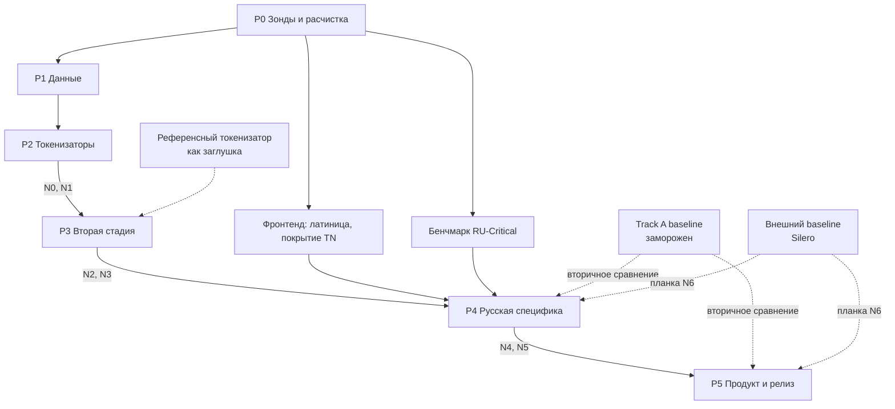

# 09 — Дорожная карта

Фазы, критерии перехода и параллелизм. Порядок обусловлен зависимостями, а не
предпочтениями: пропуск фазы означает, что следующая будет отлаживаться вслепую.

Правило проекта сохраняется: **не переходим к следующей фазе, пока не пройден
гейт текущей.** Определения гейтов — [08_evaluation.md](08_evaluation.md).

## Обзор

| Фаза | Название | Основной результат | Гейт выхода |
|------|----------|--------------------|-------------|
| **P0** | Зонды и расчистка | Решения по бэкбону и частоте кадров; чистая инфраструктура | Зонды измерены, долг снят |
| **P1** | Данные | Многокорпусный пайплайн, реестр, псевдоразметка | Объёмы T1–T2 доступны и размечены |
| **P2** | Токенизаторы | Свой акустический + семантический токенизатор | **N0**, **N1** |
| **P3** | Вторая стадия | LLM + diffusion-голова, N-Lite | **N2**, **N3** |
| **P4** | Русская специфика | Канал Н1, критические спаны Н2 | **N4**, **N5** |
| **P5** | Продукт и релиз | Телефонный вариант, N-Pro, открытая публикация | **N6**, **N7**, **N8** |

**Track A заморожен как baseline** (решение 2026-07-31). Чекпойнт
`runs/mel_stress_v01_s4/best.pt` фиксируется, дальнейшие улучшения акустической
модели, длительностей, variance и вокодера **не ведутся**. Причина: Track A не
несёт научной новизны ([01_strategy.md](01_strategy.md)), а планку натуральности
для гейта N6 теперь задаёт **внешний baseline Silero**, а не собственная слабая
система — иначе сравнение оказывается с соломенным чучелом.

Track A остаётся работающей системой и вторичной точкой сравнения; продуктовая
ветка не блокируется исследованием. Общий для обоих треков фронтенд из
[06_frontend.md](06_frontend.md) заморозке **не подлежит** — он развивается как
параллельный поток и улучшает обе системы.

## P0 — Зонды и расчистка

Самая дешёвая фаза с самой высокой отдачей: снимает неопределённости, которые
иначе будут стоить недель на более поздних фазах.

**Зонды** (детали и команды — [11_probes.md](11_probes.md)):

- Фертильность токенизаторов-кандидатов на русском и на наших наборах
- Поведение U+0301 при токенизации каждым кандидатом
- Память и латентность GigaChat Lightning на текущем и целевом железе
- Инвентаризация доступного русского аудио: часы, лицензии, каналы
- Референсный прогон: качество восстановления русского через токенизатор
  VibeVoice на разных типах контента (не только чтение, но и телефонный канал)

**Расчистка:**

- Инвентаризация P1 нашла 65 одноразовых файлов в `out/_*` (34 `.py`, 31
  `.sh`), а не в `scripts/_*`; нужная логика перенесена в номерные CLI,
  одноразовые файлы удалены
- Многокорпусная схема манифеста вместо односкорпусных допущений
- Заложить DDP-совместимость в тренер
- Реестр происхождения корпусов и компонентов

**Гейт выхода.** Все зонды измерены и записаны; решение по бэкбону принято либо
явно отложено с указанием блокера; технический долг не мешает многокорпусной
работе.

**Статус (2026-07-31): пройден по зондам, технический долг перенесён в P1.**
Зонды З1–З4 измерены, решения гейта зафиксированы и пересмотрены в M11
([11_probes.md](11_probes.md), [05_backbone.md](05_backbone.md)). Не сделано и
переносится в P1 как явные задачи:

- На старте P1 было 65 одноразовых файлов `out/_*` (34 `.py`, 31 `.sh`), а
  `scripts/_*` был пуст; нужная логика перенесена в номерные CLI, файлы удалены
- многокорпусная схема манифеста
- DDP-совместимость тренера
- реестр происхождения корпусов и компонентов

Перенос осознанный: все четыре пункта — предусловия P1, а не самостоятельная
ценность, и в чеклисте [07_data.md](07_data.md) они уже присутствуют.

**Что можно делать параллельно.** Расширение бенчмарка RU-Critical
([08_evaluation.md](08_evaluation.md)) и устранение дефекта Д2 с латиницей
([06_frontend.md](06_frontend.md)) — независимы от всего остального и дают
немедленную пользу Track A.

## P1 — Данные

**Задачи:**

- Собрать и проверить корпуса по [07_data.md](07_data.md)
- Юридически оформить банковские данные, обезличить
- Пайплайн псевдоразметки на существующих скриптах
- Симуляция телефонного канала
- Дедупликация, шардирование, стриминг
- Замороженные тестовые наборы с хешами, разделение по дикторам

**Перенесено из P0 (технический долг):**

- Свернуть одноразовые `scripts/_*.py` и `out/_*.py` в несколько CLI либо удалить
- Многокорпусная схема манифеста (корпус / диктор / канал / лицензия / качество)
- DDP-совместимость тренера
- Реестр происхождения корпусов и компонентов

**Закрытие хвостов фазы M** (до начала работы с новыми корпусами):

- Полный пересчёт baseline новыми метриками без ограничения `--max-utts`
  (n = 315 / 895 / 117): приёмка M09 была выполнена только на подвыборках
- Файнтюн вокодера M07 паркуется записью «выигрыш не измерен, домены мела не
  совпадали» — по решению о заморозке Track A он не перезапускается

**Гейт выхода.** Доступны объёмы для ступеней T1–T2 обучения токенизатора;
размеченная часть достаточна для пилота второй стадии; реестр лицензий полон;
дедупликация и разделение по дикторам работают на двух разных корпусах.

## P2 — Токенизаторы

Самая длинная фаза. Ступени T0 → T3 из [04_tokenizers.md](04_tokenizers.md).

**Задачи:**

- σ-VAE энкодер-декодер с каузальными свёртками
- Дискриминаторы и лоссы по DAC
- Стриминговое кэшированное декодирование
- Ступени T0 → T3 с проверкой на каждой
- Семантический токенизатор с ASR-прокси
- Кривая частоты кадров (гипотеза Н3) — 7.5 / 12.5 / 25 Гц
- Узкополосный вариант (гипотеза Н4)

**Гейты выхода: N0 и N1.** Copy-synth CER не хуже якоря E2 (0.073) на том же
наборе и той же ASR-конфигурации; DER на `bank_entity` не деградирует;
кэшированное декодирование совпадает с полным без всплеска на границах.

**Де-рискинг.** Пока свой токенизатор обучается, вторая стадия разрабатывается
на референсном токенизаторе как на заглушке. Подмена — по прохождении N0.
Каждый прогон помечает используемый токенизатор в манифесте.

## P3 — Вторая стадия

**Задачи:**

- Конкатенация текстовых токенов и латентов в единую последовательность
- Diffusion-голова, DDPM, CFG, быстрый сэмплер
- Curriculum по длине входа
- Обучение N-Lite: свой бэкбон 0.5B либо решение из P0
- Лесенка масштаба по образцу Track A: сначала переобучиться на малом

**Гейты выхода: N2 и N3.** N2 — прямой аналог Gate 0, который провалил Track A.
Если модель не воспроизводит содержание на малом подмножестве, масштабировать
данные бессмысленно.

**Важно.** На этой фазе обязательна проверка использования текста (аналог
`text-usage-gate` из Track A): модель не должна игнорировать текстовый вход.
Урок Track A: residual-голова умела игнорировать текст при низком teacher-forced
лоссе.

## P4 — Русская специфика

Здесь сосредоточена основная научная новизна.

**Задачи:**

- Канал обусловливания Н1: ударение, омограф, граница синтагмы, тип спана
- Абляция канала: с ним и без него
- Механизм критических спанов Н2: разметка, обусловливание, верификация,
  локальная регенерация
- Решение проблемы шва при локальной регенерации

**Гейты выхода: N4 и N5.** DER = 0 и EER ≤ 2% на `bank_entity` версии v2;
SA ≥ 0.95 на `homograph` **при валидированном измерителе** (точность детектора
≥ 0.90 — сейчас не выполнено); абляция показывает значимый вклад канала.

## P5 — Продукт и релиз

**Задачи:**

- Узкополосный телефонный вариант, оптимизация TTFB
- N-Pro на GigaChat-бэкбоне
- Маркировка синтезированного аудио (требование с 01.03.2027)
- Развёртывание в соответствии с требованиями по ЦОД
- Открытая публикация модели и бенчмарка
- Пилот P.808 и исследование валидности метрик

**Гейты выхода: N6, N7, N8.**

## Диаграмма зависимостей

## Что идёт параллельно

Три потока почти не пересекаются и должны идти одновременно:

| Поток | Содержание | Зависит от |
|-------|-----------|------------|
| Основной | P0 → P1 → P2 → P3 → P4 → P5 | последовательно |
| Бенчмарк | Аудит и выпуск v2 наборов, валидный измеритель SA, `telephony` и `long_form`, внешний baseline Silero, парные предпочтения | почти ни от чего |
| Фронтенд | Покрытие вербализации по таблице 06, омографы, тесты на категорию | почти ни от чего |

Бенчмарк и фронтенд готовят P4 и остаются полезными при замороженном Track A:
фронтенд общий для обоих треков, бенчмарк измеряет любую систему.

Фаза M (2026-07-31) была итерацией потока «Бенчмарк»: DER/EER переведены на
выравнивание, добавлены медианы и CI95, собран харнесс парных предпочтений,
проведён аудит наборов. Итоги — в `docs/m0*.md` и
`docs/frozen_numbers_mel80.md`.

## Что явно не делаем

- Не возвращаемся к latent Talker, CFM и Flow из Track A. Part 1 закрыт.
- **Не улучшаем Track A**: ни variance, ни длительности, ни вокодер. Он
  заморожен как baseline; известные дефекты задокументированы
  (`docs/m03_variance_diagnosis.md`, `docs/m09_phase_m_acceptance.md`) и
  остаются описанными, а не исправленными.
- Не дообучаем чужие веса в продуктовой ветке.
- Не гонимся за zero-shot клонированием голоса.
- Не тренируем ASR.
- Не строим многоголосые подкасты на 90 минут.
