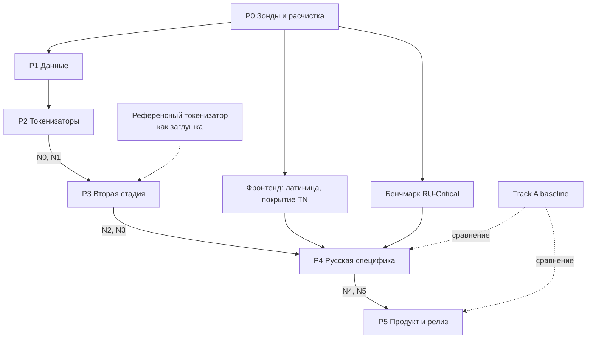

# 09 — Дорожная карта

Фазы, критерии перехода и параллелизм. Порядок обусловлен зависимостями, а не
предпочтениями: пропуск фазы означает, что следующая будет отлаживаться вслепую.

Правило проекта сохраняется: **не переходим к следующей фазе, пока не пройден
гейт текущей.** Определения гейтов — [08_evaluation.md](08_evaluation.md).

## Обзор

| Фаза | Название | Основной результат | Гейт выхода |
|------|----------|--------------------|-------------|
| **P0** | Зонды и расчистка | Решения по бэкбону и частоте кадров; чистая инфраструктура | Зонды измерены, долг снят |
| **P1** | Данные | Многокорпусный пайплайн, реестр, псевдоразметка | Объёмы T1–T2 доступны и размечены |
| **P2** | Токенизаторы | Свой акустический + семантический токенизатор | **N0**, **N1** |
| **P3** | Вторая стадия | LLM + diffusion-голова, N-Lite | **N2**, **N3** |
| **P4** | Русская специфика | Канал Н1, критические спаны Н2 | **N4**, **N5** |
| **P5** | Продукт и релиз | Телефонный вариант, N-Pro, открытая публикация | **N6**, **N7**, **N8** |

Track A при этом **не останавливается как baseline**: он остаётся работающей
системой и точкой сравнения. Продуктовая ветка не блокируется исследованием.

## P0 — Зонды и расчистка

Самая дешёвая фаза с самой высокой отдачей: снимает неопределённости, которые
иначе будут стоить недель на более поздних фазах.

**Зонды** (детали и команды — [11_probes.md](11_probes.md)):

- Фертильность токенизаторов-кандидатов на русском и на наших наборах
- Поведение U+0301 при токенизации каждым кандидатом
- Память и латентность GigaChat Lightning на текущем и целевом железе
- Инвентаризация доступного русского аудио: часы, лицензии, каналы
- Референсный прогон: качество восстановления русского через токенизатор
  VibeVoice на разных типах контента (не только чтение, но и телефонный канал)

**Расчистка:**

- Свернуть ~60 одноразовых `scripts/_*.py` и `_*.sh` в несколько нормальных CLI
  либо удалить
- Многокорпусная схема манифеста вместо односкорпусных допущений
- Заложить DDP-совместимость в тренер
- Реестр происхождения корпусов и компонентов

**Гейт выхода.** Все зонды измерены и записаны; решение по бэкбону принято либо
явно отложено с указанием блокера; технический долг не мешает многокорпусной
работе.

**Что можно делать параллельно.** Расширение бенчмарка RU-Critical
([08_evaluation.md](08_evaluation.md)) и устранение дефекта Д2 с латиницей
([06_frontend.md](06_frontend.md)) — независимы от всего остального и дают
немедленную пользу Track A.

## P1 — Данные

**Задачи:**

- Собрать и проверить корпуса по [07_data.md](07_data.md)
- Юридически оформить банковские данные, обезличить
- Пайплайн псевдоразметки на существующих скриптах
- Симуляция телефонного канала
- Дедупликация, шардирование, стриминг
- Замороженные тестовые наборы с хешами, разделение по дикторам

**Гейт выхода.** Доступны объёмы для ступеней T1–T2 обучения токенизатора;
размеченная часть достаточна для пилота второй стадии; реестр лицензий полон.

## P2 — Токенизаторы

Самая длинная фаза. Ступени T0 → T3 из [04_tokenizers.md](04_tokenizers.md).

**Задачи:**

- σ-VAE энкодер-декодер с каузальными свёртками
- Дискриминаторы и лоссы по DAC
- Стриминговое кэшированное декодирование
- Ступени T0 → T3 с проверкой на каждой
- Семантический токенизатор с ASR-прокси
- Кривая частоты кадров (гипотеза Н3) — 7.5 / 12.5 / 25 Гц
- Узкополосный вариант (гипотеза Н4)

**Гейты выхода: N0 и N1.** Copy-synth CER не хуже якоря E2 (0.073) на том же
наборе и той же ASR-конфигурации; DER на `bank_entity` не деградирует;
кэшированное декодирование совпадает с полным без всплеска на границах.

**Де-рискинг.** Пока свой токенизатор обучается, вторая стадия разрабатывается
на референсном токенизаторе как на заглушке. Подмена — по прохождении N0.
Каждый прогон помечает используемый токенизатор в манифесте.

## P3 — Вторая стадия

**Задачи:**

- Конкатенация текстовых токенов и латентов в единую последовательность
- Diffusion-голова, DDPM, CFG, быстрый сэмплер
- Curriculum по длине входа
- Обучение N-Lite: свой бэкбон 0.5B либо решение из P0
- Лесенка масштаба по образцу Track A: сначала переобучиться на малом

**Гейты выхода: N2 и N3.** N2 — прямой аналог Gate 0, который провалил Track A.
Если модель не воспроизводит содержание на малом подмножестве, масштабировать
данные бессмысленно.

**Важно.** На этой фазе обязательна проверка использования текста (аналог
`text-usage-gate` из Track A): модель не должна игнорировать текстовый вход.
Урок Track A: residual-голова умела игнорировать текст при низком teacher-forced
лоссе.

## P4 — Русская специфика

Здесь сосредоточена основная научная новизна.

**Задачи:**

- Канал обусловливания Н1: ударение, омограф, граница синтагмы, тип спана
- Абляция канала: с ним и без него
- Механизм критических спанов Н2: разметка, обусловливание, верификация,
  локальная регенерация
- Решение проблемы шва при локальной регенерации

**Гейты выхода: N4 и N5.** DER = 0 и EER ≤ 2% на `bank_entity`; SA ≥ 0.95 на
`homograph`; абляция показывает значимый вклад канала.

## P5 — Продукт и релиз

**Задачи:**

- Узкополосный телефонный вариант, оптимизация TTFB
- N-Pro на GigaChat-бэкбоне
- Маркировка синтезированного аудио (требование с 01.03.2027)
- Развёртывание в соответствии с требованиями по ЦОД
- Открытая публикация модели и бенчмарка
- Пилот P.808 и исследование валидности метрик

**Гейты выхода: N6, N7, N8.**

## Диаграмма зависимостей

## Что идёт параллельно

Три потока почти не пересекаются и должны идти одновременно:

| Поток | Содержание | Зависит от |
|-------|-----------|------------|
| Основной | P0 → P1 → P2 → P3 → P4 → P5 | последовательно |
| Бенчмарк | Расширение RU-Critical, метрики DER/EER/SA, внешний baseline, P.808 | почти ни от чего |
| Фронтенд | Латиница, покрытие вербализации, омографы | почти ни от чего |

Бенчмарк и фронтенд дают немедленную пользу Track A и одновременно готовят P4.
Их стоит вести с первого дня, не дожидаясь токенизаторов.

## Что явно не делаем

- Не возвращаемся к latent Talker, CFM и Flow из Track A. Part 1 закрыт.
- Не дообучаем чужие веса в продуктовой ветке.
- Не гонимся за zero-shot клонированием голоса.
- Не тренируем ASR.
- Не строим многоголосые подкасты на 90 минут.
