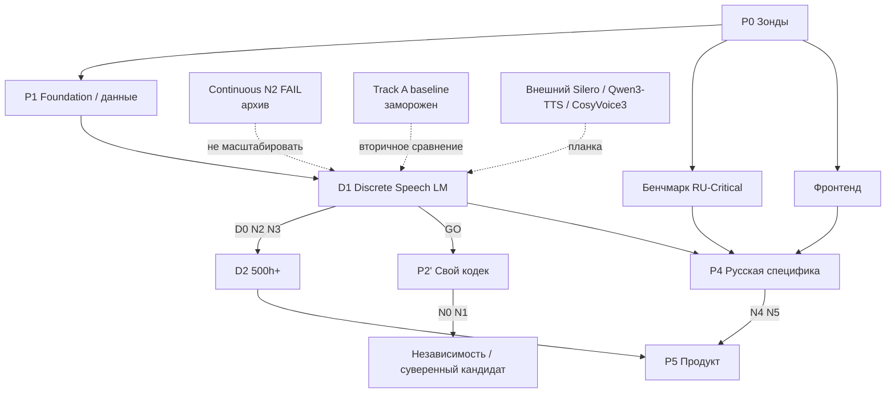

# 09 — Дорожная карта

Фазы, критерии перехода и параллелизм. Порядок обусловлен зависимостями, а не
предпочтениями: пропуск фазы означает, что следующая будет отлаживаться вслепую.

Правило проекта сохраняется: **не переходим к следующей фазе, пока не пройден
гейт текущей.** Определения гейтов — [08_evaluation.md](08_evaluation.md).

## Обзор (ревизия 2026-08)

| Фаза | Название | Основной результат | Гейт выхода |
|------|----------|--------------------|-------------|
| **P0** | Зонды и расчистка | Решения по бэкбону/частоте; долг | Пройден по зондам (2026-07-31); хвосты → foundation |
| **P1** | Данные / foundation | Multicorpus, eval sets, frontend, repro | Объёмы текущего train + реестр |
| **N2-cont** | Continuous diffusion пилот | Отрицательный контроль | **FAIL** — архив; не масштабировать |
| **D1** | Discrete Speech LM | Свой ~300M LM + frozen Qwen3-TTS 12Hz | **D0**, **N2**, **N3**, demo, D2-GO |
| **D2** | Масштаб данных 500+ ч | Только после D1 GO + юрGO | N3+ на расширенном корпусе |
| **P2′** | Свой кодек | Независимость / суверенный кандидат | **N0**, **N1** |
| **P4** | Русская специфика (полная) | Н1/Н2 на зрелой модели | **N4**, **N5** |
| **P5** | Продукт и релиз | Телефония, N-Pro, публикация | **N6**, **N7**, **N8** |

**Track A заморожен как baseline** (решение 2026-07-31). Чекпойнт
`runs/mel_stress_v01_s4/best.pt` фиксируется; улучшения mel/variance/vocoder
**не ведутся**. Планку натуральности для N6 задаёт **Silero**, не соломенный
Track A.

Фронтенд из [06_frontend.md](06_frontend.md) заморозке **не подлежит**.

**Continuous P3 (LLM + DDPM)** из прежней карты **снят с критического пути**
после `n2_first_execution` (Gate N2 FAIL, FR R² −6.64).

## P0 — Зонды и расчистка

**Статус (2026-07-31): пройден по зондам.** Решения З1–З4 / M11 зафиксированы;
часть (P3 = Qwen3.5-0.8B + diffusion) **пересмотрена** ревизией D1 (2026-08).
Технический долг перенесён в foundation / P1.

## P1 — Данные и foundation (перед/вместе с D1)

**Задачи:**

- Посадить reviewed foundation: frontend, eval sets, multicorpus, reproducibility
- Заморозить sha256 eval sets до серии D1
- Реестр происхождения корпусов и компонентов (включая codec)
- Speaker-disjoint split, дедуп, no test leakage
- **Не** добавлять Golos/OpenSTT/YODAS до юршения

**Гейт выхода.** Текущий Track N train (~72.98 ч / 51234 / 1088 —
`out/r1_freeze_result.json`) готов к discrete encode; хеши наборов зафиксированы;
worktree чист для WSL `git pull`.

## N2-cont — архив (не фаза продолжения)

Пилот continuous next-token diffusion на VibeVoice. Результат: **N2 FAIL**.
Артефакты: `.cursor/results/n2_first_execution/`. Код можно сохранять как
reference; product merge и ladder 1h/5h/full на этом тракте **запрещены**.

## D1 — Discrete Speech LM (критический путь)

Исполняемый план:
[.cursor/plans/d1-discrete-speech-lm_860c29d5.plan.md](../plans/d1-discrete-speech-lm_860c29d5.plan.md).

| Волна | Содержание | Гейт |
|-------|------------|------|
| 0 | Frozen Qwen3-TTS wrapper + copy-synth + внешние baselines | **D0** |
| 1 | Discrete `[T,16]` caches + provenance | pack equality |
| 2 | Own ~300M Speech LM + MTP + trainer + CLI | unit gates |
| 3 | Synthetic → 1-utt → 32-utt oracle | **N2**; FAIL → hard-stop |
| 4 | 1h → 5h → ~72.98h + RUSLAN research CPT | **N3** |
| 5 | Ablations: text-init, RU channels (одна переменная) | seeds + CI95 |
| 6 | Management demo + RESULTS + D2-GO/NO-GO | пакет результатов |

Правовой статус этапа: **national-component research**; не sovereign full-cycle
([02_legal.md](02_legal.md)).

Календарь `ОЦЕНКА`: 4–8 недель при 1–2× RTX 6000 Pro 96 GB; пересчёт после
throughput probe.

## D2 — Масштаб 500+ ч

Только при: D0 PASS, N2 PASS, N3 PASS, нет sampler/EOS collapse, юридически
допустимый корпус. Иначе hard-stop с локализованной причиной.

## P2′ — Свой кодек (после или параллельно без блокировки D1)

Бывшая фаза P2. Ступени T0→T3 из [04_tokenizers.md](04_tokenizers.md).
Подмена frozen Qwen3-TTS — только после N0/N1. Это путь к независимости и
кандидату в суверенный цикл.

## P4 — Русская специфика (полная)

Канал Н1 и механизм Н2 на модели, прошедшей N3. Часть RU features уже
включается в D1 волне 5 **после** text-only base — это пилот, не закрытие P4.

**Гейты: N4, N5** (N5 сейчас не измерим — SA detector 0.358).

## P5 — Продукт и релиз

Узкополосный телефонный вариант, N-Pro, маркировка аудио, ЦОД, открытая
публикация, P.808. **Гейты: N6, N7, N8.**

## Диаграмма зависимостей

## Что идёт параллельно

| Поток | Содержание | Зависит от |
|-------|-----------|------------|
| Основной | Foundation → D1 → (D2 \| P2′) → P4 → P5 | гейты |
| Бенчмарк | Аудит v2+/хеши, SA-измеритель, предпочтения | почти ни от чего |
| Фронтенд | Покрытие TN, омографы | почти ни от чего |
| Свой кодек | T0→T3 без блокировки D1 train | данные неразмеченного аудио |

## Что явно не делаем

- Не масштабируем continuous DDPM/N2 после FAIL.
- Не улучшаем Track A (variance / durations / vocoder).
- Не дообучаем полные чужие TTS-веса как product path.
- Не заявляем sovereign full-cycle при frozen foreign tokenizer.
- Не гонимся за zero-shot клонированием голоса.
- Не тренируем ASR.
- Не добавляем 500+ ч до юрGO.
- Не строим 90-минутные подкасты.
