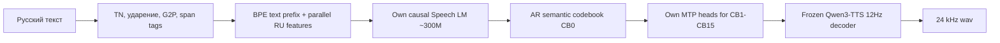

# D1 — собственный дискретный Speech LM для русского

## Результат этапа

- Собственный trainable speech LM целевого размера 250–400M (дефолтная конфигурация около 300M), собственные semantic/MTP heads и собственный trainer.
- Единственная внешняя часть тракта — замороженный Apache-2.0 `Qwen3-TTS-Tokenizer-12Hz`; его веса не обучаются и регистрируются с версией, лицензией и хешем.
- Первый multi-speaker чекпойнт на доступном Track N train (~72.98 ч), затем research-only high-quality CPT на RUSLAN для демонстрационного голоса.
- Сравнительная таблица с Qwen3-TTS 0.6B/1.7B, CosyVoice3, Silero raw/+frontend, Track A, copy-synth и N2 как отрицательным контролем.
- Явный GO/NO-GO для следующего этапа на 500+ часах. Цель D1 — работающая и измеренная модель, а не полный аналог предобучения Qwen3-TTS на 5 млн часов.

## Архитектурный контракт

- D1 использует полный текст как prefix перед акустической последовательностью; streaming text-input/dual-track scheduling откладывается до прохождения content gates. Это уменьшает риск выравнивания и ставит качество раньше TTFB.
- CB0 предсказывается авторегрессионно; остаточные codebooks — параллельным MTP, обусловленным hidden state и текущим CB0.
- Текстовые блоки разрешено инициализировать из Qwen3-0.6B; speech embeddings, modality adapters, MTP и output heads всегда обучаются с нуля. Покрытие mapping фиксируется в manifest.
- Speaker conditioning в D1 — обучаемые speaker-ID embeddings; zero-shot cloning и произвольная имперсонация не входят в этап.
- Фонемы, позиция ударения, границы слов/синтагм и тип критического спана передаются отдельными признаками, но включаются только после прохождения text-only base. В Qwen BPE подаётся stressed natural Russian, не phoneme string.
- Непрерывные VibeVoice-латенты, DDPM/DDIM N2, Track A flow/CFM и F5-style mel objective не смешиваются с основным loss; они остаются baselines.

## Предусловия и синхронизация стратегии

- До Agent mode обновить в плановом режиме `[.cursor/methodology/README.md](.cursor/methodology/README.md)`, `[01_strategy.md](.cursor/methodology/01_strategy.md)`, `[02_legal.md](.cursor/methodology/02_legal.md)`, `[03_architecture.md](.cursor/methodology/03_architecture.md)`, `[04_tokenizers.md](.cursor/methodology/04_tokenizers.md)`, `[05_backbone.md](.cursor/methodology/05_backbone.md)`, `[08_evaluation.md](.cursor/methodology/08_evaluation.md)`, `[09_roadmap.md](.cursor/methodology/09_roadmap.md)`, `[10_compute.md](.cursor/methodology/10_compute.md)` и `[12_publications.md](.cursor/methodology/12_publications.md)`: D1 — исследовательский national-component path, а собственный codec остаётся будущим путём полной независимости. Во время исполнения methodology снова read-only.
- После review посадить foundation PR: frontend #1, eval sets #2, multicorpus #3 и reproducibility #4. PR #6 с continuous N2 сохранить как отрицательный результат/источник отдельных паттернов, но не сливать как product path.
- Устранить оставшийся мусорный tracked path и определить судьбу `.cursor/results/n2_first_execution/`, чтобы WSL запускался только из чистого commit через `git pull`.
- Зафиксировать версии и sha256 `bank_entity`, `homograph`, `latin`, `telephony`, `val100` до новой серии.

## Волна 0 — tokenizer GO/NO-GO и внешние baselines

- Добавить read-only wrapper `[src/minispeech/codec/qwen3_tts_wrapper.py](src/minispeech/codec/qwen3_tts_wrapper.py)` и зарегистрировать дискретную геометрию только через `[src/minispeech/constants.py](src/minispeech/constants.py)`: sample rate, фактический frame rate, 16 codebooks, vocab sizes и dtype.
- Добавить `[scripts/70_probe_qwen3_tts_tokenizer.py](scripts/70_probe_qwen3_tts_tokenizer.py)`: повторный encode обязан быть bit-identical; decode пишет wav; измеряются copy-synth CER, DER/EER, codebook utilization и telephony degradation на тех же позициях и ASR-конфигурации, что существующие anchors.
- Прогнать Qwen3-TTS 0.6B/1.7B, CosyVoice3, Silero raw/+frontend и Track A на одинаковом frontend и замороженных наборах. Любая внешняя система пишет wav под `out/d1_discrete_speech_lm/<system>/`.
- Hard gate D0: copy-synth CER Qwen tokenizer на E2-compatible наборе не хуже 0.073; `bank_entity` DER не деградирует относительно зафиксированного codec anchor. При FAIL обучение LM не начинается.

## Волна 1 — дискретные кэши и датасет

- Добавить `[scripts/71_encode_codec_tokens.py](scripts/71_encode_codec_tokens.py)`, `[src/minispeech/data/codec_tokens.py](src/minispeech/data/codec_tokens.py)` и `[src/minispeech/data/collate_codec_seq.py](src/minispeech/data/collate_codec_seq.py)`.
- Детерминированно перекодировать текущий speaker-disjoint Track N train в `[T,16]` integer codes; старые VibeVoice latent/text-hidden caches не переиспользовать.
- Шарды хранят corpus/speaker/license, codec id+hash, text token IDs, offset-aligned stress/phoneme/span features и EOS; train/infer packing проверяется на точное равенство.
- Использовать foundation из `[src/minispeech/data/dataset.py](src/minispeech/data/dataset.py)`, `[src/minispeech/data/shards.py](src/minispeech/data/shards.py)` и `configs/data_multicorpus.yaml`; проверить speaker-disjoint split, дедупликацию и отсутствие test leakage.
- 500+ часов в D1 не добавлять: Golos/OpenSTT/YODAS остаются заблокированы лицензией/QC. Следующий этап разрешается только после реестра происхождения и юридического решения.

## Волна 2 — собственная модель и trainer

- Добавить `[src/minispeech/models/discrete_speech_lm.py](src/minispeech/models/discrete_speech_lm.py)`, `[multi_codebook_head.py](src/minispeech/models/multi_codebook_head.py)`, `[russian_conditioning.py](src/minispeech/models/russian_conditioning.py)`, `[text_init.py](src/minispeech/models/text_init.py)` и `[src/minispeech/train/discrete_lm_trainer.py](src/minispeech/train/discrete_lm_trainer.py)`.
- Добавить `configs/discrete_speech_lm_300m.yaml`, `[scripts/72_train_discrete_lm.py](scripts/72_train_discrete_lm.py)`, `[73_infer_discrete_lm.py](scripts/73_infer_discrete_lm.py)` и `[74_eval_discrete_lm.py](scripts/74_eval_discrete_lm.py)`.
- Конфиг определяет размер модели, curriculum, CE weights по codebooks, semantic-loss weight, speaker conditioning, Qwen text-init policy, sampler и DDP; фактический param count и trainable/frozen lists пишутся в manifest.
- Trainer обязан поддерживать bf16, 1–2 GPU DDP, gradient accumulation, resume с optimizer/scheduler/RNG, EMA только если измерен выигрыш, free-running checkpoint selection и чистый `git_sha`.
- Сначала измерить tokens/s, VRAM и масштабирование на RTX 4080, затем на 1× и 2× RTX 6000 Pro 96 GB; календарные оценки строить только по этим артефактам.

## Волна 3 — oracle ladder и hard-stop N2

- Unit gates до обучения: codebook order/delay, `c_t → c_{t+1}` shift, causal no-future-leak, padding invariance, EOS, deterministic greedy decode, Qwen-init mapping coverage и identical pack между train/infer.
- Oracle ladder: synthetic sequence → один реальный utterance → 32 utterances. На каждом новом `best.pt` немедленно синтезировать wav.
- Promotion с 32 utterances: free-running CER не выше `copy_synth CER + 0.03` на той же подвыборке; bootstrap CI отделён от random/wrong-utterance/trivial baselines; нет runaway/repetition; CB0 entropy/utilization не коллапсировали.
- Text-usage измеряется на free-running ASR, не только CE: shuffle и mask обязаны существенно ухудшить CER; prefix counterfactual обязан менять распознанное содержание. Teacher-forced loss/accuracy публикуются только как диагностика.
- При FAIL запрещены 1h/5h/full прогоны: локализовать shift, conditioning, sampler или EOS и повторить oracle ladder. Это прямой safeguard против повторения N2 (`FR R² −6.64` при падающем ε-loss).

## Волна 4 — лестница 1h → 5h → полный текущий train

- Обучать text-only base последовательно на 1h, 5h и ~72.98h; каждый переход требует улучшения free-running CER/DER с CI95 и PASS text-usage.
- Best checkpoint выбирается по hard-set free-running CER/DER, repeat/skip rate и стабильности, а не по teacher-forced CE.
- После multi-speaker stage выполнить короткий high-quality CPT/SFT на RUSLAN для фиксированного research/demo voice; чекпойнт маркируется CC BY-NC-SA/research-only и не выдаётся за продуктовый.
- Для каждого checkpoint оставить `demo5`, `bank_entity`, `latin`, `telephony` и long-form wavs side-by-side с Qwen3-TTS, CosyVoice3 и Silero+frontend.
- N3 target этапа: hard-set CER не хуже copy-synth topline более чем на 3 процентных пункта с CI95; `val100 CER ≤ 0.15` остаётся sanity floor. FAIL означает ремонт архитектуры, а не автоматический переход к 500h.

## Волна 5 — научные абляции после PASS base

- На 5h выбрать text initialization: Qwen3 text-init против random-init при одинаковых speech heads; масштабировать только победителя.
- На фиксированном 72.98h checkpoint менять по одной переменной: `text-only`, `+phoneme`, `+stress`, `+critical-span tags/semantic weighting`.
- Основные claim-метрики: CER, DER/EER, repeats/skips, latency и парные предпочтения; UTMOS не используется для promotion. SA публикуется только после точности измерителя ≥0.90 — сейчас гейт заблокирован.
- Минимальный материал статьи: вклад text-init, semantic-first/MTP contract и отдельные дельты русских каналов с seeds/CI95; сравнение с полными Qwen3-TTS и CosyVoice3 обязательно.

## Волна 6 — демо, решение и отчёт

- Сформировать management demo: фиксированный безопасный голос, 10–20 русских фраз, числа/даты/омографы/телефония, side-by-side внешние baselines, видимые ASR/DER/EER и ограничения лицензии.
- Любой inference пишет wav под `out/d1_discrete_speech_lm/`; итоговый индекс — `[.cursor/results/d1_discrete_speech_lm/listen_index.json](.cursor/results/d1_discrete_speech_lm/listen_index.json)`.
- Записать полный `[.cursor/results/d1_discrete_speech_lm/RESULTS.md](.cursor/results/d1_discrete_speech_lm/RESULTS.md)`, logs, manifests, config snapshots, baseline hashes и GO/NO-GO для D2.
- GO в D2 (500+ h) только при D0 PASS, 32-utt N2 PASS, full-current N3 PASS, отсутствии sampler/EOS collapse и юридически допустимом 500h corpus. Иначе hard-stop с локализованной причиной.

## Оценочный календарь

- `ОЦЕНКА` 1–2 недели: methodology/foundation, tokenizer probe, внешние baselines и code caches.
- `ОЦЕНКА` 1–2 недели: модель, trainer, unit/oracle ladder.
- `ОЦЕНКА` 2–4 недели: 1h/5h/full-current ladder, CPT, ablations и management demo.
- Итого `ОЦЕНКА` 4–8 недель при доступных 1–2× RTX 6000 Pro 96 GB; после первого throughput probe календарь пересчитывается и фиксируется артефактом.

