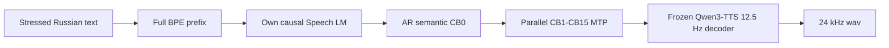
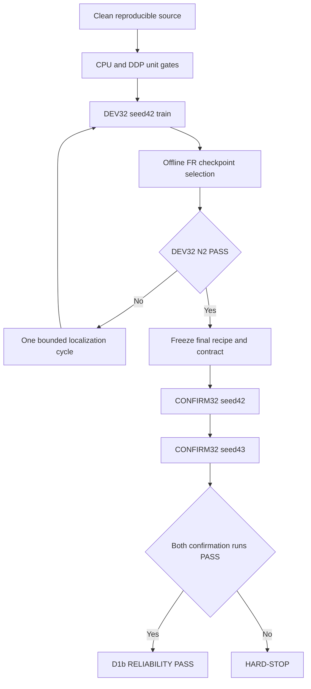

# D1b — надежное закрытие N2 на текущей RTX 4080

## 1. Назначение этапа

Этот этап продолжает D1 после формального near-miss: canonical free-running CER `0.053351` против порога `0.052842`. Он не должен «дожать» число дополнительным подбором inference-настроек на тех же 32 репликах. Его задача — устранить обнаруженные дефекты реализации, восстановить воспроизводимость и проверить, повторяется ли способность собственной модели выучивать text→speech content на независимом oracle-наборе.

Терминальный результат этапа — один из двух:

- **D1b RELIABILITY PASS:** исправленная реализация проходит N2 на development oracle и на заранее замороженном независимом confirmation oracle в двух train seeds;
- **D1b FAIL / HARD-STOP:** хотя бы один confirmation run не проходит; 1h/5h/full остаются запрещены, причина локализуется в итоговом отчёте.

Принятое пользователем ограничение: этап заканчивается на N2 и выполняется на текущей RTX 4080 Super. Даже при PASS он только разрешает планировать следующий этап; он не запускает 1h автоматически.

## 2. Обязательный контекст для исполнителя

Перед любыми изменениями прочитать:

- [`.cursor/methodology/README.md`](.cursor/methodology/README.md)
- [`.cursor/methodology/03_architecture.md`](.cursor/methodology/03_architecture.md)
- [`.cursor/methodology/04_tokenizers.md`](.cursor/methodology/04_tokenizers.md)
- [`.cursor/methodology/05_backbone.md`](.cursor/methodology/05_backbone.md)
- [`.cursor/methodology/08_evaluation.md`](.cursor/methodology/08_evaluation.md)
- [`.cursor/methodology/09_roadmap.md`](.cursor/methodology/09_roadmap.md)
- [`.cursor/methodology/10_compute.md`](.cursor/methodology/10_compute.md)
- [`.cursor/methodology/12_publications.md`](.cursor/methodology/12_publications.md)
- [`.cursor/results/d1_discrete_speech_lm/RESULTS.md`](.cursor/results/d1_discrete_speech_lm/RESULTS.md)
- [`.cursor/results/d1_discrete_speech_lm/WAVE3c_REPORT.md`](.cursor/results/d1_discrete_speech_lm/WAVE3c_REPORT.md)
- [`.cursor/results/d1_discrete_speech_lm/artifacts/n2_gate.json`](.cursor/results/d1_discrete_speech_lm/artifacts/n2_gate.json)
- [`.cursor/results/d1_discrete_speech_lm/artifacts/n2_model_rows_stop_3c.json`](.cursor/results/d1_discrete_speech_lm/artifacts/n2_model_rows_stop_3c.json)

Также до GPU-работы прочитать skills `wsl-env`, `train-ladder`, `eval-gates`; после каждого нового checkpoint — `checkpoint-listen`; при завершении или hard-stop — `plan-results`.

Зафиксированные исходные факты, которые нельзя переписывать:

- frozen Qwen3-TTS Tokenizer-12Hz: D0 PASS, 24 kHz, 12.5 Hz, 16 codebooks × 2048;
- полный discrete cache уже существует: 51 234 utterances / 72.9836 h;
- текущая модель — собственный causal Transformer + CB0 AR + CB1–CB15 MTP, около 442.7M параметров из-за vocab 248 077;
- text-init выключен; RU conditioning выключен;
- D1 WAVE3c: N2 FAIL `0.053351 > 0.052842`, один catastrophic substitution CER `0.909`;
- текущий результат получен из `last.pt`, а не из честно выбранного FR-best;
- WAVE3c inference knobs уже подбирались на текущем `s1_32`, поэтому он становится development oracle и не может быть единственным подтверждением PASS.

## 3. Нормативная архитектура D1b

Архитектурную гипотезу на этом этапе не менять:



Сохраняются:

- full-text prefix;
- autoregressive CB0;
- residual MTP heads;
- отдельный frame-level stop head;
- speaker-ID conditioning;
- greedy generation для oracle gate;
- frozen codec, `sample=False`;
- Qwen3.5 text IDs и случайная text initialization для сопоставимости с D1.

Не включать в D1b:

- Qwen text-init;
- новый text tokenizer или уменьшение vocab;
- RU phoneme/stress/span channels;
- depth-autoregressive residual decoder;
- новый codec;
- EMA;
- stochastic sampler search.

Эти изменения смешали бы исправление correctness с новой архитектурой и уничтожили бы причинную интерпретацию N2.

## 4. Плановый slug и изоляция артефактов

Использовать slug `d1b_n2_reliability`.

Новые прогоны не должны перезаписывать D1:

```text
runs/discrete_speech_lm_d1b_dev_seed42/
runs/discrete_speech_lm_d1b_confirm_seed42/
runs/discrete_speech_lm_d1b_confirm_seed43/
out/d1b_n2_reliability/
.cursor/results/d1b_n2_reliability/
```

Итоговый пакет:

```text
.cursor/results/d1b_n2_reliability/
  RESULTS.md
  PROTOCOL.md
  listen_index.json
  logs/
  artifacts/
```

Большие wav и checkpoints остаются в `out/` и `runs/`.

## 5. Preflight: воспроизводимость до GPU

Текущие D1 прогоны были выполнены из dirty tree через Windows `PYTHONPATH`. Новый promotion run так выполнять нельзя.

Исполнитель должен:

1. Проверить полный `git status` и отделить D1 code/config от результатов, логов, HF-cache мусора и чужих изменений.
2. Не удалять и не откатывать пользовательские изменения.
3. Создать recoverable snapshot перед перемещением файлов.
4. Получить отдельное явное разрешение пользователя перед commit: принятие плана само по себе не отменяет git safety rule.
5. До первого promotion GPU run обеспечить чистый commit SHA, доступный WSL через `git pull`.
6. В WSL перед каждым GPU run записывать в лог:
   - `git rev-parse HEAD`;
   - `git status --porcelain`;
   - Python, Torch, CUDA, GPU, VRAM;
   - версии `transformers` в основной и qwen-tts venv;
   - config hash и source-content hash.
7. Не использовать `MINISPEECH_ALLOW_DIRTY=1` для canonical D1b gate. Если чистый SHA недоступен, hard-stop до train.

Не редактировать `.cursor/methodology/**` во время реализации этого плана. Обнаруженные расхождения записать в `RESULTS.md` как предложения для следующего planning pass.

## 6. Замороженные oracle-наборы и anti-overfitting contract

### 6.1 Development oracle

Существующие 32 utterances из `codec_tokens_s1_32` становятся `D1B_DEV32`.

- Экспортировать их ordered `utt_id` в [`configs/train_subsets/d1b_dev32.json`](configs/train_subsets/d1b_dev32.json).
- Проверить, что список точно совпадает с исходными D1 shards и включает известный `ba1a4089…`.
- Добавить `version`, `n`, `items_sha256`, source cache paths и source manifest hash.
- DEV32 разрешено использовать для отладки, checkpoint sweep и единственного ограниченного stop calibration.
- Его результат публикуется только как continuity с D1, не как независимое подтверждение.

### 6.2 Confirmation oracle

Создать новый [`configs/train_subsets/d1b_confirm32.json`](configs/train_subsets/d1b_confirm32.json), полностью disjoint от DEV32.

Новый read-only generator [`scripts/75_freeze_d1b_oracles.py`](scripts/75_freeze_d1b_oracles.py) должен:

- читать frozen `trackn_train` и multicorpus manifest;
- исключать DEV32, val, test и review;
- использовать фиксированный seed `20260803`;
- выбрать 32 utterances;
- приблизительно сохранить соотношение RUSLAN/CV17 исходного S1;
- покрыть короткие, средние и длинные duration buckets;
- не выбирать две записи одного CV speaker, если это возможно;
- проверить отсутствие duplicate utt/audio fingerprints;
- записать selection report, source hashes и leak report;
- никогда не перезаписывать существующую версию без явного version bump.

CONFIRM32 также является train oracle: отдельные модели обучаются на этих 32 utterances и оцениваются на них. Не следует оценивать DEV-модель на CONFIRM32 как held-out TTS — это уже другая ступень, а не N2 overfit gate.

### 6.3 Confirmation split для checkpoint selection

Внутри CONFIRM32 заранее и детерминированно заморозить:

- `select8`: 8 train utterances для выбора checkpoint по free-running metric;
- `gate24`: оставшиеся 24 utterances, которые не просматриваются до фиксации checkpoint;
- `full32`: формальный N2 score на всех 32.

Для каждого confirmation seed сначала выбирается checkpoint только по `select8`, затем один раз считается `gate24` и `full32`. После просмотра `gate24/full32` запрещено менять train/infer recipe в рамках той же confirmation series.

### 6.4 Frozen evaluation contract

Создать `out/d1b_n2_reliability/frozen/eval_contract.json` и sha256. Он должен включать:

- ASR config path/hash;
- codec id и полный codec fingerprint;
- text tokenizer id;
- speaker map hash;
- sampler/infer settings;
- CER normalization version;
- bootstrap seed/count;
- definitions of catastrophic substitution and runaway;
- exact DEV/CONFIRM/select/gate hashes.

Стартовые inference values фиксируются по WAVE3c:

- `temperature: 0.0`;
- `top_k: 0`;
- `stop_threshold: 0.5`;
- `stop_consecutive: 1`;
- `min_frames: 4`;
- `max_cb0_repeat: 12`;
- `repetition_penalty: 2.0`;
- `frames_per_text_token: 2.5`;
- `stop_overrun_bias: 0.0`;
- `stop_earliest_frac: 0.7`.

Скрипты 73 и 74 должны использовать один shared resolver, а не разные fallback defaults.

## 7. Исправление speaker registry

Текущие order-dependent `_spk2id`, `abs(hash(...)) % 256` и silent clamp являются блокерами.

Добавить [`src/minispeech/data/speaker_registry.py`](src/minispeech/data/speaker_registry.py):

- строит dense deterministic mapping из полного frozen `trackn_train`;
- `0` зарезервирован для explicit unknown;
- известные speakers сортируются по стабильной строке и получают `1..N`;
- хранит `version`, source manifest hash, train-set hash, `n_speakers`, mapping и sha256;
- fail-closed при неизвестном speaker в train/eval;
- unknown разрешён только в явно помеченном inference mode;
- не зависит от Python hash seed, порядка DataLoader или DDP rank.

Canonical map хранить в [`configs/speaker_maps/trackn_v2.json`](configs/speaker_maps/trackn_v2.json) и копировать в каждый run dir.

Изменить:

- [`scripts/72_train_discrete_lm.py`](scripts/72_train_discrete_lm.py): dataset получает готовый registry, не создаёт mapping в `__getitem__`;
- [`src/minispeech/data/collate_codec_seq.py`](src/minispeech/data/collate_codec_seq.py): принимает только integer ID из registry, string fallback удаляется;
- [`src/minispeech/data/codec_seq_protocol.py`](src/minispeech/data/codec_seq_protocol.py): та же fail-closed политика;
- [`scripts/73_infer_discrete_lm.py`](scripts/73_infer_discrete_lm.py) и [`scripts/74_eval_discrete_lm.py`](scripts/74_eval_discrete_lm.py): загружают mapping из checkpoint/run manifest;
- [`src/minispeech/models/discrete_speech_lm.py`](src/minispeech/models/discrete_speech_lm.py): удалить `clamp`; проверять диапазон и выбрасывать ошибку.

Новый D1b config должен иметь `max_speakers = n_speakers + 1`, то есть покрывать все 1088 Track N speakers, а не только текущий subset. Небольшое увеличение param count измеряется и записывается; модель всё равно честно маркируется около 443M, а не ~300M.

Обязательные тесты:

- одинаковая mapping при разных порядках входа;
- одинаковая mapping в train/infer/eval;
- отсутствие collisions;
- неизвестный train speaker вызывает ошибку;
- ID за пределами embedding вызывает ошибку, не clamp;
- два simulated DDP ranks получают одинаковые IDs.

## 8. Исправление text packing и RoPE parity

Текущий collate right-pads текст до `L_max`, а speech физически начинается после `L_max`; RoPE использует общий `arange(S)`. У короткой реплики позиция первого speech token зависит от другого элемента batch, тогда как B=1 inference начинает speech после истинного `text_len`.

Выбранное исправление: per-sample `position_ids`, а не batch-size workaround.

В [`src/minispeech/models/discrete_speech_lm.py`](src/minispeech/models/discrete_speech_lm.py):

1. `build_inputs()` создаёт `[B,S] position_ids`:
   - реальные text tokens: `0..text_len-1`;
   - text padding: dummy position, полностью закрытая key padding mask;
   - speech frame `t`: `text_len+t`;
   - acoustic padding: dummy position и mask.
2. `RotaryEmbedding`/`apply_rope` принимают batched position IDs и собирают cos/sin по каждой позиции.
3. `forward_backbone()` получает position IDs явно.
4. `generate()` использует тот же контракт для B=1 и B>1.
5. Physical tensor layout может остаться `[text_pad_to_Lmax || speech]`; causal/key masks и compact position IDs должны давать одинаковые valid logits.

Обязательный test `test_text_padding_rope_batch_solo_parity`:

- один короткий sample прогоняется отдельно;
- тот же sample прогоняется в batch с более длинным text sample;
- valid acoustic CB0 logits, residual logits и stop logits короткого sample совпадают в пределах строго заданного tolerance;
- порядок элементов batch не влияет на valid outputs.

Дополнительно проверить causality и отсутствие attention к text padding.

## 9. Исправление optimizer-step semantics и resume

Новый нормативный смысл `global_step` — **optimizer update**, не microbatch.

В [`src/minispeech/train/discrete_lm_trainer.py`](src/minispeech/train/discrete_lm_trainer.py):

- вести отдельные `optimizer_step` и `microbatch_step`;
- scheduler, warmup, save/eval intervals и target steps считать в optimizer updates;
- `optimizer_step` увеличивать только после `opt.step()`;
- использовать DDP `no_sync()` на не-последних microbatches accumulation;
- сохранять checkpoint только на optimizer boundary (`accum_counter == 0`), чтобы не требовать сериализации незаписанных gradients;
- при interruption mid-accumulation безопасно возвращаться к последнему boundary checkpoint;
- checkpoint должен хранить optimizer, scheduler contract, RNG, sampler epoch/offset, both step counters, grad_accum, config hash, speaker-map hash и eval-contract hash;
- resume должен fail-closed при несовпадении step unit, grad accumulation, speaker map, subset hash или model config.

Для сопоставимости с D1 первичный compute budget — **750 optimizer updates**, потому что старые «3000 steps» при `grad_accum=4` фактически были примерно 750 updates. Не запускать автоматически 3000 optimizer updates.

Допускается один заранее определённый DEV-only extension до 1250 optimizer updates, если DEV32 не проходит и диагностика показывает underfit, а не sampler/packing failure. Confirmation recipe фиксирует выбранный horizon до первого confirmation run.

Тесты:

- 8 microbatches при `grad_accum=4` дают ровно 2 optimizer updates;
- scheduler вызывается по optimizer step;
- checkpoints создаются только на boundary;
- uninterrupted N updates и `K + resume + N-K` дают одинаковые model/optimizer states на CPU deterministic fixture;
- старый checkpoint либо мигрируется явно с `legacy_step_unit=microbatch`, либо отклоняется с понятной ошибкой.

## 10. DDP readiness без смены железа

Хотя canonical run одногPU, код не должен сохранять скрытую блокировку следующего этапа.

- Если RU conditioning выключен, его параметры либо не создаются, либо получают `requires_grad=False`; они не должны быть trainable-unused.
- Передать `ddp.find_unused_parameters` из config в `wrap_ddp`.
- Использовать `no_sync()` при accumulation.
- Добавить `torchrun --standalone --nproc_per_node=1` smoke на текущей GPU.
- Добавить CPU/gloo two-process integration test, если он стабилен в CI; он проверяет одинаковую speaker map и отсутствие DDP reduction error, но не является throughput benchmark.
- Не заявлять 2-GPU readiness как измеренную: в RESULTS писать «DDP logic tested, multi-GPU hardware not measured».

## 11. Единый stop/EOS contract

На D1b единственный рабочий termination mechanism — frame-level stop head.

- `SPEECH_EOS_ID=2048` может остаться в cache schema для forward compatibility, но не должен изображаться как обучаемый CB0 EOS.
- Явно документировать, что model backbone получает text + acoustic frames без отдельного EOS token.
- `stop_targets` строятся из последнего valid `frame_mask` frame.
- Удалить или deprecate неиспользуемый `eos_targets` из trainer path; тесты packing не должны считаться тестами model EOS.
- Config validator запрещает `eos_cb0` вне codebook vocab и несовместимые stop settings.
- Создать shared [`src/minispeech/infer/discrete_config.py`](src/minispeech/infer/discrete_config.py), который разрешает inference settings для model, script 73 и script 74 одинаково.
- DEV32 допускает не более одного predeclared calibration pass только по `stop_threshold`/`stop_consecutive`; length prior `frames_per_text_token`, overrun bias и earliest fraction не подбирать на confirmation.

Тесты:

- stop target находится на последнем valid frame;
- padded frames не участвуют в stop loss;
- forced stop завершает generation детерминированно;
- scripts 73/74 получают идентичный resolved infer dict;
- конфигурация WAVE3c round-trips в eval contract без изменения defaults.

## 12. Честный production config и text-init safety

Создать [`configs/discrete_speech_lm_d1b_443m.yaml`](configs/discrete_speech_lm_d1b_443m.yaml), не переименовывая и не ломая старый D1 config.

В новом config:

- честное имя/комментарий около 443M;
- production vocab 248 077 и pad 248 044;
- глобальный `max_speakers` из registry;
- `text_init.enabled: false`;
- `russian_conditioning.enabled: false`;
- optimizer-step semantics;
- offline FR candidate schedule;
- shared frozen inference block;
- run dir передаётся per-run override, а не переиспользует D1.

В [`src/minispeech/models/text_init.py`](src/minispeech/models/text_init.py):

- добавить `stop_head` и `modality_speech` в scratch policy;
- default fail при tokenizer/vocab mismatch;
- запретить silent row truncation без отдельного explicit unsafe flag;
- fail, если реальное mapping coverage ниже заданного порога;
- не включать text-init в D1b runs.

Production param-count test обязан загружать новый YAML и проверять измеренный диапазон, например 430–460M, вместо проверки только dataclass defaults.

## 13. Offline free-running checkpoint selection

Из-за разделения train/ASR и qwen-codec environments не выбирать `best.pt` по teacher-forced CE и не притворяться, что FR callback подключён.

Нормативный D1b flow:

1. Trainer сохраняет immutable candidate checkpoints на optimizer boundaries, например steps `250, 375, 500, 625, 750`; при DEV extension добавить `1000, 1250`.
2. Candidate не называется `best.pt`.
3. Новый [`scripts/76_select_discrete_checkpoint.py`](scripts/76_select_discrete_checkpoint.py) принимает scored JSON для candidates и выбирает checkpoint по лексикографическому ключу:
   - gate-eligible, без runaway;
   - минимальный free-running macro CER;
   - меньше catastrophic substitutions;
   - меньший `abs(log(mean_duration_ratio))`;
   - teacher-forced CE только последний tie-break.
4. Decode выполняется в `.venv_qwen_tts`, ASR score — в основной `.venv`, как в D1 WAVE3c.
5. Selection пишет `checkpoint_selection.json` с metric rows для всех candidates.
6. Только после selection выбранный checkpoint копируется/ссылается как `best.pt`, после чего немедленно выполняется mandatory listen inference.
7. `last.pt` сохраняется отдельно и также оценивается в итоговом отчёте.

Для DEV candidates можно использовать DEV32. Для CONFIRM candidates используется только frozen `select8`; `gate24/full32` до selection не декодируются.

## 14. Расширение N2 evaluator

Расширить [`scripts/74_eval_discrete_lm.py`](scripts/74_eval_discrete_lm.py), сохраняя исходные methodology criteria.

Для каждого subset/checkpoint выдавать:

- macro CER mean, median, CI95;
- micro CER;
- per-utterance CER, reference, hypothesis, frame counts и wav path;
- copy-synth CER на том же subset и decode path;
- wrong-utterance, random-codes, shuffle-text и mask-text conditions;
- paired bootstrap model vs wrong utterance;
- CB0 utilization, entropy, unique count, max run;
- duration-ratio distribution, а не только mean;
- stop reason distribution;
- catastrophic rows.

Определение D1b catastrophic substitution:

- CER `>= 0.50`; либо
- CER `>= 0.35` и word-token Jaccard reference/hypothesis `< 0.20`.

Это дополнительный D1b safety gate, не post-hoc удаление выброса. Leave-one-out/censored numbers можно публиковать только как diagnostic, никогда как основание PASS.

Text-usage D1b acceptance:

- shuffle CER и mask CER каждый не менее чем `model CER + 0.05`;
- prefix/shuffle изменяет hypothesis минимум у 25% utterances;
- paired CI model vs wrong utterance полностью меньше нуля.

Stability acceptance:

- `runaway_or_repetition=false`;
- `cb0_max_run <= 12`;
- mean duration ratio в `[0.90, 1.10]`;
- ни одной реплики с ratio `<0.5` или `>2.0`;
- duration buckets и все исключения перечислены.

## 15. Unit и integration gate до обучения

До GPU training должны пройти:

- существующие `tests/test_qwen3_tts_geometry.py`;
- существующие `tests/test_codec_tokens_pack.py`;
- существующие `tests/test_discrete_speech_lm.py`;
- новый `tests/test_speaker_registry.py`;
- новый `tests/test_discrete_lm_trainer_steps.py`;
- новый `tests/test_discrete_lm_resume.py`;
- новые eval/selection tests, допустимо в `tests/test_discrete_n2_protocol.py`.

Обязательные сценарии:

- deterministic speaker map и no-clamp;
- solo/batched RoPE parity;
- causal no-future leak после batched positions;
- optimizer/microbatch counters;
- resume equivalence;
- DDP single-process smoke;
- shared infer config parity;
- candidate selection ordering;
- catastrophic detector;
- DEV/CONFIRM disjointness и hash stability;
- production YAML param count;
- text-init mismatch fails closed.

Если unit/integration gate не зелёный, GPU training запрещён.

## 16. GPU execution waves



### Wave A — DEV32 seed 42

- Обучить с 750 optimizer updates, bf16, batch/accum в пределах 14.5 GB.
- Оценить all candidates на DEV32.
- Выбрать FR-best offline.
- Синтезировать model/copy conditions и обязательный listen demo.
- Провести targeted triage известного hallucination `ba1a4089…`.
- Если failure только stop-tail — разрешён один bounded calibration cycle.
- Если failure обусловлен text-usage, packing, speaker или collapse — вернуться к соответствующему коду, не расширять compute.
- После DEV PASS окончательно заморозить config, horizon, candidate schedule и eval contract.

### Wave B — CONFIRM32 seed 42

- Новый run dir и новая случайная initialization.
- Обучение на CONFIRM32 с полностью замороженным recipe.
- Candidate selection только по `select8`.
- После selection единожды оценить `gate24`, затем `full32` и full text-usage suite.
- Не менять никакие knobs после просмотра результата.

### Wave C — CONFIRM32 seed 43

- Повторить Wave B с единственным изменением train seed.
- Те же subset, recipe, horizon, selection и evaluation contract.
- Любое дополнительное отличие делает сравнение невалидным.

## 17. Формальный D1b gate

### DEV continuity PASS

DEV32 должен пройти исходный N2:

- FR macro CER `<= copy_synth CER + 0.03`;
- separation vs wrong/random;
- text-usage PASS;
- CB0 healthy;
- no runaway;
- zero catastrophic substitutions по D1b definition.

### Confirmation PASS для каждого seed

Каждый из seed 42 и 43 обязан:

- пройти исходный N2 на `full32`;
- пройти CER threshold на ранее не просмотренном `gate24`;
- иметь zero catastrophic substitutions на `gate24` и `full32`;
- пройти text-usage и stability criteria;
- оставить wavs и per-row artifacts.

### Итог

- **D1b RELIABILITY PASS** только если DEV и оба confirmation seeds PASS.
- Один PASS и один FAIL означает **UNSTABLE / FAIL**, а не majority vote.
- Если confirmation FAIL, запрещено подбирать knobs на его `gate24`; следующий эксперимент требует нового плана/contract version.
- PASS разрешает создать отдельный план 1h→5h→73h, но не запускает его.

## 18. Wav и listening contract

После каждого нового выбранного `best.pt` выполнить inference и сохранить wavs:

```text
out/d1b_n2_reliability/dev_seed42/listen_demo/
out/d1b_n2_reliability/dev_seed42/n2/{model,copy_synth,wrong_utt,random_codes,shuffle_text,mask_text}/
out/d1b_n2_reliability/confirm_seed42/...
out/d1b_n2_reliability/confirm_seed43/...
```

Зеркалировать в Windows `C:\projects\tts-self\out\d1b_n2_reliability\...` с ASCII filenames.

`listen_index.json` должен содержать:

- checkpoint path/hash;
- subset/seed;
- model и copy wav pairs;
- known DEV hallucination;
- все confirmation catastrophic failures, если они появились;
- несколько deterministic successful examples;
- exact Windows play paths.

Listening не заменяет gate, а выявленные слухом дополнительные content substitutions обязательно попадают в RESULTS.

## 19. Логи и артефакты

Обязательная структура `out/d1b_n2_reliability/`:

```text
frozen/
  dev32.json
  confirm32.json
  confirm_select8.json
  confirm_gate24.json
  speaker_map.json
  eval_contract.json
  hashes.json
  leak_report.json
metrics/
  dev_seed42_candidate_rows.json
  dev_seed42_n2_gate.json
  confirm_seed42_selection.json
  confirm_seed42_gate24.json
  confirm_seed42_full32.json
  confirm_seed43_selection.json
  confirm_seed43_gate24.json
  confirm_seed43_full32.json
  d1b_reliability_gate.json
wavs...
```

Каждый run dir содержит:

```text
run_manifest.json
resolved_config.yaml
speaker_map.json
candidate checkpoints
checkpoint_selection.json
best.pt
last.pt
console.log
```

Итоговый `.cursor/results/d1b_n2_reliability/RESULTS.md` обязан включать:

- план, дату, clean git SHA и environment hashes;
- исходный D1 near-miss без переписывания;
- список code/config changes;
- unit/integration gate;
- DEV и оба confirmation runs;
- mean/median/CI, catastrophic rows и duration distributions;
- exact checkpoint roles;
- listen paths;
- methodology alignment;
- формальный PASS/FAIL и разрешён ли отдельный 1h plan;
- предложения по methodology только как follow-up, без редактирования methodology во время execution.

## 20. Hard-stop правила

Немедленно остановить этап и не масштабировать данные, если:

- нет clean reproducible SHA;
- codec hash или D0 unexpectedly изменился;
- unit parity/resume/speaker tests не проходят;
- CUDA NaN/Inf сохраняются после одного локального исправления;
- DEV после одного bounded debug cycle не проходит N2;
- confirmation seed 42 или 43 не проходит;
- появляется хотя бы один confirmation catastrophic substitution;
- text-usage перестаёт проходить;
- CB0/runaway collapse возвращается;
- требуется изменить frozen recipe после просмотра confirmation gate;
- возникает соблазн удалить worst utterance или заменить macro gate leave-one-out числом.

При hard-stop всё равно сформировать полный results pack и wav index.

## 21. Явно вне этапа

- 1h, 5h и 72.98h train;
- RUSLAN CPT;
- D2 500h+;
- юридическое GO для новых корпусов;
- CosyVoice/Qwen 1.7B full-suite completion;
- RU conditioning ablations;
- Qwen text-init vs random;
- vocab shrink/rematerialization;
- новый backbone или codec;
- SA/N5, UTMOS promotion, listener study;
- multi-GPU throughput claims;
- management claim «качественная готовая TTS».

Эти задачи получают право на отдельное планирование только после D1b RELIABILITY PASS.