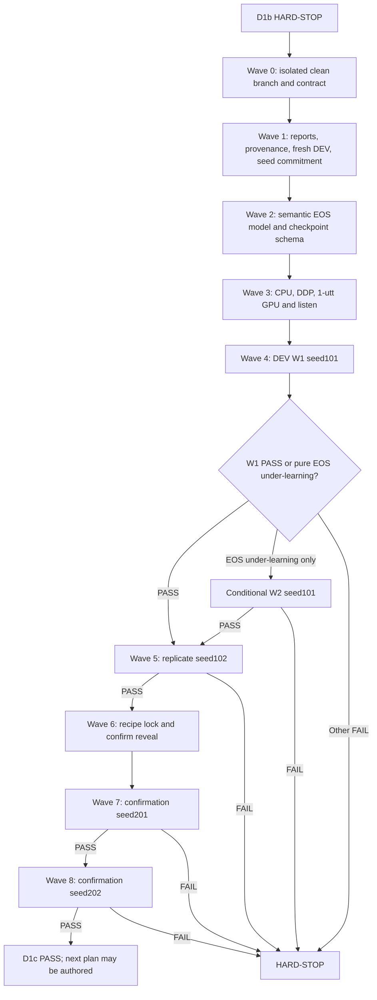

# D1c Semantic EOS termination-repair

## 0. Решение, статус и терминальная цель

Пользователь выбрал архитектурный вариант **explicit semantic EOS**, а не очередную калибровку D1b stop-head. Это решение считается зафиксированным для данного плана.

D1c — узкий ремонт окончания генерации на 32-utterance oracle. Он не является масштабированием модели и не открывает 1h автоматически.

Исходное научное состояние:

- D1b формально закрыт как **HARD-STOP**: [`.cursor/results/d1b_n2_reliability/d1b_reliability_gate.json`](.cursor/results/d1b_n2_reliability/d1b_reliability_gate.json).
- Предыдущий PASS имеет статус `INVALID_WITHDRAWN`.
- Чистый seed 43 самостоятельно устанавливает HARD-STOP.
- На `confirm32_v2` seed 43 прошёл CER и text-usage, но провалил stability: `hard_cap_count=3/24` на gate24 и `4/32` на full32; `runaway_or_repetition=true`.
- Seed 42 остаётся только диагностическим из-за `git_dirty=true`; он воспроизводит те же hard-cap контакты и дополнительно phrase loop.
- В обоих seeds все candidates 250/375/500/625/750 оставались FR-ineligible, а step 750 был лишь «лучшим из failing» по teacher-forced tie-break.
- Одинаковые четыре utterances доходили до cap в обоих seeds; aggregate duration ratio и CB0 health при этом были нормальными. Это подтверждает termination defect, а не content collapse.
- Детали и первичные пути: [`.cursor/results/d1b_n2_reliability/RESULTS.md`](.cursor/results/d1b_n2_reliability/RESULTS.md), [`.cursor/results/d1b_n2_reliability/metrics/confirm_v2_summary.json`](.cursor/results/d1b_n2_reliability/metrics/confirm_v2_summary.json), [`.cursor/results/d1b_hardstop_closure_48a251f5/RESULTS.md`](.cursor/results/d1b_hardstop_closure_48a251f5/RESULTS.md).

Терминальный результат D1c допускает только одно из трёх состояний:

1. **D1c PASS** — semantic EOS проходит fresh DEV32 в двух train seeds и fresh independent CONFIRM32 в двух train seeds, сохраняя все content/text-usage/stability критерии N2.
2. **D1c HARD-STOP** — любой model-result failure после исчерпания заранее разрешённой DEV-развилки; 1h/5h/full остаются запрещены.
3. **INVALID_RUN / INFRA-STOP** — provenance, subset, contract, hash, dirty-tree или infrastructure contract нарушены; результат не считается ни PASS, ни научным FAIL, но исполнение останавливается до отдельного решения.

Даже D1c PASS означает только разрешение **спланировать** следующий 1h-этап. Он не разрешает запускать 1h, 5h или full в рамках этого плана.

## 1. Обязательная граница scope

### 1.1 Что разрешено

- Новый termination mode `semantic_eos_v1`.
- Расширение только semantic CB0 output vocabulary с 2048 до 2049 классов.
- EOS supervision на первой позиции после последнего реального codec frame.
- Новый checkpoint/report/eval-contract schema, необходимый для несовместимой termination semantics.
- Исправление canonical evaluator→selector interface и fail-closed provenance до первого GPU train.
- Fresh DEV32 и fresh independently seeded CONFIRM32, полностью disjoint от всех burned D1/D1b oracles.
- Ровно две заранее объявленные EOS-loss recipe: W1 primary и W2 conditional fallback.
- 32-utterance train-only experiments на текущей RTX 4080/4080 Super 16 GB в WSL2.
- Диагностический 1-utterance overfit/synthesis до DEV.

### 1.2 Что запрещено

- Любой 1h, 5h, full-corpus или 500h+ train.
- Повторное использование D1b `confirm32_v1`/`confirm32_v2` как PASS authority.
- Подбор настроек по D1b confirmation artifacts.
- Третий EOS-loss weight, дополнительный training horizon, дополнительный confirmation train seed или новый confirmation set после model-result failure.
- Изменение backbone, числа layers/heads, d_model, MTP architecture, text tokenizer, speaker map, text-init, RU conditioning, sampler temperature/top-k, repetition penalty или codec.
- Обучение/finetune Qwen3-TTS codec.
- Re-encode TTS targets со stochastic sampling.
- Использование text-derived hard cap как успешного termination.
- Ретроспективное исправление D1b primary artifacts.
- Human-listening-driven retuning confirmation recipe.
- Правки [`.cursor/methodology/`](.cursor/methodology/) во время исполнения плана.
- Коммит пользовательских несвязанных methodology/results/tmp изменений вместе с D1c.

## 2. Read-first packet для агента без контекста

До первой правки агент обязан прочитать:

- [`.cursor/methodology/README.md`](.cursor/methodology/README.md)
- [`.cursor/methodology/03_architecture.md`](.cursor/methodology/03_architecture.md)
- [`.cursor/methodology/04_tokenizers.md`](.cursor/methodology/04_tokenizers.md)
- [`.cursor/methodology/05_backbone.md`](.cursor/methodology/05_backbone.md)
- [`.cursor/methodology/08_evaluation.md`](.cursor/methodology/08_evaluation.md)
- [`.cursor/methodology/09_roadmap.md`](.cursor/methodology/09_roadmap.md)
- [`.cursor/methodology/10_compute.md`](.cursor/methodology/10_compute.md)
- [`.cursor/plans/d1b_n2_reliability_7bd71c65.plan.md`](.cursor/plans/d1b_n2_reliability_7bd71c65.plan.md)
- [`.cursor/plans/d1b_hardstop_closure_48a251f5.plan.md`](.cursor/plans/d1b_hardstop_closure_48a251f5.plan.md)
- [`.cursor/results/d1b_n2_reliability/RESULTS.md`](.cursor/results/d1b_n2_reliability/RESULTS.md)
- [`.cursor/results/d1b_n2_reliability/PROTOCOL.md`](.cursor/results/d1b_n2_reliability/PROTOCOL.md)
- [`.cursor/results/d1b_n2_reliability/artifacts/V1_SUPERSEDED.md`](.cursor/results/d1b_n2_reliability/artifacts/V1_SUPERSEDED.md)
- [`.cursor/results/d1b_hardstop_closure_48a251f5/RESULTS.md`](.cursor/results/d1b_hardstop_closure_48a251f5/RESULTS.md)
- [`configs/eval_contracts/d1b_n2_reliability.json`](configs/eval_contracts/d1b_n2_reliability.json)
- [`configs/train_subsets/d1b_dev32.json`](configs/train_subsets/d1b_dev32.json)
- [`configs/train_subsets/d1b_confirm32.json`](configs/train_subsets/d1b_confirm32.json)
- [`configs/train_subsets/d1b_confirm32_v2.json`](configs/train_subsets/d1b_confirm32_v2.json)
- [`src/minispeech/data/codec_tokens.py`](src/minispeech/data/codec_tokens.py)
- [`src/minispeech/data/collate_codec_seq.py`](src/minispeech/data/collate_codec_seq.py)
- [`src/minispeech/data/codec_seq_protocol.py`](src/minispeech/data/codec_seq_protocol.py)
- [`src/minispeech/models/multi_codebook_head.py`](src/minispeech/models/multi_codebook_head.py)
- [`src/minispeech/models/discrete_speech_lm.py`](src/minispeech/models/discrete_speech_lm.py)
- [`src/minispeech/infer/discrete_config.py`](src/minispeech/infer/discrete_config.py)
- [`src/minispeech/train/discrete_lm_trainer.py`](src/minispeech/train/discrete_lm_trainer.py)
- [`src/minispeech/eval/discrete_n2.py`](src/minispeech/eval/discrete_n2.py)
- [`scripts/72_train_discrete_lm.py`](scripts/72_train_discrete_lm.py)
- [`scripts/73_infer_discrete_lm.py`](scripts/73_infer_discrete_lm.py)
- [`scripts/74_eval_discrete_lm.py`](scripts/74_eval_discrete_lm.py)
- [`scripts/75_freeze_d1b_oracles.py`](scripts/75_freeze_d1b_oracles.py)
- [`scripts/76_select_discrete_checkpoint.py`](scripts/76_select_discrete_checkpoint.py)

Непосредственно перед GPU работой прочитать skills:

- [`.cursor/skills/wsl-env/SKILL.md`](.cursor/skills/wsl-env/SKILL.md)
- [`.cursor/skills/train-ladder/SKILL.md`](.cursor/skills/train-ladder/SKILL.md)
- [`.cursor/skills/eval-gates/SKILL.md`](.cursor/skills/eval-gates/SKILL.md)
- [`.cursor/skills/checkpoint-listen/SKILL.md`](.cursor/skills/checkpoint-listen/SKILL.md)
- [`.cursor/skills/plan-results/SKILL.md`](.cursor/skills/plan-results/SKILL.md)

## 3. Рабочий slug, репозиторий и сохранение чужих изменений

`<PLAN_SLUG>` всегда вычислять из фактического имени этого plan-файла без `.plan.md`. Не сокращать и не придумывать другой slug. Все `out/` и `.cursor/results/` пути должны использовать именно его.

План создан при tracked tip `0661d10eb616362e74dc1750e03cf25c33a7943e`, совпадающем с `origin/master`, но Windows authoring tree уже содержит несвязанные modified/untracked methodology/results/tmp файлы. Поэтому `0661d10` — только baseline commit, а не утверждение о чистом текущем worktree.

Перед реализацией:

1. Снять `git status --short`, сохранить список чужих изменений и не удалять их.
2. Не выполнять `git reset --hard`, `git checkout -- <path>` или массовую очистку текущего Windows tree.
3. Предпочтительный путь — отдельный clean worktree/feature branch от `origin/master`, например `d1c/semantic-eos`, чтобы D1c commits физически не захватили текущие methodology/results/tmp файлы.
4. Если отдельный worktree невозможен, остановиться и запросить у пользователя способ сохранить/отделить чужие изменения.
5. Коммит и push выполнять только после явного разрешения пользователя. До canonical WSL GPU run нужен clean committed source SHA; если разрешения на commit/push нет, остановиться перед GPU.
6. WSL clone должен checkout/pull именно разрешённую D1c branch, а не копировать source через `/mnt/c`/rsync.
7. Train/eval выполнять только из `~/projects/tts-self` на Linux filesystem.
8. Не запускать из `/mnt/c/projects/tts-self`.

## 4. Неподвижные D1c инварианты

- Target geometry остаётся `qwen3tts_12hz`: 24 kHz, 12.5 Hz, 16 codebooks, реальные codec IDs `0..2047`.
- [`src/minispeech/constants.py`](src/minispeech/constants.py) остаётся единственным registry codec geometry; model-level EOS не меняет `TargetSpec.codebook_size=2048`.
- Frozen codec не входит в trainable graph.
- `sample=False` для targets сохраняется.
- Full stressed Russian text prefix сохраняется.
- Text-init остаётся `false`.
- Russian conditioning остаётся `false`.
- Speaker map остаётся [`configs/speaker_maps/trackn_v2.json`](configs/speaker_maps/trackn_v2.json), content hash `64e7cdc5c3447a43d7484b7538f9fd5df88551650d7b95ddb23110f9c36dca6e`.
- Архитектура backbone/MTP, optimizer, LR, batch, grad accumulation и 750 optimizer-step budget остаются D1b-compatible.
- Generation остаётся greedy: `temperature=0.0`, `top_k=0`.
- `repetition_penalty=2.0`, `max_cb0_repeat=12`, `min_frames=4`, global safety `max_frames=750`.
- Никакого text-length `expected`, `frames_per_text_token`, `stop_earliest_frac`, `stop_threshold`, `stop_consecutive`, `stop_overrun_bias` в canonical semantic-EOS inference.
- Safety stop предотвращает зависание процесса, но всегда означает formal FAIL.
- Promotion только по free-running report; teacher-forced metrics — обязательная диагностика/tie-break, не самостоятельное основание PASS.

## 5. Точный semantic EOS model contract

### 5.1 Vocabulary separation

- Codec CB0 real vocabulary: 2048 IDs, `0..2047`.
- Model semantic output vocabulary: 2049 classes.
- `semantic_eos_id = 2048`.
- Semantic head output: 2049.
- Speech input embedding table: строго 2048 rows; EOS никогда не подаётся в `speech_emb`.
- Residual CB1–CB15 heads: строго по 2048 classes.
- Codec decoder получает только `[T,16]` real-code frames; EOS row не существует.

В [`DiscreteSpeechLMConfig`](src/minispeech/models/discrete_speech_lm.py) добавить explicit поля/validation для:

```yaml
model:
  termination:
    mode: semantic_eos_v1
    eos_id: 2048
    semantic_vocab_size: 2049
    codec_vocab_size: 2048
```

Legacy default должен остаться `frame_stop_v1`, чтобы D1b configs/checkpoints продолжали читаться только в historical/diagnostic mode. D1c config обязан явно указать `semantic_eos_v1`; silent default для canonical D1c запрещён.

Validation должна требовать:

- `eos_id == codebook_size`;
- `semantic_vocab_size == codebook_size + 1`;
- `speech_emb.num_embeddings == codebook_size`;
- semantic head output rows == `semantic_vocab_size`;
- residual output rows == `codebook_size`;
- в `semantic_eos_v1` отсутствует trainable `stop_head`;
- в `frame_stop_v1` semantic head остаётся 2048, а legacy stop-head остаётся единственным trainable terminator;
- один checkpoint не может одновременно активировать оба termination mechanisms.

### 5.2 Teacher-forced sequence

Для utterance с `T` реальными codec frames:

- semantic prediction slot `0` получает `speech_start + speaker + modality` и предсказывает CB0 frame 0;
- slot `t`, `1 <= t < T`, получает embedding реального CB0 frame `t-1` и предсказывает CB0 frame `t`;
- slot `T` получает embedding последнего реального CB0 frame `T-1` и предсказывает EOS 2048;
- residual heads работают только на slots `0..T-1`;
- slot `T` не имеет residual targets и не создаёт fake codec frame.

Для padded batch с `T_max`:

- `codes`: `[B,T_max,16]` только real frames;
- `codec_frame_mask`: `[B,T_max]`;
- `semantic_targets`: `[B,T_max+1]`, real CB0 IDs до собственной длины строки, EOS ровно на позиции `acoustic_len`, padding после неё;
- `semantic_mask`: `[B,T_max+1]`, valid на `0..acoustic_len` включительно;
- `eos_positions`: `[B] == acoustic_lens`;
- `residual_mask == codec_frame_mask`;
- EOS каждой строки находится на её собственной длине, а не на общем `T_max`.

Не использовать binary `eos_targets` как model target. Старое поле можно временно оставить только как deprecated legacy diagnostic, но D1c trainer/evaluator обязаны использовать integer `semantic_targets` и explicit masks.

### 5.3 RoPE и attention

Physical layout остаётся `[text_pad_to_Lmax || semantic_slots]`.

Для каждой строки:

- real text positions: `0..text_len-1`;
- semantic positions, включая EOS prediction slot: `text_len + 0 .. text_len + acoustic_len`;
- text/acoustic padding получает dummy position 0 и блокируется key-padding mask;
- causal mask не позволяет EOS slot видеть будущее;
- short-sample solo/batched parity обязана сохраняться, включая EOS logit.

### 5.4 Heads и loss

[`MultiCodebookHead`](src/minispeech/models/multi_codebook_head.py) должен разнести `semantic_vocab_size` и `codebook_size`. Не расширять residual heads до 2049.

Loss D1c:

```text
cb0_frame_ce = mean CE на real CB0 frame positions
residual_ce  = прежний masked residual CE на real frames
semantic_eos_ce = mean CE по одному EOS position на utterance
total = cb0_weight * cb0_frame_ce + residual_ce + eos_loss_weight * semantic_eos_ce
```

Обязательные log keys:

- `ce_cb0_frame`
- `ce_residual`
- `ce_semantic_eos`
- `loss_total`
- `tf_eos_final_top1_accuracy`
- `tf_eos_early_top1_false_positive_count`
- `tf_eos_final_probability_mean/min`

Две и только две разрешённые recipes:

- W1 primary: `eos_loss_weight=1.0`.
- W2 conditional fallback: `eos_loss_weight=2.0`.

W2 разрешена только если W1 seed101 проходит content, CB0, duration, catastrophic и text-usage checks, не имеет early-EOS pathology, но не выучивает EOS: часть model rows заканчивается safety limit и/или final-EOS TF accuracy ниже 100%. W2 запрещена при CER/text-usage/collapse/phrase-loop/early-EOS failure. Любой третий weight запрещён.

### 5.5 Free-running generation

Добавить structured output, не ломая legacy tensor API. Рекомендуемый контракт:

```python
@dataclass
class DiscreteGenerationOutput:
    codes: torch.Tensor
    frame_mask: torch.Tensor
    lengths: torch.Tensor
    rows: list[dict[str, Any]]
```

Canonical D1c scripts обязаны вызывать metadata-returning path. Legacy `generate()` может возвращать tensor для D1b/tests, но formal D1c report без exact metadata запрещён.

На каждом decode step:

1. Получить 2049 semantic logits.
2. Сохранить raw EOS logit/probability/margin.
3. До четырёх emitted real frames маскировать EOS на `-inf`.
4. Если raw argmax был EOS, но min-frame mask его запретил, увеличить `early_eos_suppressed_count`.
5. Repetition penalty применять только к real CB0 classes `0..2047`, не к EOS.
6. Выбрать semantic token greedy.
7. Если token == 2048:
   - выставить `termination_reason=learned_eos`;
   - не вызывать residual heads;
   - не добавлять frame;
   - не embedding-ить EOS;
   - завершить строку.
8. Если token real:
   - вызвать residual heads;
   - собрать `[CB0..CB15]`;
   - добавить один frame;
   - обновить CB0 run.
9. Если после real frame достигнут repeat guard, завершить как `safety_cb0_repeat`.
10. Если emitted frames достигли 750 без EOS, завершить как `safety_max_frames`.

Приоритет одновременных predicates должен быть фиксирован и протестирован: learned EOS до frame emission; затем repeat safety; затем global max safety. Нельзя постфактум угадывать reason по длине.

Per-row generation metadata минимум:

- `termination_mode`
- `termination_reason`
- `termination_step`
- `n_decoded_frames`
- `eos_selected`
- `eos_logit_at_stop`
- `eos_probability_at_stop`
- `eos_margin_to_best_real_cb0`
- `max_eos_probability_before_stop`
- `early_eos_suppressed_count`
- `max_cb0_run`
- `safety_max_frames`
- `safety_max_cb0_repeat`
- `decode_seed`
- `generated_codes_sha256`

Formal evaluator D1c не имеет права вызывать `estimate_stop_reason`; эта функция остаётся только для immutable D1b legacy reports.

## 6. Новый config и checkpoint schema

Создать отдельный config, не переименовывая и не меняя meaning D1b config:

- [`configs/discrete_speech_lm_d1c_semantic_eos_w1.yaml`](configs/discrete_speech_lm_d1c_semantic_eos_w1.yaml)
- [`configs/discrete_speech_lm_d1c_semantic_eos_w2.yaml`](configs/discrete_speech_lm_d1c_semantic_eos_w2.yaml)

W2 должен отличаться от W1 ровно одним effective field: `loss.eos_loss_weight: 2.0` вместо `1.0`. Автоматическая config diff проверка обязана это доказать.

D1c checkpoint schema:

- `schema = minispeech.discrete_lm_checkpoint`
- `schema_version = 2.0.0`
- `termination.mode = semantic_eos_v1`
- `termination.eos_id = 2048`
- `termination.semantic_vocab_size = 2049`
- `termination.codec_vocab_size = 2048`
- embedded optimizer/microbatch counters;
- config/model/subset/speaker-map/eval-contract/recipe hashes;
- clean git SHA;
- run manifest hash.

D1c resume/load обязан fail-closed при отсутствующем v2 schema, termination-mode mismatch, vocab mismatch, recipe mismatch или legacy stop-head state. D1b legacy checkpoint может грузиться только legacy config path; silent partial/non-strict load запрещён.

Canonical DEV/CONFIRM runs стартуют с random initialization step 0 и `resume=false`. Confirmation interruption требует quarantine run dir и полного рестарта с тем же seed; продолжение `last.pt` в formal confirmation запрещено.

## 7. Eval contract 2.0 и recipe lock

D1c несовместим с D1b contract 1.2.0. D1b contract не менять.

Создать:

- [`configs/eval_contracts/d1c_semantic_eos_v2_0_0.json`](configs/eval_contracts/d1c_semantic_eos_v2_0_0.json) — DEV-bound contract.
- [`configs/eval_contracts/d1c_semantic_eos_v2_0_1.json`](configs/eval_contracts/d1c_semantic_eos_v2_0_1.json) — confirmation-bound patch после reveal.
- [`configs/eval_contracts/d1c_recipe_lock_v1.json`](configs/eval_contracts/d1c_recipe_lock_v1.json).

Contract 2.0 обязан содержать:

- schema/id/version;
- content `sha256` с текущей canonical-json процедурой;
- отдельный `recipe_sha256`;
- `recipe_source_manifest_sha256` для executable/config files;
- model/termination/loss block;
- exact optimizer budget и candidate steps;
- exact inference settings;
- codec fingerprint;
- text-tokenizer fingerprint, а не только local path;
- speaker-map content hash;
- ASR raw-config hash, parsed-config hash, backend/model/weight artifact hash, decoding settings и package version;
- normalizer function/module/source-file hash;
- `jiwer`, torch, torchaudio, soundfile и relevant ASR package versions;
- reference manifest path/file hash;
- bootstrap/catastrophic/phrase-loop/CB0/duration/text-usage/termination gate definitions;
- subset registry with file hash, ordered IDs hash, role/count/split hashes;
- candidate-selection policy;
- train/decode/bootstrap/random-baseline seeds;
- burn-registry hash;
- formal-mode bypass prohibitions.

`recipe_sha256` вычислять из recipe projection, исключающего confirmation seed reveal, confirmation IDs/hashes, timestamps и full contract SHA. Contract 2.0.1 имеет новый full SHA, но обязан сохранить `recipe_sha256` и `recipe_source_manifest_sha256` из 2.0.0.

Разрешённый diff 2.0.0→2.0.1:

- confirmation seed reveal proof;
- `d1c_confirm32_v1` path/file/items/split hashes;
- contract version/full SHA;
- immutable creation metadata.

Любой другой diff после recipe lock делает confirmation запрещённым и завершает D1c как protocol stop.

## 8. Wave-0: обязательное устранение evaluator/selector/provenance gaps

До GPU training закрыть следующие фактические gaps текущей D1b обвязки.

### 8.1 Canonical report schema

Добавить [`src/minispeech/eval/discrete_report_schema.py`](src/minispeech/eval/discrete_report_schema.py) и documented schema [`configs/eval_contracts/schemas/discrete_eval_report_v2.schema.json`](configs/eval_contracts/schemas/discrete_eval_report_v2.schema.json).

Final report:

- `schema = minispeech.discrete_eval_report`
- `schema_version = 2.0.0`
- `formal_eligible`
- checkpoint block/path/hash/embedded step/schema;
- run/config/recipe/contract/subset/ASR/normalizer/codec/speaker/git provenance;
- exact infer block;
- evaluator-computed TF metrics;
- all condition rows;
- recomputed summaries/gates;
- per-condition `rows_sha256`;
- final `report_sha256` excluding only its own hash field.

Decode-only bundle имеет отдельный `minispeech.discrete_decode_bundle/2.0.0`; score-only обязан проверить bundle hash и каждый WAV hash до ASR.

### 8.2 Exact row binding

Каждый formal report и каждая condition должны хранить:

- subset contract key/path/file SHA;
- split name;
- expected count;
- ordered expected `utt_ids`;
- `ordered_utt_ids_sha256`;
- evaluated count;
- ordered evaluated IDs/hash;
- exact equality/uniqueness/order assertions.

Каждая row должна хранить:

- `ordinal`;
- target/reference `utt_id`;
- `conditioning_utt_id` или explicit masked/random marker;
- normalized reference hash;
- WAV path/file SHA/PCM hash;
- generated codes hash;
- generation metadata;
- ASR hypothesis;
- normalized hypothesis hash;
- character edit counts;
- CER;
- GT/generated frame counts.

Missing, extra, duplicate, reordered или partial rows — formal refusal. Top-level claimed subset hash без recomputation из exact row IDs не считается доказательством.

### 8.3 Known hashed subset by default

Обобщить D1-specific oracle handling в [`src/minispeech/data/discrete_oracles.py`](src/minispeech/data/discrete_oracles.py), сохранив [`src/minispeech/data/d1b_oracles.py`](src/minispeech/data/d1b_oracles.py) как historical compatibility wrapper.

Formal D1c:

- subset обязан быть registered в активном contract;
- payload обязан содержать top-level и split hashes;
- file hash и ordered ID hash проверяются;
- bare JSON list, unknown alias/path, unhashed payload и silent first-N запрещены;
- `--skip-eval-contract`, legacy N2, GT-derived max frames и manual TF CE запрещены;
- diagnostic unfrozen subset возможен только с explicit flag и всегда `formal_eligible=false`; selector его отвергает.

Исправить существующий gap: отсутствие declared hash в payload сейчас может пройти. В formal v2 missing hash обязан падать.

### 8.4 Evaluator→selector direct interface

[`scripts/74_eval_discrete_lm.py`](scripts/74_eval_discrete_lm.py) обязан сам выдавать selector-consumable v2 report, включая `teacher_forced_ce_source=eval_computed` и contract/recipe/checkpoint/subset hashes.

[`scripts/76_select_discrete_checkpoint.py`](scripts/76_select_discrete_checkpoint.py) в D1c formal mode:

- принимает только evaluator-produced report paths/manifest;
- не принимает hand-authored flat candidate rows как authority;
- валидирует hashes/schema/provenance;
- recompute metrics/gate/eligibility из rows;
- игнорирует и сверяет copied summary/verdict/gate_eligible;
- требует exact candidate steps `[250,375,500,625,750]`, каждый ровно один раз;
- требует один checkpoint hash/step match на report;
- требует same subset/contract/recipe/ASR/infer across candidates;
- требует finite eval-computed TF total CE;
- если eligible candidates нет, завершает ошибкой и не выбирает «least bad»;
- сначала пишет selection JSON, затем копирует selected immutable candidate в `best.pt`, затем проверяет SHA equality.

Legacy D1b input modes можно оставить только как explicit historical mode; они не должны быть доступны через D1c formal contract.

### 8.5 ASR and score-only provenance

Добавить helper в [`src/minispeech/eval/asr.py`](src/minispeech/eval/asr.py), который возвращает canonical ASR provenance:

- raw [`configs/asr.yaml`](configs/asr.yaml) file SHA;
- canonical parsed config SHA;
- backend/model/language/temperature/beam/previous-text/vad settings;
- package name/version;
- resolved model-weight artifact SHA или immutable expected weight SHA из backend registry;
- device/precision policy;
- normalizer ID/module/source SHA;
- scoring package version.

Score-only отклоняет changed config, model artifact, normalizer, package contract, WAV hash, decode bundle hash, contract или recipe.

### 8.6 Correct text-usage pairing

Текущий D1b gate ошибочно передаёт model-vs-wrong paired CI в text-usage acceptance, семантически ожидающий model-vs-shuffle. D1c Wave-0 обязан:

- отдельно вычислять model-vs-wrong separation;
- отдельно вычислять paired model-minus-shuffle bootstrap;
- связывать rows по `utt_id`, не positional `zip` без проверки;
- требовать CI95 upper < 0 для model-vs-shuffle;
- проверять same ordered reference IDs;
- сохранять обе bootstrap distributions/provenance.

## 9. Fresh oracle policy и burn registry

### 9.1 Historical burned inventory

Создать append-only [`configs/train_subsets/d1_oracle_burn_registry.json`](configs/train_subsets/d1_oracle_burn_registry.json) и занести минимум:

- D1/D1b DEV32: `c886ba31f3305546d9b4938e1cd0b7a2fa4fce738d7da342e9da2a30a28b172c`.
- D1b CONFIRM v1: `232df2786859820298271a4845006bbcd4f9b78cfd9fb37872da90d0eee7265c`.
- D1b CONFIRM v2: `63d7e351602e62d26196d944cd1f7a9e928a241e70d968f6eb58c0d1b7a746b9`.
- D1b contract 1.2.0: `d04295d3ac9864afe5002a8470baead8f5f57a3c8f8d38831fe134aa7feada92`.

Для каждого oracle хранить role/version/path/file hash/items hash/status/first-output time/supersession reason.

Старые sets разрешены только для historical analysis. Они не участвуют в D1c tuning, selection, confirmation или PASS.

### 9.2 Generic D1c freezer

Создать [`scripts/77_freeze_d1c_oracles.py`](scripts/77_freeze_d1c_oracles.py). Он читает только static metadata и frozen source inventories; никакие model metrics/outputs/listening/difficulty labels использовать нельзя.

Обязательные exclusions:

- все burned `utt_id`;
- Track N val/test/review;
- exact normalized path;
- manifest audio SHA/file SHA/decoded PCM SHA для selected/burned rows;
- normalized text SHA;
- near-duplicate text по зафиксированному правилу, например character 5-gram Jaccard `>=0.90`;
- duplicate CV speaker между fresh DEV и fresh CONFIRM, если pool позволяет;
- missing/corrupt codec cache;
- codec/text metadata mismatch.

### 9.3 Fresh DEV32

Создать [`configs/train_subsets/d1c_dev32.json`](configs/train_subsets/d1c_dev32.json) до model training.

Fixed DEV selection seed: `20260805`.

Composition:

- 6 RUSLAN, 26 Common Voice RU.
- Duration buckets по заранее записанным boundaries; целевое распределение 10 short / 11 medium / 11 long.
- В RUSLAN 2/2/2 по duration.
- В CV 8/9/9.
- Статический termination-relevant показатель `codec_frames / max(text_token_count,1)` вычисляется только из frozen cache metadata.
- Зафиксировать quartile boundaries по eligible pool.
- В selected 32 обеспечить минимум 6 rows из low quartile и минимум 6 из high quartile.
- CV speakers уникальны; silent relaxation запрещена.
- Stable final order: corpus, затем `utt_id`.

В DEV payload заморозить `select8`, `gate24`, `full32`:

- select8: 2 RUSLAN + 6 CV, покрывает все duration buckets и оба ratio extremes;
- gate24: точное ordered complement;
- full32: canonical ordered list;
- split union/disjoint/order hashes.

DEV разрешено многократно использовать только в заранее ограниченной W1/W2/seed102 policy.

### 9.4 Independent confirmation seed commitment

До первого DEV model output внешний custodian/пользователь генерирует secret unsigned 64-bit seed вне repository и сохраняет его у себя. В repository до recipe lock попадает только commitment:

```text
SHA256(UTF8("d1c-confirm-v1\n" + decimal_seed + "\n"))
```

Создать [`configs/train_subsets/d1c_confirm_seed_commitment.json`](configs/train_subsets/d1c_confirm_seed_commitment.json) с commitment, algorithm, custodian role, generator version/hash и intended role. Plain seed до recipe lock не логировать, не коммитить и не передавать агенту.

Если внешний commitment отсутствует, остановиться до DEV GPU run и запросить его; не выдумывать seed самостоятельно как замену независимости.

После двух DEV seeds PASS и committed recipe lock:

1. Получить reveal от custodian.
2. Проверить commitment.
3. Однократно создать [`configs/train_subsets/d1c_confirm32_v1.json`](configs/train_subsets/d1c_confirm32_v1.json).
4. Применить те же static composition/stratification rules.
5. Проверить полную disjointness с burn registry и DEV.
6. Записать `select8/gate24/full32` и hashes.
7. Обновить contract 2.0.1 только allowlisted fields.
8. Commit subset/contract binding; executable recipe files не менять.

После materialization set считается sealed. После первого model output он считается burned независимо от PASS/FAIL.

## 10. Seeds, determinism и checkpoint schedule

Зафиксировать:

- DEV subset selection seed: `20260805`.
- DEV train seeds: `101`, затем `102`.
- CONFIRM train seeds: `201`, затем `202`.
- Bootstrap seed: `42`.
- Bootstrap resamples: `1000`.
- Random-code baseline base seed: `42001`.
- Greedy model decode seed записывается, хотя model path детерминирован.

Random baseline per-row seed:

```text
uint64(first_8_bytes(SHA256("<base>|<condition>|<utt_id>")))
```

Training budget:

- ровно 750 optimizer updates;
- `grad_accum=4`;
- candidate steps ровно `250,375,500,625,750`;
- нет 1000/1250 extension;
- нет pre-existing `best.pt`;
- candidate filenames immutable `candidate_step_XXXX.pt`;
- `last.pt` отдельно;
- selection только после всех пяти reports.

## 11. Formal candidate eligibility и selection

Candidate на `select8` eligible только если одновременно:

- v2 schema/provenance/hash validation PASS;
- exact 8 ordered rows во всех conditions;
- checkpoint/embedded step/hash match;
- all 8 model rows `termination_reason=learned_eos`;
- `safety_max_frames_count=0`;
- `safety_cb0_repeat_count=0`;
- `early_eos_suppressed_count=0`;
- no empty generation;
- no phrase loop/runaway;
- CB0 max run `<=12`;
- mean duration ratio `[0.90,1.10]`;
- every row duration ratio `[0.5,2.0]`;
- zero catastrophic rows;
- model macro CER `<= copy_synth macro CER + 0.03` на том же select8;
- text-usage criteria PASS;
- TF final-EOS top1 accuracy `100%`;
- TF early-EOS top1 false positives `0`;
- all numeric metrics finite.

Если eligible candidates нет, `best.pt` не создаётся.

Среди eligible candidates lexicographic sort:

1. minimum macro CER;
2. minimum catastrophic count;
3. minimum maximum absolute log duration error по rows;
4. minimum mean absolute log duration error;
5. minimum evaluator-computed TF total CE;
6. lower optimizer step;
7. checkpoint SHA как deterministic final tie-break.

Gate24/full32 никогда не участвуют в checkpoint selection.

## 12. Formal D1c N2 gate

Новый gate ID: `N2_D1c_semantic_eos_v1`.

Он сохраняет все D1b content requirements и добавляет strict EOS requirements.

### 12.1 Provenance gate

Все поля должны пройти:

- clean source and score worktrees;
- non-unknown git SHA;
- same recipe source manifest;
- contract/recipe/config/checkpoint/run-manifest hashes;
- known frozen subset file/items/order/count;
- speaker map/codec/text tokenizer fingerprints;
- ASR/normalizer/package provenance;
- WAV/generated-code hashes;
- exact row completeness/order;
- recomputed summary/gate/report hashes.

### 12.2 Content/text gate

- Model macro CER `<= copy_synth macro CER + 0.03` на том же split.
- Bootstrap separation vs wrong-utterance и random-code.
- Shuffle CER и mask CER не менее model + 0.05.
- Не менее 25% hypotheses меняются при shuffle.
- Paired model-minus-shuffle CI95 upper `<0`.
- CB0 utilization `>=0.05`.
- CB0 entropy `>=2.0`.
- Zero catastrophic rows.
- No ASR phrase loop/runaway.

### 12.3 Termination gate

Для каждой model row:

- `termination_reason == learned_eos`;
- `eos_selected == true`;
- no safety termination;
- no empty generation;
- `early_eos_suppressed_count == 0`;
- CB0 max run `<=12`;
- duration ratio inside `[0.5,2.0]`.

Aggregate:

- learned EOS count == N;
- safety max count == 0;
- safety repeat count == 0;
- legacy hard-cap count == 0;
- mean duration ratio `[0.90,1.10]`;
- no phrase loop;
- TF final-EOS top1 accuracy 100%;
- TF early-EOS false positives 0.

Safety guard может остановить process, но никогда не превращается в PASS.

### 12.4 Split/seed gate

Для каждого train seed:

1. Оценить пять candidates только на select8.
2. Lock один eligible best.
3. Сразу синтезировать mandatory best listen WAVs, но не использовать слух для retuning.
4. One-shot full six-condition N2 на gate24.
5. Full six-condition N2 на full32.
6. Seed PASS только если gate24 и full32 PASS.

D1c PASS только если:

- DEV selected recipe seed101 PASS;
- DEV replication seed102 PASS;
- CONFIRM seed201 PASS;
- CONFIRM seed202 PASS.

Один FAIL означает terminal HARD-STOP; majority vote и seed203 запрещены.

## 13. Ограниченная DEV decision policy

### 13.1 W1 seed101

- Train from scratch на fresh DEV full32.
- Evaluate all five candidates on DEV select8.
- Если eligible candidate есть, select/promote, gate24/full32.
- Если seed101 полностью PASS, W1 становится provisional recipe и W2 не запускается.

### 13.2 Единственная условная W2

W2 разрешена только при pure EOS under-learning W1:

- CER/content/text usage/CB0/catastrophic/duration проходят;
- нет early EOS;
- нет phrase loop/content collapse;
- failure ограничен missing learned EOS / safety max / TF final EOS miss.

Тогда:

- новый run dir;
- тот же DEV set;
- тот же seed101;
- тот же source/config/infer/horizon;
- единственная effective diff — EOS loss 1.0→2.0.

Если W2 не проходит, D1c HARD-STOP. Никаких дополнительных weights/thresholds/horizons.

### 13.3 Seed102 replication

- Запустить выбранную W1 или W2 recipe с seed102 from step 0.
- Никакой адаптации после результата.
- Seed102 обязан пройти select eligibility, gate24 и full32.
- При FAIL D1c HARD-STOP; нельзя вернуться к другому weight.

## 14. Пошаговые execution waves



### Wave 0 — clean isolation and preflight

- Isolate D1c branch/worktree without touching unrelated current changes.
- Verify baseline ancestry from `0661d10` or later approved `origin/master`.
- Read methodology/skills.
- Verify Linux disk free; reserve минимум 200 GB for up to five 5-candidate runs plus WAVs.
- Verify CUDA GPU, bf16, both venvs, HF_HOME, codec cache paths.
- Verify D1b formal gate remains HARD-STOP and historical hashes unchanged.
- Record preflight report under `.cursor/results/<PLAN_SLUG>/logs/`.
- Obtain external confirmation-seed commitment before model output.

Exit: clean committed source path is available; no D1c GPU run occurred.

### Wave 1 — evaluation/provenance/oracle infrastructure

Implement report schema, generic oracle registry/freezer, evaluator-selector direct interface, ASR provenance, row binding, correct model-vs-shuffle bootstrap, burn registry, fresh DEV32 and contract 2.0.0.

Required negative tests must demonstrate refusal of missing/extra/reordered rows, unknown subset, stale hashes, manual TF CE, mixed ASR, stale WAVs, no eligible candidate and formal bypass flags.

Exit: all Wave-1 tests pass; DEV overlap report clean; contract/self/recipe hashes verify; no model training.

### Wave 2 — semantic EOS implementation

Implement collate/model/head/loss/generation/config/checkpoint schema exactly as sections 5–7.

Preserve D1b legacy behavior behind explicit legacy mode. Do not alter codec geometry/weights.

Exit: shape/mask/causality/padding/generation/checkpoint tests pass.

### Wave 3 — CPU/full tests and 1-utterance GPU smoke

Run focused tests, full pytest and real world-size-1 torchrun smoke on clean committed SHA.

Then run a bounded 1-utterance GPU overfit from a burned DEV row for infrastructure only:

- verify EOS loss decreases;
- TF final EOS becomes top1;
- FR ends with learned EOS;
- decoder receives no EOS;
- write WAVs to `out/<PLAN_SLUG>/smoke_1utt/listen_demo/`;
- update listen index;
- do not claim N2.

Any new `last.pt` requires immediate listen inference per checkpoint-listen rule.

Exit: all tests green and 1-utt exact metadata/WAV successful.

### Wave 4 — fresh DEV seed101

Run W1 seed101, produce all five candidates, candidate reports, selection, last/best WAVs, gate24/full32 reports.

If pure EOS under-learning only, execute exactly one W2 seed101 run. Otherwise PASS→replication or FAIL→hard-stop.

Exit: one provisional recipe has clean seed101 PASS.

### Wave 5 — DEV seed102 replication

Run provisional recipe unchanged with seed102. Produce same complete artifacts.

Exit: both DEV seeds PASS; create `d1c_recipe_lock_v1.json`, source manifest, config diff proof, hashes, and commit/push only with user authorization.

### Wave 6 — reveal and freeze confirmation

- Receive/recompute commitment proof.
- Generate confirmation exactly once.
- Verify all exact/near duplicate exclusions.
- Produce contract 2.0.1.
- Verify allowlisted diff and unchanged recipe/source hashes.
- Commit only subset/contract/burn-binding changes.
- Sync clean WSL SHA.

Exit: sealed fresh CONFIRM32 and clean contract-bound source.

### Wave 7 — confirmation seed201

From step 0:

- train all 32;
- score all five candidates on select8 only;
- require eligible candidate;
- write selection before best promotion;
- synthesize mandatory last/best/listen WAVs;
- run gate24 once;
- run full32 once;
- seal machine verdict before any listening-based interpretation.

Any model-result FAIL => HARD-STOP; no seed202 as rescue requirement is needed scientifically, but run seed202 only if seed201 PASS because final rule requires both.

### Wave 8 — confirmation seed202

Repeat Wave 7 with only train seed changed. No recipe/config/code/subset/infer difference.

Any difference beyond seed invalidates run. Any gate FAIL => HARD-STOP.

### Wave 9 — closure

Always, including hard-stop:

- write final RESULTS/PROTOCOL/wave reports;
- copy compact JSON summaries/log references;
- finalize gate JSON and burn registry;
- finalize `listen_index.json` with exact Windows/Linux paths;
- state whether D1c PASS, HARD-STOP or INVALID_RUN;
- explicitly state 1h/5h/full not started;
- do not mutate methodology during execution.

## 15. Required tests

Добавить минимум:

- [`tests/test_d1c_semantic_eos.py`](tests/test_d1c_semantic_eos.py)
- [`tests/test_discrete_eval_report_schema.py`](tests/test_discrete_eval_report_schema.py)
- [`tests/test_d1c_oracles.py`](tests/test_d1c_oracles.py)
- [`tests/test_d1c_selector_integration.py`](tests/test_d1c_selector_integration.py)

Model/collate cases:

- semantic head 2049, speech embedding/residual heads 2048;
- EOS target at each row’s own `acoustic_len`;
- semantic mask includes T+1, residual mask only T;
- EOS position has no residual loss;
- padding cannot affect valid frame/EOS logits or losses;
- last real CB0 is input to EOS slot;
- no future leak;
- solo/batched parity including EOS;
- generated frame count excludes EOS;
- EOS is never embedded/decoded;
- residual heads skipped on EOS;
- min-frame mask and suppression metadata;
- exact safety reasons/precedence;
- independent batched row lengths;
- greedy repeated decode deterministic;
- synthetic tiny overfit learns EOS;
- legacy D1b mode unchanged.

Checkpoint/resume cases:

- v2 schema and termination contract stored;
- semantic checkpoint rejected by legacy config and vice versa;
- config/subset/contract/recipe/termination mismatch rejected;
- strict state load;
- atomic save success/failure unchanged;
- candidate steps and optimizer-step semantics unchanged.

Report/selector cases:

- evaluator output accepted directly;
- flat/manual candidate rejected in D1c formal mode;
- missing/extra/duplicate/reordered IDs rejected;
- row/hash/summary tamper rejected;
- unknown/unhashed subset rejected;
- diagnostic subset marked ineligible;
- missing candidate step rejected;
- mixed contract/recipe/ASR/infer rejected;
- checkpoint hash/step mismatch rejected;
- non-eval TF CE rejected;
- no eligible candidate raises and never creates best;
- promoted best hash equals candidate;
- summaries recompute exactly.

ASR/score-only cases:

- raw/parsed ASR hash mismatch;
- weight artifact/version mismatch;
- normalizer source mismatch;
- WAV hash mismatch;
- decode bundle hash mismatch;
- missing canonical decode provenance;
- changed package contract;
- model-vs-shuffle pairing by ID and CI correctness.

Oracle cases:

- burn registry includes all historical sets;
- DEV disjoint from burns/held-out inventories;
- CONFIRM disjoint from DEV/burns;
- exact audio/text/path/PCM duplicates rejected;
- near-text duplicates rejected;
- commitment reveal verification/failure;
- select8/gate24 union/disjoint/order/hash;
- fixed composition/buckets/ratio extremes/speaker uniqueness;
- generator selection depends only on static metadata;
- overwrite at same version refused.

Test sequence before any 32-utt GPU train:

```bash
PYTHONPATH=src python -m pytest -q tests/test_d1c_semantic_eos.py
PYTHONPATH=src python -m pytest -q tests/test_discrete_eval_report_schema.py
PYTHONPATH=src python -m pytest -q tests/test_d1c_oracles.py
PYTHONPATH=src python -m pytest -q tests/test_d1c_selector_integration.py
PYTHONPATH=src python -m pytest -q tests/test_discrete_stop_config.py
PYTHONPATH=src python -m pytest -q tests/test_discrete_speech_lm.py
PYTHONPATH=src python -m pytest -q tests/test_discrete_lm_trainer_steps.py tests/test_discrete_lm_resume.py
PYTHONPATH=src python -m pytest -q
PYTHONPATH=src torchrun --standalone --nproc_per_node=1 <D1C_SMOKE_SCRIPT>
```

Не hardcode итоговое число новых tests. Требование: ни один из baseline 362 tests не исчез/не был отключён, все новые tests проходят, ожидаемые skips объяснены.

## 16. Canonical WSL execution template

Перед каждой GPU wave:

```bash
cd ~/projects/tts-self
git fetch origin
git checkout <AUTHORIZED_D1C_BRANCH>
git pull --ff-only origin <AUTHORIZED_D1C_BRANCH>
test -z "$(git status --porcelain)" || { echo DIRTY_WORKTREE; exit 2; }
git rev-parse HEAD

source .venv/bin/activate
export HF_HOME="$HOME/hf_cache"
unset MINISPEECH_ALLOW_DIRTY
uv pip install -e . --no-deps
python scripts/00_env_check.py
```

Train template:

```bash
python scripts/72_train_discrete_lm.py \
  --config configs/discrete_speech_lm_d1c_semantic_eos_w1.yaml \
  --eval-contract configs/eval_contracts/d1c_semantic_eos_v2_0_0.json \
  --subset configs/train_subsets/d1c_dev32.json \
  --subset-split full32 \
  --run-name <RUN_NAME> \
  --seed <TRAIN_SEED> \
  --stage S1 \
  --codec-tokens-dir "$CODEC_DIRS"
```

После реализации CLI final commands должны быть записаны в `PROTOCOL.md`; нельзя слепо использовать этот template, если actual `--formal` flags отличаются.

Decode-only должен идти в Qwen codec venv, score-only — в main ASR venv, при этом оба этапа обязаны записывать/проверять same source/contract/recipe provenance.

## 17. Run names и artifact layout

Linux primary:

```text
runs/
  d1c_eos_smoke_1utt/
  d1c_eos_dev_w1_seed101/
  d1c_eos_dev_w2_seed101/          # только если разрешена decision rule
  d1c_eos_dev_locked_seed102/
  d1c_eos_confirm_seed201/
  d1c_eos_confirm_seed202/

out/<PLAN_SLUG>/
  frozen/
  smoke_1utt/
  dev/w1_seed101/
  dev/w2_seed101/                  # conditional
  dev/seed102/
  confirm/seed201/
  confirm/seed202/
```

Каждый candidate output:

```text
checkpoint.sha256
decode_bundle.json
decode_bundle.sha256
eval_report.json
eval_report.sha256
wavs/<condition>/*.wav
```

Results pack обязательно:

```text
.cursor/results/<PLAN_SLUG>/
  RESULTS.md
  PROTOCOL.md
  WAVE0_REPORT.md
  WAVE1_REPORT.md
  DEV_REPORT.md
  CONFIRM_REPORT.md
  d1c_reliability_gate.json
  listen_index.json
  artifacts/
    burn_registry_snapshot.json
    contract_hashes.json
    oracle_overlap_report.json
    seed_commitment_proof.json
    recipe_lock.json
    config_diff_w1_w2.json
    selection_*.json
    gate_*.json
    final_gate.json
  logs/
```

Multi-GB checkpoints/full WAV suites остаются на Linux ext4. В Windows `C:\projects\tts-self\out\<PLAN_SLUG>\...` зеркалировать representative ASCII-named listen WAVs и small JSON. Не копировать 5 GB checkpoints на C:.

`listen_index.json` минимум содержит:

- plan slug;
- contract/recipe/source hashes;
- subset/split/file/items hashes;
- train seed;
- checkpoint path/hash/step;
- termination mode;
- machine verdict;
- Linux и Windows paths;
- last vs best;
- model/copy pairs;
- failure rows;
- explicit note, что listening не изменяет gate.

## 18. Immediate stop matrix

Остановиться до GPU, если:

- current unrelated changes не изолированы;
- clean committed SHA отсутствует;
- пользователь не разрешил необходимые commit/push;
- external confirmation commitment отсутствует;
- Wave-0 tests или full pytest не проходят;
- ASR/model/normalizer hash невозможно зафиксировать;
- fresh DEV не удовлетворяет disjointness/composition;
- formal bypass остаётся;
- report rows нельзя exact-bind к subset;
- D0 codec fingerprint неожиданно изменился.

Остановиться в DEV, если:

- W1 имеет content/text-usage/CB0/catastrophic/early-EOS/phrase-loop failure;
- W1 pure EOS failure и W2 также не проходит;
- seed102 не воспроизводит выбранную recipe;
- eligible checkpoint отсутствует;
- требуется третий weight, threshold, horizon или seed.

Остановиться в confirmation, если:

- commitment не сходится;
- contract diff не allowlisted;
- recipe/source hash изменился;
- subset пересекается с burns/DEV;
- tree dirty или run resumed;
- любой candidate set incomplete;
- seed201 или seed202 проваливает select eligibility, gate24 или full32;
- предлагается изменить что-либо после просмотра confirmation output;
- предлагается seed203/replacement set.

## 19. Final decision semantics

**D1c PASS** доказывает только следующее:

- собственный Speech LM выучил explicit semantic EOS на fresh DEV;
- locked recipe перенеслась на independently frozen fresh confirmation oracle;
- два confirmation random-init train seeds прошли;
- ни один formal model row не зависел от hard cap/safety stop;
- D1b content и text-usage gate не деградировали.

D1c PASS не доказывает N3, long-form, naturalness, production readiness или готовность к 500h. После PASS разрешено составить новый 1h plan.

Любой model-result failure оставляет 1h/5h/full запрещёнными и требует закрывающий HARD-STOP pack, а не продолжение поиска параметров.

## 20. Definition of Done

План завершён только когда:

- semantic EOS implementation и v2 schemas покрыты tests;
- D1b historical mode не сломан;
- fresh DEV/CONFIRM и burn policy доказаны hashes;
- evaluator→selector end-to-end formal path не требует ручной candidate assembly;
- ASR/subset/WAV/checkpoint/report provenance fail-closed;
- mandatory WAVs существуют и проиндексированы;
- final gate имеет один недвусмысленный статус;
- results/logs/artifacts ссылаются на реальные on-disk числа;
- явно записано, что 1h/5h/full не запускались;
- никакие D1b frozen primary artifacts и methodology docs не изменены во время исполнения.