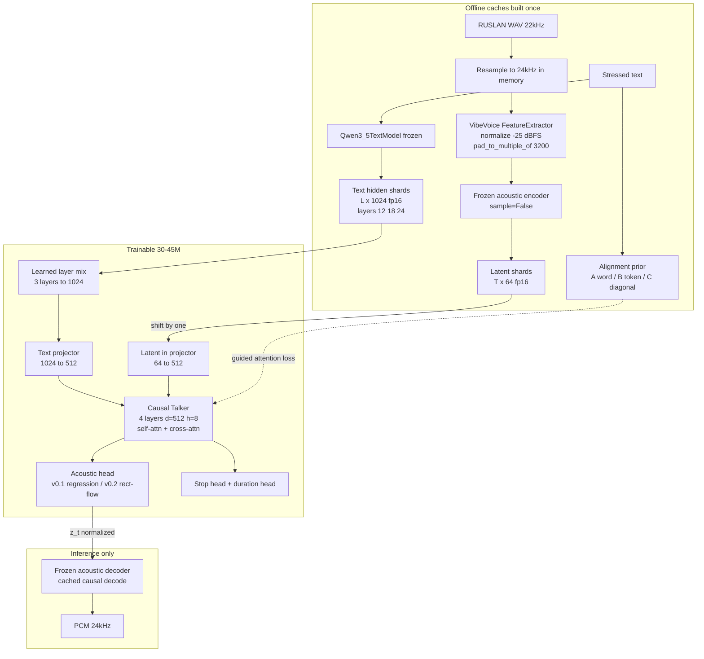

# MiniSpeech-RU: E2E план (v2, implementation-ready)

Исследовательский прототип русской TTS на одной **RTX 4080 / 4080 Super 16 ГБ**. Архитектурный ориентир — [VibeVoice](docs/vibevoice.pdf) (next-token diffusion над непрерывными латентами 7.5 Hz); бюджетные ограничения и выбор данных — из [docs/conversation.md](docs/conversation.md).

Репозиторий greenfield: сейчас есть только `docs/`.

---

## 0. Что изменилось относительно v1 плана

Все замечания приняты и внесены. Кратко:

- **Добавлено явное выравнивание.** Talker получает `z_(t-1)` + cross-attention к тексту, stop head и duration predictor. Раньше механизма длительности не было вообще.
- **Фонемы не идут в Qwen tokenizer.** В Qwen подаётся стрессированный русский текст; фонемы — отдельный encoder и вторая memory для cross-attention (с Phase 3).
- **Qwen вынесен из train loop.** Text hidden states кешируются offline; во время обучения Qwen не занимает VRAM вообще. Возвращается только на Phase 5 (LoRA ablation).
- **Data pipeline переработан.** Нет второй копии WAV, нет собственной loudness-нормализации (её делает feature extractor), `sample=False` обязателен, латенты нормализуются по train-статистике, кеш шардированный, а не 22 тысячи `.pt`.
- **MSE-этап понижен до smoke test** с новыми exit criteria (лестница 32 фразы → 1 ч → 5 ч → корпус), loss = L1 + 0.2·cosine + 0.1·stop.
- **Flow objective формализован** (rectified flow, velocity target, Heun 4 шага, EMA, CFG 10% dropout).
- **Talker уменьшен** до 4×512, суммарно 30–45M trainable.
- **Streaming упрощён**: cached causal decode как базовый механизм, overlap-add только как фикс при слышимых швах; TTFB получил строгое определение и декомпозицию.
- **Phase 0 стал go/no-go** с количественными гейтами по ΔWER.
- **Split не случайный**, добавлен challenge set.
- **Среда — WSL2**, bitsandbytes убран из v0.1.

Плюс мои дополнения, помеченные ниже как **[+]**. Сводка — в разделе 14.

### Правки второго круга ревью (внесены точечно)

- **`vae_std` больше не трактуется как бюджет ошибки.** Sweep остался, но переименован в decoder sensitivity sweep и читается как эмпирическое измерение чувствительности; 0.625 — просто одна из точек сетки. Добавлен структурированный шум.
- **Batch не фиксирован** — `mode: auto` с кандидатами 8/16/32/64 и бюджетом 14.5 ГБ.
- **Duration head двухуровневый** — utterance в Phase 2, token-level в Phase 2b как источник monotonic prior.
- **Stop loss усилен** — `pos_weight`/focal, отдельные precision/recall, завершение по трём условиям сразу.
- **Forced alignment перестал быть блокером** — уровни A/B/C с явной деградацией и валидацией проекции на BPE.
- **Добавлена диагностика того, что Talker использует текст** — гейт ступени S1.
- **Добавлен latent-delta (residual) baseline** и измерение автокорреляции латентов в Phase 1.
- **Добавлен неавторегрессионный fallback** с заранее зафиксированным условием переключения.

Три пункта, отмеченных как критические (трактовка `vae_std`, stop loss, проверка использования текста), внесены полностью.

---

## 1. Проверенные факты (основание для конфигов)

Эти значения подтверждены по документации, а не предполагаются. От них зависят все размерности ниже.

### VibeVoice Acoustic Tokenizer (`microsoft/VibeVoice-AcousticTokenizer`, MIT)

- Класс: `transformers.VibeVoiceAcousticTokenizerModel`; feature extractor через `AutoFeatureExtractor` (`VibeVoiceAcousticTokenizerFeatureExtractor`).
- Config: `hidden_size=64` (это **и есть latent dim**), `downsampling_ratios=(2,2,4,5,5,8)` → произведение **3200**, `depths=(3,3,3,3,3,3,8)`, `num_filters=32`, `ffn_expansion=4`, `**vae_std=0.625`**.
- Feature extractor: `sampling_rate=24000`, `**normalize_audio=True`, `target_dB_FS=-25**`, `eps=1e-6`.
- Сигнатуры:
  - `model.encode(input_values, padding_cache=None, use_cache=None, sample=True)` → `.latents`, `.padding_cache`
  - `model.decode(latents, padding_cache=None, use_cache=False)` → `.audio`, `.padding_cache`
- Пример из документации: вход `[1, 1, 224000]` при `pad_to_multiple_of=3200` → латенты `[1, 70, 64]` → аудио `[1, 1, 224000]`.
- Cache: `len(padding_cache.per_layer_in_channels) == 34` и у encoder, и у decoder.

**Производные константы проекта:**

```text
SAMPLES_PER_FRAME = 3200
SR                = 24000
FRAME_RATE        = 7.5 Hz
FRAME_MS          = 133.333 ms
LATENT_DIM        = 64
VAE_STD           = 0.625
n_frames(x)       = n_samples / 3200   (после pad_to_multiple_of=3200)
```

### Qwen3.5-0.8B-Base (Apache 2.0)

- 24 слоя, hidden **1024**, FFN intermediate **3584**, vocab **248320** (padded, tied embeddings), контекст 262144.
- Layout: `6 × (3 × (Gated DeltaNet → FFN) → 1 × (Gated Attention → FFN))`.
- В `Qwen3_5TextConfig.layer_types` правило генерации: `"linear_attention" if (i+1) % 4 else "full_attention"` → **full attention на слоях с индексами 3, 7, 11, 15, 19, 23** (0-based). Это ровно те слои, куда имеет смысл ставить LoRA на Phase 5.
- Модель нативно мультимодальная (есть vision tower) → берём **только** `Qwen3_5TextModel`, не `Qwen3_5ForConditionalGeneration`.
- **[+] Важно:** путь Gated DeltaNet требует опциональных пакетов `causal_conv1d` и `fla`; без них transformers молча падает на медленный и более прожорливый PyTorch-fallback. Для одноразового прохода кеширования это терпимо, для Phase 5 (LoRA) — нет. Ставим их сразу в WSL2.

### RUSLAN Stressed (`stilletto/ruslan-stressed`, CC BY 4.0)

- ~31 час, 22 200 файлов, один диктор, исходный SR ~22 kHz, тексты с автоматически расставленными ударениями.
- Карточка корпуса **прямо предупреждает об ошибках расстановки ударений на омографах** → это входит в data-cleaning и в challenge set.

### Оценка размера кешей

```text
Латенты:  31 ч × 3600 × 7.5 ≈ 837 000 фреймов × 64 × 2 B (fp16) ≈ 107 МБ
Текст:    22 200 × ~40 токенов × 1024 × 2 B (fp16)              ≈ 1.8 ГБ на слой
```

**[+] Отсюда важное следствие:** оба кеша целиком помещаются в RAM/страничный кеш, поэтому **данные перестают быть ограничением на batch** — ни диск, ни VRAM под замороженные модели больше не мешают. Но потолок всё равно ставит VRAM под активации: Talker, cross-attention `[B, T, L]`, внутренние блоки головы, несколько flow-time сэмплов на Phase 3, EMA и состояния оптимизатора. Поэтому batch **не фиксируется в плане**, а подбирается автоматически (`batch.mode: auto`, кандидаты `[8, 16, 32, 64]`, бюджет 14.5 ГБ — см. §8). Рабочая гипотеза: 32–64 на regression baseline и 8–32 на flow.

Главное следствие сохраняется независимо от конкретной цифры: эпоха по RUSLAN — это сотни, а не десятки тысяч шагов, то есть **минуты**. Бюджет проекта тратится на количество экспериментов, а не на длительность одного прогона, поэтому план строится вокруг многих коротких ablation-прогонов.

---

## 2. Цель и границы

### Цель v0.2 (то, что защищаем как результат)

- Русский, **один диктор** (RUSLAN), разборчивая и естественная речь.
- Непрерывные латенты VibeVoice 7.5 Hz, codec **frozen**, никогда не обучается.
- Rectified flow head вместо регрессии.
- Потоковый **вывод** аудио при полностью известном тексте, измеренный TTFB.
- Фразы 1–10 с.

### Вне scope

- Обучение codec / semantic tokenizer.
- Full finetune 0.8B.
- Потоковый **приём** текста (переносится на после v0.2).
- Long-form 90 мин, 4 спикера.
- Overlapping speech.

### Зафиксированные решения

- Backbone: `Qwen/Qwen3.5-0.8B-Base`, класс `Qwen3_5TextModel`, **offline-кеш hidden states**.
- Codec: `microsoft/VibeVoice-AcousticTokenizer`, frozen, `sample=False`.
- Вход Qwen: **стрессированный русский текст**, не фонемы.
- Talker: causal self-attention + cross-attention к тексту, вход `z_(t-1)`.
- Head v0.1: регрессия (L1+cos). Head v0.2: rectified flow.
- Semantic tokenizer VibeVoice: не используем.
- Среда: **WSL2 Ubuntu**, проект на Linux FS.
- Данные: `~/datasets/tts/` внутри WSL2 (не `/mnt/c`, иначе I/O деградирует).
- Оптимизатор v0.1: обычный fused AdamW. bitsandbytes — только при реальном OOM.

### **[+] Критический пробел, которого не было ни в v1, ни в ревью: расстановка ударений на инференсе**

RUSLAN Stressed даёт ударения для **обучения**. Но на инференсе пользователь подаёт обычный текст без ударений. Если этого не решить, train/inference distribution разойдутся и модель будет получать вход, которого не видела.

Решение, фиксируется сейчас:

- Инференс-фронтенд обязан ставить ударения автоматически (`RUAccent` или аналогичный русский accentuator) **до** подачи в Qwen.
- Формат ударения должен **побайтово совпадать** с тем, что в RUSLAN Stressed (комбинирующий U+0301 vs `+` перед гласной — определить в Phase 1 и зафиксировать в `frontend/stress.py` как единственный источник истины).
- В Phase 1 добавляется тест: прогнать accentuator по train-текстам без ударений и измерить agreement с разметкой RUSLAN. Это одновременно оценка качества accentuator и оценка качества самой разметки.
- Если agreement < 90%, обучаем модель с **аугментацией**: с вероятностью ~15% подавать текст без ударений, чтобы модель не разваливалась при ошибках accentuator.

---

## 3. Архитектура




### Точный контракт тензоров

```text
text_hidden      [B, L, 1024]  fp16 cache, 3 слоя -> learned mix
text_mask        [B, L]        bool
text_memory      [B, L, 512]   after projector
z_target         [B, T, 64]    normalized latents
z_input          [B, T, 64]    [BOS, z_0..z_(T-2)]
frame_mask       [B, T]        bool, T = ceil(n_samples/3200)
h                [B, T, 512]   Talker output
z_pred           [B, T, 64]    head output (normalized space)
stop_logits      [B, T]        BCE target: 1 на последнем валидном фрейме
dur_pred         [B]           предсказанное T (в фреймах), Phase 2
tok_dur_pred     [B, L]        длительность каждого токена в фреймах, Phase 2b
align_prior      [B, T, L]     prior уровня A/B/C, для guided attention
```

Обратное преобразование перед декодером: `z_raw = z_pred * latent_std + latent_mean`.

### Почему именно так

- **Cross-attention, а не конкатенация.** При 7.5 Hz на 5-секундную фразу приходится ~38 акустических фреймов и ~30 текстовых токенов, то есть соотношение ~1.2–1.5:1 (для английского BPE VibeVoice сообщает 2:1). Последовательности крошечные, полная cross-attention стоит копейки и даёт явный, инспектируемый механизм выравнивания.
- **Вход `z_(t-1)`.** Без него Talker — не авторегрессионная модель речи, а text-to-sequence регрессор, и у него нет способа поддерживать локальную фазовую/просодическую связность.
- **Talker с full attention, а не Qwen.** Gated DeltaNet — рекуррентное сжатое состояние; нет доказательств, что оно сохраняет мелкие фонетические детали. Qwen остаётся Thinker'ом.
- **[+] 133 мс на латент — это очень много.** Один фрейм покрывает больше, чем фонему. Значит внутри одного латента спрятана существенная вариативность произношения, и это главный аргумент, почему чистая L1/MSE регрессия обязана усреднять. Flow здесь не «улучшение», а необходимость. Это же означает, что head на 8–16M может оказаться мал — закладываем возможность роста до 24–32M, если Phase 3 покажет underfitting.

---

## 4. Окружение

```text
Windows 11
└── WSL2 Ubuntu 24.04
    ├── CUDA 12.x + драйвер с Windows-хоста
    ├── Python 3.11 (uv)
    ├── PyTorch 2.6+ cu124
    ├── transformers (pinned; нужна версия с VibeVoiceAcousticTokenizer и Qwen3_5)
    ├── causal_conv1d, fla   # быстрый путь Gated DeltaNet
    ├── flash-attn           # только для Talker и full-attn слоёв Qwen
    └── ~/projects/tts-self  # Linux FS, не /mnt/c
```

Зависимости: `torch`, `torchaudio`, `transformers`, `accelerate`, `peft` (Phase 5), `safetensors`, `soundfile`, `librosa`, `numpy`, `einops`, `omegaconf`, `wandb`, `jiwer`, `ruaccent`, `pytest`.

**[+] Репродуцируемость:** `uv.lock` коммитим; каждый run пишет `run_manifest.json` с git sha, hash конфига, версиями `torch`/`transformers`, именем GPU, seed. Без этого ablation-таблица через месяц не будет воспроизводима.

**[+] Windows-хост остаётся только для прослушивания** — выходные WAV пишем в `/mnt/c/projects/tts-self/out/`, чтобы открывались из Windows без копирования.

---

## 5. Структура репозитория

```text
tts-self/
  pyproject.toml            uv.lock            README.md
  configs/
    codec.yaml              qwen.yaml
    data_ruslan.yaml        talker_v01.yaml    flow_v02.yaml
    train_v01.yaml          train_v02.yaml     infer.yaml
  src/minispeech/
    frontend/
      normalize.py          # числа, даты, аббревиатуры, ё
      stress.py             # ЕДИНЫЙ формат ударений (train == infer)
      g2p.py                # Phase 3, отдельный канал
    codec/
      wrapper.py            # load frozen, encode(sample=False), cached decode
      stats.py              # latent mean/std по train
    data/
      manifest.py           # JSONL схема + валидация
      shards.py             # safetensors шарды + индекс
      dataset.py            # collate, маски, shifted input
      alignment.py          # forced alignment -> align_prior
    models/
      layer_mix.py          # learned mix кешированных слоёв Qwen
      projector.py
      talker.py             # causal self-attn + cross-attn
      heads_regression.py   # v0.1
      heads_flow.py         # v0.2 rectified flow
      stop_duration.py
      minispeech.py
    train/
      trainer.py  losses.py  ema.py  guided_attn.py  logging.py
    infer/
      generate.py  stream.py  cfg.py
    eval/
      asr_wer.py  stress_acc.py  utmos.py  latency.py  alignment_metrics.py
  scripts/
    00_env_check.py       01_download.sh        02_build_manifest.py
    03_verify_text_asr.py 04_encode_latents.py  05_cache_text_hidden.py
    06_align.py           07_train.py           08_infer.py
    09_eval.py            10_smoke_e2e.py
  tests/                  notebooks/            docs/
```

---

## 6. Phase 0 — Codec feasibility (go/no-go)

**Это единственная фаза с правом остановить проект.** Если tokenizer портит русскую речь, вся архитектура бессмысленна.

### Задачи

1. WSL2, uv-окружение, `00_env_check.py`: CUDA, VRAM, версии, наличие `causal_conv1d`/`fla`.
2. Скачать `microsoft/VibeVoice-AcousticTokenizer` и `Qwen/Qwen3.5-0.8B-Base`.
3. Скачать RUSLAN (только для выборки 300 фраз на этом этапе).
4. **[+] Verify tensor layout.** Документация `decode` описывает latents как `(batch, channels, seq_len)`, но пример передаёт `[1, 70, 64]`. Проверить эмпирически и зафиксировать в `codec/wrapper.py` с assert'ом на форму. Это ловушка, которая иначе всплывёт на Phase 2 в виде «модель учится, но звук — шум».
5. **[+] Verify per-item нормализацию.** Feature extractor нормализует к −25 dBFS; проверить, делает ли он это по-элементно при батче с padding. Если нет — кодировать по одной записи (при 22 тыс. файлов это всё равно минуты).
6. Roundtrip 300 фраз: original → ASR → `WER_orig`; roundtrip → ASR → `WER_codec`.
7. Cache-equivalence: полный decode против chunked cached decode, `max|Δ|` по сэмплам.
8. RTF encoder и decoder, пиковый VRAM.
9. Аудирование 30 фраз: шипящие, мягкость, ударения, взрывные.

### **[+] Decoder sensitivity sweep — самый ценный тест этой фазы**

Цель — **эмпирически** измерить, насколько decoder терпит ошибку в латентном пространстве, и получить численный ориентир целевого RMSE для акустической головы вместо гадания «MSE 0.05 — это хорошо или плохо».

```text
для σ in {0, 0.05, 0.1, 0.2, 0.3, 0.45, 0.625, 0.9, 1.25}:
    z_noisy = μ + σ · ε            # ε ~ N(0, I), μ — латент при sample=False
    decode(z_noisy) → ASR → WER(σ), UTMOS(σ)
```

**Важно: не связывать результат с `vae_std=0.625` заранее.** `vae_std` относится к распределению posterior при обучении VAE, а не к гарантированной устойчивости decoder к произвольному независимому шуму вокруг конкретного latent mean. Совпадение точки перегиба с 0.625 было бы приятным, но ожидать его нельзя. Значение 0.625 включено в сетку только как одна из точек отсчёта, а не как предсказанный порог. Никакие решения плана не должны опираться на «σ=0.625 безопасен» — только на измеренную кривую.

Что даёт результат:

- **эмпирический целевой RMSE для Phase 2/3** — уровень σ, при котором WER ещё не растёт заметно;
- реалистичный потолок качества;
- ранний сигнал о том, насколько строгие требования к голове: если деградация начинается уже при σ≈0.1, регрессия почти наверняка недостаточна и head придётся делать больше; если кривая пологая — regression baseline может дожить дольше.

**[+] Дополнительно — структурированный шум, а не только изотропный.** Реальная ошибка модели не будет белым шумом: она будет коррелирована во времени и смещена по отдельным размерностям. Поэтому к sweep добавить две вариации: (а) временно-коррелированный шум (AR(1) с ρ=0.8 вдоль оси кадров), (б) шум только в подмножестве латентных размерностей с наибольшей дисперсией. Если decoder заметно чувствительнее к коррелированному шуму, чем к белому при том же RMSE, это меняет приоритет с «уменьшать MSE» на «не допускать систематического дрейфа» — а это ровно тот режим отказа, который ожидается от AR-генерации.

Этот эксперимент делается **до** написания Talker и записывается в `docs/phase0_report.md` как кривая, а не как одно число.

### Acceptance gate (все условия одновременно)

- `WER_codec − WER_orig ≤ 4 п.п.` (цель ≤ 2 п.п.)
- Нет систематической потери шипящих/мягкости на слух (30 фраз, чеклист)
- `sample=False` детерминирован: два прогона идентичны побитово
- Cached decode ≈ full decode: `max|Δ| < 1e-3` в нормированных сэмплах
- Decoder RTF < 0.3 на 4080
- Decoder sensitivity кривые (белый и AR(1) шум) построены и записаны в `docs/phase0_report.md`

**Fallback при провале:** WavTokenizer или 12.5 Hz codec (MOSS/Qwen3-TTS-класса). Формат данных проекта от этого не зависит — меняется только `codec/wrapper.py`, `LATENT_DIM` и `FRAME_RATE`. Поэтому все константы держим в одном модуле.

---

## 7. Phase 1 — Offline caches

### 1a. Manifest

`data/manifest.jsonl`, одна строка на utterance:

```json
{"utt_id":"ruslan_000123","wav":"ruslan/wavs/000123.wav","text_raw":"Привет, как дела?",
 "text_stressed":"Приве́т, как дела́?","speaker":"ruslan","n_samples_24k":120000,
 "n_frames":38,"dur_s":5.0,"split":"train","asr_cer":0.03,"stress_agreement":0.95}
```

Обработка аудио — **строго минимальная**, потому что нормализацию делает feature extractor:

- удаление DC offset
- проверка clipping
- обрезка избыточной тишины по краям (VAD/энергия, оставлять ~50–100 мс)
- отбраковка битых файлов
- resample 22k → 24k **в памяти**, вторая копия корпуса не создаётся
- **не** делать свою loudness-нормализацию

### 1b. **[+] ASR-верификация текста**

RUSLAN — аудиокнижный корпус; рассинхрон текста и аудио и пропущенные слова там встречаются. Прогнать Whisper large-v3 по всем 22 200 файлам, посчитать CER между транскриптом и текстом манифеста, отбросить всё с `CER > 0.25`, вручную посмотреть 50 худших. Одноразовая GPU-задача на несколько часов, которая снимает целый класс необъяснимых проблем обучения на Phase 2.

### 1c. Latent cache

```python
inputs = fe(audio_24k, sampling_rate=24000, pad_to_multiple_of=3200)
out = model.encode(inputs.input_values, sample=False)   # sample=False обязательно
z = out.latents            # [1, T, 64]
```

- `T = n_samples_padded / 3200`; **истинное** число фреймов = `ceil(n_samples_real / 3200)`, всё сверх него маскируется в loss.
- Хранение: **safetensors-шарды** по ~2000 utterance + `index.json` (`utt_id → shard, offset, n_frames`). Никаких 22 тысяч отдельных `.pt`.
- Весь кеш ~107 МБ fp16 → грузим в RAM целиком, dataloader без диска.

### 1d. Latent statistics

По train-сплиту посчитать `latent_mean[64]`, `latent_std[64]`, сохранить в `stats.safetensors` и **вшить в каждый чекпоинт**. Обучение — в нормализованном пространстве, денормализация перед decode.

**[+] Дополнительно записать:** per-dim гистограммы, эксцесс, корреляционную матрицу 64×64. Если размерности сильно коррелированы, часть ёмкости head тратится впустую и стоит рассмотреть whitening. По умолчанию — простая per-dim нормализация.

### 1e. Text hidden cache

Прогнать `Qwen3_5TextModel` (frozen, bf16, `output_hidden_states=True`) по `text_stressed`.

**[+] Какие слои кешировать.** Кешировать все 25 — это ~~45 ГБ, неприемлемо. Кешировать только последний — потеря гибкости: для акустики обычно полезнее средние слои. Решение: **кешировать слои 12, 18 и 24** (~~5.4 ГБ fp16) и обучать скалярный softmax-микс поверх них (`models/layer_mix.py`, 3 обучаемых параметра). Даёт выбор слоя как обучаемый гиперпараметр почти бесплатно, а веса микса потом — готовый результат для статьи.

Хранение — те же шарды. Токенизация фиксируется и сохраняется (`input_ids` в манифесте), чтобы forced alignment и text hidden ссылались на одни и те же индексы.

### 1f. **[+] Forced alignment → guided attention prior**

Главный технический риск проекта — выравнивание. Полагаться только на диагональный prior необязательно, когда можно получить настоящий:

1. Прогнать выравнивание (MFA с русской моделью либо CTC-выравнивание на wav2vec2/Whisper) → границы слов в секундах.
2. Перевести секунды в индексы латентных фреймов: `frame = round(t_sec * 7.5)`.

Дальше — **три уровня качества prior, с явной деградацией**:

- **Alignment A — word-level prior.** Границы слов в кадрах, без проекции на BPE. Маска строится на уровне слов: кадру `t` разрешены все токены слова, в которое он попадает. Надёжно, потому что не зависит от токенизации.
- **Alignment B — projected Qwen-token prior.** Границы слов делятся между токенами пропорционально длине токена в символах, `align_prior[T, L]` хранится разреженно (для каждого кадра — диапазон допустимых токенов). Точнее, но шумнее.
- **Alignment C — monotonic Gaussian prior.** Диагональ по отношению `T/L` без всякого выравнивания. Работоспособный минимум.

**Проекция на BPE может оказаться шумной** — на окончаниях, дефисах, числах и особенно на комбинирующих символах ударения токенизация Qwen не обязана совпадать с границами слов. Поэтому B применяется только если пройдёт валидацию: на 200 примерах проверить монотонность спроецированных границ и отсутствие вырожденных нулевых интервалов. Если доля дефектных проекций выше 10% — используем A. Если и выравнивание в целом не получилось — C.

Во всех трёх случаях prior используется одинаково: guided-attention loss с затухающим весом (сильный на старте, к нулю к 30–40% обучения). На инференсе зависимости не возникает ни в одном варианте.

**Forced alignment не является блокером Phase 1.** Baseline стартует на том уровне, который доступен: отсутствие A и B откладывает точность выравнивания, но не останавливает Phase 2. Уровень, фактически использованный в прогоне, пишется в `run_manifest.json` — это одна из строк будущей ablation-таблицы (A vs B vs C).

### 1g. Split — не случайный

- Разделение по **непрерывным диапазонам исходных книг/глав**, а не по случайным utterance. В аудиокниге соседние фрагменты почти дублируются.
- Дедупликация по нормализованному тексту.
- `train / val / test = 90 / 5 / 5`.
- **Challenge set (150–200 фраз, фиксируется навсегда):** омографы (за́мок/замо́к, бо́льшая/больша́я), числа и даты, аббревиатуры, фамилии, слова с `ё`, длинные сложные слова, вопросительные и восклицательные предложения, короткие реплики (<1 с), длинные (>10 с).
- **Test set не меняется после первого прогона.** Записать его hash.

### Acceptance gate

Блокирующие условия:

- 100% train имеет латенты и text hidden
- Случайные 32 записи: `decode(cache) ≈ decode(fresh encode)`
- Статистика латентов сохранена, `mean≈0/std≈1` после нормализации проверено
- Распределение `T/L` (фреймов на токен) построено — опорное число для duration head
- **[+]** Автокорреляция латентов по времени измерена — вход для решения по residual-голове (§8)

Неблокирующие (определяют уровень prior, но не останавливают Phase 2):

- Достигнутый уровень выравнивания: A (word-level) / B (projected token) / C (monotonic Gaussian)
- Доля покрытых train-примеров и доля дефектных проекций при B
- Монотонность проверена визуально на 20 примерах

---

## 8. Phase 2 — Alignment baseline (regression)

Цель фазы — **не качество, а доказательство, что архитектура выравнивается, завершается и не расходится**.

### Конфиг

```yaml
talker:
  d_model: 512
  num_layers: 4
  num_heads: 8
  ffn_dim: 2048
  cross_attention: true
  latent_dim: 64
  dropout: 0.1
  rope: true              # относительные позиции по акустической оси
head_regression:
  hidden: 1024
  layers: 3
  residual: true            # см. latent-delta baseline ниже
stop_head:
  hidden: 256
  loss: bce
  positive_weight: 10.0     # ~1 положительная метка на 40 отрицательных
duration_head:
  level: utterance          # Phase 2; token-level добавляется в Phase 2b
  hidden: 256

batch:
  mode: auto
  candidates: [8, 16, 32, 64]
  target_vram_gb: 14.5
```

**[+] Batch подбирается автоматически, а не фиксируется.** Кеши малы, но VRAM всё равно уходит на активации Talker, cross-attention `[B, T, L]`, внутренние блоки головы, несколько flow-time сэмплов (Phase 3), EMA и состояния оптимизатора. `mode: auto` прогоняет кандидатов по убыванию, замеряет пиковую память на нескольких шагах и берёт наибольший, укладывающийся в `target_vram_gb`. Ожидание: на regression baseline вероятны 32–64, на flow-модели реалистичнее 8–32. Выбранное значение пишется в `run_manifest.json`, чтобы ablation-прогоны сравнивались при известном (а при необходимости — принудительно одинаковом) batch.


| Компонент                  | Trainable  |
| -------------------------- | ---------- |
| Layer mix                  | ~3         |
| Text projector 1024→512    | ~0.5M      |
| Latent in-projector 64→512 | <0.1M      |
| Talker 4×512               | ~20–30M    |
| Regression head            | ~8–16M     |
| Stop + duration heads      | <1M        |
| **Итого**                  | **30–45M** |


### Данные в батче

```text
input:  [BOS, z_0, z_1, ..., z_(T-2)]
target: [z_0, z_1, z_2, ..., z_(T-1)]
```

`BOS` — обучаемый вектор. Все loss'ы маскируются по `frame_mask`.

### Loss

```text
L = L1(z_pred, z_target)
  + 0.2  · cosine_loss(z_pred, z_target)
  + 0.1  · BCE(stop_logits, stop_target, pos_weight=10.0)
  + λ(step) · guided_attention_loss(attn, align_prior)      # λ: 1.0 -> 0 к 35% шагов
  + 0.05 · L1(dur_pred, T)                                   # auxiliary
```

### **[+] Stop head: дисбаланс и условие завершения**

На фразу приходится одна положительная метка на ~40 отрицательных (5 с при 7.5 Hz = 38 кадров). Обычный BCE в такой постановке легко сходится к «всегда ноль» и формально показывает низкий loss. Меры:

- `pos_weight=10.0` в BCE (значение подобрать под фактическое среднее `T` по корпусу: разумная эвристика — `pos_weight ≈ mean(T)/4`);
- если и этого мало — focal loss (`γ=2`), переключается флагом в конфиге;
- отдельно логировать precision/recall стоп-детектора, а **не** только суммарный loss.

**Завершение на инференсе — по комбинации трёх условий, а не по одному порогу:**

1. `p(stop) > θ` удерживается **несколько кадров подряд** (например, 2–3), а не одиночный выброс;
2. пройдена минимальная ожидаемая длительность (`dur_pred × 0.5`), чтобы не обрывать фразу в начале;
3. hard cap `dur_pred × 1.5` — принудительная остановка, даже если stop head молчит.

### **[+] Duration head — двухуровневый**

Одна общая длина фразы даёт hard cap, но почти не помогает выравниванию. Поэтому два уровня, вводимые последовательно:

- **Phase 2 (сейчас):** `utterance_duration` — скаляр `T` на фразу. Дёшево, закрывает cap и даёт диагностику.
- **Phase 2b (после того, как S2 сойдётся):** предсказание длительности **каждого слова или текстового токена** из `text_memory`. Из накопленной суммы token durations строится дополнительный monotonic prior: для кадра `t` известен ожидаемый диапазон токенов, и он подмешивается в cross-attention как bias.

Второй уровень особенно окупается на числах, аббревиатурах, фамилиях и длинных русских словах, где отношение «символы → длительность» сильно нелинейно, а именно там ошибки выравнивания наиболее заметны. Обучающая цель для token durations берётся из того же forced alignment, что и `align_prior` (§7.1f), поэтому дополнительной разметки не требуется.

### **[+] Latent-delta (residual) baseline**

Соседние акустические кадры при 7.5 Hz почти наверняка сильно коррелированы. Проверяем оба варианта головы под одним флагом `head_regression.residual`:

```text
A (direct):    ẑ_t = Head(h_t)
B (residual):  ẑ_t = z_(t-1) + Head(h_t)
```

Ожидание: вариант B заметно облегчает регрессию и снижает drift, поскольку модель предсказывает малую поправку, а не полный вектор. Побочный риск — B может «залипать» на копировании предыдущего кадра и игнорировать текст; это ловится диагностикой из следующего раздела. Перед выбором померить автокорреляцию латентов по времени на train-сплите (делается ещё в Phase 1 вместе с per-dim статистикой) — она сразу скажет, сколько именно даёт residual-параметризация.

### **[+] Проверка, что Talker действительно использует текст (обязательная диагностика)**

Наиболее коварный режим отказа на S1: модель запоминает акустические траектории по `z_(t-1)` и практически игнорирует `text_memory`. Teacher-forced regression при этом выглядит отлично, а AR-инференс порождает бессмысленную речь. Четыре проверки, гоняются на каждой ступени лестницы:

1. **Text shuffle test.** Перемешать тексты внутри батча, оставив латенты на месте. Loss обязан **заметно вырасти**. Если рост меньше ~20%, текст не используется и дальше идти нельзя.
2. **Fixed text, varied prefix.** Один текст с разными предыдущими латентами — выход должен оставаться близок по содержанию.
3. **Text memory masking.** Полностью замаскировать `text_memory` — loss должен деградировать сопоставимо с п.1.
4. **Cross-attention mass.** Средняя масса внимания, приходящаяся на токены, релевантные текущему кадру по `align_prior`. Логируется как скаляр вместе с диагональностью.

Эти проверки — **гейт ступени S1**, а не опциональная диагностика. Особенно важны при включённом residual-варианте головы, где соблазн копировать предыдущий кадр максимален.

### **[+] Митигация autoregressive drift (обязательно, а не опционально)**

Teacher forcing + AR inference — известный источник расхождения, и на 7.5 Hz одна плохая рамка портит 133 мс звука. Три меры, по возрастанию стоимости:

1. **Input noise на `z_(t-1)`** — добавлять `N(0, σ_in²)` к входным латентам во время обучения, `σ_in` растёт по расписанию 0 → 0.15 (в нормализованном пространстве). Почти бесплатно и обычно даёт основной эффект.
2. **Scheduled sampling** — с вероятностью p(step) подставлять собственное предсказание вместо ground truth. Дороже (нужен второй forward), включать только если п.1 недостаточно.
3. **Free-running validation метрика** — каждые N шагов честно генерировать 8 val-фраз авторегрессионно и логировать L1 против ground truth. Обычная val loss на teacher forcing **не показывает** drift; без этой метрики можно долго радоваться падающему графику при разваливающемся звуке.

### Лестница обучения (строго последовательно)


| Ступень | Данные      | Что доказываем                   | Gate                                       |
| ------- | ----------- | -------------------------------- | ------------------------------------------ |
| S1      | 32 фразы    | модель вообще способна запомнить | free-running L1 → ~0, аудио узнаваемо      |
| S2      | 1 час       | обобщение внутри диктора         | attention диагональна, stop срабатывает    |
| S3      | 5 часов     | стабильность                     | нет collapse, длительность в пределах ±20% |
| S4      | весь RUSLAN | масштаб                          | корректное завершение на challenge set     |


**Exit criteria Phase 2 (качество здесь ещё не требуется):**

1. S1 переобучается почти до нуля.
2. S2 переобучается на часе речи.
3. На полном RUSLAN речь корректно **завершается** (stop head работает, нет бесконечной генерации).
4. Выход связан с текстом, нет коллапса в шум или тишину.
5. Диагональность attention > 0.7 по метрике из `eval/alignment_metrics.py`.
6. Free-running L1 не более чем в 2× хуже teacher-forced.

WER здесь **не** является гейтом — измеряем и записываем как baseline для A/B, но решения по нему не принимаем.

### **[+] Fallback: неавторегрессионный Talker (решение принимается в конце Phase 2)**

Накопление ошибки `z_(t-1) → z_t` — главный риск проекта, и он может не сниматься ни input noise, ни scheduled sampling. Держим наготове полностью параллельный вариант:

```text
text_memory
  → token duration predictor (Phase 2b)
  → length regulator: развернуть токены в T кадров
  → parallel acoustic hidden [B, T, 512]  (bidirectional, без causal маски)
  → flow head покадрово (кадры независимы при заданном hidden)
```

Это FastSpeech-подобная схема с flow-декодером. Она **теряет часть инноваций VibeVoice** — нет next-token AR-генерации, нет естественного streaming по мере генерации, качество просодии обычно ниже, чем у AR при равных данных. Но она структурно не может расходиться, обучается быстрее и на 20–30 часах одного диктора часто даёт более стабильный результат.

**Условие переключения, фиксируется заранее, чтобы не решать это в состоянии фрустрации:** если на ступени S3 (5 часов) free-running L1 более чем в 3× хуже teacher-forced **и** прослушивание показывает разваливающуюся речь после ~3 секунд, **и** это воспроизводится после включения input noise и scheduled sampling — переключаемся на неавторегрессионный вариант и фиксируем это как результат («на данном масштабе данных AR не удержался»), а не как неудачу.

Совместимость: text projector, layer mix, duration head, flow head и весь data pipeline переиспользуются без изменений. Переписывается только `models/talker.py` (снятие causal маски + length regulator). Именно поэтому оно и держится как реальный fallback, а не как второй проект: цена переключения — один модуль.

Дополнительный аргумент в пользу того, чтобы держать этот путь открытым: при 133 мс на кадр последовательности крайне короткие (38 кадров на 5 секунд), а на таких длинах преимущество AR над параллельной генерацией заметно меньше, чем на высокочастотных токенизаторах в 25–50 Hz.

### Логирование

loss-компоненты по отдельности, grad norm, LR, VRAM, attention heatmap (4 val-фразы) каждые N шагов, аудио 4 val-фраз, free-running L1, распределение предсказанных длительностей, per-dim R² по 64 латентным размерностям (**[+]** — сразу видно, какие размерности не выучиваются).

---

## 9. Phase 3 — Rectified flow head

### Формулировка (фиксируется)

Обучение:

```text
z0 = чистый нормализованный латент
eps ~ N(0, I)
t  ~ U(0, 1)                      # позже: logit-normal сэмплирование t
x_t = (1 - t) * z0 + t * eps
v_target = eps - z0
v_pred = FlowHead(x_t, t, h_t, cond_null_flag)
L_flow = MSE(v_pred, v_target)
```

Инференс:

```text
x_1 ~ N(0, I)
интегрировать ODE от t=1 к t=0 (Heun, 4 шага)
z_hat = x_0
```

### Параметры

- Head: старт **8–16M** (DiT-подобные блоки с AdaLN по `t` и `h_t`), при underfitting растить до 24–32M.
- Sampler: Heun, 4 шага; затем сравнить 4 / 6 / 8 и Euler vs Heun.
- CFG: dropout условия 10% при обучении (обучаемый `null_h`), scale искать в 1.0–2.0.
- **EMA** на все обучаемые модули (decay 0.999), eval только по EMA-весам.
- **[+] Логит-нормальное сэмплирование `t`** (медиана ~0.5) вместо равномерного — стандартно улучшает flow-модели, стоит одну строку.
- **[+] Общий Talker.** Head меняется, Talker переиспользуется — инициализировать из чекпоинта Phase 2, это экономит недели. Дополнительно: первые ~2000 шагов Talker заморожен, учится только head.

### Ablation-таблица (заготовка для статьи)

- regression baseline vs rect-flow
- шаги sampler: 4 / 6 / 8
- CFG scale: 1.0 / 1.3 / 1.6 / 2.0
- размер head: 8M / 16M / 32M
- EMA on/off
- input noise σ_in: 0 / 0.05 / 0.15

Так как эпоха — минуты, эта таблица реально исполнима.

### Exit criteria

- WER/CER на test лучше regression baseline при равных шагах обучения
- UTMOS не хуже baseline
- Stress-accuracy на challenge set измерена
- Слепое A/B на 30 парах: flow предпочтителен ≥60%

---

## 10. Phase 4 — Streaming output

### Базовый механизм

```python
cache = None
for chunk in latent_chunks:                     # chunk = 2..8 латентов
    out = codec.decode(chunk, padding_cache=cache, use_cache=True)
    cache = out.padding_cache
    yield out.audio
```

**Overlap-add — не базовый механизм.** Причинные свёртки + `padding_cache` должны давать бесшовное продолжение. OLA включаем только если Phase 0 cache-equivalence или прослушивание покажут швы.

Потоковый **приём текста** — не в этой фазе. Текст известен целиком.

### Определение TTFB (фиксируется)

> Время от завершения нормализации входного текста до появления первого доступного PCM-буфера длительностью не менее 20–40 мс.

### Декомпозиция (измерять по отдельности, до постановки цели)

1. Qwen forward по тексту (на инференсе кеша нет — это реальная стоимость, в отличие от обучения)
2. Один вызов flow head (× число шагов ODE)
3. Генерация первого латента (Talker + head)
4. Задержка decoder на минимальном чанке
5. Минимальное число латентов, при котором decoder отдаёт валидный PCM

Один латент = **133.33 мс** аудио, поэтому уже 1–2 латента с запасом перекрывают 20–40 мс буфер; узкое место — фиксированная стоимость Qwen + первый шаг Talker.

**[+] Наблюдение:** так как Qwen на инференсе перестаёт быть бесплатным, у него появляется прямой вклад в TTFB. Это дополнительный аргумент против LoRA на Phase 5, если выигрыш по качеству мал — и аргумент за то, чтобы измерить, достаточно ли прогонять Qwen только до слоя 18 (максимальный кешируемый слой микса) вместо всех 24. Экономия ~25% времени Qwen забесплатно, если layer-mix отдаст основной вес слою 12 или 18.

Цель 300–700 мс сохраняется как **гипотеза**, подтверждается или корректируется после замеров.

Также измеряем RTF и стабильность при непрерывной генерации 60+ с.

---

## 11. Phase 5 — LoRA ablation

Сравнение при равном бюджете шагов:

- **A:** Qwen frozen (кеш) — baseline
- **B:** LoRA на последних 4 блоках вокруг full-attention слоёв (индексы 19, 23 + их FFN)
- **C:** LoRA на слоях 12–23

LoRA rank 8–16, LR 5e-5. При включении LoRA кеш text hidden больше не валиден → Qwen возвращается в train loop, VRAM растёт, шаг замедляется. Именно поэтому это отдельная поздняя фаза с явным A/B, а не «добавим после baseline».

**Оставляем LoRA только при измеримом улучшении WER, точности ударений или просодии**, превышающем стоимость по скорости обучения и TTFB.

---

## 12. Phase 6 — Multi-speaker, emotion, cloning

- Данные: `langswap/dialogs-ru-emotional-conversations` (~20.6 ч, 3 актёра, 12 стилей).
- Speaker: reference-latents в стиле VibeVoice (`Speaker_k : z_k` как дополнительная cross-attention memory) — предпочтительнее отдельного speaker encoder, потому что переиспользует тот же латентный домен и не добавляет новую модальность.
- Альтернативный/дополнительный канал: WavLM/ECAPA embedding как глобальный вектор.
- Emotion/style: обучаемые embeddings по 12 меткам Dialogs + interpolation при инференсе.
- **[+] Phase 3 фонемный канал** подключается здесь же: отдельный небольшой phoneme encoder → вторая memory, поскольку Dialogs не имеет разметки ударений и G2P становится необходим.
- Zero-shot: prompt 3–10 с → reference latents → синтез.
- Метрики: SIM (WavLM-large), WER, emotion-classification accuracy, A/B preference.

Реалистичный порог SIM для такого объёма данных: 0.4–0.5 на unseen.

---

## 13. Evaluation, тесты, риски

### Eval suite


| Метрика               | Инструмент                      | Когда           | Заметка                                 |
| --------------------- | ------------------------------- | --------------- | --------------------------------------- |
| WER / CER             | Whisper large-v3 (ru)           | каждый чекпоинт | всегда рядом с `WER_codec` как потолком |
| ΔWER к codec ceiling  | производная                     | каждый чекпоинт | **[+]** честнее абсолютного WER         |
| Stress accuracy       | challenge set + ручная разметка | milestones      | ключевая RU-специфика                   |
| UTMOS                 | no-reference MOS                | milestones      |                                         |
| Alignment diagonality | `eval/alignment_metrics.py`     | Phase 2–3       |                                         |
| Free-running L1       | внутренняя                      | каждые N шагов  | детектор drift                          |
| TTFB / RTF            | `eval/latency.py`               | Phase 4+        | по определению из §10                   |
| SIM                   | WavLM-large                     | Phase 6         |                                         |
| A/B preference        | 30–50 пар                       | milestones      |                                         |


### Тесты (`pytest`, гоняются локально перед каждым большим прогоном)

- форма и dtype всего контракта тензоров из §3
- `encode(sample=False)` детерминирован
- cached decode == full decode в пределах допуска
- нормализация латентов: roundtrip `normalize → denormalize` идемпотентен
- collate: маски совпадают с `n_frames`, padding не течёт в loss
- shifted input: `z_input[:,1:] == z_target[:,:-1]`
- stop target: ровно одна единица на последовательность, на последнем валидном фрейме
- checkpoint содержит `latent_mean/std` и версию конфига

### `10_smoke_e2e.py`

Один прогон: загрузить codec → encode/decode фикстуру → загрузить чекпоинт → teacher-forced шаг → авторегрессионно сгенерировать 2 с → cached streaming decode → записать WAV → напечатать TTFB, RTF, пиковый VRAM. Должен проходить на чистой машине.

### Риски


| Риск                                   | Вероятность                 | Митигация                                                                          |
| -------------------------------------- | --------------------------- | ---------------------------------------------------------------------------------- |
| Выравнивание текст↔кадры               | высокая                     | cross-attn + prior уровня A/B/C + диагональность как гейт + лестница S1–S4         |
| **Talker игнорирует текст**            | **высокая, маскируется**    | text shuffle / masking / cross-attn mass как гейт S1 (§8)                          |
| Качество codec на русском              | средняя                     | Phase 0 go/no-go с ΔWER gate; fallback на 12.5 Hz codec изолирован в одном модуле  |
| Autoregressive drift                   | высокая                     | input noise, free-running метрика, scheduled sampling, residual head               |
| AR не удерживается даже после митигаций| средняя                     | заранее описанный неавторегрессионный fallback с фиксированным условием переключения |
| Длительность и завершение              | средняя                     | двухуровневый duration head + pos_weight/focal + тройное условие остановки          |
| Шумная проекция alignment на BPE       | средняя                     | деградация B → A → C; выравнивание не блокирует Phase 2                            |
| Ошибки ударений в RUSLAN               | высокая                     | ASR-верификация, challenge set, аугментация текстом без ударений                   |
| Расхождение train/infer по ударениям   | **высокая, легко упустить** | единый `frontend/stress.py`, accentuator на инференсе, agreement-тест              |
| 133 мс на латент → регрессия усредняет | высокая                     | flow как основная версия; sensitivity sweep даёт эмпирический целевой RMSE          |
| VRAM на flow-этапе меньше ожидаемой    | средняя                     | `batch.mode: auto` вместо зафиксированного batch                                   |
| Один диктор → узкая модель             | принята                     | явное ограничение v0.2                                                             |
| Transformers API дрейфует              | средняя                     | pinned версия + `uv.lock` + smoke-тест на API                                      |
| Официального TTS-кода VibeVoice нет    | факт                        | diffusion/flow head пишем сами по статье; полагаемся только на published tokenizer |


### Лицензии и безопасность

Qwen3.5 Apache 2.0, VibeVoice tokenizer MIT, RUSLAN CC BY 4.0 (требует указания авторства). Сырые датасеты не коммитятся. README содержит research-only disclaimer и предупреждение о deepfake-рисках, как в [техрепорте VibeVoice](docs/vibevoice.pdf).

---

## 14. **[+] Сводка моих дополнений**

Отдельно, чтобы их было видно среди принятых правок:

1. **Decoder sensitivity sweep в Phase 0** — эмпирическая кривая «ошибка в латентах → деградация речи», дающая целевой RMSE для головы. Трактуется как измерение, **без** привязки к `vae_std` как к предсказанному порогу. Дополнен структурированным шумом (AR(1) во времени, шум по подмножеству размерностей), потому что реальная ошибка модели не белая.
2. **Расстановка ударений на инференсе** — критический train/infer gap, которого не было ни в одном варианте плана. Единый формат ударений + accentuator + agreement-тест + аугментация без ударений.
3. **Кеш трёх слоёв Qwen (12/18/24) с обучаемым миксом** вместо выбора одного слоя вслепую; ~5.4 ГБ, 3 обучаемых параметра, попутно даёт результат для статьи и подсказку для оптимизации TTFB.
4. **Forced alignment с явной деградацией A → B → C** и валидацией проекции на BPE; не блокирует Phase 2, уровень пишется в манифест прогона.
5. **Input noise + free-running validation** как обязательные меры против AR drift; teacher-forced val loss объявлен ненадёжным индикатором.
6. **ASR-верификация всего корпуса** до обучения — снимает класс проблем от рассинхрона текста и аудио в аудиокниге.
7. **Автоподбор batch** (`auto`, кандидаты 8/16/32/64, бюджет 14.5 ГБ) вместо фиксированного значения; сохраняется главное следствие малых кешей — эпоха идёт минуты, поэтому план строится вокруг большого числа коротких ablation-прогонов.
8. **Проверка layout латентов и per-item нормализации** в Phase 0 — две конкретные ловушки API, дающие «модель учится, но звук — шум».
9. **ΔWER к codec ceiling** как основная метрика вместо абсолютного WER.
10. **Per-dim R² по 64 размерностям** как диагностика того, какие компоненты латента не выучиваются.
11. **Изоляция всех codec-констант в одном модуле**, чтобы fallback на другой токенизатор был правкой одного файла.
12. **run_manifest.json** с git sha, hash конфига, выбранным batch и уровнем alignment.
13. **Диагностика использования текста как гейт S1** — text shuffle, masking, fixed-text/varied-prefix, cross-attention mass. Без неё хорошая teacher-forced регрессия может сосуществовать с бессмысленным AR-инференсом, особенно при residual-голове.
14. **Двухуровневый duration head** — utterance в Phase 2, token-level в Phase 2b с превращением в monotonic prior; цели берутся из того же forced alignment, дополнительной разметки не нужно.
15. **Взвешенный stop loss и тройное условие завершения** — `pos_weight ≈ mean(T)/4` или focal, плюс остановка по устойчивому `p(stop)` + минимальной длительности + hard cap.
16. **Latent-delta (residual) baseline** под флагом, с предварительным измерением автокорреляции латентов в Phase 1, чтобы решение опиралось на данные.
17. **Неавторегрессионный fallback** с заранее зафиксированным условием переключения на S3 — цена перехода ограничена одним модулем, так как duration head, flow head и pipeline переиспользуются.

---

## 15. Таймлайн (part-time)


| Фаза          | Срок            | Артефакт                                               |
| ------------- | --------------- | ------------------------------------------------------ |
| Phase 0       | 3–5 дней        | `docs/phase0_report.md`, go/no-go, sensitivity-кривая  |
| Phase 1       | 1–1.5 недели    | шарды латентов и text hidden, alignment, challenge set |
| Phase 2       | 2–3 недели      | Talker выравнивается, использует текст и завершает речь (S1→S4) |
| Phase 2b      | внутри Phase 2  | token-level duration head → monotonic prior            |
| Phase 3       | 2–3 недели      | flow-модель, ablation-таблица, A/B                     |
| Phase 4       | 1–1.5 недели    | streaming, измеренный TTFB/RTF                         |
| **v0.2 demo** | **8–12 недель** | связная русская речь + потоковый вывод                 |
| Phase 5       | 1 неделя        | LoRA A/B/C, решение                                    |
| Phase 6       | 4+ недели       | multi-speaker, эмоции, cloning                         |


Порядок исполнения не переставляется: Phase 0 имеет право остановить проект, Phase 2 не начинается без кешей латентов и text hidden (выравнивание при этом блокером **не** является), Phase 3 переиспользует Talker из Phase 2.

**Что окончательно фиксируется только по результатам, а не сейчас:** размер и конфигурация flow-головы, необходимость flow вообще, residual против direct, уровень alignment prior, batch, и авторегрессионная схема против параллельной. Все эти решения имеют определённый выше источник данных — sensitivity sweep, автокорреляция латентов, результаты S1–S3 — и принимаются по ним.