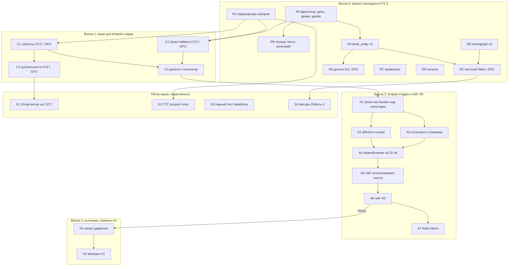

# Track N — этап N2-first

Документ написан так, чтобы его мог выполнить агент, **не участвовавший** в
предыдущей работе. Весь необходимый контекст продублирован здесь.

Разделы 0–4 обязательны к прочтению **до начала любой задачи**. Раздел 5 —
только своя задача.

---

## 0. Как исполнять этот план

### 0.1. Роли

- **Оркестратор** — читает раздел 4 (волны), запускает субагентов, собирает
  отчёты, обновляет статусы задач. Сам код не пишет.
- **Субагент-исполнитель** — берёт ровно **одну** задачу из раздела 5,
  выполняет её целиком, пишет отчёт по форме из раздела 6.

### 0.2. Правила мультиагентной работы

1. **Один файл — один владелец.** Матрица владения — раздел 4.3. Две задачи с
   пересекающимися списками файлов **нельзя** запускать параллельно.
2. **Одна GPU-задача одновременно.** В системе одна RTX 4080 Super 16 ГБ.
3. **Задача не выполнена без критерия приёмки.** Если критерий не достигнут —
   это провал, а не «частично сделано». Формулировку критерия не подгонять.
4. **Не выходить за границы задачи.** Нашёл соседнюю проблему — запиши в отчёт,
   **не чини**.
5. **Никаких коммитов без явного указания пользователя.**
6. **Если не уверен — остановись и спроси.**

### 0.3. Сквозные запреты

- **Не выдумывать числа.** Любое число в отчёте или документе должно иметь путь
  к породившему его артефакту. Отсутствие результата записывается как
  отсутствие, а не заменяется правдоподобной оценкой.
- **Track A заморожен.** Не улучшать ни акустическую модель, ни длительности,
  ни variance, ни вокодер. Основание: `.cursor/methodology/09_roadmap.md`.
- **Не обучать кодек.** Референсный акустический токенизатор используется
  только на инференс, энкодинг строго с `sample=False`.
- **Чужие веса — только исследовательский инструмент.** Референсный токенизатор
  и любые чужие веса в продукт не идут (`.cursor/methodology/02_legal.md`).
  Продуктовый путь требует своего токенизатора и обеспечивается фазой P2, которая
  в этот план **не входит**.
- **Не менять замороженные наборы молча.** Любое исправление содержимого
  `configs/eval_sets/*.json` — только через поднятие `version` и обновление
  хешей по процедуре из `.cursor/methodology/08_evaluation.md`.
- **Эталон разметки не может быть выходом нашего же фронтенда.** Это главный
  урок ревью P1: 94.6 % labels `bank_entity` v2 оказались дословным выходом
  `verbalize_text`. `expected_spoken` пишется по внешней норме; совпадение с
  фронтендом — предмет измерения, а не определение истины.
- **Внешний baseline получает тот же фронтенд, что и наша система**, либо
  публикуются оба условия. Иначе нарушается правило «одна переменная за раз».
- **Не запускать тяжёлые прогоны из `/mnt/c/...`** — только из Linux FS.
- **Не запускать прогоны из грязного git-дерева** (см. R7).
- **Не редактировать `.cursor/methodology/**`** в ходе исполнения этого плана.
  Синхронизация методологии — отдельная задача при планировании следующего этапа.
- **Не начинать P2.** Не трогать `scripts/43_train_tokenizer.py` и
  `runs/tokenizer_t0_small/`.
- **P.808 и абсолютный MOS не делаем.** Инструмент натуральности — парные
  предпочтения.
- **Не удалять и не коммитить** содержимое `data/`, `runs/`, аудио, кэши,
  `*.safetensors`.

### 0.4. Обязательное чтение перед началом

Минимум для всех:

- [.cursor/results/p1_data_execution/REVIEW.md](../results/p1_data_execution/REVIEW.md) — что именно сломано и почему этот этап так устроен
- [.cursor/methodology/README.md](../methodology/README.md) — карта и якорные числа
- [.cursor/methodology/09_roadmap.md](../methodology/09_roadmap.md) — фазы, заморозка Track A, де-рискинг второй стадии
- [.cursor/methodology/08_evaluation.md](../methodology/08_evaluation.md) — метрики, версионирование наборов, гейты N-серии

Дополнительно по задачам: `03_architecture.md` и `05_backbone.md` для волны 2,
`06_frontend.md` для R3–R5 и H1, `07_data.md` для волны 1,
`04_tokenizers.md` для понимания, почему токенизатор здесь референсный.

Скиллы: `.cursor/skills/offline-caches` (волна 1), `train-ladder` (волна 2),
`text-usage-gate` (A5), `checkpoint-listen` (A7, обязателен), `eval-gates`,
`plan-results` (по завершении), `wsl-env`.

### 0.5. Правила артефактов

- **Любой инференс пишет wav** под `out/n2_first_execution/<система>/`
  (`.cursor/rules/inference-wavs.mdc`). На Windows-зеркале имена файлов ASCII.
- По завершении этапа — `.cursor/results/n2_first_execution/RESULTS.md` + `logs/`
  + `listen_index.json` (`.cursor/rules/methodology-and-results.mdc`).
- Каждый прогон обучения пишет `run_manifest.json` с **верным** `git_sha`
  (см. R7).

---

## 1. Контекст

### 1.1. Что это за проект

MiniSpeech-RU — исследовательский русский TTS. Тезис: существует класс задач
**intelligibility-critical TTS** (телефония, банкинг), где значимый отказ — не
«звучит роботом», а «произнёс не то число, не тот реквизит, не то ударение».

Текущий production — **Track A**, заморожен как baseline:

```text
русский текст → нормализация → ударения → символьные метки CTC
  → mel-модель (~10M, from scratch) → HiFi-GAN → 22.05 кГц
```

Чекпойнт: `runs/mel_stress_v01_s4/best.pt`.

Целевая архитектура **Track N** (концепция LatentLM / VibeVoice):

```text
ударённый русский текст → предобученный LLM-бэкбон, предсказывающий
  следующий непрерывный латент → diffusion-голова → замороженный
  акустический токенизатор → звук
```

### 1.2. Почему этот этап устроен именно так

**Решение: гейт N2 выносится вперёд фазы P2.**

Основания, все измеренные:

1. `08_evaluation.md`: «Гейт **N2 — самый важный**. Именно его аналог провалил
   Track A». Пока N2 не проверен, масштабировать что-либо бессмысленно.
2. P2 «Токенизаторы» — по методологии «самая длинная фаза». Существующий скелет
   T0 даёт copy-synth CER **0.84** против якоря E2 **0.073**
   (`out/probe_ref_tokenizer_domains.json`, `.cursor/results/track_n_p0_conclusion.md`).
   Довести свой непрерывный кодек до уровня референса на 67 часах — отдельный
   исследовательский проект.
3. Токенизатор сам по себе не даёт слышимого результата: качество появляется
   только после второй стадии.
4. `09_roadmap.md` прямо разрешает де-рискинг: «Пока свой токенизатор обучается,
   вторая стадия разрабатывается на референсном токенизаторе как на заглушке.
   Подмена — по прохождении N0».
5. Фаза P1 принесла данные, которых раньше не было: **67.5021 clean-ч** Common
   Voice RU 17, 2 671 диктор (`out/pilot_qc.json`) плюс ~15.4 ч RUSLAN ≈ **83 ч**
   из ~100 ч, которые `07_data.md` требует для пилота второй стадии.

### 1.3. Чем это отличается от провала Part 1

Это ключевой вопрос методологической чистоты, и его надо понимать до начала
волны 2.

| | Part 1 (провал, Gate 0 FAIL) | Этот этап |
|---|---|---|
| Последовательностная модель | **Talker с нуля**, 4 слоя, d_model 512 (`configs/talker_v01_direct.yaml`) | **предобученный Qwen3.5-0.8B** как бэкбон |
| Роль Qwen | замороженный текстовый энкодер, подаётся через cross-attention | сам предсказывает следующий латент; текст и латенты — одна последовательность |
| Голова | регрессия L1 / rectified flow | diffusion (DDPM) с CFG |
| Данные | 15.4 ч, **один диктор** | ~83 ч, **2 672 диктора** |
| Результат | `r2_overall ≈ −0.11`, `var_ratio ≈ 0.319`, диагональность 0.092 | предмет измерения |

Диагноз Part 1 из `01_strategy.md`: «Провалилось обучение с нуля
последовательностной модели на 15 часах при **выброшенном предобученном
LLM-бэкбоне и diffusion-голове**, то есть ровно тех компонентах, где сосредоточен
акустический приор». Этот этап возвращает оба компонента. Задача 1 фазы P3 в
`09_roadmap.md` сформулирована дословно как «конкатенация текстовых токенов и
латентов в единую последовательность» — это и есть A1.

**Это не перезапуск заброшенных S4/Flow.** Запрет из `AGENTS.md` («do not resume
latent S4/Flow until Gate 0 passes») относится к прежней конфигурации
own-Talker-from-scratch. Новая конфигурация — другой эксперимент, и его
единственная цель — получить сигнал по N2.

### 1.4. Что оставила после себя фаза P1

Полный разбор: [`.cursor/results/p1_data_execution/REVIEW.md`](../results/p1_data_execution/REVIEW.md).

Подтверждено ревью (перепроверено независимо):

- все 15 строк таблиц `docs/frozen_numbers_mel80.md` воспроизводятся из
  построчных JSON, максимальное расхождение 3.3e-16;
- 8/8 хешей наборов сходятся при независимом пересчёте;
- `pilot_qc.json`: 46 783 utts, 69.1003 ч, 2 671 диктор, **67.5021 clean-ч**,
  сумма по тегам сходится, `speaker_overlap` пуст;
- `merge_dedup_report.json`: 68 425 − 42 = 68 383, приоритет ruslan > CV17;
- ни один чекпойнт в окне P1 не изменён;
- `ruff` на P1-путях: 0 замечаний; коммит `66445e5` проходит 196 тестов.

Три дефекта, которые ремонтирует волна 0:

| # | Дефект | Числа |
|---|--------|-------|
| **B1** | наборы Track N заморожены **до** QC | merged-манифест 02:08:38, сплиты 02:09:13, QC CV17 завершён 05:47:35. В `trackn_train` попали **7 811** строк RUSLAN с `exclude` и 1 796 с `review`; все **46 741** активная строка CV17 имеет `qc_tag: None`; 3 059 строк `val` молча выпали |
| **B2** | labels `bank_entity` v2 = выход нашего вербализатора | **298 из 315 (94.6 %)** воспроизводятся `verbalize_text`; 13 из 15 категорий на 100 %; **21** label с неверной формой года («две тысячи двадцать шесть года»), **28** с «точка» вместо «целых/десятых»; «девять пять» для 09:05 |
| **B3** | Silero сравнивался в неравных условиях | у **1 275 из 1 277** строк `model_input_text == text`, то есть сырой текст с цифрами; Track A получал вербализованный. Отсюда DER 0.9739 у Silero на `bank_entity` |

Плюс: контексты `homograph` v2 остаются неграмматичными («на эту сре́ды»,
«из натурального хло́пок») при заявленном «all contexts resolve stress: True»;
`git_sha` в манифестах прогонов P1 указывает на `cd08a26` вместо `66445e5`;
техдолг `out/_*` снят только в WSL (на Windows 65 файлов).

### 1.5. Измеренная планка

| Набор | Track A | Silero v4_ru | Артефакт |
|-------|--------:|-------------:|----------|
| `val100` mean CER | 0.0319 | **0.0078** | `out/baseline_p1_v2_full.json`, `out/external_baseline_silero_v2.json` |
| `homograph` mean CER | 0.0703 | **0.0094** | там же |
| `demo5` mean CER | 0.0935 | **0.0305** | там же |
| `bank_entity` DER | 0.6142 | 0.9739 | условия неравны, см. B3 |
| copy-synth topline (E2, латенты) | **0.073** | — | `out/latent_error_calibration.json` |
| реальная запись человека, `val100` | 0.060 | — | `out/baseline_track_a_critical.json` |

Из этого следуют два ориентира для волны 2:

- **Потолок тракта** для латентного пути — CER 0.073. Число модели без потолка
  неинтерпретируемо (`08_evaluation.md`, правило 2).
- **`val100` насыщен**: синтез Silero 0.0078 против человека 0.060. На этом
  наборе системы не различаются; трудные наборы обязательны.

---

## 2. Среда

### 2.1. Две копии репозитория

- **Авторская (Windows / Cursor):** `C:\projects\tts-self` — здесь правится код.
- **GPU-рантайм (WSL2 Ubuntu):** `~/projects/tts-self` — `git pull` того же
  репозитория, venv `.venv` в Linux FS.

Синхронизация: код правится на Windows, коммитится (с разрешения пользователя),
в WSL делается `git pull`. **Копировать файлы вместо pull запрещено** — именно
это в P1 привело к тому, что WSL-клон остался на `cd08a26` с 311 грязными
файлами, а `git_sha` в манифестах прогонов стал неверным. См. R7.

### 2.2. Стандартная преамбула для WSL

```bash
cd ~/projects/tts-self
source .venv/bin/activate
export HF_HOME=$HOME/hf_cache
git rev-parse --short HEAD   # записать в лог задачи
git status --porcelain | head   # должно быть пусто
```

### 2.3. Известные грабли (каждая уже стоила времени)

- **Дистрибутив WSL по умолчанию — не Ubuntu.** Всегда `wsl -d Ubuntu -- bash -lc '...'`.
- **PowerShell не понимает `&&`.** Разделять `;` или отдельными вызовами.
- **Кавычки и не-ASCII в командах WSL из PowerShell ломаются.** Надёжный способ:
  положить скрипт в файл, `sed -i 's/\r$//'`, запустить файл.
- **CRLF ломает запуск скриптов в WSL** (`bad interpreter`). Есть
  `scripts/49_fix_crlf.py`.
- **Кириллические имена wav портятся через `/mnt/c`.** На Windows-зеркале
  использовать ASCII-имена.
- **`sudo` недоступен.** Всё системное ставится user-local.
- **На Windows нет `soundfile`/`torchaudio`** — часть тестов там падает на
  импорте. Полный `pytest` гонять в WSL.
- **Длинные прогоны — в `tmux`** с `2>&1 | tee runs/<name>/console.log`.
- **Два git-worktree в WSL.** В P1 появился `~/projects/tts-self-p1` (detached
  HEAD на `66445e5`). После R7 лишние worktree удалить, чтобы прогоны не
  расходились по деревьям.

### 2.4. Диск (измерено 2026-08-01)

| Раздел | Всего | Свободно |
|--------|------:|---------:|
| `/` (Linux FS, `~`) | 1007 ГБ | **780 ГБ** |
| `/mnt/c` (Windows) | 1.9 ТБ | ~12 ГБ |

`~/datasets/tts/common_voice_ru17` занимает 3.5 ГБ. Латенты и текстовые
скрытые состояния для 83 ч — новый существенный расход, оценить до запуска
(волна 1, C1/C2) и записать факт.

**Ничего крупного в `/mnt/c`.** Аудио, чекпойнты, кэши остаются в Linux FS. В
Windows едут только JSON, docs и ASCII-wav для прослушивания.

### 2.5. Внешние ресурсы на диске (WSL)

| Путь | Что |
|------|-----|
| `~/datasets/tts/ruslan/manifest.jsonl` | Манифест RUSLAN (21 642 строки) |
| `~/datasets/tts/ruslan/{wavs,mels,latents,text_hidden}/` | Кэши Track A и латентного пути |
| `~/datasets/tts/ruslan/align/forced.json` | Forced alignment, char-уровень |
| `~/datasets/tts/common_voice_ru17/manifest.jsonl` | Манифест пилота (46 783 строки) |
| `~/datasets/tts/common_voice_ru17/corpus_qc.jsonl` | QC пилота (46 783 строки) |
| `~/datasets/tts/multicorpus/manifest.jsonl` | Слитый манифест (68 425 строк) |
| `~/models/wav2vec2-large-xlsr-53-russian` | CTC для выравнивания и второго голоса QC |
| `~/models/hifigan/generator.pt` | Вокодер Track A |
| `~/hf_cache` | HF-кэш |

### 2.6. Ключевые конфиги

| Файл | Роль |
|------|------|
| `configs/data_ruslan_local.yaml` | RUSLAN: `latent_dir`, `text_hidden_dir`, `stats_path`, `sample_rate_src: 22050`, `sample_rate_tgt: 24000`, `split.strategy: contiguous_ranges` |
| `configs/data_common_voice_ru17.yaml` | CV17: ingest из parquet, `field_map.speaker_id: client_id`, `container_id: client_id`, `split.strategy: speaker` (в блоке `ingest`) и `speaker_holdout` (в блоке `data`) |
| `configs/qwen_local.yaml`, `configs/qwen.yaml` | локальный путь к Qwen3.5 и параметры извлечения скрытых состояний |
| `configs/talker_v01_direct.yaml` | Part 1 регрессия: лесенка S1 32 utt / S2 1 ч / S3 5 ч / S4 полный, `batch.mode: auto`, `target_vram_gb: 14.5`, `precision: bf16` |
| `configs/flow_v02.yaml` | Part 1 rectified flow |
| `configs/codec.yaml` | референсный акустический токенизатор |
| `configs/eval_mel_suite.yaml` | наборы: demo5, val100, homograph, bank_entity, latin, telephony |

Новые конфиги этого этапа создаются рядом, существующие Part 1 **не
переписываются** (они нужны как исторический референс).

---

## 3. Карта состояния кода

Главный раздел для оценки объёма: **значительная часть инфраструктуры уже
написана**, и переписывать её заново запрещено. Ниже — что есть, что есть но не
подключено, и что придётся написать.

### 3.1. Что готово и работает

Данные (`src/minispeech/data/`):

- `manifest.py` — `Utterance` с полями `corpus`, `speaker_id`, `container_id`,
  `channel`, `sample_rate`, `license`, `source_url`, `qc_tag`, `split`, `extra`;
  функции `iter_manifest`, `write_manifest_iter`, `filter_split`,
  `contiguous_split`, `speaker_split`, `container_speaker_split`,
  `assert_no_speaker_leak`, `text_dedup_key`, `audio_fingerprint`,
  `detect_duplicates`, `deduplicate_utterances`
- `corpus_registry.py` — реестр 12 корпусов с лицензиями и вердиктами (P1)
- `ingest.py`, `merge.py` — приём произвольного корпуса и слияние с дедупом (P1)
- `shards.py` — `ShardWriter`/`ShardReader` на safetensors, индекс
  `{prefix}_index.json`, ленивое чтение
- `channel.py` — симуляция телефонного канала: 300–3400 Гц, 8 кГц, G.711 µ-law и
  A-law, Opus в узкой полосе
- `dataset.py`, `mel_dataset.py` — датасеты латентного и mel-путей

Оценка (`src/minispeech/eval/`):

- `critical_spans.py` — выравнивание по словам, DER по числительным, EER, SA
- `stress_acoustic.py` — акустический SA (измеритель невалиден, 0.358)
- `stress_classifier.py` — супервизный детектор ударения (P1, 0.8257);
  `wilson_interval` в строках ~401–412, вызов в ~422–431
- `preference.py` — парные предпочтения с ловушками и биномиальным CI95
- `test_sets.py` — загрузка наборов, медианы, бутстрап-CI95, счётчик выбросов

Скрипты (`scripts/`, всего 64): кэши `04_encode_latents.py`,
`05_cache_text_hidden.py`, выравнивание `26_build_forced_align.py`,
`06_align.py`, обучение `07_train.py`, оценка `09_eval.py`,
`32_eval_mel_suite.py`, калибровка `21_latent_error_calibration.py`, внешний
baseline `39_external_baseline_eval.py`, наборы `54_eval_sets.py`, реестр
`55_corpus_registry.py`, приём и слияние `56`/`57`, заморозка `58`, пилот
`59`/`60`, CTC-переразметка `61`, каналы `62`, аудиты `63`/`64`.

Обучение (`src/minispeech/train/`): `trainer.py` (латентный путь Part 1),
`mel_trainer.py` (Track A), `vocoder_trainer.py`, `distributed.py`.

Кодек (`src/minispeech/codec/`):

- `wrapper.py:54–184` — `VibeVoiceCodec`; в конструкторе (`:57–82`) грузится
  `VibeVoiceAcousticTokenizerModel`, все параметры замораживаются, раскладка
  латентов определяется один раз через `_detect_layout()` (`:84–95`)
- **`sample=False` защищён кодом** (`:127–137`): при `sample=True` бросается
  `ValueError("Training/TTS encoding must use sample=False (deterministic mean)")`
- **Ресемпл в 24 кГц уже внутри энкодера** (`:113–116`), через
  `torchaudio.functional.resample`, по фактической `sr` переданного аудио
- `cache_check.py:12–30` — `decode_chunked()`, кэшированное каузальное
  декодирование; используется в `infer/generate.py` (`synthesize_streaming`)
- `stats.py` — `LatentNormalizer`, `compute_latent_stats`

Модели (`src/minispeech/models/`):

| Файл | Классы | Роль |
|------|--------|------|
| `minispeech.py:30–150` | `MiniSpeech`, `MiniSpeechOutput` | латентная модель Part 1 (regression/flow) |
| `talker.py:144–247` | `Talker`, `TalkerBlock`, `NonARTalker` | 4 слоя, каузальный AR над латентами, текст **только через cross-attention** (`:123–138`); `latent_in = Linear(64, d_model)` (`:159`) |
| `heads_regression.py:9–32` | `RegressionHead` | прямая/residual регрессия латента |
| `heads_flow.py:42–153` | `FlowHead`, `SinusoidalTimeEmbed` | rectified flow, **CFG через `null_h`** (`:94–115`), сэмплер Heun (`:118–153`) |
| `stop_duration.py:9–54` | `StopHead`, `UtteranceDurationHead`, `TokenDurationHead`, `stop_decision()` | стоп и длительности |
| `layer_mix.py`, `projector.py` | `LayerMix`, `MLPProjector` | softmax по кэшированным слоям Qwen → `d_model` |
| `tokenizer/model.py:22–73` | `AcousticTokenizer` | свой σ-VAE (P2, **не трогать**) |

Геометрия: `src/minispeech/constants.py`, реестр `TARGETS` (`:154–159`),
резолвер `get_target()` (`:164–174`). **Параллельных констант не заводить.**

| Имя | kind | dim | sr | frame_rate | Примечание |
|-----|------|----:|---:|-----------:|------------|
| `vibevoice64` | latent | 64 | 24000 | 7.5 Гц | замороженный VibeVoice, `sample=False`, 3200 сэмплов/кадр |
| `mel80` | mel | 80 | 22050 | ≈86.13 Гц | Track A, fmax 11025 |
| `mel80_hifigan` | mel | 80 | 22050 | ≈86.13 Гц | домен вокодера, fmax 8000 |
| `sigma_vae64_t0` | latent | 64 | 24000 | 7.5 Гц | свой σ-VAE (P2) |

Свободные инструменты оценки, которые надо переиспользовать, а не писать заново:

- `eval/free_running.py` — `dtw_l1`, `duration_ratio`, `stop_success`,
  `runaway`, агрегаты `duration_in_band_rate`, `mean_dtw_l1`; ключ отбора
  чекпойнта `fr_selection_key()` (`:100–108`)
- `eval/head_diagnostics.py` — `r2_score()`, `per_dim_r2()`,
  `variance_ratio()`, `lag_correlations()`
- `eval/text_usage.py` — shuffle / mask / prefix-counterfactual тесты
- `scripts/09b_eval_free_running.py` — FR-оценка и свип масштаба длительности
- `scripts/22_head_diagnostics.py` — панель E3 и **R² гейта 0** (порог ≥ 0.28,
  `docs/experiment_protocol.md`)
- `scripts/21_latent_error_calibration.py` — потолок копи-синта и кривые
  CER(σ)/CER(α)

### 3.2. Что написано, но под новую задачу не подходит

- **`configs/talker_v01_direct.yaml` — это Part 1, не наша конфигурация.**
  Talker 4 слоя, `d_model: 512`, `cross_attention: true`,
  `text_projector.in_dim: 1024` (скрытое состояние Qwen подаётся через
  cross-attn), `latent_projector: 64 → 512`, головы `head_regression` и
  `stop_head`. Это ровно та архитектура, что провалила Gate 0. Файл не трогать —
  он нужен как исторический референс.
- **`configs/flow_v02.yaml`** — rectified flow Part 1, та же оговорка.
- **DDP только в mel-тренере.** `distributed.py` подключён к `mel_trainer.py`;
  `trainer.py` и `vocoder_trainer.py` не покрыты. В этом этапе **не трогаем**: на
  одной карте не нужно.
- **`scripts/58_freeze_trackn_sets.py:39`** — правило отбора
  `if row.qc_tag != "duplicate"` пропускает `exclude` и `review`. Правится в R1.
- **Реестр хешей наборов** по умолчанию пишется в `out/eval_set_hashes.json`,
  то есть в gitignored каталог. Правится в R7.
- **`latent_projector` из YAML не подключён.** Ключ
  `latent_projector: {in_dim: 64, out_dim: 512}` присутствует в
  `talker_v01.yaml` и `talker_v01_direct.yaml`, но в `MiniSpeech` не читается:
  Talker использует собственный `latent_in` (`talker.py:159`). Мёртвый ключ, на
  него не опираться.
- **`scripts/09_eval.py` привязан к архитектуре Part 1.** Тесты использования
  текста вызываются на `MiniSpeech`/Talker. Логику в A5 надо портировать, сохранив
  **те же ключи** JSON, а не переиспользовать скрипт как есть.
- **`scripts/32_eval_mel_suite.py` — только Track A** (`MelBaseline`). Для
  латентной модели он неприменим; гейт N2 нуждается в своей обвязке.
- **DDP в латентном пути отсутствует.** `distributed.py` подключён только к
  `mel_trainer.py`. В этом этапе не добавляем: одна карта.
- **Докстринг `scripts/04_encode_latents.py` говорит про RUSLAN, но код
  корпус-независим:** читает любой манифест через `read_manifest()`, аудио — через
  `sf.read` построчно, частота берётся из файла. Отдельной правки под CV17 не
  требуется.
- **Ingest не ресемплит аудио на диске** (`data/ingest.py:307–308`, `:449–450`):
  `n_24 = round(frames * SR / samplerate)`, то есть длительность считается в
  геометрии 24 кГц, а сам ресемпл происходит на этапе энкодинга.

### 3.3. Чего нет вообще и что придётся написать

Это и есть основной объём волны 2. Список проверен по коду; порядок — по
риску реализации, от высокого к низкому.

| # | Чего нет | Задача | Что есть рядом как опора |
|---|----------|--------|--------------------------|
| 1 | **Qwen как AR-бэкбон.** Ни один модуль не прогоняет LLM по последовательности `[текст ∥ латенты]` с каузальной маской через обе модальности. Qwen используется только как замороженный текстовый энкодер (`05_cache_text_hidden.py`, `infer/generate.py:59–84`) | A1 | зонды памяти `42_probe_backbone.py`, `52_probe_lm_budget.py` (только замеры) |
| 2 | **Проекция латента в скрытое пространство LLM.** Talker работает в своих 512, Qwen — в 1024; `latent_projector` из YAML не подключён | A1 | `talker.py:159` как образец, `projector.py` (`MLPProjector`) |
| 3 | **Коллатор единой последовательности.** `collate_minispeech` (`data/dataset.py:118–186`) собирает раздельные `text_hidden [B,n,L,H]` и `z_input [B,T,64]`; совместной маски на L+T нет | A3 | тот же коллатор как отправная точка |
| 4 | **Голова над состояниями LLM.** `FlowHead` обусловлен скрытым состоянием Talker, не Qwen | A2 | `heads_flow.py`: `null_h` для CFG (`:94–115`), сэмплер Heun (`:118–153`) — паттерны переиспользовать |
| 5 | **Тренер для LLM-бэкбона.** `Trainer` оптимизирует `MiniSpeech`; нет обработки конкатенированных последовательностей и curriculum по длине | A4 | `trainer.py` (FR-aware отбор чекпойнта, `run_manifest`), `utils.py:127–153` (`auto_batch_size`) |
| 6 | **CFG на LLM-пути** | A2 | CFG для flow-головы уже есть |
| 7 | **Обвязка гейта N2 для латентной модели.** Ближайшее — `22_head_diagnostics.py` (R²), `09_eval.py` (текст), `21_latent_error_calibration.py` (кривые CER), но все привязаны к Talker | A6 | те же модули как источник метрик |
| 8 | **Драйвер энкодинга по слитому манифесту** с обновлением статистики по смеси корпусов | C1 | `04_encode_latents.py` корпус-независим, нужен только запуск и статистика |
| 9 | **Curriculum по длине последовательности** | A3 | нет |
| 10 | Инференс второй стадии (`scripts/66_infer_n2.py`) | A7 | `infer/generate.py`, `decode_chunked` |
| 11 | Канал обусловливания Н1 | H1 | `frontend/stress.py`, `06_frontend.md` |

Текущая и целевая схемы:

```text
СЕЙЧАС (реализовано):
  ударённый текст → [offline] Qwen3.5 → кэш [n_layers, L, 1024]
    → LayerMix → MLPProjector → text_memory [B, L, 512]
  латенты → Talker (4 слоя, каузальный, cross-attn) → RegressionHead | FlowHead

ЦЕЛЬ (в репозитории отсутствует):
  ударённый текст → эмбеддинги токенизатора Qwen
  латенты → LatentProjector → та же размерность, что у Qwen
  последовательность → concat → каузальный forward Qwen3.5 → diffusion/flow-голова → z_t
```

### 3.4. Ответы на вопросы, которые обычно задают заново

Проверено по коду — переспрашивать и перепроверять не нужно:

| Вопрос | Ответ |
|--------|-------|
| Кто ресемплит CV17 в 24 кГц? | `VibeVoiceCodec.preprocess()`, `codec/wrapper.py:113–116`, по фактической `sr` файла. Ingest длительности считает в геометрии 24 кГц, но аудио на диске не пересохраняет |
| Умеет ли энкодер латентов не-RUSLAN корпус? | Да, читает любой манифест через `read_manifest()`; докстринг устарел |
| Работает ли кэш Qwen с произвольным манифестом? | Да, читает `data.manifest`. Выход `[n_layers, L, 1024]`; `configs/qwen_local.yaml`: `cached_layers: [11, 17, 23]`, `hidden_size: 1024`, `dtype: bfloat16`, `max_length: 256` |
| Какие ключи эмитит гейт использования текста? | `scripts/09_eval.py:85–101`: `text_shuffle`, `text_mask`, `text_prefix_counterfactual`, `attention_diagonality`, `s1_text_usage_pass`, `s2_text_usage_pass`; выход с кодом 2 при провале S1 |
| Порог R² гейта 0 | ≥ 0.28 (`docs/experiment_protocol.md`); Part 1 дал ≈ −0.11 |
| Фильтрует ли forced-align отбракованные записи? | Да, `scripts/26_build_forced_align.py:166–168` исключает `qc_tag` из `data.exclude_tags` (по умолчанию `exclude`) |
| Нужны ли правки для speaker-holdout в детекторе ударения? | Для группировки — нет: `assign_holdout_groups()` (`eval/stress_classifier.py:279–336`) сам выбирает speaker-holdout при более одного диктора. Нужны данные: манифест CV17 с заполненным `forced_path` |

Остаётся один открытый вопрос, он адресован задаче A6:

- На каком наборе посчитаны тривиальные baseline в `out/trivial_baselines.json`
  (файл существует)? Если набор не совпадает с held-out после R1 — пересчитать на
  нём, иначе сравнение в N2 некорректно.

---

## 4. Волны и параллелизм

### 4.1. Схема



### 4.2. Что можно запускать одновременно

- **Старт (без GPU, параллельно):** R1, R3, R5, R7, R8, S3, S4
- **После R3:** R4, R9
- **После R4 и R5:** R2 (GPU), R6 (GPU)
- **После R1:** C1 (GPU), C2 (GPU, ещё требует R3), S2 (GPU) — по одной GPU-задаче
- **После C3:** S1 (GPU) — детектору ударения нужен `forced.json` для CV17
- **После R2:** S4 (нужны три системы для парных предпочтений)
- **Волна 2 строго последовательно** по зависимостям: A1 → A2/A3 → A4 → A5 → A6 → A7
- **GPU-очередь на весь этап:** R2 → R6 → C1 → C2 → C3 → S1 → S2 → A4 → A5 → A6 → A7 → H1 → H2

Волна 0 обязана закрыться **полностью** до A6: гейт N2 измеряется на наборах v3
и сравнивается с baseline, полученными в R2/R6. Волну 1 можно начинать сразу
после R1, не дожидаясь R4/R5.

### 4.3. Матрица владения файлами

| Задача | Владеет |
|--------|---------|
| R1 | `scripts/57_merge_manifests.py`, `scripts/58_freeze_trackn_sets.py`, `configs/eval_sets/trackn_*.json`, `~/datasets/tts/multicorpus/`, `out/trackn_eval_hashes.txt`, `tests/test_trackn_eval_sets.py` |
| R2 | `scripts/39_external_baseline_eval.py`, `out/external_baseline_silero_v3.json`, `tests/test_external_baseline.py`, раздел Silero в `docs/frozen_numbers_mel80.md` |
| R3 | `src/minispeech/frontend/verbalize.py`, `src/minispeech/frontend/normalize.py` |
| R4 | `configs/eval_sets/bank_entity.json`, `scripts/63_audit_bank_entity.py`, `docs/bank_entity_v3_audit.md` |
| R5 | `configs/eval_sets/homograph.json`, `scripts/64_audit_homograph.py`, `docs/homograph_v3_audit.md` |
| R6 | `out/bank_delta_2x2.json`, раздел baseline в `docs/frozen_numbers_mel80.md` |
| R7 | `scripts/54_eval_sets.py` (путь реестра), `configs/eval_set_hashes.json` (новый), `src/minispeech/train/run_manifest`-часть, `docs/reproducibility.md` (новый) |
| R8 | `out/_*` на Windows, мусорный файл в корне, `configs/eval_sets/telephony.json` (ключ `n`), `tests/test_eval_mel_suite.py` |
| R9 | `tests/test_frontend_track_a.py` |
| C1 | `scripts/04_encode_latents.py`, `configs/data_common_voice_ru17.yaml` (блок кэшей), `~/datasets/tts/common_voice_ru17/latents/`, `out/c1_latents_cv17.json` |
| C2 | `scripts/05_cache_text_hidden.py`, `~/datasets/tts/common_voice_ru17/text_hidden/`, `out/c2_text_hidden_cv17.json` |
| C3 | `scripts/26_build_forced_align.py`, `scripts/06_align.py`, `~/datasets/tts/common_voice_ru17/align/`, `out/c3_align_cv17.json` |
| C4 | `src/minispeech/data/dataset.py`, `src/minispeech/data/shards.py`, `tests/test_dataset_multicorpus.py` (новый), `out/c4_dataset_report.json` |
| A1 | `src/minispeech/models/backbone_lm.py` (новый), `src/minispeech/models/latent_io.py` (новый), `configs/n2_qwen_latent_v01.yaml` (новый) |
| A2 | `src/minispeech/models/head_diffusion.py` (новый), тот же конфиг |
| A3 | `src/minispeech/data/collate_latent_seq.py` (новый), блок `train.batch` конфига |
| A4–A6 | `src/minispeech/train/n2_trainer.py` (новый), `scripts/65_train_n2.py` (новый), `runs/n2_*`, `out/n2_*.json` |
| A7 | `scripts/66_infer_n2.py` (новый), `out/n2_first_execution/**` |
| H1 | `src/minispeech/frontend/cond_channel.py` (новый), конфиг N2 |
| H2 | `out/h2_ablation_n1.json`, `docs/n1_ablation.md` (новый) |
| S1 | `src/minispeech/eval/stress_classifier.py`, `out/stress_classifier_cv17.json` |
| S2 | `scripts/61_recheck_excluded_ctc.py`, `out/e6_full_cv17.json`, раздел E6 в `docs/corpus_inventory.md` |
| S3 | `scripts/62_eval_telephony_channels.py`, `out/p1_telephony_channels.json` (перезапись сводки), раздел телефонии в `docs/corpus_inventory.md` |
| S4 | `docs/paper1_*.md`, `scripts/51_preference_test.py`, `out/paper1_figures/` |

**Конфликты, которые нельзя нарушать:**

- R3, R9 касаются фронтенда и его тестов — строго R3, затем R9
- R4, R5, R1 все касаются `configs/eval_sets/` — строго R1 → (R4, R5) → хеши
- R2, R6 касаются `docs/frozen_numbers_mel80.md` — последовательно
- A1, A2, A3 касаются одного конфига `configs/n2_qwen_latent_v01.yaml` — блоки
  разные, но правки согласовать через оркестратора; безопаснее последовательно
- S3 переписывает сводку в артефакте P1 — только раздел сводки, построчные
  данные не трогать

---

## 5. Задачи

### R1 — Переморозка наборов Track N после QC

**Волна:** 0. **GPU:** нет. **Зависимости:** нет.

**Владеет:** `scripts/57_merge_manifests.py`, `scripts/58_freeze_trackn_sets.py`,
`configs/eval_sets/trackn_*.json`, `~/datasets/tts/multicorpus/`,
`out/trackn_eval_hashes.txt`, `tests/test_trackn_eval_sets.py`.

**Контекст (измерено ревью P1).** Слитый манифест записан 02:08:38, наборы
заморожены 02:09:13, а QC для CV17 завершился только 05:47:35. Поэтому:

- все **46 741** активная строка CV17 в наборах имеет `qc_tag: None`;
- правило отбора в `scripts/58_freeze_trackn_sets.py:39`
  (`rows = [row for row in read_manifest(manifest) if row.qc_tag != "duplicate"]`)
  пропустило в `trackn_train` **7 811** строк RUSLAN с `qc_tag: exclude` и
  **1 796** с `review`;
- **3 059** активных строк CV17 со `split: val` (4.939 ч) не попали ни в один
  набор, и в блоке `source` это не отмечено.

**Шаги.**

1. Пересобрать слитый манифест **после** QC: пересоздать
   `~/datasets/tts/multicorpus/manifest.jsonl` из актуальных манифестов RUSLAN и
   CV17 так, чтобы `qc_tag` был заполнен у обоих корпусов. Проверить
   распределение `qc_tag` по корпусам и привести его в отчёте.
2. Изменить правило отбора: из train исключать `exclude`; по `review` принять
   **явное** решение и записать его в `selection` (рекомендация: исключить из
   train, сохранить как отдельный набор `trackn_review` для будущего анализа).
3. Зафиксировать `val` явным третьим набором `trackn_val` либо документировать
   отбрасывание в блоке `source` числом строк и часов. Молча терять 3 059 строк
   нельзя.
4. Поднять `version` наборов до `2.0.0`, пересчитать хеши через
   `scripts/54_eval_sets.py hash`, обновить `manifest_sha256`.
5. Дополнить `tests/test_trackn_eval_sets.py`: тест, что ни один `utt_id` из
   train не имеет `qc_tag` из множества `{exclude, duplicate}`.

**Приёмка.**

- в отчёте таблица `qc_tag` × корпус для нового манифеста; **ноль** строк с
  `qc_tag: None` среди активных
- в `trackn_train` **ноль** строк с `qc_tag: exclude` и `duplicate`
- сумма строк по наборам плюс явно документированный остаток равна числу
  активных строк; расхождение = провал
- пересечение дикторов train/test пусто (`assert_no_speaker_leak`)
- `python scripts/54_eval_sets.py verify` завершается кодом 0
- названы часы и число дикторов каждого набора

**Запрет.** Не менять пороги QC. Не удалять старые версии наборов — только
поднимать `version`.

---

### R3 — Вербализация: даты, время, десятичные дроби

**Волна:** 0. **GPU:** нет. **Зависимости:** нет. **Блокирует:** R4, R9, C2.

**Владеет:** `src/minispeech/frontend/verbalize.py`,
`src/minispeech/frontend/normalize.py`.

**Контекст (измерено ревью P1).** Прямые прогоны `verbalize_text`
(`.cursor/results/p1_data_execution/artifacts/review_frontend_date_time_probe.json`):

| Вход | Сейчас | Норма русского |
|------|--------|----------------|
| `Дата 01.02.2020` | Дата первый февраля две тысячи двадцать года | перв**ое** февраля две тысячи двадцат**ого** года |
| `Платёж 12.05.2024` | двенадцатый мая две тысячи двадцать четыре года | двенадцат**ое** мая … двадцать четвёрт**ого** года |
| `Срок до 31.12.2026` | тридцать первый декабря две тысячи двадцать шесть года | тридцать перв**ого** декабря … двадцать шест**ого** года |
| `Открытие в 09:05` | девять пять | девять **ноль** пять |
| `Оплата в 14:00` | четырнадцать ноль | четырнадцать **ноль ноль** (или «четырнадцать часов») |
| `Коэффициент риска 0,25` | ноль точка два пять | ноль цел**ых** двадцать пять сот**ых** |
| `Приём с 09:05 до 18:30` | с девять пять до восемнадцать тридцать | с девяти ноль пяти до восемнадцати тридцати |

**Где именно правится** (проверено по коду, `src/minispeech/frontend/verbalize.py`):

| Что | Адрес | Текущая логика |
|-----|-------|----------------|
| Дата ДД.ММ.ГГГГ | регексп `_DATE_DMY` `:189`, обработчик `:511–513` | `verbalize_date()` = `verbalize_ordinal(d) + месяц + verbalize_int(y) + " года"` — отсюда и «первый», и «две тысячи двадцать шесть года» |
| Дата со словесным месяцем | `_DATE_MONTH_WORD` `:190–195`, `_date_month_word` `:515–519` | тот же порядковый |
| Порядковые | `verbalize_ordinal()` `:301+`, `_ORD_UNITS` `:113` | `_ORD_UNITS[1] = "первый"` |
| Время ЧЧ:ММ | `_TIME_RE` `:208`, применение `:535` | `verbalize_time()` = `verbalize_int(h) + verbalize_int(mi, feminine=True)` — ведущий ноль теряется |
| Время через точку | `_TIME_DOT_RE` `:210–213`, `_time_dot` `:537–541` | то же |
| Десятичная дробь | `_DECIMAL_RE` `:218`, обработчик `:568` | `verbalize_decimal()` = `verbalize_int(whole) + " точка " + цифры по одной` |

**Шаги.**

1. Даты: согласование числа с контекстом (именительный «первое февраля» по
   умолчанию, родительный после предлогов «с», «до», «от», «по») и год в
   родительном падеже порядкового («две тысячи двадцатого года»). Ключевое: год
   сейчас проходит через `verbalize_int`, нужен порядковый в родительном.
2. Время: не терять ведущий ноль минут; `HH:00` читать корректно; предусмотреть
   вариант «часов/минут» и выбрать один как канонический, зафиксировав решение
   в докстринге.
3. Десятичные дроби: «целых/десятых/сотых» с согласованием рода
   («ноль целых двадцать пять сотых»); отделить десятичную запятую от точки как
   разделителя предложения. Если решено сохранить «точка» для каких-то контекстов
   (например, версии ПО) — правило описать явно.
4. Диапазоны времени: применять управление предлогами к времени так же, как к
   целым числам.
5. Порядок обработки не менять: TN → вербализация → ударение.

**Приёмка.**

- по каждой из трёх категорий (даты, время, дроби) не менее **шести** тестов с
  **точным равенством** ожидаемой строки, включая падежное управление
- ни один существующий тест не ослаблен и не переписан под новый результат
- `pytest -q tests/test_frontend_track_a.py tests/test_translit.py` зелёный
- в отчёте таблица «до → после» по всем семи строкам из контекста выше

**Запрет.** Не подстраивать вербализатор под текущие labels `bank_entity` v2 —
они как раз и содержат ошибку. Эталон — норма русского языка.

---

### R4 — `bank_entity` v3 с независимой разметкой

**Волна:** 0. **GPU:** нет. **Зависимости:** R3.

**Владеет:** `configs/eval_sets/bank_entity.json`,
`scripts/63_audit_bank_entity.py`, `docs/bank_entity_v3_audit.md`.

**Контекст (измерено ревью P1).** Аудит B01 в P1 сверял `expected_spoken` с
выходом нашего вербализатора, поэтому **298 из 315 (94.6 %)** labels стали
дословной копией `verbalize_text`; по 13 из 15 категорий — 100 %. Артефакт:
`.cursor/results/p1_data_execution/artifacts/review_bank_v2_label_circularity.json`.
Следствие: DER/EER измеряют соответствие нашему фронтенду, а не корректность
русской речи, и система, произносящая правильный русский, штрафуется.

**Ключевое требование.** `expected_spoken` версии 3.0.0 пишется **по норме
русского языка**, независимо от кода. Совпадение с вербализатором после этого —
измеряемая величина, а не определение.

**Шаги.**

1. Для каждой из 315 позиций записать `expected_spoken` по норме: справочник /
   носитель / орфоэпическая норма. Источник нормы указывать в отчёте по
   категориям.
2. Отдельным полем (например, `frontend_spoken_at_v3`) зафиксировать, что
   выдавал вербализатор на момент выпуска — это документирует расхождение, но
   **не** является эталоном.
3. Посчитать и опубликовать **долю совпадения** нормы с фронтендом по каждой из
   15 категорий. Это новая измеряемая характеристика фронтенда.
4. Расхождения норма↔фронтенд, не закрытые R3, выписать как баги фронтенда и
   передать в отдельный поток. **Не чинить здесь.**
5. Поднять версию до `3.0.0` через `scripts/54_eval_sets.py bump`, обновить хеши.
6. Провести аудит ошибок первого рода на выборке отвергнутых спанов после
   пересчёта (R6) и указать долю артефактов метрики.

**Приёмка.**

- 315 позиций перепроверены; для каждой указано, откуда взята норма
- доля совпадения нормы с фронтендом названа числом по каждой категории
- **ни одна** позиция не изменена «под вербализатор»; в отчёте явно сказано, что
  эталон независим
- `version` = `3.0.0`, `verify` проходит
- в документе перечислено, какие числа v2 стали несравнимы и почему

**Запрет.** Не менять тексты позиций (`text`) — меняется только разметка. Не
удалять позиции без доказанной невалидности.

---

### R5 — `homograph` v3: валидатор согласования

**Волна:** 0. **GPU:** нет. **Зависимости:** нет.

**Владеет:** `configs/eval_sets/homograph.json`,
`scripts/64_audit_homograph.py`, `docs/homograph_v3_audit.md`.

**Контекст (измерено ревью P1).** Аудит v2 починил `char_index` (250 → 0) и
формы, удалил 155 невалидных пар и заявил «All sampled contexts resolve stress:
True». Но среди тех же «checked» позиций остались грамматически невозможные
фразы: `homo_211` «Книги расставили по деревянным **по́лки**», `homo_111` «у
глубокой **про́пасть**», `homo_876` «из натурального **хло́пок**», `homo_796`
«на эту **сре́ды**», `homo_002` «к древнему **за́мок**», `homo_231` «много
полезного **бело́к**» и другие. Генератор вставлял лексему в словарной форме, не
согласуя падеж. Для части позиций это ломает предусловие: контекст не разрешает
ударение, потому что такой формы в нём быть не может.

**Шаги.**

1. Написать программную проверку согласования: лексема должна стоять в форме,
   требуемой синтаксисом контекста (падеж после предлога, число после
   количественного, согласование с прилагательным). Допустимо использовать
   морфологический анализатор; выбор инструмента зафиксировать.
2. Классифицировать позиции: согласовано / не согласовано / спорно.
3. Не согласованные — либо исправить форму (сохранив различающее ударение), либо
   удалить. Решение по каждой позиции с причиной.
4. Повторить ручную выборку не менее 100 позиций **после** правок, и в критерий
   выборки включить именно ранее проблемные категории.
5. Поднять версию до `3.0.0`, обновить хеши.

**Приёмка.**

- доля не согласованных позиций в v2 названа числом
- в v3 доля не согласованных = **0** по программной проверке
- ручная выборка ≥ 100 позиций после правок, результат в документе, с явным
  указанием, сколько позиций было исправлено и сколько удалено
- `version` = `3.0.0`, `verify` проходит
- сказано, какие числа v2 стали несравнимы

**Запрет.** Не «исправлять» ударение так, чтобы пара перестала быть омографной.

---

### R2 — Честное сравнение с Silero: три условия

**Волна:** 0. **GPU:** да. **Зависимости:** R4, R5.

**Владеет:** `scripts/39_external_baseline_eval.py`,
`out/external_baseline_silero_v3.json`, `tests/test_external_baseline.py`,
раздел Silero в `docs/frozen_numbers_mel80.md`.

**Контекст (измерено ревью P1).** В `out/external_baseline_silero_v2.json` у
**1 275 из 1 277** строк `model_input_text == text`: Silero получал сырой текст
с арабскими цифрами, а Track A — текст после нашей TN и вербализации.
Нормализация применялась только как fallback на двух строках (`bank_156`,
`bank_162`) после `ValueError`. Отсюда DER 0.9739 и EER 0.9937 у Silero на
`bank_entity`: система просто теряет числительное. Это нарушает правило «одна
переменная за раз» и делает сравнительную таблицу не сравнением систем.

**Шаги.**

1. Добавить в скрипт режим входа: `--input-mode raw|frontend`, где `frontend`
   применяет тот же путь TN + вербализации, что получает Track A.
2. Прогнать **три условия** на наборах v3 (`demo5`, `val100`, `bank_entity`,
   `homograph`, `latin`): Silero raw, Silero + наш фронтенд, Track A.
3. Все три условия — одна ASR-конфигурация, одна нормализация ссылок, одни
   функции CER/DER/EER/SA.
4. Записать wav всех трёх условий под `out/n2_first_execution/<условие>/`
   (правило `inference-wavs.mdc`).
5. Обновить раздел в `docs/frozen_numbers_mel80.md`: таблица из трёх систем, и
   явная фиксация, какое условие является сравнением **систем**, а какое —
   измерением вклада **фронтенда**.

**Приёмка.**

- три условия измерены на одних и тех же позициях v3, `n` совпадает
- для `bank_entity` названа дельта DER между Silero raw и Silero + фронтенд —
  это и есть измеренный вклад нашего фронтенда
- в доке больше нет утверждения о победе Track A без указания условия
- wav всех условий на диске, пути названы
- если Silero + фронтенд оказывается лучше Track A на критических наборах — это
  записывается как есть, без смягчения

**Запрет.** Не подбирать вариант фронтенда под результат. Fallback-путь
применять единообразно ко всем позициям, а не только к падающим.

---

### R6 — Разложение дельты 2×2 и оговорка по `val100`/`latin`

**Волна:** 0. **GPU:** да. **Зависимости:** R4.

**Владеет:** `out/bank_delta_2x2.json`, раздел baseline в
`docs/frozen_numbers_mel80.md`.

**Контекст.** Приёмка B03 в P1 требовала объяснить дельту DER/EER между версиями
«через аудит: сколько пунктов дала правка разметки». Сделана только label-only
переоценка (`out/bank_entity_v1_hyp_v2_labels.json`, Δ DER −0.0553), остаток
дельты остался необъяснённым, потому что одновременно изменился фронтенд.
Дополнительно ревью нашло: `ref_norm` изменился и на `val100` (2 строки), и на
`latin` (6 строк), а их дельты в доке подаются как чистые.

**Шаги.**

1. Построить таблицу 2×2: {labels v2, labels v3} × {frontend до R3, frontend
   после R3}, все четыре ячейки на одном чекпойнте
   `runs/mel_stress_v01_s4/best.pt`.
2. Разложить наблюдаемую дельту на вклад разметки и вклад фронтенда.
3. Проверить и указать, на каких наборах изменился `ref_norm`, и добавить
   оговорку о несравнимости для `val100` и `latin`.

**Приёмка.**

- четыре ячейки измерены, дельты названы числами с CI95
- сумма вкладов согласуется с наблюдаемой дельтой; необъяснённый остаток назван
  числом, а не опущен
- оговорка про `val100` и `latin` внесена в док

---

### R7 — Восстановление провенанса

**Волна:** 0. **GPU:** нет. **Зависимости:** нет.

**Владеет:** `scripts/54_eval_sets.py` (путь реестра),
`configs/eval_set_hashes.json` (новый), часть `run_manifest` в тренере,
`docs/reproducibility.md` (новый).

**Контекст (измерено ревью P1).** Основной WSL-клон стоит на `cd08a26` (4
коммита позади) с **311** грязными файлами; P1-код попал туда копированием с
Windows (CRLF, статус `UNTRACKED`), а не через `git pull`. Канонический прогон
B04 шёл из отдельного worktree `~/projects/tts-self-p1` на `66445e5`. Итог:
`git_sha` в манифестах прогонов P1 **неверен**, провенанс восстановим только
контент-хешированием. Отдельно: реестр хешей наборов
`out/eval_set_hashes.json` лежит в gitignored `out/`, то есть заморозка наборов
не под контролем версий.

**Шаги.**

1. Привести WSL-клон к коммиту: зафиксировать или отбросить локальные изменения,
   `git pull --ff-only`, убедиться, что `git status --porcelain` пуст. Лишние
   worktree удалить (`git worktree remove`).
2. Перенести реестр хешей наборов в отслеживаемый путь
   `configs/eval_set_hashes.json`; в `scripts/54_eval_sets.py` изменить значение
   по умолчанию, сохранив `--hash-file` для совместимости.
3. Добавить в код, пишущий `run_manifest.json`, запись `git_dirty: true|false` и
   отказ от запуска (или явное предупреждение с пометкой в манифесте), если
   дерево грязное.
4. Написать `docs/reproducibility.md`: протокол синхронизации Windows ↔ WSL,
   запрет копирования вместо pull, требование чистого дерева, как проверить
   провенанс постфактум контент-хешированием.

**Приёмка.**

- `git status --porcelain` в WSL пуст, `git rev-parse HEAD` совпадает с Windows
- `git worktree list` содержит одну запись
- `configs/eval_set_hashes.json` под контролем версий, `verify` проходит с
  дефолтным путём
- новый прогон пишет `git_sha` и `git_dirty`; на грязном дереве поведение
  соответствует выбранной политике и задокументировано
- `docs/reproducibility.md` существует и описывает все четыре пункта

---

### R8 — Гигиена

**Волна:** 0. **GPU:** нет. **Зависимости:** нет.

**Владеет:** `out/_*` на Windows, мусорный файл в корне,
`configs/eval_sets/telephony.json`, `tests/test_eval_mel_suite.py`.

**Контекст.** Техдолг D00 фазы P1 снят только в WSL: на Windows остаются **65**
файлов `out/_*`. В корне репозитория лежит untracked-файл нулевой длины с именем
из фрагмента python-кода (`", out) … print(WIN`), созданный из WSL 2026-07-31.
`configs/eval_sets/telephony.json` не имеет ключа `n` (у остальных семи есть).
`tests/test_eval_mel_suite.py` изменён на Windows и не закоммичен — это правка
кода, а не результатов.

**Шаги.**

1. Удалить `out/_*` на Windows (только файлы с префиксом подчёркивания).
2. Удалить мусорный файл в корне (имя содержит символы U+F00A/U+F03A; удалять из
   WSL или через литеральный путь).
3. Добавить ключ `n` в `telephony.json` **через `bump`**, не правя файл молча.
4. По `tests/test_eval_mel_suite.py` принять решение: закоммитить как правку
   теста или откатить. Записать решение в отчёт.

**Приёмка.**

- `ls out/_*` на Windows не даёт файлов
- мусорный файл отсутствует, `git status` чист от него
- `telephony.json` имеет `n`, версия поднята, `verify` проходит
- состояние `tests/test_eval_mel_suite.py` определено и объяснено

**Запрет.** Не удалять из `out/` ничего, кроме файлов с префиксом подчёркивания.
Артефакты `out/*.json`, `out/*.wav`, `out/*_listen_demo/` не трогать.

---

### R9 — Тесты категорий: точное равенство

**Волна:** 0. **GPU:** нет. **Зависимости:** R3.

**Владеет:** `tests/test_frontend_track_a.py`.

**Контекст (измерено ревью P1).** `test_bank_entity_category_matrix` содержит
ровно 15 категорий, но **14 из 15** проверяются на вхождение подстроки
(`assert expected in verbalize_text(raw)`), параметр `category` отбрасывается
(`_ = category`), а шесть категорий покрыты одним примером. Ожидания местами
почти пустые: `"плюс семь"` для полного телефона, `"гугл"` для «Оплата Google
Pay», `"девять пять"` для `09:05`. Именно поэтому баги дат и времени прошли
незамеченными.

**Шаги.**

1. Перевести матрицу на **точное равенство** полной ожидаемой строки.
2. Не менее **трёх** примеров на каждую из 15 категорий.
3. Связать имена категорий с реальными значениями `category` из
   `configs/eval_sets/bank_entity.json`: тест обязан падать, если в наборе
   появилась категория, которой нет в матрице.

**Приёмка.**

- 15 категорий × ≥3 примера, все на точном равенстве
- тест на полноту покрытия категорий набора существует и проходит
- `pytest -q tests/test_frontend_track_a.py` зелёный

---

### C1 — Латенты референсного токенизатора для CV17

**Волна:** 1. **GPU:** да. **Зависимости:** R1.

**Владеет:** `scripts/04_encode_latents.py`, блок кэшей в
`configs/data_common_voice_ru17.yaml`, `~/datasets/tts/common_voice_ru17/latents/`,
`out/c1_latents_cv17.json`.

**Контекст.** Проверено по коду: `scripts/04_encode_latents.py` корпус-независим
(читает любой манифест через `read_manifest()`, аудио построчно через `sf.read`),
а ресемпл в 24 кГц делает сам кодек — `codec/wrapper.py:113–116` по фактической
частоте файла. `sample=False` защищён `ValueError` в `wrapper.py:127–137`.
Поэтому переписывать энкодер не нужно; риск в другом: ingest считал длительности
в геометрии 24 кГц, не пересохраняя аудио (`data/ingest.py:307–308`), поэтому
`n_frames` в манифесте и фактическое число кадров после энкодинга обязаны
сойтись, иначе где-то расходится частота.

**Шаги.**

1. Добавить в `configs/data_common_voice_ru17.yaml` блок путей кэшей
   (`latent_dir`, `text_hidden_dir`, `stats_path`, `align_dir`) по образцу
   RUSLAN.
3. Кодировать **только** строки, попавшие в наборы после R1 (не весь корпус),
   строго `sample=False`, ресемпл в 24 кГц.
4. Записать статистику латентов (`stats_path`) отдельно для смеси корпусов и
   сравнить с RUSLAN: заметное расхождение масштаба — сигнал проблемы ресемпла.
5. Оценить и записать фактический объём кэша на диске и время прогона.

**Приёмка.**

- число закодированных записей равно числу строк в наборах после R1; расхождение
  = провал
- `sample=False` подтверждён (в отчёте — строка кода или флаг конфига)
- **`n_frames` из манифеста совпадает с фактическим числом кадров** после
  энкодинга у 100 % записей; расхождение хотя бы у одной = провал (признак
  неверной частоты). В отчёте распределение исходных `sample_rate` по корпусу
- статистика латентов CV17 и RUSLAN приведена рядом; расхождение объяснено
- **контроль качества тракта:** на выборке ≥ 50 записей CV17 сделан copy-synth
  (латенты → декодер → ASR) и назван CER. Он должен быть сопоставим с якорем
  **0.073**; если существенно хуже — остановиться и разобраться, это дефект
  кэша, а не свойство данных
- объём на диске и время прогона названы числами; `df -h ~` до и после

**Запрет.** Не обучать и не дообучать токенизатор. Не включать `sample=True`.

---

### C2 — Кэш текстовых скрытых состояний Qwen3.5 для CV17

**Волна:** 1. **GPU:** да. **Зависимости:** R1, R3.

**Владеет:** `scripts/05_cache_text_hidden.py`,
`~/datasets/tts/common_voice_ru17/text_hidden/`, `out/c2_text_hidden_cv17.json`.

**Контекст.** В Qwen подаётся **ударённый натуральный русский текст**, никогда
не фонемы (`AGENTS.md`, non-negotiable 4). Ударение ставится через
`frontend/stress.py`, символ — комбинирующий акут U+0301. Порядок фронтенда:
TN → вербализация → ударение. Поэтому C2 зависит от R3: до починки дат и времени
кэш содержал бы неверные словоформы.

**Шаги.**

1. Прогнать текст CV17 через тот же фронтенд, что используется при инференсе, и
   сохранить итоговую строку рядом с кэшем (для проверки train/infer parity).
2. Закэшировать скрытые состояния Qwen3.5. Параметры уже заданы в
   `configs/qwen_local.yaml`: `cached_layers: [11, 17, 23]`, `hidden_size: 1024`,
   `dtype: bfloat16`, `max_length: 256`. Выход — `[n_layers, L, 1024]` на запись.
3. Проверить, что `max_length: 256` не обрезает тексты CV17: назвать долю записей,
   у которых число токенов достигает лимита. Если обрезание есть — остановиться и
   сообщить, а не молча увеличивать лимит.
4. Проверить парность: для случайной выборки ≥ 20 записей строка из кэша
   совпадает со строкой, которую даёт инференс-путь.
5. Записать объём и время.

**Приёмка.**

- число записей совпадает с C1
- размерность скрытых состояний названа и равна 1024; число слоёв равно 3
- доля записей, упирающихся в `max_length`, названа числом
- парность train/infer подтверждена на выборке ≥ 20 записей; расхождение = провал
- в отчёте пример строки после фронтенда с видимыми знаками ударения
- объём и время названы числами

**Запрет.** Qwen не обучается и не дообучается. Фонемы в Qwen не подаются.

---

### C3 — Выравнивание и длительности для CV17

**Волна:** 1. **GPU:** да. **Зависимости:** C1.

**Владеет:** `scripts/26_build_forced_align.py`, `scripts/06_align.py`,
`~/datasets/tts/common_voice_ru17/align/`, `out/c3_align_cv17.json`.

**Контекст.** Для второй стадии выравнивание нужно не как жёсткий вход, а как
приор и как источник длительностей для диагностики. Методология: предпочитать
`forced.json` от `scripts/26_build_forced_align.py`, затем `06_align.py --level A`;
уровень C — только заготовка. Скрипт уже сам исключает отбракованные записи
(`:166–168`, по `data.exclude_tags`, по умолчанию `exclude`).

**Дополнительная роль этой задачи.** `forced.json` для CV17 — предусловие задачи
S1: детектор ударения берёт из него спаны гласных. Без C3 перемер SA на
многодикторных данных невозможен.

**Шаги.**

1. Построить forced alignment для строк CV17 из наборов после R1.
2. Посчитать покрытие: доля записей с валидным выравниванием, распределение
   длительностей единиц.
3. Явно записать, какие записи выравнивание не получили и почему.

**Приёмка.**

- доля покрытия названа числом
- записи без выравнивания перечислены по причинам
- распределение длительностей приведено; аномалии (нулевые или сверхдлинные
  единицы) названы числом

---

### C4 — Датасет и коллатор над двумя корпусами

**Волна:** 1. **GPU:** нет. **Зависимости:** C1, C2.

**Владеет:** `src/minispeech/data/dataset.py`, `src/minispeech/data/shards.py`,
`tests/test_dataset_multicorpus.py` (новый), `out/c4_dataset_report.json`.

**Контекст.** Слой данных исторически односкорпусный. Шардирование и ленивое
чтение уже есть (`ShardWriter`/`ShardReader`, индекс `{prefix}_index.json`).
Нужно, чтобы датасет читал смесь RUSLAN + CV17 по наборам после R1 без утечки и
без загрузки корпуса в память.

**Шаги.**

1. Датасет принимает список наборов (`trackn_train`, `trackn_val`,
   `trackn_test`) и читает латенты и текстовые состояния лениво.
2. Speaker-aware сэмплирование: доля RUSLAN в батче ограничена, иначе один
   диктор с 15 ч задавит 2 671 диктора CV17. Правило зафиксировать в конфиге.
3. Тест: ни один `utt_id` и ни один диктор не пересекается между train и test;
   пиковая память не растёт с числом записей (проверить на 1 000 и 10 000).

**Приёмка.**

- `pytest -q tests/test_dataset_multicorpus.py` зелёный
- утечка по `utt_id` и по диктору = 0, проверено `assert_no_speaker_leak`
- пиковая память на 1 000 и 10 000 записей названа числами и не растёт линейно
- в отчёте фактическая доля корпусов в батче при выбранном правиле

---

### A1 — Qwen3.5 как последовательностный бэкбон над латентами

**Волна:** 2. **GPU:** да. **Зависимости:** C4.

**Владеет:** `src/minispeech/models/backbone_lm.py` (новый),
`src/minispeech/models/latent_io.py` (новый),
`configs/n2_qwen_latent_v01.yaml` (новый).

**Контекст.** Это центральное отличие от Part 1. Там Qwen был замороженным
текстовым энкодером, подаваемым в cross-attention 4-слойного Talker с нуля.
Здесь Qwen сам является последовательностной моделью: текстовые токены и латенты
идут **одной последовательностью**, и модель предсказывает следующий латент.
Формулировка задачи 1 фазы P3 в `09_roadmap.md`: «Конкатенация текстовых токенов
и латентов в единую последовательность».

**Шаги.**

1. `latent_io.py`: проекция латента (`vibevoice64`, `LATENT_DIM = 64`) в скрытое
   пространство бэкбона и обратно; позиционная разметка кадров; маска, отделяющая
   текстовую часть от акустической.
2. `backbone_lm.py`: загрузка предобученного Qwen3.5, сборка входной
   последовательности `[текстовые эмбеддинги][латентные эмбеддинги]`, каузальная
   маска, выдача скрытых состояний по акустическим позициям.
3. Политика обучаемых параметров: на старте бэкбон **заморожен**, обучаются
   только проекции и голова. LoRA и разморозка — отдельное решение, не в этой
   задаче (`AGENTS.md`, non-negotiable 3).
4. Конфиг `configs/n2_qwen_latent_v01.yaml` со всеми геометриями; целевая
   геометрия только через `TARGETS` из `src/minispeech/constants.py`, параллельных
   констант не заводить.
5. Смоук: forward на батче из 2 записей, проверка форм, проверка что градиент
   приходит только в разрешённые параметры, замер VRAM.

**Приёмка.**

- forward проходит; формы входа и выхода названы числами
- список обучаемых параметров и их суммарное число в отчёте; в бэкбоне
  обучаемых **ноль** на старте
- каузальность проверена тестом: изменение латента на позиции t не меняет выход
  на позициях < t
- VRAM на батче из конфига названа числом и ≤ 14.5 ГБ
- геометрия берётся из `TARGETS`, новых констант не создано

**Запрет.** Не дообучать Qwen на этом шаге. Не подавать фонемы. Не переписывать
`configs/talker_v01_direct.yaml` и другие конфиги Part 1.

---

### A2 — Diffusion-голова

**Волна:** 2. **GPU:** да. **Зависимости:** A1.

**Владеет:** `src/minispeech/models/head_diffusion.py` (новый), тот же конфиг.

**Контекст.** Второй компонент, выброшенный в Part 1. Голова предсказывает
непрерывный латент, обусловленный скрытым состоянием бэкбона. Референс —
DDPM с classifier-free guidance и быстрым сэмплером.

**Что переиспользовать.** В `src/minispeech/models/heads_flow.py` уже есть
рабочие паттерны: обучение с выбрасыванием обусловливания и токен `null_h` для
CFG (`:94–115`), сэмплер Heun (`:118–153`), синусоидальное вложение времени.
Голова там обусловлена скрытым состоянием **Talker**, поэтому переносится не код
целиком, а схема. Если по итогам смоука выбрана flow-голова над состояниями
Qwen вместо DDPM — это допустимо, но выбор обосновать числами в отчёте и
зафиксировать в конфиге.

**Шаги.**

1. Реализовать DDPM-голову: расписание шума, обучение по предсказанию шума,
   обусловливание скрытым состоянием бэкбона.
2. CFG: обучение с случайным выбрасыванием обусловливания, инференс с масштабом
   guidance из конфига.
3. Детерминированный режим оценки: фиксированный seed, малое число шагов; ровно
   он используется во всех метриках, чтобы числа были воспроизводимы.
4. Санити-проверка вне обучения: при подаче **истинного** контекста голова должна
   восстанавливать латент лучше константного предсказания среднего.

**Приёмка.**

- при фиксированном seed два прогона дают побитово равный результат
- CFG реализован; в отчёте таблица «масштаб guidance → CER» минимум по трём
  значениям
- санити-проверка: ошибка восстановления существенно ниже константного
  предсказания среднего, названа числом
- число шагов сэмплера и время на запись названы числами

**Запрет.** Не использовать `vae_std = 0.625` как допустимую ошибку предсказания
(`AGENTS.md`, non-negotiable 2). Опора — нормализованные CER(σ)/CER(α) из
`scripts/21_latent_error_calibration.py`.

---

### A3 — Curriculum по длине и упаковка батчей

**Волна:** 2. **GPU:** да. **Зависимости:** A1.

**Владеет:** `src/minispeech/data/collate_latent_seq.py` (новый), блок
`train.batch` конфига N2.

**Шаги.**

1. Коллатор для смешанной последовательности текст+латенты с корректными
   масками и паддингом.
2. Curriculum: начинать с коротких записей, расширять до 15 с.
3. Авто-подбор батча по образцу Part 1: `mode: auto`, кандидаты, бюджет
   ~14.5 ГБ VRAM.

**Приёмка.**

- подобранный размер батча и фактическая VRAM названы числами
- расписание curriculum зафиксировано в конфиге, а не в коде
- тест коллатора на записях разной длины: маски корректны, паддинг не влияет на
  лосс (проверить равенство лосса при разном порядке записей в батче)

---

### A4 — Переобучение на 32 высказываниях

**Волна:** 2. **GPU:** да. **Зависимости:** A2, A3.

**Владеет:** `src/minispeech/train/n2_trainer.py` (новый),
`scripts/65_train_n2.py` (новый), `runs/n2_s1_*`, `out/n2_s1_*.json`.

**Контекст.** Правило проекта: сначала переобучиться на малом, потом
масштабировать (`train-ladder`). Если модель не может переобучиться на 32
записях — дальше идти нельзя, это ошибка пайплайна.

**Шаги.**

1. Тренер с `run_manifest.json` (включая верный `git_sha` и `git_dirty` из R7),
   логами, чекпойнтами, FR-aware отбором чекпойнта.
2. Обучение на 32 записях до переобучения.
3. Free-running метрики (не только teacher-forced): DTW L1, отношение
   длительностей, R², `var_ratio`, ASR CER на этих же 32 записях. Считать через
   существующие модули: `eval/free_running.py`, `eval/head_diagnostics.py`,
   `scripts/09b_eval_free_running.py`, `scripts/22_head_diagnostics.py` — свои
   реализации метрик не писать.
4. Обязательный listen-demo по правилу `checkpoint-listen` сразу после появления
   `best.pt`.

**Приёмка.**

- teacher-forced лосс на train падает до режима переобучения; кривая в отчёте
- **free-running** CER на этих 32 записях назван числом и сопоставлен с
  копи-синт потолком **0.073** и с константным baseline из
  `out/trivial_baselines.json`
- `var_ratio` и `r2_overall` названы числами. Точки отсчёта: Part 1 дал
  `r2 ≈ −0.11` и `var_ratio ≈ 0.319`, порог гейта 0 из
  `docs/experiment_protocol.md` — **R² ≥ 0.28**
- wav на диске под `out/n2_first_execution/n2_s1_listen_demo/`, пути названы
- если переобучение не достигается — задача закрывается как провал с диагностикой,
  без перехода к A5

**Запрет.** Не трогать `configs/talker_v01_direct.yaml`. Не сравнивать с Part 1 по
teacher-forced лоссу — только по free-running метрикам.

---

### A5 — Гейт использования текста

**Волна:** 2. **GPU:** да. **Зависимости:** A4.

**Владеет:** те же файлы, что A4, плюс `out/n2_text_usage.json`.

**Контекст.** Урок Track A: голова умела игнорировать текст при низком
teacher-forced лоссе. Читать `.cursor/skills/text-usage-gate/SKILL.md`.
Логика тестов лежит в `src/minispeech/eval/text_usage.py`, но `scripts/09_eval.py`
вызывает её на `MiniSpeech`/Talker (`:85–101`), то есть **привязан к архитектуре
Part 1**. Порт нужен, но **ключи JSON сохраняются как есть**, чтобы числа были
сопоставимы: `text_shuffle`, `text_mask`, `text_prefix_counterfactual`,
`attention_diagonality`, `s1_text_usage_pass`, `s2_text_usage_pass`. Поведение
выхода тоже сохранить: код 2 при провале S1.

**Шаги.**

1. Shuffle-тест: перемешать соответствие текст↔аудио. Метрики обязаны резко
   ухудшиться.
2. Mask-тест: занулить текстовое обусловливание. То же требование.
3. Prefix-тест при необходимости (см. скилл).
4. Диагональность внимания: для LLM-бэкбона определить, по каким головам и слоям
   она считается, и записать решение в отчёт — прямой аналог метрики Part 1 здесь
   не определён.

**Приёмка.**

- дельта CER между нормальным и shuffle прогоном названа числом с CI95 и
  существенно положительна
- то же для mask
- если модель **не** ломается на shuffle или mask — гейт провален, и это
  блокирует A6; заявлять N2 в такой ситуации запрещено

---

### A6 — Гейт N2

**Волна:** 2. **GPU:** да. **Зависимости:** A5.

**Владеет:** `runs/n2_s2_*`, `runs/n2_s3_*`, `out/n2_gate.json`.

**Формулировка гейта** (`08_evaluation.md`): «N2 — Вторая стадия учится. На малом
подмножестве модель воспроизводит содержание: CER существенно ниже константного
baseline. Прямой аналог Gate 0, который Track A провалил».

**Обвязки для этого гейта не существует.** `scripts/32_eval_mel_suite.py` работает
только с `MelBaseline` (Track A) и для латентной модели неприменим. Метрики
брать из `eval/free_running.py`, `eval/head_diagnostics.py`,
`eval/test_sets.py` (медианы, бутстрап-CI95, счётчик выбросов) и ASR-обвязки
`configs/asr.yaml`; новую агрегацию писать поверх них, а не вместо.

**Операционализация, не подлежащая смягчению.**

1. Обучить на 1 ч, затем на 5 ч (лесенка S2 → S3) из наборов после R1.
2. На **held-out** (`trackn_test`, дикторы не виданы) измерить free-running CER
   с бутстрап-CI95.
3. Сравнить с **лучшим** из тривиальных baseline (`out/trivial_baselines.json`) и
   с копи-синт потолком **0.073**.
4. Критерий PASS: верхняя граница CI95 нашей модели **ниже** нижней границы CI95
   лучшего тривиального baseline. Пересечение интервалов = не пройдено.

**Приёмка.**

- CER на held-out с CI95 назван числом для 1 ч и 5 ч
- CER лучшего тривиального baseline на том же наборе назван числом с CI95
- вердикт PASS/FAIL по правилу выше, без переформулировки
- дополнительно: CER на `bank_entity` v3 и `latin` — для понимания, где модель
  ломается на критических спанах
- `val100` приводится как санити-пол, но **не** как аргумент (набор насыщен, Ф4)
- обязательный listen-demo, wav на диске

**Запрет.** Не подбирать порог под результат. Не заменять held-out на train. Не
объявлять PASS по teacher-forced лоссу, длительностям или стопу.

---

### A7 — Listen-demo и сравнение на слух

**Волна:** 2. **GPU:** да. **Зависимости:** A6.

**Владеет:** `scripts/66_infer_n2.py` (новый), `out/n2_first_execution/**`,
`.cursor/results/n2_first_execution/listen_index.json`.

**Шаги.**

1. Инференс на `demo5` и на выборке `bank_entity` v3.
2. Разложить три системы по папкам с совпадающими именами файлов: N2, Track A,
   Silero + фронтенд (из R2).
3. Зеркалировать на Windows с ASCII-именами, записать `listen_index.json`.

**Приёмка.**

- три папки с совпадающими именами файлов, wav непустые
- пути названы пользователю
- `listen_index.json` заполнен

---

### H1 — Канал обусловливания Н1 (условная, только после A6 PASS)

**Волна:** 3. **GPU:** да. **Зависимости:** A6 PASS.

**Владеет:** `src/minispeech/frontend/cond_channel.py` (новый), конфиг N2.

**Контекст.** Первое из четырёх направлений новизны из `01_strategy.md`:
«Встраивание ударения и разрешения омографов в обусловливание модели, а не только
в текстовую строку». Решение гейта P0 (N14, ревизия M11): форма ударения —
**отдельный канал признаков** параллельно токенам, строка U+0301 ненадёжна.
Состав канала по `06_frontend.md`: ударение, признак омографа, граница синтагмы,
тип критического спана.

**Приёмка.**

- канал реализован как отдельный вход, не как модификация текстовой строки
- признаки перечислены и их размерности названы
- обучение с каналом сходится; VRAM и время названы

**Запрет.** Одна переменная за раз: кроме канала, в конфигурации A6 не меняется
ничего.

---

### H2 — Абляция канала Н1

**Волна:** 3. **GPU:** да. **Зависимости:** H1.

**Владеет:** `out/h2_ablation_n1.json`, `docs/n1_ablation.md` (новый).

**Приёмка.**

- две конфигурации, отличающиеся **только** наличием канала
- дельта по CER, DER, EER на `bank_entity` v3 и `homograph` v3 названа числами с
  CI95
- по SA: если к моменту H2 задача S1 дала валидный измеритель (точность ≥ 0.90),
  SA приводится как метрика; иначе — только как диагностика, с явной пометкой
- вывод формулируется и в отрицательном варианте: если канал не даёт значимого
  вклада, это записывается как измеренный отрицательный результат

---

### S1 — SA-детектор на CV17 с настоящим speaker-holdout

**Поток:** наука. **GPU:** да. **Зависимости:** R1, **C3** (нужен `forced.json`
для CV17: детектор берёт из него спаны гласных).

**Владеет:** `src/minispeech/eval/stress_classifier.py`,
`out/stress_classifier_cv17.json`.

**Контекст.** В P1 детектор дал **0.8257** [0.7883, 0.8577] на 459 словах при
пороге годности 0.90, и N5 остался неизмеримым. Блокер был записан прямо в
артефакте: «The legacy single-speaker RUSLAN manifest exposes no distinct
container_id values; a true container-held-out estimate is unavailable». Фаза P1
этот блокер сняла данными: CV17 даёт **2 671 диктора** и `container_id` из
`client_id`. Дополнительно ревью нашло два дефекта метода: интервал Wilson
считает 459 слов независимыми, хотя они вложены в ~500 высказываний (~5.2
слова) и 17 блоков (~27 слов); и прокси-блоки не изолируют **лексемы**, поэтому
0.8257 надо читать как верхнюю границу обобщения.

**Что править, а что нет.** Группировку править **не нужно**:
`assign_holdout_groups()` (`eval/stress_classifier.py:279–336`) сам выбирает
speaker-holdout, когда дикторов больше одного, и падает на прокси-блоки только в
однодикторном случае. Нужны данные (C3) и замена метода интервала.

**Шаги.**

1. Перевести отбор данных на CV17 (или смесь) с **настоящим** speaker-holdout:
   передать манифест CV17 с заполненным `forced_path`; `speaker_id` ingest уже
   заполняет как `{corpus}:{client_id}`.
2. Заменить Wilson на кластерный bootstrap по высказываниям (и отдельно по
   дикторам); привести оба интервала.
3. Добавить holdout по лексемам: доля тестовых слов, чей тип не встречался в
   train, назвать числом и привести точность отдельно на этом подмножестве.
4. Объяснить судьбу записей с несовпадением выравнивания (в P1 их было 96 из 500
   и это не описано).

**Приёмка.**

- точность на speaker-held-out названа с кластерным CI95
- точность на невиданных лексемах названа отдельным числом
- вердикт по порогу 0.90 сформулирован; результат ниже порога — допустимый
  результат, порог не подгонять
- если порог взят — явно записать, что предусловие гейта N5 выполнено

---

### S2 — CTC как второй голос QC на всех exclude

**Поток:** наука. **GPU:** да. **Зависимости:** R1.

**Владеет:** `scripts/61_recheck_excluded_ctc.py`, `out/e6_full_cv17.json`,
раздел E6 в `docs/corpus_inventory.md`.

**Контекст.** В P1 на выборке 200 из 673 исключённых записей CTC вернул 139
записей (118 в `clean`, 21 в `review`) — **71.92 %** проверенных exclude-часов.
Это опровергает наблюдение E6 из Part 1 и означает систематическую
перебраковку Whisper-QC. На тысячах часов (T2/T3) эффект существенный.

**Шаги.**

1. Прогнать все 673 исключённые записи.
2. Посчитать долю возврата и распределение по причинам расхождения Whisper и CTC.
3. Сформулировать правило для T2/T3: когда второй голос обязателен.

**Приёмка.**

- доля возврата на полном множестве названа числом и сопоставлена с 71.92 % на
  выборке
- правило для масштабирования записано в док
- пороги QC не менялись

---

### S3 — Парный тест значимости для telephony

**Поток:** наука. **GPU:** нет. **Зависимости:** нет.

**Владеет:** `scripts/62_eval_telephony_channels.py`, сводка в
`out/p1_telephony_channels.json`, раздел телефонии в `docs/corpus_inventory.md`.

**Контекст.** Сравнение каналов парное по построению (те же wav, те же
`ref_norm`, длительности побайтово равны), но в артефакте нет ни одного парного
теста: только три перекрывающихся маргинальных CI95. При этом 20 из 30 дельт для
G.711 и 19 из 30 для Opus — **точные нули**.

**Шаги.**

1. Добавить парный тест (bootstrap по позициям либо знаковый тест) для каждого
   канала против широкой полосы.
2. Переформулировать вывод в доке в соответствии с результатом.

**Приёмка.**

- p-value или бутстрап-CI дельты названы числами для обоих каналов
- число точных нулей приведено
- если различие не обнаружено — вывод в доке звучит как «различие не обнаружено
  при n = 30», а не как утверждение о деградации

---

### S4 — Фигуры Работы 1 и парные предпочтения

**Поток:** наука. **GPU:** частично. **Зависимости:** R2.

**Владеет:** `docs/paper1_*.md`, `scripts/51_preference_test.py`,
`out/paper1_figures/`.

**Контекст.** По `12_publications.md` Работа 1 после P1 близка к готовности:
внешний baseline закрыт. Осталось: фигуры из реальных свипов (не заглушки) и
парные предпочтения со слушателями. MOS помечается как **не измеренный**;
подменять его абсолютным UTMOS запрещено.

**Шаги.**

1. Собрать фигуры из существующих артефактов свипов, без синтетических данных.
2. Провести парные предпочтения с ловушками «файл против самого себя» на трёх
   системах: Silero + фронтенд, Track A, N2 (если A6 к этому моменту прошёл).
3. Записать долю ответов «одинаково» на ловушках как контроль качества панели.

**Приёмка.**

- каждая фигура имеет путь к породившему её артефакту
- число слушателей и число сравнений названы; биномиальный CI95 приведён
- MOS в тексте помечен как не измеренный
- если слушателей собрать не удалось — задача закрывается как блокированная, без
  подстановки чисел

---

## 6. Формат отчёта субагента

Каждый субагент по завершении задачи выдаёт отчёт строго по этой форме.

1. **Идентификатор задачи** и одна строка о том, что сделано.
2. **Критерий приёмки** — процитировать дословно и написать, достигнут или нет,
   **с числами**. Не «выполнено», а «доля совпадения нормы с фронтендом 0.61 по
   категории `dates`, было 1.00».
3. **Изменённые и созданные файлы** — полный список путей.
4. **Артефакты** — пути к созданным `out/*.json`, wav, документам, манифестам.
5. **Команды для воспроизведения** — что именно запускалось, с указанием
   `git rev-parse --short HEAD` и `git status --porcelain` (должен быть пуст).
6. **Найдено попутно** — проблемы за границами задачи, которые агент **не
   чинил**.
7. **Блокеры** — что помешало, если критерий не достигнут.

Запрещено: подгонять формулировку критерия под полученный результат, заменять
отсутствующее измерение оценкой, объявлять задачу выполненной частично.

---

## 7. Гейт выхода этапа

Проверяется оркестратором после закрытия всех задач волн 0–2.

**Часть 1 — валидность восстановлена:**

- в `trackn_train` ноль строк с `qc_tag` из `{exclude, duplicate}`; ноль активных
  строк с `qc_tag: None`; остаток строк документирован
- `bank_entity` v3 и `homograph` v3 выпущены; эталон разметки **независим** от
  вербализатора, доля совпадения с фронтендом названа числом по каждой категории
- в `homograph` v3 доля не согласованных с контекстом позиций = 0
- Silero измерен в двух условиях (raw и с нашим фронтендом), вклад фронтенда
  назван числом; таблица трёх систем в `docs/frozen_numbers_mel80.md`
- дельта v2→v3 разложена по схеме 2×2; необъяснённый остаток назван числом
- WSL-клон чист и совпадает с коммитом; реестр хешей наборов под контролем версий
- матрица 15 категорий на точном равенстве, ≥3 примера на категорию
- техдолг `out/_*` снят на **обеих** машинах

**Часть 2 — сигнал по N2 получен:**

- кэши латентов и текстовых состояний построены для наборов после R1; copy-synth
  на выборке CV17 сопоставим с якорем 0.073
- модель переобучается на 32 записях; free-running метрики названы
- гейт использования текста пройден (shuffle и mask ломают синтез)
- **вердикт N2 объявлен**: PASS или FAIL по правилу непересечения CI95 с лучшим
  тривиальным baseline на held-out
- wav на диске под `out/n2_first_execution/`, пути названы
- `.cursor/results/n2_first_execution/RESULTS.md` + `logs/` + `listen_index.json`
  записаны

**Чего гейт не требует:** прохождения N2 (FAIL — допустимый и ценный результат),
валидного измерителя SA, MOS, P.808, улучшения Track A, своего токенизатора.

**Что делать при N2 FAIL.** Это не повод повторять попытку немедленно. Развилки,
в порядке предпочтения: (1) больше данных — перейти к T2 и вернуться; (2) LoRA
бэкбона (требует измеренного обоснования, `AGENTS.md` non-negotiable 3);
(3) другой класс головы; (4) признать, что путь требует своего токенизатора, и
переключиться на P2. Выбор развилки — отдельное решение пользователя, а не
задача этого плана.

---

## 8. Что дальше (за границами этого плана)

- **P2 «Токенизаторы»** (`.cursor/methodology/04_tokenizers.md`): σ-VAE с
  каузальными свёртками, дискриминаторы по DAC, ступени T0 → T3, гейты N0 и N1,
  кривая частоты кадров Н3, узкополосный вариант Н4. Стартует после сигнала N2.
  Существующий скелет `runs/tokenizer_t0_small/` (copy-synth CER ≈ 0.84 против
  якоря 0.073) пройденным T0 не считается.
- **Н2 — механизм критических спанов** (`06_frontend.md`): разметка,
  обусловливание, верификация, локальная регенерация. После Н1.
- **Расширение данных до T2** (~500 ч): бюджет 60 ГБ израсходован на 2.9 %.
  Кандидаты без юридических конфликтов — RuLS 98 ч (Public Domain), CV 25 (CC0,
  нужен доступ MDC). Golos 1240 ч заблокирован конфликтом лицензий.
- **Набор `long_form`** — последний незакрытый пункт чеклиста наборов в
  `08_evaluation.md`.
- **Синхронизация методологии.** В ходе этого плана `.cursor/methodology/**`
  править запрещено. При планировании следующего этапа внести: два новых правила
  измерения (эталон разметки не может быть выходом нашего фронтенда; внешний
  baseline получает тот же фронтенд) и отметить фактически закрытые пункты
  чеклистов `08_evaluation.md` и `07_data.md`.


