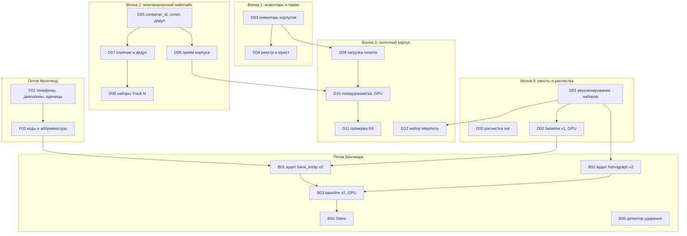

# Track N — фаза P1 «Данные» (исполняемая версия)

Документ написан так, чтобы его мог выполнить агент, **не участвовавший** в
предыдущей работе. Весь необходимый контекст продублирован здесь.

Разделы 0–4 обязательны к прочтению **до начала любой задачи**. Раздел 5 —
только своя задача.

---

## 0. Как исполнять этот план

### 0.1. Роли

- **Оркестратор** — читает раздел 4 (волны), запускает субагентов, собирает
  отчёты, обновляет статусы задач. Сам код не пишет.
- **Субагент-исполнитель** — берёт ровно **одну** задачу из раздела 5,
  выполняет её целиком, пишет отчёт по форме из раздела 6.

### 0.2. Правила мультиагентной работы

1. **Один файл — один владелец.** В каждой задаче указан список файлов, которые
   она правит. Две задачи с пересекающимися списками **нельзя** запускать
   параллельно. Матрица владения — раздел 4.3.
2. **Одна GPU-задача одновременно.** В системе одна RTX 4080 Super 16 ГБ.
   GPU-задачи сериализуются, даже если они в одной волне.
3. **Задача не выполнена без критерия приёмки.** Если критерий не достигнут —
   это провал, а не «частично сделано». Формулировку критерия не подгонять.
4. **Не выходить за границы задачи.** Нашёл соседнюю проблему — запиши в отчёт,
   **не чини**.
5. **Никаких коммитов без явного указания пользователя.**
6. **Если не уверен — остановись и спроси.** Это дешевле, чем сделать неверно и
   заставить переделывать зависимые задачи.

### 0.3. Сквозные запреты

- **Не выдумывать числа.** Любое число в отчёте или документе должно иметь путь
  к породившему его артефакту. Отсутствие результата записывается как
  отсутствие, а не заменяется правдоподобной оценкой.
- **Track A заморожен.** Не улучшать ни акустическую модель, ни длительности, ни
  variance, ни вокодер. Найденный дефект качества — в отчёт, не в починку.
  Основание: `.cursor/methodology/09_roadmap.md`, раздел про заморозку.
- **Не менять замороженные наборы молча.** Любое исправление содержимого
  `configs/eval_sets/*.json` — только через поднятие `version` и обновление
  хешей по процедуре из `.cursor/methodology/08_evaluation.md`.
- **Бюджет диска 60 ГБ** на все новые данные фазы. Перед любой загрузкой
  `df -h ~`, после — фактический размер в отчёт.
- **Ничего крупного в `/mnt/c`.** На Windows-разделе свободно ~12 ГБ. Аудио,
  чекпойнты и кэши остаются в Linux FS. В Windows едут только JSON и docs.
- **Не запускать обучение и тяжёлые прогоны из `/mnt/c/...`** — только из
  `~/projects/tts-self`.
- **Не начинать P2.** Не трогать `scripts/43_train_tokenizer.py` и
  `runs/tokenizer_t0_small/`.
- **Не предобучать N-Lite.** Замер M10 — нижняя граница, требует перемера.
- **P.808 и MOS в этой фазе не делаем вообще.** Решение пользователя: качество
  звучания настолько роботизированное, что абсолютная субъективная оценка
  неинформативна.
- **Не обучать кодек VibeVoice**, энкодинг только с `sample=False`.
- **Не удалять и не коммитить** содержимое `data/`, `runs/`, аудио, кэши,
  `*.safetensors`.

### 0.4. Обязательное чтение перед началом

Минимум для всех:

- [.cursor/methodology/README.md](../methodology/README.md) — карта и якорные числа
- [.cursor/methodology/09_roadmap.md](../methodology/09_roadmap.md) — фазы и заморозка Track A
- [.cursor/methodology/08_evaluation.md](../methodology/08_evaluation.md) — метрики, версионирование наборов, правила измерения

Дополнительно по задачам: `07_data.md` для D03–D12, `06_frontend.md` для F01–F02.

---

## 1. Контекст

### 1.1. Что это за проект

MiniSpeech-RU — исследовательский русский TTS. Текущий production (**Track A**,
заморожен как baseline):

```text
русский текст → нормализация чисел → простановка ударений
  → символьные метки CTC-алфавита (с ударениями)
  → MelBaseline (non-AR, FastSpeech-подобная, ~10M параметров)
  → log-mel 80 бинов @ 86.13 Гц → HiFi-GAN → волна 22050 Гц
```

Чекпойнт baseline: `runs/mel_stress_v01_s4/best.pt`. Корпус: RUSLAN, один
диктор, ~15.4 clean часов.

**Track N** — целевая линия: собственные непрерывные акустические токенизаторы +
предобученный текстовый бэкбон + diffusion-голова. Методология в
`.cursor/methodology/`.

### 1.2. Решения, принятые до этой фазы

Все три приняты пользователем и уже зафиксированы в методологии:

1. **Track A заморожен.** Планку натуральности для гейта N6 задаёт **внешний
   baseline Silero**, а не собственная слабая система.
2. **Критический путь фазы P3 — Qwen3.5-0.8B** как предобученный бэкбон.
   N-Lite (свой ~0.5B) — отдельный трек суверенности, не блокирует P3.
3. **Пересчёт baseline делается дважды:** сначала на наборах v1 (задача D02),
   затем на v2 после аудита (задача B03).

### 1.3. Что выяснила фаза M (нужно для понимания запретов)

- Средний CER на `val100` **насыщен**: синтез 0.031, реальная запись человека
  0.060, GT-мел через вокодер 0.064. Метрика упёрлась в шум ASR.
- Прежние DER 0.365 и EER 0.489 **невалидны**: `hyp_digits` был пуст на всех
  позициях, DER вырождался в EER, спан искался подстрокой.
- Аудит набора показал, что **46 %** отвергнутых спанов `bank_entity` v1 —
  артефакты самой разметки; истинный EER ≈ 0.264 с интервалом [0.205, 0.332].
- Акустический детектор ударения даёт точность **0.358** при пороге годности
  0.90 — измеритель SA невалиден, гейт N5 сейчас неизмерим.
- Файнтюн вокодера не дал доказанного выигрыша: домены мела при обучении
  (fmax 8000) и инференсе (fmax 11025) не совпадали, а val-мел-лосс ухудшался
  после 500 шагов. Задача закрыта как «выигрыш не измерен».
- Единственное слышимое улучшение за фазу дал **фронтенд**: транслитерация
  латиницы, `TTS` стал произноситься как `тэ-тэ-э́с`. Отсюда приоритет потока
  фронтенда в этой фазе.

---

## 2. Окружение

### 2.1. Две копии репозитория

- **Windows (авторская копия):** `C:\projects\tts-self`. Здесь пишется код.
  GPU-работы отсюда не запускаются.
- **WSL Ubuntu (GPU-рантайм):** `~/projects/tts-self` (пользователь `adam`).
  Клон того же репозитория.

Синхронизация: код правится на Windows, коммитится (с разрешения пользователя),
в WSL делается `git pull`. Если коммитить нельзя — копировать **конкретные
файлы** через `/mnt/c/projects/tts-self/...`, но не директорию целиком.

### 2.2. Стандартная преамбула для WSL

```bash
cd ~/projects/tts-self
source .venv/bin/activate
export HF_HOME=$HOME/hf_cache
```

### 2.3. Известные грабли (каждая уже стоила времени)

- **Дистрибутив WSL по умолчанию — не Ubuntu.** Всегда указывать явно:
  `wsl -d Ubuntu -- bash -lc '...'`.
- **PowerShell не понимает `&&`.** Разделять `;` или делать отдельные вызовы.
- **Кавычки и не-ASCII в командах WSL из PowerShell ломаются.** Надёжный
  способ: положить скрипт в файл и запустить файл, а не передавать код строкой.
- **CRLF ломает запуск скриптов в WSL** (`bad interpreter`). Есть
  `scripts/49_fix_crlf.py`.
- **`sudo` недоступен.** Всё системное ставится user-local.
- **На Windows нет `torchaudio`** — часть тестов там падает по импорту. Полный
  `pytest` гонять в WSL.
- **Длинные прогоны — в `tmux`** с `2>&1 | tee runs/<name>/console.log`.
- **`uv` может быть недоступен в WSL-шелле;** `python -m pip` в venv тоже может
  отсутствовать. Проверять до использования.

### 2.4. Диск (измерено 2026-07-31)

| Раздел | Всего | Свободно |
|--------|------:|---------:|
| `/` (Linux FS, `~`) | 1007 ГБ | **786 ГБ** |
| `/mnt/c` (Windows) | 1.9 ТБ | **12 ГБ** |

`~/datasets` занимает 30 ГБ. Бюджет фазы — **не более 60 ГБ новых данных**, всё
в Linux FS.

### 2.5. Внешние ресурсы на диске (WSL)

| Путь | Что |
|------|-----|
| `~/datasets/tts/ruslan/manifest.jsonl` | Манифест корпуса |
| `~/datasets/tts/ruslan/wavs/` | Аудио |
| `~/datasets/tts/ruslan/mels/` | Mel-кэш, индекс `mels_index.json` |
| `~/datasets/tts/ruslan/align/forced.json` | Forced alignment, char-уровень |
| `~/datasets/tts/ruslan/f0_energy/` | Кэш F0 и энергии, префикс `f0e` |
| `~/models/wav2vec2-large-xlsr-53-russian` | CTC-модель для выравнивания |
| `~/models/hifigan/generator.pt` | Вокодер SpeechBrain LibriTTS 22050 |
| `~/hf_cache` | HF-кэш |

---

## 3. Карта состояния кода

Это главный раздел для оценки объёма: **значительная часть инфраструктуры уже
написана в P0, но не подключена**. Не писать заново то, что есть.

### 3.1. Что уже готово и работает

Данные:

- `src/minispeech/data/manifest.py` — класс `Utterance` уже имеет поля
  `corpus`, `speaker_id`, `channel`, `sample_rate`, `license`, `source_url`,
  `qc_tag`, `split`, `extra`. Есть `apply_utterance_defaults`,
  `iter_manifest`, `write_manifest_iter`, `filter_split`, `contiguous_split`,
  `speaker_split`, `container_speaker_split`, `assert_no_speaker_leak`,
  `text_dedup_key`, `audio_fingerprint`, `detect_duplicates`,
  `deduplicate_utterances`, `iter_deduped_manifests`
- `src/minispeech/data/corpus_registry.py` — реестр корпусов, **одна запись**
  `ruslan`
- `src/minispeech/data/shards.py` — `ShardWriter` и `ShardReader` на
  safetensors, индекс `{prefix}_index.json`, ленивое чтение
- `src/minispeech/data/channel.py` — симуляция телефонного канала: полоса
  300–3400 Гц, понижение до 8 кГц, G.711 µ-law и A-law, Opus в узкой полосе
- `tests/test_manifest_multi.py` — тесты дедупа и сплитов

Оценка:

- `src/minispeech/eval/critical_spans.py` — DER по словам-числительным, EER на
  выровненном окне, допуск морфологии по префиксу, SA
- `src/minispeech/eval/stress_acoustic.py` — акустический SA (измеритель
  невалиден, 0.358)
- `src/minispeech/eval/preference.py` — парные предпочтения с ловушками и
  биномиальным CI95
- `src/minispeech/eval/test_sets.py` — загрузка наборов, агрегация с медианой,
  бутстрап-CI95 и счётчиком выбросов
- `scripts/32_eval_mel_suite.py` — единая точка входа; флаги включают
  `--acoustic-sa`, `--copy-synth-topline`, `--max-utts`, `--prefer-vocoder`

### 3.2. Что написано, но не подключено

- **Дедуп не вызывается из билдера манифеста.** `scripts/02_build_manifest.py`
  строки ~189–197 делают самодельный дедуп по `text_raw.lower()`, а библиотечные
  `deduplicate_utterances` и `audio_fingerprint` не используются нигде в
  `scripts/`.
- **`split.strategy` из конфига игнорируется.** `configs/data_ruslan_local.yaml`
  объявляет `strategy: contiguous_ranges`, но билдер всегда зовёт
  `contiguous_split` напрямую (строки ~198–204). `speaker_split` не используется
  в пайплайне вообще.
- **Реестр корпусов не используется скриптами.** Нет ни одного вызова
  `corpus_registry` или `apply_utterance_defaults` из `scripts/`.
- **Симуляция телефонии используется только в зонде**
  `scripts/41_probe_ref_tokenizer.py`; в пайплайне данных её нет.
- **DDP только в mel-тренере.** `src/minispeech/train/distributed.py` и
  `mel_trainer.py` покрыты; `trainer.py` и `vocoder_trainer.py` — нет. В этой
  фазе **не трогаем**: на одной карте не нужно.

### 3.3. Реальные пробелы, которые закрывает эта фаза

- **В наборах нет поля `version`.** Хеши лежат текстом в
  `out/n10_eval_set_hashes.txt` (только три набора), скрипта проверки нет.
- **Набор `latin` не зарегистрирован** в `configs/eval_mel_suite.yaml` — он был
  доступен только через временный `out/eval_mel_suite_n10.yaml`, которого нет в
  Windows-копии.
- **Нет первоклассного `container_id`** (книга, сессия, ролик) — только внутри
  `extra`. Без него контейнерный сплит на новых корпусах строится вслепую.
- **Нет CLI приёма произвольного корпуса и слияния манифестов.**
- **`scripts/39_external_baseline_eval.py` не является baseline:** обрезает вход
  до 20 текстов (`texts[:20]`), не считает ни одной метрики, поле `sets`
  инициализируется пустым словарём и никогда не заполняется.
- **Пробелы вербализации** (проверено по коду `verbalize.py` и `normalize.py`):
  - телефонные номера — правила нет вообще
  - диапазоны (`10–15`, `с 9 до 18`) — нет
  - единицы (`км/ч`, `м²`, `кг`) — нет
  - длинные коды (ИНН, КПП, БИК, счета) читаются количественным числительным
    вместо чтения по цифрам; правило для счёта срабатывает только в контексте
    «номер счёта N»
  - СНИЛС отсутствует в словаре аббревиатур; отсутствуют МФО, ОКВЭД и часть
    других, встречающихся в `bank_entity`
- **Техдолг** — это **65 файлов `out/_*`** (34 `.py` и 31 `.sh`, все под
  gitignore), а не `scripts/_*`: там **0 файлов**. Формулировка в
  `09_roadmap.md` про «~60 одноразовых `scripts/_*.py`» неточна и правится в
  задаче D00.
- **Четыре новых CLI не отслеживаются git:** `scripts/50_train_vocoder.py`,
  `51_preference_test.py`, `52_probe_lm_budget.py`, `53_calibrate_acoustic_sa.py`.

### 3.4. Состав наборов (измерено)

| Набор | Позиций | Структура элементов |
|-------|--------:|---------------------|
| `bank_entity` | 315 | `utt_id`, `text`, `note`, `category`, `critical_spans` со полями `start`, `end`, `type`, `expected_spoken` |
| `homograph` | 895 | `utt_id`, `text`, `note`, `stress_target` с полями `char_index`, `lexeme`, `contrast`, `type` |
| `latin` | 117 | `utt_id`, `text`, `note`, `expected_spoken` на уровне элемента; **нет** `critical_spans` |
| `demo5` | 5 | `utt_id`, `text` |
| `val100` | 100 | `utt_ids` на верхнем уровне, `kind: utt_ids` |

`bank_entity` покрывает 15 категорий по 20–22 позиции: целые, дробные, деньги,
проценты, даты, время, телефоны, счета, коды, русские аббревиатуры, латинские
аббревиатуры, заимствования, единицы, порядковые, диапазоны.

---

## 4. Волны и параллелизм

### 4.1. Схема



### 4.2. Что можно запускать одновременно

- **Старт:** D00, D01, D03, F01, B05 — независимы друг от друга по файлам
- **После D01:** D02 (GPU)
- **После D03:** D04, D09
- **Волна 2 целиком** независима от волн 0 и 1 по файлам, можно вести параллельно
- **GPU-очередь:** D02 → D10 → D11 → D12 → B03 → B04 → B05. Строго по одной

### 4.3. Матрица владения файлами

| Задача | Владеет |
|--------|---------|
| D00 | `out/_*`, `scripts/50..53` (только проверка), `.cursor/methodology/09_roadmap.md` |
| D01 | `configs/eval_sets/*.json`, `configs/eval_mel_suite.yaml`, `scripts/54_eval_sets.py`, `tests/test_eval_sets_version.py`, `docs/frozen_numbers_mel80.md` (таблица хешей) |
| D02 | `out/baseline_p1_v1_full.json`, `docs/frozen_numbers_mel80.md` (раздел baseline) |
| D03 | `out/corpus_probe_v2.json`, `docs/corpus_inventory.md` |
| D04 | `src/minispeech/data/corpus_registry.py`, `scripts/55_corpus_registry.py`, `docs/corpus_registry.md`, `docs/legal_questions_p1.md` |
| D05 | `src/minispeech/data/manifest.py`, `scripts/02_build_manifest.py`, `tests/test_manifest_multi.py` |
| D06 | `scripts/56_ingest_corpus.py`, `configs/data_<corpus>.yaml`, `tests/test_ingest_corpus.py` |
| D07 | `scripts/57_merge_manifests.py`, `tests/test_merge_manifests.py` |
| D08 | `configs/eval_sets/trackn_*.json`, `out/trackn_eval_hashes.txt` |
| D09 | `~/datasets/tts/<corpus>/`, `out/pilot_download.json` |
| D10 | манифест пилота, `out/pilot_qc.json` |
| D11 | `out/e6_recheck.json` |
| D12 | `configs/eval_sets/telephony.json`, `configs/eval_mel_suite.yaml` (после D01) |
| F01 | `src/minispeech/frontend/verbalize.py`, `tests/test_frontend_track_a.py` |
| F02 | те же, что F01, плюс `src/minispeech/frontend/normalize.py` |
| B01 | `configs/eval_sets/bank_entity.json`, `docs/bank_entity_v2_audit.md` |
| B02 | `configs/eval_sets/homograph.json`, `docs/homograph_v2_audit.md` |
| B03 | `out/baseline_p1_v2_full.json`, `docs/frozen_numbers_mel80.md` |
| B04 | `scripts/39_external_baseline_eval.py`, `out/external_baseline_silero_v2.json` |
| B05 | `src/minispeech/eval/stress_classifier.py`, `out/stress_classifier_eval.json` |

**Конфликты, которые нельзя нарушать:**

- D01, B01, B02, D08, D12 все касаются `configs/eval_sets/` — строго
  последовательно в порядке D01 → (B01, B02) → D08 → D12
- D02, B03 касаются `docs/frozen_numbers_mel80.md` — последовательно
- F01 и F02 касаются `verbalize.py` — строго F01, затем F02

---

## 5. Задачи

### D00 — Расчистка одноразовых помощников

**Волна:** 0. **GPU:** нет. **Зависимости:** нет.

**Владеет:** `out/_*.py`, `out/_*.sh`, раздел про техдолг в
`.cursor/methodology/09_roadmap.md`.

**Контекст.** В `out/` лежат 65 одноразовых помощников (34 `.py`, 31 `.sh`),
созданных в фазах P0 и M. Все под gitignore, в индексе git их нет. В
`scripts/_*` — ноль файлов, вопреки формулировке в методологии.

**Шаги.**

1. Составить список файлов `out/_*` с их назначением по первым трём строкам.
2. Проверить, есть ли среди них логика, которой нет в номерных CLI. Известный
   кандидат: `out/_m09_summarize.py` (сводка baseline и скоринг предпочтений) —
   если такой функции нет в `scripts/32_eval_mel_suite.py` или
   `scripts/51_preference_test.py`, перенести её туда подкомандой.
3. Удалить все `out/_*` после переноса.
4. Проверить, что четыре неотслеживаемых CLI работают:
   `python scripts/50_train_vocoder.py --help` и аналогично для 51, 52, 53.
   **Не коммитить.**
5. Исправить в `09_roadmap.md` формулировку долга: заменить «~60 одноразовых
   `scripts/_*.py`» на фактическое положение (65 файлов `out/_*`, `scripts/_*`
   пуст), сохранив смысл пункта.

**Приёмка.**

- `ls out/_* 2>/dev/null` не даёт ни одного файла
- все четыре команды `--help` завершаются кодом 0
- в отчёте список удалённого и список перенесённого с указанием, куда
- формулировка в `09_roadmap.md` соответствует факту

**Запрет.** Ничего не удалять из `out/`, кроме файлов с префиксом подчёркивания.
Артефакты `out/*.json`, `out/*.wav`, `out/*_listen_demo/` не трогать.

---

### D01 — Версионирование наборов и регистрация latin

**Волна:** 0. **GPU:** нет. **Зависимости:** нет.

**Владеет:** `configs/eval_sets/*.json`, `configs/eval_mel_suite.yaml`,
`scripts/54_eval_sets.py` (новый), `tests/test_eval_sets_version.py` (новый),
таблица хешей в `docs/frozen_numbers_mel80.md`.

**Контекст.** Процедура версионирования описана в
`.cursor/methodology/08_evaluation.md`, раздел «Версионирование и аудит
наборов». Сейчас у наборов нет поля `version`, хеши лежат текстом в
`out/n10_eval_set_hashes.txt` только для трёх наборов, скрипта проверки нет.

**Ключевое решение (не менять без согласования).** Хешировать **отдельно**
массив `items` и файл целиком:

- `items_sha256` — канонический JSON массива `items` (сортировка ключей,
  `ensure_ascii=False`, без отступов). Он не меняется при добавлении
  метаданных, поэтому старые числа остаются сопоставимыми.
- `file_sha256` — весь файл. Он изменится при добавлении `version`, и это
  ожидаемо и документируется.

**Шаги.**

1. Добавить в каждый из пяти наборов поле `version: "1.0.0"`. **Ни один элемент
   `items` не менять.**
2. Создать `scripts/54_eval_sets.py` с подкомандами:
   - `verify` — сверить `items_sha256` каждого набора с записанным в
     `out/eval_set_hashes.json`
   - `hash` — пересчитать и записать `out/eval_set_hashes.json`
   - `bump --set <id> --to <version>` — поднять версию, пересчитать хеши,
     потребовать явного флага `--confirm-content-changed`, если `items_sha256`
     изменился
3. Зарегистрировать `latin` в `configs/eval_mel_suite.yaml` в блоке
   `test_sets`, чтобы не зависеть от временного `out/eval_mel_suite_n10.yaml`.
4. Добавить тест: пять наборов загружаются, у каждого есть `version`, `verify`
   проходит.
5. Дополнить таблицу хешей в `docs/frozen_numbers_mel80.md` колонкой
   `items_sha256` и приписать, что `file_sha256` изменился из-за добавления
   метаданных, а содержимое — нет.

**Приёмка.**

- `python scripts/54_eval_sets.py verify` завершается кодом 0 на пяти наборах
- `git diff --stat configs/eval_sets/` показывает изменения **только** в строках
  с `version`; доказать это в отчёте выводом `git diff`
- `python scripts/32_eval_mel_suite.py --sets latin --skip-asr --max-utts 2`
  находит набор через основной suite YAML

---

### D02 — Полный пересчёт baseline на наборах v1

**Волна:** 0. **GPU:** да. **Зависимости:** D01.

**Владеет:** `out/baseline_p1_v1_full.json`, раздел baseline в
`docs/frozen_numbers_mel80.md`.

**Контекст.** Приёмка задачи M09 предыдущей фазы была выполнена только на
подвыборках `--max-utts 50`. Нужна полная точка отсчёта на неизменном
чекпойнте. Второй пересчёт (на v2) — отдельная задача B03.

**Команда (WSL, из `~/projects/tts-self`).**

```bash
python scripts/32_eval_mel_suite.py \
  --ckpt runs/mel_stress_v01_s4/best.pt \
  --sets demo5,val100,bank_entity,homograph,latin \
  --prefer-vocoder neural \
  --acoustic-sa \
  --copy-synth-topline \
  --out out/baseline_p1_v1_full.json \
  --wav-dir out/baseline_p1_v1_wavs
```

Прогон длинный (1432 позиции с ASR). Запускать в `tmux` с логом.

**Приёмка.**

- у каждого набора в JSON есть `mean_cer`, `median_cer`, `cer_ci95_low`,
  `cer_ci95_high`, `n`, `n_cer_gt_1`
- `n` равно полному размеру набора: 5, 100, 315, 895, 117
- у `bank_entity` есть `der` и `eer`, и они различаются по значению
- у `homograph` есть `sa` и `sa_mode: acoustic`
- в `docs/frozen_numbers_mel80.md` новый раздел с таблицей, где явно написано:
  SA приведена как диагностика, гейтом не является, измеритель невалиден
  (0.358 при пороге 0.90)

**Запрет.** Не менять чекпойнт, не менять `--gap-mode`, не включать
`--duration-mode pred`. Это измерение замороженной системы, а не эксперимент.

---

### D03 — Проверенный инвентарь корпусов

**Волна:** 1. **GPU:** нет (нужна сеть). **Зависимости:** нет.

**Владеет:** `out/corpus_probe_v2.json`, `docs/corpus_inventory.md`.

**Контекст.** Существующий `docs/corpus_inventory.md` собран в P0 кабинетно, по
памяти. Методология требует фактической проверки перед включением корпуса в
план (`07_data.md`, первый абзац).

**Кандидаты для проверки:** Common Voice ru, Golos, SOVA, M-AILABS ru,
OpenSTT, плюс всё, что уже перечислено в текущем инвентаре.

**Шаги.**

1. Для каждого кандидата получить **фактические** данные из источника: размер в
   байтах, строку лицензии как её сообщает хаб, признак gated, число дикторов и
   часов, если объявлено. Ничего не брать по памяти.
2. Записать в `out/corpus_probe_v2.json` со ссылкой на способ получения каждого
   числа.
3. Обновить `docs/corpus_inventory.md`: у каждой строки URL, лицензия, размер,
   gated, вердикт о допустимости обучения либо пометка «информации нет».
4. Выбрать **один** пилотный корпус по трём критериям и обосновать выбор
   числами:
   - не менее 50 часов, ожидаемых после QC
   - не менее 20 дикторов
   - объём загрузки не более 60 ГБ
5. Если ни один кандидат не проходит все три критерия — так и записать, назвать
   лучший компромисс и указать, каким критерием пришлось пожертвовать.

**Приёмка.**

- в JSON и в docs у каждого кандидата есть URL, лицензия, размер, gated
- отсутствие данных записано как отсутствие, а не заменено оценкой
- назван один рекомендованный пилот с числами по трём критериям

**Запрет.** Ничего не скачивать в этой задаче, кроме метаданных. Загрузка — D09.

---

### D04 — Реестр происхождения и вопросы юристу

**Волна:** 1. **GPU:** нет. **Зависимости:** D03.

**Владеет:** `src/minispeech/data/corpus_registry.py`,
`scripts/55_corpus_registry.py` (новый), `docs/corpus_registry.md`,
`docs/legal_questions_p1.md` (новый).

**Контекст.** В реестре одна запись `ruslan`, и ни один скрипт его не
использует. Реестр нужен и для воспроизводимости, и для 243-ФЗ
(`.cursor/methodology/02_legal.md`).

**Шаги.**

1. Внести в `CORPORA` проверенные в D03 корпуса. Обязательные поля: имя,
   источник, URL, лицензия, допустимость обучения, частота дискретизации,
   канал, число дикторов, часы, дата проверки.
2. Создать `scripts/55_corpus_registry.py` с подкомандами:
   - `list` — таблица реестра
   - `show --corpus <name>` — одна запись
   - `verify --data <config>` — сверить манифест с реестром: у всех utts поле
     `corpus` заполнено и есть в реестре, `license` совпадает с реестром
3. Сгенерировать `docs/corpus_registry.md` из реестра (не писать руками).
4. Создать `docs/legal_questions_p1.md`: пронумерованные вопросы к `ЮРИСТ`, по
   каждому — что именно он блокирует. Минимум: банковские данные и их
   обезличивание, корпуса с ShareAlike и NonCommercial, статус производных
   наборов (симулированная телефония из чужого аудио).

**Приёмка.**

- `python scripts/55_corpus_registry.py verify --data configs/data_ruslan_local.yaml`
  завершается кодом 0 на существующем манифесте RUSLAN
- в реестре не менее трёх корпусов с заполненными полями
- в `legal_questions_p1.md` каждый вопрос пронумерован и указывает блокируемое
  решение

---

### D05 — container_id, стратегия сплита и дедуп в билдере

**Волна:** 2. **GPU:** нет. **Зависимости:** нет.

**Владеет:** `src/minispeech/data/manifest.py`, `scripts/02_build_manifest.py`,
`tests/test_manifest_multi.py`.

**Контекст.** Библиотека умеет всё нужное, но билдер этим не пользуется: он
делает самодельный дедуп по `text_raw.lower()` (строки ~189–197) и всегда зовёт
`contiguous_split`, игнорируя `split.strategy` из конфига (строки ~198–204).

**Шаги.**

1. Добавить в `Utterance` первоклассное поле `container_id` (книга, сессия,
   ролик) с обратной совместимостью: если поля нет в JSONL, брать из
   `extra["container_id"]`, иначе `None`.
2. Научить `02_build_manifest.py` читать `split.strategy` и выбирать:
   - `contiguous_ranges` → `contiguous_split` (текущее поведение)
   - `speaker_holdout` → `speaker_split`
   При неизвестном значении — падать с внятной ошибкой, а не молча выбирать.
3. Заменить самодельный дедуп на `deduplicate_utterances`; в отчёт вывести,
   сколько дублей найдено каждым способом (текст, аудиоотпечаток).
4. Дополнить тесты: двухдикторный синтетический манифест, `speaker_holdout` не
   пропускает диктора в оба сплита, `assert_no_speaker_leak` проходит.

**Приёмка.**

- RUSLAN пересобирается, и число utts и распределение по сплитам **совпадает с
  текущим манифестом до единицы**; расхождение считается регрессией и должно
  быть объяснено
- на синтетическом двухдикторном примере speaker-holdout не даёт утечки
- `pytest -q tests/test_manifest_multi.py` зелёный

**Запрет.** Не переписывать существующий манифест RUSLAN поверх, пока
расхождение не объяснено. Собирать в новый файл и сравнивать.

---

### D06 — CLI приёма произвольного корпуса

**Волна:** 2. **GPU:** нет. **Зависимости:** D05.

**Владеет:** `scripts/56_ingest_corpus.py` (новый), шаблон
`configs/data_<corpus>.yaml`, `tests/test_ingest_corpus.py` (новый).

**Шаги.**

1. Вход: каталог корпуса, имя корпуса из реестра, схема раскладки (шаблон пути
   до wav и до транскрипта, если он есть).
2. Выход: манифест JSONL с заполненными `corpus`, `speaker_id`, `channel`,
   `sample_rate`, `license`, `source_url`, `container_id`, `dur_s`.
3. Запись **потоковая** через `write_manifest_iter`; корпус не держать в памяти
   целиком.
4. Поля корпуса брать из реестра (`apply_utterance_defaults`), а не хардкодить.

**Приёмка.**

- на синтетическом каталоге из 10 файлов и трёх «дикторов» строится валидный
  манифест, проходящий `scripts/55_corpus_registry.py verify`
- пиковая память процесса не растёт с числом файлов (проверить на 10 и на 1000
  синтетических записях)

---

### D07 — Слияние манифестов и межкорпусный дедуп

**Волна:** 2. **GPU:** нет. **Зависимости:** D05.

**Владеет:** `scripts/57_merge_manifests.py` (новый),
`tests/test_merge_manifests.py` (новый).

**Шаги.**

1. Слить N манифестов в один, сохранив происхождение каждой utt.
2. Применить `detect_duplicates` по тексту и по аудиоотпечатку.
3. Записать `out/merge_dedup_report.json`: сколько дублей, между какими
   корпусами, по какому признаку совпало.
4. Политика разрешения конфликтов: при дубле оставлять запись из корпуса с более
   высоким приоритетом (приоритет задаётся аргументом), остальные помечать
   `qc_tag: duplicate`, а не удалять.

**Приёмка.**

- подсаженный в два корпуса одинаковый файл найден и помечен
- отчёт содержит пары и причину совпадения
- итоговый манифест не содержит двух записей с одинаковым `audio_fingerprint`

---

### D08 — Замороженные тестовые наборы Track N

**Волна:** 2. **GPU:** нет. **Зависимости:** D07, D01.

**Владеет:** `configs/eval_sets/trackn_*.json` (новые),
`out/trackn_eval_hashes.txt`.

**Шаги.**

1. Из объединённого манифеста выделить held-out **по дикторам**, а не по
   уттерансам.
2. Оформить как наборы в существующем формате (`kind: utt_ids`), с полем
   `version: "1.0.0"`.
3. Зафиксировать хеши через `scripts/54_eval_sets.py hash`.

**Приёмка.**

- пересечение множеств дикторов train и test пусто, проверено
  `assert_no_speaker_leak`
- наборы имеют `version` и попадают в `out/eval_set_hashes.json`
- в отчёте указано число дикторов и часов в каждом наборе

---

### D09 — Загрузка пилотного корпуса

**Волна:** 3. **GPU:** нет (нужна сеть). **Зависимости:** D03.

**Владеет:** `~/datasets/tts/<corpus>/`, запись в реестре,
`out/pilot_download.json`.

**Шаги.**

1. `df -h ~` до начала, число в отчёт.
2. Скачать корпус, выбранный в D03, **только в Linux FS**. Если корпус больше
   бюджета — скачивать ограниченное подмножество и явно записать правило
   отбора.
3. Записать `out/pilot_download.json`: URL, объём в байтах, sha256 архивов,
   дата, команда загрузки.
4. `df -h ~` после, число в отчёт.

**Приёмка.**

- фактический объём загрузки не более 60 ГБ
- свободного места после загрузки не менее 100 ГБ
- в JSON есть sha256 каждого скачанного архива
- ничего не записано в `/mnt/c`

**Запрет.** Не запускать загрузку, если в D03 корпус помечен как gated без
подтверждённого доступа или с лицензией, запрещающей обучение.

---

### D10 — Псевдоразметка пилота

**Волна:** 3. **GPU:** да. **Зависимости:** D06, D09.

**Владеет:** манифест пилота, `out/pilot_qc.json`.

**Контекст.** Инструменты готовы: `scripts/03_verify_text_asr.py` (ASR + DSP
QC, resume-safe) и `scripts/03b_apply_qc.py`. Пороги QC из
`docs/experiment_protocol.md`: `clean` при CER ≤ 0.15, `review` в диапазоне
0.15–0.25, `exclude` выше 0.25.

**Шаги.**

1. `scripts/56_ingest_corpus.py` → манифест пилота.
2. `scripts/03_verify_text_asr.py` → `corpus_qc.jsonl`.
3. `scripts/03b_apply_qc.py` → проставить `qc_tag`.
4. Свести в `out/pilot_qc.json`: часы и число utts по каждому `qc_tag`, число
   дикторов, распределение длительностей.

**Приёмка.**

- распределение `qc_tag` приведено и по часам, и по числу utts
- число clean-часов названо числом
- если clean-часов меньше 50 — записать сколько получилось и назвать причину
  (шум, лицензия, отбраковка ASR), не подгонять пороги

**Запрет.** Не менять пороги QC ради красивого числа. Пороги зафиксированы в
протоколе.

---

### D11 — Проверка наблюдения E6

**Волна:** 3. **GPU:** да. **Зависимости:** D10.

**Владеет:** `out/e6_recheck.json`, раздел в `docs/corpus_inventory.md`.

**Контекст.** В Part 1 (эксперимент E6) пересчёт по вербализованным ссылкам не
вернул ни одного часа из `exclude`. Методология
(`.cursor/methodology/07_data.md`) отмечает: полноценное переразмечивание
CTC-моделью может вернуть часы, потерянные из-за вставок Whisper, и на тысячах
часов разница существенна. Проверить на пилоте.

**Шаги.**

1. Взять подмножество `exclude` из D10 (не менее 200 utts или всё, если меньше).
2. Переразметить CTC-моделью `~/models/wav2vec2-large-xlsr-53-russian`.
3. Пересчитать CER относительно исходного текста и применить те же пороги.
4. Записать, сколько utts и часов перешло из `exclude` в `review` или `clean`.

**Приёмка.**

- названо число возвращённых часов и доля от исходного `exclude`
- ноль записывается как ноль, без оговорок и оценок
- в docs добавлен вывод: стоит ли применять переразметку на всём корпусе

---

### D12 — Набор telephony

**Волна:** 3. **GPU:** да (для измерения CER). **Зависимости:** D01.

**Владеет:** `configs/eval_sets/telephony.json` (новый),
`configs/eval_mel_suite.yaml`.

**Контекст.** Симуляция канала готова: `src/minispeech/data/channel.py`
(полоса 300–3400 Гц, 8 кГц, G.711 µ-law и A-law, Opus в узкой полосе). Целевой
домен N-Lite — телефония, и набор нужен для будущих гейтов.

**Шаги.**

1. Составить набор фраз целевого домена (IVR-подобные реплики, суммы, коды).
   Источник — категории из `.cursor/methodology/06_frontend.md`.
2. Прогнать синтез Track A и применить `channel.py` в двух режимах: G.711 и
   Opus в узкой полосе.
3. Зарегистрировать набор в suite YAML, зафиксировать хеши через
   `scripts/54_eval_sets.py hash`.
4. Измерить справочный CER Track A в обоих режимах канала и в широкой полосе.

**Приёмка.**

- набор зарегистрирован, имеет `version` и попадает в хеш-файл
- измерен CER в трёх условиях: широкая полоса, G.711, Opus узкая полоса
- дельта CER от канала названа числом

---

### F01 — Вербализация телефонов, диапазонов и единиц

**Поток:** фронтенд. **GPU:** нет. **Зависимости:** нет.

**Владеет:** `src/minispeech/frontend/verbalize.py`,
`tests/test_frontend_track_a.py`.

**Контекст.** Проверено по коду: этих трёх категорий в вербализаторе **нет
вообще**. `bank_entity` содержит по 20–22 позиции на каждую, то есть метрика их
уже измеряет, а фронтенд не обрабатывает.

**Шаги.**

1. Телефоны: `+7 900 123-45-67` и варианты записи. Правило: «плюс семь»,
   далее группами.
2. Диапазоны: `10–15`, `с 9 до 18`, включая корректный предлог.
3. Единицы: `кг`, `км/ч`, `м²`, с согласованием с числом («два килограмма»,
   «пять километров в час»).
4. Порядок обработки не менять: TN, затем вербализация, затем ударение.

**Приёмка.**

- по каждой из трёх категорий не менее пяти тестов, включая согласование с
  числом
- `pytest -q tests/test_frontend_track_a.py tests/test_translit.py` зелёный
- существующие тесты не изменены под новый результат

---

### F02 — Коды, счета и аббревиатуры

**Поток:** фронтенд. **GPU:** нет. **Зависимости:** F01.

**Владеет:** те же файлы, что F01, плюс
`src/minispeech/frontend/normalize.py`.

**Контекст.** Сейчас длинные коды читаются количественным числительным
(десятизначный ИНН как одно число), а правило для счёта срабатывает только в
контексте «номер счёта N». СНИЛС отсутствует в словаре аббревиатур, как и МФО,
ОКВЭД и часть других из `bank_entity`.

**Шаги.**

1. Читать по цифрам: ИНН, КПП, БИК, СНИЛС, ОГРН, номера счетов и карт — вне
   зависимости от контекста, по длине и формату.
2. Добавить недостающие русские аббревиатуры, встречающиеся в наборе.
3. Собрать матрицу тестов: по одному представителю каждой из 15 категорий
   `bank_entity`, с ожидаемым устным видом в тесте.

**Приёмка.**

- матрица из 15 тестов зелёная
- в отчёте указано, какие категории до задачи давали неверный устный вид, с
  примерами до и после

**Важно для B01.** Именно исправленный здесь вербализатор становится эталоном
для аудита набора. Пока F02 не закрыта, B01 начинать нельзя.

---

### B01 — Аудит bank_entity и выпуск версии 2.0.0

**Поток:** бенчмарк. **GPU:** нет. **Зависимости:** F02, D02.

**Владеет:** `configs/eval_sets/bank_entity.json`,
`docs/bank_entity_v2_audit.md`.

**Контекст.** Аудит M01 показал: **46 %** отвергнутых спанов — артефакты
разметки, истинный EER ≈ 0.264 [0.205, 0.332] против отчётных 0.489. Причина —
`expected_spoken` местами не соответствует тому, что должен произнести
корректный вербализатор.

**Шаги.**

1. Для каждого из 315 элементов и каждого спана сравнить `expected_spoken` с
   выходом исправленного вербализатора на исходном фрагменте текста.
2. Расхождения классифицировать: ошибка разметки, законный вариант
   произношения, ошибка вербализатора.
3. Исправить **только** доказанные ошибки разметки. Ошибки вербализатора
   выписать в отчёт и передать в поток фронтенда, не чинить здесь.
4. Поднять версию до `2.0.0` через `scripts/54_eval_sets.py bump`, обновить
   хеши.
5. Записать `docs/bank_entity_v2_audit.md`: сколько позиций проверено, сколько
   исправлено, разбивка по категориям.

**Приёмка.**

- доля исправленных позиций названа числом
- `version` равна `2.0.0`, хеши обновлены, `verify` проходит
- в документе явно сказано, какие числа v1 стали несравнимы и почему
- ни одна позиция не исправлена «на глаз» без указания причины

---

### B02 — Аудит homograph и выпуск версии 2.0.0

**Поток:** бенчмарк. **GPU:** нет. **Зависимости:** D01.

**Владеет:** `configs/eval_sets/homograph.json`,
`docs/homograph_v2_audit.md`.

**Контекст.** Структура `stress_target`: `char_index`, `lexeme`, `contrast`,
`type`. Ни одна из этих величин не проверялась после генерации набора.

**Шаги.**

1. Проверить программно: `char_index` указывает на позицию гласной внутри
   `lexeme` в поле `text`; `lexeme` действительно встречается в тексте.
2. Проверить выборочно не менее 100 позиций: `lexeme` и `contrast` образуют
   существующую пару омографов, а контекст действительно разрешает ударение.
3. Исправить доказанные ошибки, поднять версию, обновить хеши.

**Приёмка.**

- доля позиций с битым `char_index` названа числом
- проверено не менее 100 позиций вручную, результат в документе
- `version` поднята, хеши обновлены, `verify` проходит

---

### B03 — Второй пересчёт baseline на наборах v2

**Поток:** бенчмарк. **GPU:** да. **Зависимости:** B01, B02.

**Владеет:** `out/baseline_p1_v2_full.json`,
`docs/frozen_numbers_mel80.md`.

**Шаги.** Тот же прогон, что D02, но на наборах версии 2.0.0 и с записью в
другой файл. Чекпойнт неизменный: `runs/mel_stress_v01_s4/best.pt`.

**Приёмка.**

- в `docs/frozen_numbers_mel80.md` две таблицы рядом: v1 и v2
- явно сказано, что межверсионное сравнение недопустимо
- дельта DER и EER между версиями объяснена через аудит: сколько пунктов дала
  правка разметки, а не изменение системы

---

### B04 — Silero как настоящий внешний baseline

**Поток:** бенчмарк. **GPU:** да. **Зависимости:** B03.

**Владеет:** `scripts/39_external_baseline_eval.py`,
`out/external_baseline_silero_v2.json`.

**Контекст.** Текущий скрипт не является baseline: обрезает вход до 20 текстов
(`texts[:20]`), не считает ни одной метрики, поле `sets` создаётся пустым и
никогда не заполняется. Внешний baseline обязателен в каждой сравнительной
таблице (`.cursor/methodology/12_publications.md`).

**Шаги.**

1. Снять ограничение в 20 текстов; идти по наборам и по уттерансам, писать wav.
2. Прогнать через тот же ASR (`configs/asr.yaml`) и ту же нормализацию
   (`normalize_verbalized_for_asr`), что и `32_eval_mel_suite.py`.
3. Подключить `compute_set_critical_metrics` для DER, EER и SA.
4. Заполнять поле `sets` теми же ключами, что в baseline: `mean_cer`,
   `median_cer`, CI95, `n`, `n_cer_gt_1`, `der`, `eer`, `sa`.
5. Внести лицензию Silero в реестр происхождения (D04).

**Приёмка.**

- структура JSON совпадает с `out/baseline_p1_v2_full.json` по набору ключей
- получена таблица Track A против Silero по CER, медиане, CI95, DER, EER на
  наборах v2
- лицензия Silero записана в реестр
- если Silero недоступен офлайн — задача закрывается как блокированная с
  указанием причины, без подстановки чисел

---

### B05 — Супервизный детектор ударения (стретч)

**Поток:** бенчмарк. **GPU:** да. **Зависимости:** нет.

**Владеет:** `src/minispeech/eval/stress_classifier.py` (новый),
`out/stress_classifier_eval.json`.

**Контекст.** Гейт N5 требует SA не ниже 0.95, но измеритель SA невалиден:
эвристика на длительности, энергии и F0 даёт **0.358** на 779 словах при пороге
годности 0.90 (`out/m05_acoustic_sa_calibration.json`). Методология
(`08_evaluation.md`, раздел «Валидность измерителя как предусловие гейта»)
запрещает использовать метрику в гейте до валидации измерителя.

**Шаги.**

1. Данные: реальная речь RUSLAN, выровненная CTC, ударение известно из
   `accentuate`. Признаки: длительность, энергия, F0 и их контуры на спанах
   гласных, плюс позиция в слове и число слогов.
2. Модель: небольшой классификатор (логистическая регрессия или градиентный
   бустинг на признаках, либо маленькая нейросеть) — предсказывает, какая
   гласная слова ударная.
3. Оценка: held-out **по дикторам**, если дикторов больше одного; иначе — по
   контейнерам. Точность с доверительным интервалом.

**Приёмка.**

- точность на held-out названа числом с интервалом
- если точность ниже 0.90 — задача закрывается записью «измеритель SA
  по-прежнему невалиден, гейт N5 остаётся неизмеримым». Это **допустимый**
  результат
- порог 0.90 не подгонять, выборку под результат не менять

---

## 6. Формат отчёта субагента

Каждый субагент по завершении задачи выдаёт отчёт строго по этой форме.

1. **Идентификатор задачи** и одна строка о том, что сделано.
2. **Критерий приёмки** — процитировать дословно и написать, достигнут или нет,
   **с числами**. Не «выполнено», а «clean-часов 43.7 из целевых 50, недобор
   объяснён отбраковкой ASR».
3. **Изменённые и созданные файлы** — полный список путей.
4. **Артефакты** — пути к созданным `out/*.json`, документам, манифестам.
5. **Команды для воспроизведения** — что именно запускалось.
6. **Найдено попутно** — проблемы за границами задачи, которые агент **не
   чинил**.
7. **Блокеры** — что помешало, если критерий не достигнут.

Запрещено: подгонять формулировку критерия под полученный результат, заменять
отсутствующее измерение оценкой, объявлять задачу выполненной частично.

---

## 7. Гейт выхода P1

Проверяется оркестратором после закрытия всех задач.

- Пилотный корпус скачан в пределах 60 ГБ, размечен, дедуплицирован, разбит по
  дикторам без утечки; число clean-часов названо числом
- Реестр происхождения заполнен: у каждого корпуса URL, лицензия и вердикт о
  допустимости обучения; `55_corpus_registry.py verify` проходит
- Наборы версии 2.0.0 выпущены с аудитом; оба пересчёта baseline (v1 и v2)
  выполнены и записаны в `docs/frozen_numbers_mel80.md`
- Silero измерен на тех же наборах теми же метриками, таблица сравнения есть
- Фронтенд закрывает все 15 категорий `bank_entity` тестами
- Техдолг `out/_*` снят
- Многокорпусный пайплайн проверен **на двух разных корпусах**, а не на одном

**Что гейт не требует:** валидного измерителя SA (B05 — стретч), MOS, P.808,
улучшения качества Track A.

---

## 8. Что дальше (за границами этого плана)

После гейта P1 идёт фаза P2 «Токенизаторы» из
`.cursor/methodology/09_roadmap.md`: σ-VAE с каузальными свёртками,
дискриминаторы по DAC, ступени T0–T3, кривая частоты кадров (гипотеза Н3),
узкополосный вариант (Н4). Гейты N0 и N1.

Предусловия старта P2, которые закрывает эта фаза: объёмы T1 доступны и
размечены, тестовые наборы заморожены по дикторам, метрики валидны, внешний
baseline подключён.

Отдельно и **не** в этой фазе: перемер пропускной способности для N-Lite
(замер M10 — нижняя граница при загрузке карты меньше трети).
