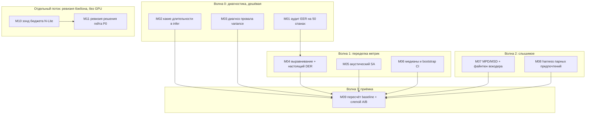

# Фаза M — валидное измерение и слышимое качество

Продолжение после гейта P0. Направление: сначала починить измерительный аппарат
(выбор пользователя), но так, чтобы за две недели появилось слышимое изменение с
доказательством, а не «по ощущениям».

## Три факта, на которых стоит план

1. **Основная метрика насыщена.** val100: синтез CER 0.031, реальная запись
  человека 0.060, GT mel через нейровокодер 0.064
   (`out/baseline_track_a_critical.json`). Синтез «лучше» человека — значит CER на
   val100 упёрся в ASR, а не в качество. Он не увидит ни артефактов вокодера, ни
   просодии — ровно того, что слышно.
2. **DER и SA сейчас не работают.** В `out/baseline_track_a_critical.json` нет ни
  одного непустого `hyp_digits`, поэтому DER всегда падает в ветку
   `n_digit_errors = len(unmatched_digits)` в
   [src/minispeech/eval/critical_spans.py](src/minispeech/eval/critical_spans.py) —
   это EER, взвешенный цифрами, а не цифровая метрика. SA даёт `skipped` на всех
   895 позициях, потому что `_strip_stress("за́мок") == _strip_stress("замо́к")`;
   текстовый ASR не различит омографы никогда.
3. **Просодические головы уже есть и уже провалились.** `pitch_head` /
  `energy_head` / `dur_head` реализованы в
   [src/minispeech/models/mel_baseline.py](src/minispeech/models/mel_baseline.py),
   конфиг [configs/mel_variance_v01.yaml](configs/mel_variance_v01.yaml)
   существует, кэш строит [scripts/36_cache_f0_energy.py](scripts/36_cache_f0_energy.py) —
   и variance-прогон дал val100 CER 0.430. Переобучать слепо запрещено; сначала
   диагноз.

## Инварианты фазы

- **Наборы заморожены хешами** (`out/n10_eval_set_hashes.txt`,
`docs/frozen_numbers_mel80.md`). Правка `configs/eval_sets/*.json` допустима
только версионированно: новый `version`, новые хеши, обязательный пересчёт
baseline. Менять набор молча запрещено.
- **Не переобучать variance** до завершения M03.
- **Не выдумывать числа**; отсутствие результата пишется как отсутствие.
- Одна RTX 4080 Super — GPU-задачи сериализуются.
- Коммиты только по явному указанию пользователя.
- Формат отчёта субагента — раздел 6 из
[.cursor/plans/track_n_phase0_execution.plan.md](.cursor/plans/track_n_phase0_execution.plan.md).

## Волны

## Волна 0 — диагностика (день 1–2)

### M01 — Аудит EER на 50 спанах

- Владеет: `out/m01_eer_audit.json`, `docs/m01_eer_audit.md`. Код не правит.
- Из `out/baseline_track_a_critical.json` взять все `critical_utterances` с
`matched: false`, случайная выборка 50 (seed фиксирован).
- Для каждого: `text`, `expected_spoken`, `hyp_raw`, `ref_norm` — вручную
классифицировать в одну из трёх категорий: реальная ошибка синтеза; артефакт
падежа/согласования; артефакт метрики (нормализация, границы спана).
- Приёмка: 50 позиций классифицированы; посчитана доля каждой категории;
выведена оценка «истинного» EER с интервалом. Список битых `expected_spoken`
вынесен отдельно, **но файлы наборов не правятся**.

### M02 — Какие длительности реально в production-синтезе

- Владеет: `out/m02_duration_probe.json`, wav в `out/m02_dur_demo/`.
- Прочитать `pack_infer_phones_and_durs` в
[src/minispeech/data/frame_projection.py](src/minispeech/data/frame_projection.py)
и путь `--dur-mode` в [scripts/28_infer_mel.py](scripts/28_infer_mel.py);
установить, что использует production-команда: табличные `mean_stats` или
предсказания `dur_head`.
- Синтезировать demo5 обоими режимами с одного чекпойнта
`runs/mel_stress_v01_s4/best.pt`, посчитать CER и длительности, сохранить оба
набора wav для слепого сравнения в M08.
- Приёмка: однозначный ответ, какой режим в production; два набора wav и числа
CER/длительностей для обоих. Если `dur_head` не используется — это заявка на
бесплатный слышимый выигрыш, зафиксировать как рекомендацию.

### M03 — Диагноз провала variance (CER 0.430)

- Владеет: `out/m03_variance_diagnosis.json`, `docs/m03_variance_diagnosis.md`.
Обучение **не запускать**.
- Проверить по порядку: полнота кэша `~/datasets/tts/ruslan/f0_energy/`
относительно train-сплита; поведение `collate_mel` при частичном кэше (targets
подставляются только если они есть у всех элементов батча); подаётся ли на
инференсе предсказанный pitch/energy при том, что в обучении лосс был активен
лишь на части батчей; нормализация pitch (сырые Гц против z-score).
- Приёмка: назван конкретный механизм расхождения train/infer с указанием строк
кода и числами (доля батчей без targets, доля utts без кэша). Если механизм не
найден — так и записать, без гипотез вместо факта.

## Волна 1 — переделка метрик (день 3–6, без GPU)

### M04 — Выравнивание вместо подстроки и настоящий DER

- Владеет: [src/minispeech/eval/critical_spans.py](src/minispeech/eval/critical_spans.py),
`tests/test_critical_spans.py`.
- Заменить `span_matches` на выравнивание слов эталона и гипотезы (Levenshtein по
словам, уже есть `edits_from_jiwer_words` в
[src/minispeech/eval/bootstrap.py](src/minispeech/eval/bootstrap.py)); спан
проверять на выровненном окне, а не поиском подстроки.
- Допуск морфологии по результатам M01: сравнение по усечённой основе слова
(общий префикс не меньше N символов) вместо точного совпадения; правило
описать в докстринге, порог обосновать данными аудита, не подгонкой.
- DER считать по **словам-числительным**: вербализовать цифры спана через
`verbalize_text` и сопоставлять последовательности числительных эталона и
гипотезы позиционно. Арабские цифры в гипотезе оставить как дополнительный
путь, а не основной; Whisper их почти не выдаёт, и `AsrConfig` не имеет
`initial_prompt`, поэтому полагаться на них нельзя.
- Приёмка: синтетический тест с одной неверной цифрой из десяти даёт DER ровно
0.1 **на словесной гипотезе** (а не только на цифровой); DER и EER на
`bank_entity` больше не совпадают по смыслу и оба отличаются от старых чисел;
прежние тесты проходят.

### M05 — Акустический SA

- Владеет: `src/minispeech/eval/stress_acoustic.py` (новый),
`tests/test_stress_acoustic.py` (новый), точка подключения в
[scripts/32_eval_mel_suite.py](scripts/32_eval_mel_suite.py).
- Собрать one-shot обёртку «wav + текст → выравнивание» из существующих
кирпичей: `transcript_for_ctc`, `text_to_ctc_char_labels(keep_stress=True)`,
`compute_ctc_emissions`, `try_ctc_align_emissions` из
[src/minispeech/data/forced_align.py](src/minispeech/data/forced_align.py).
Сейчас публичного API для произвольного wav нет, только корпусные скрипты.
- Из выравнивания вырезать спаны гласных целевого слова; для каждой посчитать
длительность, энергию (норма mel-кадра, как в
[scripts/36_cache_f0_energy.py](scripts/36_cache_f0_energy.py)) и F0
(`librosa.pyin`; новых зависимостей не добавлять).
- Решающее правило: ударной считается гласная с максимальным составным баллом
(длительность, энергия, F0 — веса калибруются на **реальных записях RUSLAN**,
где ударение известно из `accentuate`, а не на синтезе). Метка `correct`,
`incorrect` или `skipped`, если выравнивание слова не удалось.
- Приёмка: на held-out подмножестве реальных записей RUSLAN (минимум 100 слов с
известным ударением) детектор даёт accuracy не ниже 0.90 — иначе он не годен
как метрика и это надо признать; на `homograph` число `skipped` строго меньше
895; SA возвращает число, а не `skipped` целиком.

### M06 — Медианы, устойчивость, доверительные интервалы

- Владеет: [scripts/32_eval_mel_suite.py](scripts/32_eval_mel_suite.py),
`src/minispeech/eval/test_sets.py` (агрегация).
- Подключить `paired_bootstrap_delta` из
[src/minispeech/eval/bootstrap.py](src/minispeech/eval/bootstrap.py) — сейчас в
suite он не импортируется; выводить mean, median и CI95 в JSON и в консоль.
- Пометить выбросы: `latin_090` имеет CER около 11.8 и один правит средним по
набору; добавить поле с числом позиций, где CER больше 1.0.
- Приёмка: JSON содержит median и CI95 для каждого набора; печать показывает
median; на `latin` видно, что median и mean расходятся, и число выбросов
зафиксировано.

## Волна 2 — слышимое (день 5–12, GPU)

### M07 — Файнтюн HiFi-GAN на RUSLAN

- Владеет: `src/minispeech/models/hifigan_disc.py` (новый),
`src/minispeech/train/vocoder_trainer.py` (новый),
`scripts/50_train_vocoder.py` (новый), `configs/vocoder_ft_v01.yaml` (новый).
- Опираться на уже написанный план
[docs/t11_vocoder_ft_deferred.md](docs/t11_vocoder_ft_deferred.md) и на
существующий генератор `HifiGanGenerator` в
[src/minispeech/infer/hifigan.py](src/minispeech/infer/hifigan.py). Дискриминаторов
в репозитории нет — реализовать MPD и MSD.
- Инициализация из `~/models/hifigan/generator.pt` (SpeechBrain LibriTTS,
английский, многодикторный), файнтюн на парах mel↔wav из RUSLAN с целевой
геометрией `mel80_hifigan`. Лоссы: mel-реконструкция, adversarial hinge,
feature matching.
- Данные строить из уже закэшированных mel и wav корпуса; train/val разделять по
книжным диапазонам, как принято в проекте.
- Приёмка: copy-synth CER на val100 не хуже текущего 0.064 в пределах CI **и**
слепое парное предпочтение в M09 значимо в пользу нового вокодера. Одного
улучшения лосса недостаточно — это не критерий.

### M08 — Harness парных предпочтений

- Владеет: `src/minispeech/eval/preference.py` (новый),
`scripts/51_preference_test.py` (новый), `tests/test_preference.py` (новый).
- В репозитории нет ничего для парных сравнений — есть только протокол
[docs/p808_pilot_protocol.md](docs/p808_pilot_protocol.md). Реализовать:
сборку пар A/B из двух наборов wav, рандомизацию порядка и меток, сохранение
ключа отдельно от бюллетеня, простой CLI или HTML для прослушивания, скоринг с
биномиальным CI95.
- Обязательные ловушки качества: несколько пар-дубликатов (одинаковые файлы) для
оценки шума ответов.
- Приёмка: тесты на рандомизацию и скоринг проходят; на паре «файл против самого
себя» предпочтение не отличается от 50% статистически; бюллетень не раскрывает,
какая система A.

## Волна 3 — приёмка (день 12–14)

### M09 — Пересчёт baseline и слепой A/B

- Владеет: `out/baseline_m_critical.json`,
[docs/frozen_numbers_mel80.md](docs/frozen_numbers_mel80.md) (новый раздел).
- Пересчитать все наборы новыми метриками (M04, M05, M06) на неизменном
чекпойнте `runs/mel_stress_v01_s4/best.pt` — это новая точка отсчёта, старые
DER 0.365 и EER 0.489 объявить невалидными с объяснением почему.
- Прогнать слепой A/B на 25–30 парах для двух сравнений: старый против нового
вокодера (M07) и табличные против предсказанных длительностей (M02, если M02
показал, что `dur_head` не используется).
- Приёмка: JSON содержит CER, DER, EER, акустический SA с median и CI95 для всех
наборов; результат A/B записан с CI; явно сказано, какие числа несравнимы с
P0 и почему.

## Отдельный поток — ревизия решения по бэкбону (без GPU, параллельно всему)

Причина. Решение гейта P0 «критический путь — свой ~0.5B с нуля» записано в
[.cursor/methodology/05_backbone.md](.cursor/methodology/05_backbone.md) как
следствие зондов З1 и З4, но зонды измерили только фертильность токенизаторов и
VRAM/латентность. Качество текстового приора не измерял никто, а фактический
запрет Qwen как продуктового бэкбона принят раньше и по другим основаниям — в
[.cursor/methodology/02_legal.md](.cursor/methodology/02_legal.md) (строки 81–83,
правовой статус) и [.cursor/methodology/01_strategy.md](.cursor/methodology/01_strategy.md)
(строка 101, слабая новизна замены LLM). Дополнительно решение конфликтует с
собственным основанием Track N: в
[01_strategy.md](.cursor/methodology/01_strategy.md) строки 58–72 зафиксировано,
что VibeVoice не обучает LLM с нуля, а берёт предобученный Qwen2.5, и что
обучение последовательностной модели с нуля на доступных данных уже дало
Gate 0 FAIL.

### M10 — Зонд бюджета N-Lite

- Волна: параллельно. GPU: только для замера пропускной способности. Параллельно с M01–M09.
- Владеет: `out/probe_lm_budget.json`, `docs/text_corpus_inventory.md` (новые).
- Зависимости: нет. Закрывает неотмеченный чеклист-пункт в
[05_backbone.md](.cursor/methodology/05_backbone.md) строка 125.
- Шаги:
  - Измерить фактическую пропускную способность обучения модели класса 0.5B на
  RTX 4080 Super: токенов в секунду при bf16, реалистичная длина контекста,
  градиентное накопление. Не оценка, а замер на коротком прогоне.
  - По замеру экстраполировать календарное время предобучения для нескольких
  бюджетов токенов, и отдельно — для целевого железа. Явно указать, что это
  экстраполяция замера, а не литературная оценка.
  - Инвентаризировать доступный русский **текстовый** корпус по образцу N03
  (источник, объём в токенах, лицензия, допустимость обучения, способ
  получения). N03 покрыла только аудио.
- Приёмка: есть измеренный tokens/s и вытекающие календарные оценки минимум для
трёх бюджетов токенов; для каждого текстового источника указан URL и лицензия
либо пометка, что информации нет. Ни одно число не взято по памяти.

### M11 — Ревизия решения гейта P0 по бэкбону

- Волна: параллельно. GPU: не нужен. Зависимости: M10.
- Владеет: `.cursor/methodology/05_backbone.md` (раздел решений),
`.cursor/methodology/11_probes.md` (таблица результатов),
`.cursor/results/track_n_p0_conclusion.md` (раздел решений).
- Шаги:
  - Переписать решение 1 гейта P0: критический путь фазы P3 — **Qwen3.5-0.8B**
  как предобученный бэкбон, единственный кандидат, укладывающийся в realtime на
  16 ГБ (1.45 ГБ, ~105 мс по `out/probe_backbone_profile.json`).
  - Зафиксировать честную причину прежней формулировки: запрет Qwen как
  продуктового бэкбона правовой и публикационный, а не измерительный. Прежнее
  обоснование через З1/З4 переклассифицировать: разрыв фертильности 3.41 против
  3.32 токенов на слово (2.7%) не является аргументом против Qwen.
  - N-Lite (свой ~0.5B) остаётся целью суверенности и выносится в отдельный трек
  с предусловиями из M10: измеренный бюджет предобучения и наличие текстового
  корпуса. N-Lite **не блокирует** P3.
  - Сохранить абляцию «Qwen против своего 0.5B против GigaChat» из
  [12_publications.md](.cursor/methodology/12_publications.md) строка 85 и
  отметить, что она достижима только при реализованном Qwen-пути.
  - Отметить, что замена бэкбона дешёвая: латенты и текст конкатенируются в одну
  последовательность без cross-attention мостов
  ([05_backbone.md](.cursor/methodology/05_backbone.md) строки 18–21).
  - Правовой контур не менять: статус «национальная модель» прямо допускает
  открытый зарубежный компонент ([02_legal.md](.cursor/methodology/02_legal.md)
  строки 59–61); вопросы `ЮРИСТ` остаются открытыми как были.
- Приёмка: решение 1 переписано в обоих файлах методологии и в заключении P0; для
каждого утверждения указан артефакт или документ-источник; предусловия старта
N-Lite перечислены со ссылкой на числа M10; ни одно решение не обосновано
отсутствующим измерением.

## Что осознанно не делаем в этой фазе

- Не переобучаем variance (pitch/energy) — до вывода M03.
- Не трогаем Track N в коде: ни T1 токенизатора, ни второй стадии. M10 и M11 —
только измерение и методология, без реализации бэкбона.
- Не начинаем предобучение своего 0.5B: до M10 его стоимость не измерена.
- Не правим замороженные наборы; список битых позиций из M01 идёт в отдельную
версионированную задачу следующей фазы.
- Не полагаемся на UTMOS: он невалиден для русского (в Gate V4 разница 0.005 при
n=100).

