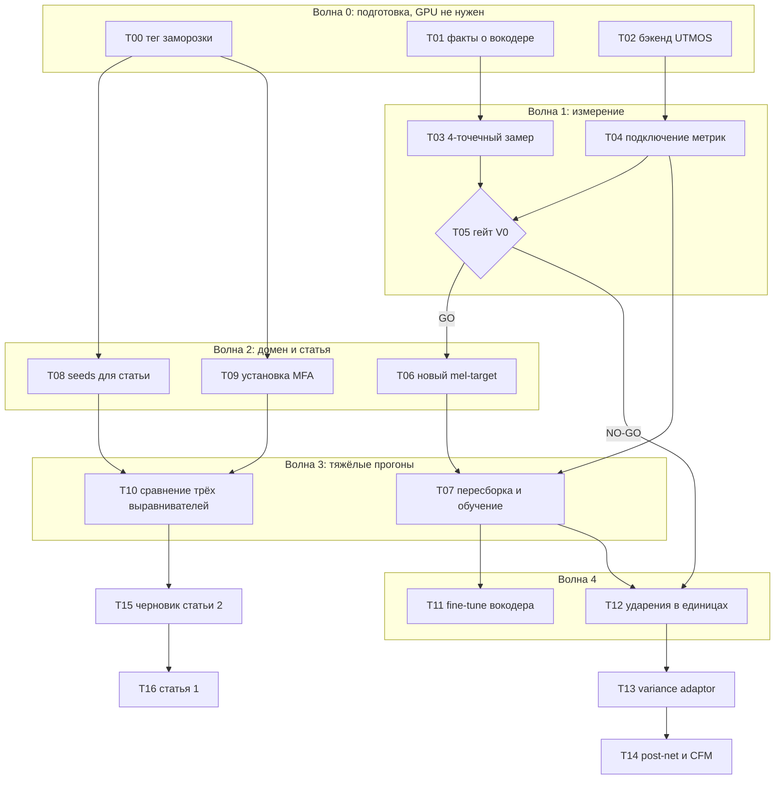

# Track A: дорожная карта качества (исполняемая версия)

Документ написан так, чтобы его мог выполнить агент, **не участвовавший** в предыдущей работе. Весь необходимый контекст продублирован здесь. Читать сверху вниз; разделы 0-4 обязательны к прочтению до начала любой задачи.

---

## 0. Как исполнять этот план

### 0.1. Роли

- **Оркестратор** — читает раздел 4 (волны), запускает субагентов, собирает их отчёты, обновляет статусы задач. Сам код не пишет.
- **Субагент-исполнитель** — берёт ровно одну задачу из раздела 5, выполняет её целиком, пишет отчёт по форме из раздела 6.

### 0.2. Правила мультиагентной работы

1. **Один файл — один владелец.** В каждой задаче раздела 5 указан список файлов, которые она правит. Две задачи с пересекающимися списками **нельзя** запускать параллельно. Это главная причина, по которой задачи сгруппированы в волны.
2. **Одна GPU-задача одновременно.** В системе одна RTX 4080 Super 16 ГБ. Обучение и инференс на GPU сериализуются, даже если задачи в одной волне.
3. **Задача не считается выполненной без критерия приёмки.** Если критерий не достигнут — это не «частично сделано», а провал, и агент обязан сообщить об этом честно, а не подгонять формулировку.
4. **Не выходить за границы задачи.** Нашёл соседнюю проблему — запиши в отчёт, не чини.
5. **Никаких коммитов без явного указания пользователя.**

### 0.3. Сквозные запреты

- Не обучать кодек VibeVoice ни при каких обстоятельствах. Энкодинг только с `sample=False`.
- Не перезапускать латентную ветку (Talker S4, Flow, LoRA) — она заморожена по Gate 0 FAIL.
- Не мутировать `MEL80` в [src/minispeech/constants.py](src/minispeech/constants.py). Только добавление нового target в реестр.
- Не скачивать модели с Hugging Face или torch.hub без предварительной проверки свободного места и без явного упоминания в отчёте, что и куда скачано.
- Не удалять и не коммитить содержимое `data/`, `runs/`, `out/*.wav`, кэши.
- Не запускать обучение из `/mnt/c/...` — только из `~/projects/tts-self`.

---

## 1. Контекст проекта

### 1.1. Что это

MiniSpeech-RU — исследовательский русский TTS. Актуальный production-путь (Track A):

```text
русский текст → нормализация чисел → простановка ударений → символьные метки CTC-алфавита
  → MelBaseline (non-AR, FastSpeech-подобная) → log-mel 80 бинов @ 86.13 Гц
  → HiFi-GAN → волна 22050 Гц
```

Длительности каждой метки берутся из forced alignment, а не выучиваются вниманием. Подробное описание архитектуры: [docs/architecture.md](docs/architecture.md).

### 1.2. Как сюда пришли (нужно для понимания запретов)

Изначально проект строился как `Qwen3.5-0.8B хиддены → Talker → латенты VibeVoice 64-D @ 7.5 Гц`. Эта ветка провалила Gate 0: голова схлопнулась в константу (\(R^2 \approx -0.11\)), синтез был неразборчив (CER около 0.89), при этом прокси-гейты (duration, stop, DTW) проходили. Диагностика: [docs/part1_diagnosis.md](docs/part1_diagnosis.md).

Track A построен заново на mel и довёл разборчивость до рабочей. Отдельно был найден и починен дефект: char-CTC forced alignment оставляет blank-разрывы примерно на 62% длительности реплики, из-за чего обучающий таймлайн молча обрезался до 38% длины mel.

### 1.3. Текущие числа (база для всех сравнений)

- Production чекпоинт: `runs/mel_baseline_v01_s4/best.pt`, обучен на 12490 репликах / 15.41 ч.
- Свободный синтез, val100, Whisper CER: **0.048** (медиана 0.026), WER 0.153, NEAR_SILENT 0.
- Свободный синтез demo5: 0.048 через Griffin-Lim, 0.042 через HiFi-GAN.
- Live-прогон suite через HiFi-GAN: demo5 0.099, homograph 0.034, bank_entity 0.093 (после починки скоринга).
- Топлайн copy-synthesis: GT mel → Griffin-Lim = **0.027**.
- Oracle-длительности: S1e 0.031, S1d 0.052. Свободные на train: S1e 0.211.
- Покрытие таймлайна: до починки 0.318, после `expand_neighbor` — 1.000.
- CFM-ветка проиграла регрессии на S2 (0.699 против 0.079) и заморожена.

### 1.4. Главный смысловой вывод

CER измеряет **разборчивость**, а не натуральность. Натуральность в проекте сейчас **не измеряется ничем**: [src/minispeech/eval/optional_metrics.py](src/minispeech/eval/optional_metrics.py) возвращает `skipped` для UTMOS, NISQA и GigaAM, а [src/minispeech/eval/utmos.py](src/minispeech/eval/utmos.py) — заглушка на восемь строк, возвращающая `None`. Поэтому задача T02/T04 (метрики) блокирует критерии приёмки почти всех последующих фаз.

---

## 2. Окружение

### 2.1. Две копии репозитория

- **Windows (авторская копия):** `C:\projects\tts-self`. Здесь пишется код. GPU-работы отсюда не запускаются.
- **WSL Ubuntu (GPU-рантайм):** `~/projects/tts-self`. Клон того же репозитория. Здесь идут обучение, инференс, ASR.

Вся работа закоммичена и запушена (коммит `56c8182` в `master`), поэтому синхронизация теперь тривиальна:

```bash
# в WSL, перед каждым GPU-прогоном
cd ~/projects/tts-self
git pull
git rev-parse --short HEAD   # записать SHA в отчёт
```

Если код правился на Windows и ещё не закоммичен — либо закоммитить (с разрешения пользователя), либо скопировать конкретные файлы через `/mnt/c/projects/tts-self/...`. Копирование всей директории не делать.

### 2.2. Стандартная преамбула для WSL

```bash
cd ~/projects/tts-self
source .venv/bin/activate
export HF_HOME=$HOME/hf_cache
```

Активация venv также настраивает espeak: `LD_LIBRARY_PATH` и `PHONEMIZER_ESPEAK_LIBRARY` указывают на user-local сборку в `~/local/espeak-ng`.

### 2.3. Внешние ресурсы на диске

- Манифест корпуса: `~/datasets/tts/ruslan/manifest.jsonl`
- Аудио: `~/datasets/tts/ruslan/wavs/`
- Mel-кэш: `~/datasets/tts/ruslan/mels/` (индекс `mels_index.json`, около 13160 записей)
- Forced alignment: `~/datasets/tts/ruslan/align/forced.json` (около 13647 записей, char-уровень)
- CTC-модель для выравнивания: `~/models/wav2vec2-large-xlsr-53-russian`
- Вокодер: `~/models/hifigan/generator.pt` (SpeechBrain, LibriTTS, 22050 Гц)
- Свободного места на домашнем разделе было около 900 ГБ

### 2.4. Известные грабли (проверено на практике)

- **PowerShell не понимает `&&`.** На Windows команды разделять `;` или делать отдельные вызовы.
- **CRLF ломает запуск скриптов в WSL.** Есть вспомогательный `scripts/_fix_crlf.py`. Симптом: `bad interpreter` или мгновенный выход.
- **Обучение может упереться в RAM и уйти в своп** (случалось около шага 2300). Лечится возобновлением с последнего чекпоинта; загрузка шардов уже ленивая (`preload: false`).
- **`sudo` недоступен** (нет пароля). Всё системное ставится user-local, как это сделано с espeak-ng.
- **На Windows отсутствует `torchaudio`**, часть тестов там падает по импорту. Полный `pytest` гонять в WSL.
- **Длинные прогоны запускать в `tmux`** с `2>&1 | tee runs/<name>/console.log`.

---

## 3. Карта кода

Геометрия целей:

- [src/minispeech/constants.py](src/minispeech/constants.py) — `TargetSpec`, реестр `TARGETS`, `MEL80` (строки 85-100), `VIBEVOICE64`. Поля `fmin`, `fmax`, `mel_scale`, `mel_norm` **отсутствуют** — их значения захардкожены в `mel.py`.

Фронтенд:

- [src/minispeech/frontend/normalize.py](src/minispeech/frontend/normalize.py), [src/minispeech/frontend/verbalize.py](src/minispeech/frontend/verbalize.py) — нормализация текста и чисел
- [src/minispeech/frontend/stress.py](src/minispeech/frontend/stress.py) — ударения, комбинирующий акут U+0301
- [src/minispeech/frontend/g2p.py](src/minispeech/frontend/g2p.py) — phonemizer + espeak, с fallback на графемы
- [src/minispeech/frontend/phone_vocab.py](src/minispeech/frontend/phone_vocab.py) — `PhoneVocab`, поле `unit` со значением `char` или `phone`
- [src/minispeech/frontend/durations.py](src/minispeech/frontend/durations.py) — `MeanDurationPredictor`, `SilGapModel`, упаковка меток для инференса

Выравнивание и проекция:

- [src/minispeech/data/forced_align.py](src/minispeech/data/forced_align.py) — CTC-выравнивание, `transcript_for_ctc`, `text_to_ctc_char_labels`, заглушки MFA
- [src/minispeech/data/frame_projection.py](src/minispeech/data/frame_projection.py) — `fill_segment_gaps` с режимами `expand_neighbor` и `sil_fill`, матрицы перекрытия

Данные и модель:

- [src/minispeech/data/mel.py](src/minispeech/data/mel.py) — извлечение log-mel, кэш
- [src/minispeech/data/mel_dataset.py](src/minispeech/data/mel_dataset.py) — датасет и collate
- [src/minispeech/models/mel_baseline.py](src/minispeech/models/mel_baseline.py) — `MelBaseline`, `dur_head`, лоссы
- [src/minispeech/models/mel_cfm.py](src/minispeech/models/mel_cfm.py) — CFM-вариант, заморожен
- [src/minispeech/train/mel_trainer.py](src/minispeech/train/mel_trainer.py) — тренер

Инференс и оценка:

- [src/minispeech/infer/vocoder.py](src/minispeech/infer/vocoder.py) — `mel_to_wav`, `griffin_lim`
- [src/minispeech/infer/hifigan.py](src/minispeech/infer/hifigan.py) — генератор HiFi-GAN и ремап ключей SpeechBrain
- [src/minispeech/eval/optional_metrics.py](src/minispeech/eval/optional_metrics.py), [src/minispeech/eval/utmos.py](src/minispeech/eval/utmos.py) — метрики качества, сейчас заглушки
- [src/minispeech/eval/test_sets.py](src/minispeech/eval/test_sets.py), [configs/eval_mel_suite.yaml](configs/eval_mel_suite.yaml) — замороженные тест-сеты
- [src/minispeech/eval/bootstrap.py](src/minispeech/eval/bootstrap.py) — доверительные интервалы

Скрипты (в WSL запускать из корня репозитория):

- `scripts/26_build_forced_align.py` — построение `forced.json`, методы `uniform`, `ctc`, заглушка `mfa`
- `scripts/27_train_mel.py` — обучение mel, флаги `--config`, `--data`, `--stage`
- `scripts/28_infer_mel.py` — инференс, флаги `--ckpt`, `--text`, `--out`, `--duration-mode` (по умолчанию `mean_stats`), `--prefer-vocoder`, `--save-mel-only`
- `scripts/29_cache_mels.py` — сборка mel-кэша, флаги `--config`, `--split`, `--max-utts`, `--out`
- `scripts/30_mel_copy_synth_eval.py` — copy-synthesis топлайн и oracle-длительности
- `scripts/32_eval_mel_suite.py` — прогон замороженных наборов, флаги `--ckpt`, `--sets`, `--out`, `--prefer-vocoder`, `--vocoder-ckpt`, `--seed-production`, `--max-utts`
- `scripts/33_download_hifigan.py` — загрузка вокодера

---

## 4. Волны и параллелизм



Владение файлами по волнам (проверка на конфликты):

- Волна 0: T00 не трогает код; T01 только читает; T02 владеет `src/minispeech/eval/utmos.py`. Конфликтов нет, можно параллельно.
- Волна 1: T03 владеет новым `scripts/34_vocoder_domain_probe.py`; T04 владеет `src/minispeech/eval/optional_metrics.py` и `scripts/32_eval_mel_suite.py`. Конфликтов нет, но обе используют GPU — сериализовать по времени.
- Волна 2: T06 владеет `constants.py`, `mel.py`, `vocoder.py`, `29_cache_mels.py`, `shards.py`. T08 и T09 кода почти не трогают (T09 владеет `forced_align.py` и `26_build_forced_align.py`). Конфликтов нет.
- Волна 3: T07 и T10 обе тяжёлые по GPU — строго последовательно.

---

## 5. Задачи

### T00 — Тег заморозки и снимок чисел

- **Волна:** 0. **GPU:** не нужен. **Параллельно с:** T01, T02.
- **Владеет файлами:** `docs/frozen_numbers_mel80.md` (новый).
- **Зависимости:** нет.

**Зачем.** Все числа статьи 2 получены в текущем mel-домене (`fmax = sr/2`). Задача T06 меняет домен, после чего абсолютные CER поедут. Без тега статья станет невоспроизводимой.

**Шаги.**

1. Убедиться, что рабочее дерево чистое относительно отслеживаемых файлов: `git status`.
2. Создать аннотированный тег на текущем HEAD (`56c8182`): имя `paper2-frozen-mel80`, в сообщении указать, что это состояние соответствует mel80 с `fmax=sr/2` и результатам S1-S4.
3. **Тег не пушить без явного разрешения пользователя.** Спросить перед `git push origin <tag>`.
4. Создать `docs/frozen_numbers_mel80.md` и перенести туда снимок всех текущих чисел из раздела 1.3 этого документа, с указанием источника каждого числа (путь к JSON в `out/`).

**Критерий приёмки.** `git tag -l` показывает `paper2-frozen-mel80`; файл `docs/frozen_numbers_mel80.md` существует и для каждого числа содержит путь к породившему его артефакту.

**При провале.** Если дерево грязное из-за несвязанных изменений — не коммитить их, а сообщить пользователю и остановиться.

---

### T01 — Факты об окружении вокодера

- **Волна:** 0. **GPU:** не нужен. **Параллельно с:** T00, T02.
- **Владеет файлами:** `docs/vocoder_facts.md` (новый).
- **Зависимости:** нет.

**Зачем.** Вся гипотеза фазы 0 держится на предположении, что HiFi-GAN обучался с `mel_fmax = 8000`, тогда как проект считает mel с `fmax = 11025`. Предположение надо подтвердить фактами, а не принять на веру.

**Что известно точно (перепроверять не нужно, но сверить стоит).** В [src/minispeech/data/mel.py](src/minispeech/data/mel.py) ветка librosa (строки 78-90) задаёт `fmin=0.0`, `fmax=sr_tgt/2.0`, `power=1.0`, затем `log(max(mel, 1e-5))`. Ветка torchaudio (строки 98-109) задаёт `f_min=0.0`, `f_max=sr_tgt/2.0`, `power=1.0`, но **не задаёт** `norm` и `mel_scale`, то есть получает `norm=None` и `mel_scale="htk"`. librosa по умолчанию использует slaney-шкалу и slaney-нормировку. Это означает, что две ветки дают **разные mel-фильтры**.

**Шаги.**

1. В WSL перечислить содержимое `~/models/hifigan/` и прочитать все конфигурационные файлы (`hyperparams.yaml`, `config.json`, любые `.yaml`). Извлечь: `sample_rate`, `n_fft`, `hop_length`, `win_length`, `n_mels`, `mel_fmin`, `mel_fmax`, `power`, признак нормализации mel, тип шкалы фильтров.
2. Если конфига рядом с чекпоинтом нет — определить источник по [scripts/33_download_hifigan.py](scripts/33_download_hifigan.py) и найти опубликованные гиперпараметры этой модели.
3. Выполнить `python -c "from minispeech.data.mel import mel_backend_name; print(mel_backend_name())"` — узнать, какая ветка реально используется в WSL.
4. Зафиксировать версии `librosa` и `torchaudio`.
5. Записать всё в `docs/vocoder_facts.md`, явно ответив на два вопроса: чему равен `mel_fmax` вокодера и совпадают ли mel-фильтры проекта с теми, на которых он обучался.

**Критерий приёмки.** В `docs/vocoder_facts.md` указано конкретное числовое значение `mel_fmax` вокодера со ссылкой на источник, и явно сказано, какой бэкенд mel активен в WSL.

**При провале.** Если гиперпараметры найти не удалось — так и написать, и в T03 добавить дополнительную точку замера с `fmax=8000`, трактуя её как эмпирическую проверку вместо подтверждённой.

---

### T02 — Реальный бэкенд UTMOS

- **Волна:** 0. **GPU:** желателен, но не обязателен. **Параллельно с:** T00, T01.
- **Владеет файлами:** [src/minispeech/eval/utmos.py](src/minispeech/eval/utmos.py), `tests/test_utmos_backend.py` (новый).
- **Зависимости:** нет.

**Зачем.** Без объективной оценки натуральности нельзя принять ни одну последующую фазу: CER не отличает разборчивую механическую речь от разборчивой естественной.

**Текущее состояние.** [src/minispeech/eval/utmos.py](src/minispeech/eval/utmos.py) целиком:

```python
def utmos_score(audio_path: str) -> float | None:
    """Return None unless a UTMOS implementation is installed."""
    return None
```

**Шаги.**

1. Проверить свободное место: `df -h $HOME`. Требуется не менее 5 ГБ запаса.
2. Выбрать один бэкенд в порядке предпочтения: `torch.hub` репозиторий `sarulab-speech/UTMOS22`, либо pip-пакет `utmosv2`, либо `speechmos`. Выбор и причину зафиксировать в отчёте.
3. Реализовать `utmos_score(audio_path) -> float | None` с ленивой загрузкой модели и кэшированием экземпляра между вызовами (не грузить модель на каждый файл).
4. Сохранить контракт: при отсутствии зависимостей или модели функция возвращает `None`, а не бросает исключение.
5. Модель класть в `~/models/utmos/` или в `HF_HOME`; путь указать в отчёте.
6. Написать тест, который при отсутствующей зависимости проверяет возврат `None`, а при наличии — что скор попадает в диапазон примерно от 1 до 5.
7. Проверить руками на трёх файлах: реальная запись из корпуса, синтез S4 через HiFi-GAN, синтез S4 через Griffin-Lim. Ожидаемый порядок: реальная запись выше синтеза; HiFi-GAN выше Griffin-Lim. Если порядок нарушен — бэкенд подключён неверно.

**Критерий приёмки.** `utmos_score` возвращает числа для трёх проверочных файлов, и порядок значений соответствует ожидаемому.

**При провале.** Если ни один бэкенд не ставится — попробовать NISQA как замену и честно записать, что UTMOS недоступен. Не имитировать метрику эвристикой.

---

### T03 — Четырёхточечный замер mel-домена

- **Волна:** 1. **GPU:** да. **Параллельно с:** T04 (по коду можно, по GPU — сериализовать).
- **Владеет файлами:** `scripts/34_vocoder_domain_probe.py` (новый).
- **Зависимости:** T01.

**Зачем.** Это решающий эксперимент фазы 0. Ключевая идея: гипотезу можно проверить **целиком на ground-truth аудио, не трогая обученную модель**. Если mel, посчитанный с `fmax=8000`, проходит через HiFi-GAN заметно лучше, чем текущий с `fmax=11025`, значит домен действительно рассогласован, и переобучение оправдано. Если разницы нет — фазы 2 и 3 не нужны.

**Шаги.**

1. Создать `scripts/34_vocoder_domain_probe.py`. Скрипт **не должен** менять `MEL80` или другие общие модули: второй вариант mel считается локально внутри скрипта прямым вызовом librosa.
2. Взять n = 40 реплик из val-сплита манифеста (тот же контур выбора, что и в [scripts/30_mel_copy_synth_eval.py](scripts/30_mel_copy_synth_eval.py) — прочитать его и повторить способ загрузки конфига данных и списка реплик).
3. Для каждой реплики построить четыре аудиодорожки:
   - **A. Реальная запись** — исходный wav, приведённый к 22050 Гц. Это пол ошибки ASR.
   - **B. mel@11025 → Griffin-Lim** — через `waveform_to_logmel(..., target="mel80")` и `griffin_lim`. Ожидаемое значение CER около 0.027, служит проверкой корректности прогона.
   - **C. mel@11025 → HiFi-GAN** — тот же mel, но `mel_to_wav(..., prefer="neural")`.
   - **D. mel@8000 → HiFi-GAN** — mel посчитать локально: `librosa.feature.melspectrogram(y=wav, sr=22050, n_fft=1024, hop_length=256, win_length=1024, n_mels=80, fmin=0.0, fmax=8000.0, power=1.0)`, затем `np.log(np.maximum(mel, 1e-5)).T`. Значения `fmax` и параметры фильтров взять из `docs/vocoder_facts.md`, если T01 нашла точные.
4. Прогнать ASR по всем четырём наборам. Использовать тот же путь и ту же нормализацию, что и остальной проект: сверить с [scripts/30_mel_copy_synth_eval.py](scripts/30_mel_copy_synth_eval.py) и обязательно применить `normalize_verbalized_for_asr` к референсу и гипотезе — иначе числа будут несопоставимы с уже записанными.
5. Если T02 завершена — посчитать UTMOS для всех четырёх наборов.
6. Записать `out/vocoder_domain_probe.json`: по каждой реплике и агрегаты (среднее, медиана CER и WER, UTMOS), плюс блок метаданных (git SHA, `mel_backend_name()`, путь к вокодеру, значения `fmax` в каждом варианте).
7. Сохранить wav-ы вариантов B, C, D для первых пяти реплик в `out/vocoder_domain_probe_wavs/` — пользователь будет слушать.
8. Скопировать JSON в `C:\projects\tts-self\out\`.

**Критерий приёмки.** JSON содержит все четыре набора с непустыми агрегатами; вариант B воспроизводит известное значение CER около 0.027 с разумным допуском (это самопроверка корректности прогона).

**При провале.** Если вариант B сильно отличается от 0.027 — прогон некорректен (скорее всего другая нормализация текста или другой сплит). Разбираться с этим до интерпретации остальных вариантов.

---

### T04 — Подключение метрик качества

- **Волна:** 1. **GPU:** да. **Параллельно с:** T03 по коду.
- **Владеет файлами:** [src/minispeech/eval/optional_metrics.py](src/minispeech/eval/optional_metrics.py), [scripts/32_eval_mel_suite.py](scripts/32_eval_mel_suite.py), [configs/eval_mel_suite.yaml](configs/eval_mel_suite.yaml).
- **Зависимости:** T02.

**Зачем.** Сделать натуральность измеримой и встроить это в регулярный прогон, чтобы все последующие фазы имели критерий приёмки.

**Шаги.**

1. В `optional_metrics.py` заменить заглушку `score_utmos_v2` на вызов реального `utmos_score` из T02.
2. Разобраться с `score_nisqa`: либо подключить реальный пакет, либо оставить честный `skipped` с указанием причины.
3. Проверить, что `score_mcd_dtw` и `score_f0_rmse` действительно считаются — им нужна только librosa. Если они молча пропускаются, найти и устранить причину.
4. Добавить в [scripts/32_eval_mel_suite.py](scripts/32_eval_mel_suite.py) режим copy-synthesis топлайна: для наборов, где известен референсный wav, считать метрики не только для синтеза, но и для реальной записи и для GT mel через тот же вокодер. Это даёт три опорные точки в одном отчёте.
5. Прогнать полный набор метрик для текущего S4 (`runs/mel_baseline_v01_s4/best.pt`) через HiFi-GAN на `demo5` и `val100`, записать `out/eval_mel_suite_s4_baseline_full.json`.
6. Внести получившиеся значения UTMOS в `docs/next_intelligibility.md` как базовую линию с явной пометкой, что это точка отсчёта для фаз 2-6.

**Критерий приёмки.** В отчёте по S4 поля UTMOS, MCD-DTW и F0 RMSE содержат числа, а не `skipped`; в `docs/next_intelligibility.md` есть строка базовой линии.

**При провале.** Если UTMOS так и не заработал, зафиксировать это как блокер и не переходить к T06: без метрики натуральности смена домена не может быть оценена.

---

### T05 — Гейт V0: решение по mel-домену

- **Волна:** 1. **GPU:** не нужен. **Зависимости:** T03, T04.
- **Владеет файлами:** `docs/next_intelligibility.md` (раздел с вердиктом).

**Шаги.**

1. Прочитать `out/vocoder_domain_probe.json`.
2. Сравнить вариант D (mel@8000 → HiFi-GAN) с вариантом C (mel@11025 → HiFi-GAN) по CER и UTMOS.
3. Вынести вердикт по правилу:
   - **GO**, если D лучше C по UTMOS заметно, либо CER падает более чем на 0.01 абсолютных. Переходим к T06.
   - **NO-GO**, если разница в пределах шума. Тогда mel-домен не является узким местом; T06, T07 и T11 понижаются в приоритете, и следующей выполняется T12 (ударения).
4. Записать вердикт, числа и обоснование в `docs/next_intelligibility.md`.
5. Сообщить пользователю результат до начала T06 — это точка ветвления плана.

**Критерий приёмки.** В документе есть однозначный вердикт GO или NO-GO с числами.

---

### T06 — Новый mel-target и защита кэша

- **Волна:** 2. **GPU:** не нужен. **Параллельно с:** T08, T09.
- **Владеет файлами:** [src/minispeech/constants.py](src/minispeech/constants.py), [src/minispeech/data/mel.py](src/minispeech/data/mel.py), [src/minispeech/infer/vocoder.py](src/minispeech/infer/vocoder.py), `scripts/29_cache_mels.py`, [src/minispeech/data/shards.py](src/minispeech/data/shards.py), `tests/test_mel_target_registry.py` (новый).
- **Зависимости:** T05 = GO.

**Зачем.** Привести mel-домен в соответствие с вокодером, не сломав воспроизводимость прошлых прогонов и статьи.

**Шаги.**

1. Расширить `TargetSpec` в [src/minispeech/constants.py](src/minispeech/constants.py) полями `fmin: float | None`, `fmax: float | None`, `mel_scale: str | None`, `mel_norm: str | None`. Для существующего `MEL80` проставить значения, **точно соответствующие текущему поведению**: `fmin=0.0`, `fmax=11025.0`, `mel_scale="slaney"`, `mel_norm="slaney"`. Это критично: `MEL80` не должен изменить поведение ни на йоту.
2. Зарегистрировать новый target `mel80_hifigan`: те же `sample_rate=22050`, `n_fft=1024`, `hop_length=256`, `win_length=1024`, `n_mels=80`, но `fmax` из `docs/vocoder_facts.md` (ожидается 8000.0), `mel_scale` и `mel_norm` — под конвенцию вокодера.
3. Провести параметры через [src/minispeech/data/mel.py](src/minispeech/data/mel.py):
   - ветка librosa (строки 78-88) — брать `fmin`/`fmax` из спеки, явно передавать `htk` и `norm`;
   - ветка torchaudio (строки 98-107) — явно задать `f_min`, `f_max`, `norm`, `mel_scale` из спеки. Сейчас там молча используются `norm=None` и `mel_scale="htk"`, что не совпадает с librosa.
4. Провести параметры через [src/minispeech/infer/vocoder.py](src/minispeech/infer/vocoder.py):
   - `griffin_lim`, ветка librosa (строки 186-194) — `mel_to_audio` сейчас не получает `fmin`/`fmax` вообще и использует свои умолчания;
   - ветка torchaudio (строки 212-218) — `f_max=spec.sample_rate / 2.0` захардкожен, заменить на значение из спеки.
5. В `scripts/29_cache_mels.py` строка 51 захардкожено `target="mel80"` — добавить флаг `--target` со значением по умолчанию `mel80`.
6. **Защита кэша.** Записывать `target` и результат `mel_backend_name()` в индекс mel-кэша (метаданные шардов) и проверять их при чтении. При несовпадении — явная ошибка с понятным текстом, а не тихая работа. Причина: `default_mel_dir` возвращает единый путь `<ruslan_dir>/mels` для любого домена, и без проверки два домена молча перемешаются. Это ровно тот же класс тихой ошибки, что и blank-разрывы, из-за которых проект уже потерял время.
7. Тесты: `MEL80` сохранил прежние параметры; `mel80_hifigan` зарегистрирован; извлечение mel двумя бэкендами на синтетическом сигнале даёт близкие результаты для одной и той же спеки (это проверяет пункт 3).
8. Прогнать `pytest -q` в WSL.

**Критерий приёмки.** Тесты проходят; извлечение mel по `mel80` побитово или почти побитово совпадает с тем, что было до изменений (проверить на одной реплике против существующего кэша); новый target доступен через `get_target("mel80_hifigan")`.

**При провале.** Если старый кэш перестал совпадать — откатить и разбираться: это означает, что где-то изменилось поведение по умолчанию, и все прошлые числа окажутся невоспроизводимыми.

---

### T07 — Пересборка кэша и обучение в новом домене

- **Волна:** 3. **GPU:** да, длительная. **Строго последовательно** с T10.
- **Владеет файлами:** `configs/mel_hifigan_v01.yaml` (новый), артефакты в `runs/` и `out/`.
- **Зависимости:** T06, T04.

**Шаги.**

1. `git pull` в WSL, записать SHA.
2. Собрать mel-кэш в новом домене **в отдельную директорию**: `~/datasets/tts/ruslan/mels_hifigan/`, с `--target mel80_hifigan`. Старый кэш не трогать.
3. Создать `configs/mel_hifigan_v01.yaml` копией [configs/mel_baseline_v01.yaml](configs/mel_baseline_v01.yaml) с изменённым target, путём к кэшу и `run_dir: runs/mel_hifigan_v01`.
4. Сначала **fine-tune** от `runs/mel_baseline_v01_s4/best.pt` — это дёшево и быстро отвечает на вопрос, помогает ли домен. Если результат неубедителен, обучить с нуля на полном корпусе.
5. Запускать в `tmux`, следить за RAM.
6. Прогнать полный набор метрик (T04) на `demo5` и `val100`, сравнить с `out/eval_mel_suite_s4_baseline_full.json`.
7. Записать сравнение в `docs/next_intelligibility.md`.

**Критерий приёмки (гейт V2).** UTMOS вырос относительно базовой линии при CER на val100 не хуже 0.06. Иначе — зафиксировать отрицательный результат и вернуться к `mel80`.

**При провале обучения.** Если процесс упал по памяти — возобновить с последнего чекпоинта, как это уже делалось ранее; уменьшить размер батча только если возобновление не помогает, и обязательно отметить это в отчёте, поскольку меняется условие сравнения.

---

### T08 — Seeds и доверительные интервалы для статьи 2

- **Волна:** 2. **GPU:** да, но лёгкая (S1-масштаб, 32 реплики). **Параллельно с:** T06, T09.
- **Владеет файлами:** `out/paper2_seeds_*.json`.
- **Зависимости:** T00.

**Зачем.** Сейчас ключевые числа статьи получены по одному прогону на конфигурацию. Рецензент справедливо потребует разброс.

**Шаги.**

1. Переключиться на тег `paper2-frozen-mel80` (или работать в отдельном worktree), чтобы числа соответствовали замороженному домену.
2. Прогнать по три seed-а для двух конфигураций режима заполнения разрывов: `sil_fill` (соответствует S1d) и `expand_neighbor` (соответствует S1e). Данные — те же 32 реплики, что и раньше.
3. Для каждого прогона посчитать: покрытие таймлайна `cover_ratio`, val mel L1, CER при oracle-длительностях, CER свободного синтеза.
4. Дополнительно прогнать конфигурацию **без починки разрывов** (сырые CTC-спаны) — это и есть та самая точка с CER около 0.86, и она нужна как третье плечо сравнения.
5. Посчитать bootstrap-CI, используя [src/minispeech/eval/bootstrap.py](src/minispeech/eval/bootstrap.py).
6. Сохранить `out/paper2_seeds_summary.json` со средними, стандартными отклонениями и интервалами.

**Критерий приёмки.** Для трёх конфигураций (сырой CTC, `sil_fill`, `expand_neighbor`) есть по три seed-а с CI; порядок величин воспроизводит ранее зафиксированные числа.

---

### T09 — Установка MFA и реальное выравнивание

- **Волна:** 2. **GPU:** не обязателен. **Параллельно с:** T06, T08.
- **Владеет файлами:** [src/minispeech/data/forced_align.py](src/minispeech/data/forced_align.py), `scripts/26_build_forced_align.py`.
- **Зависимости:** T00.

**Зачем.** MFA даёт независимое фонемное выравнивание. Для статьи это превращает частный баг в свойство класса выравнивателей. Для фазы 4b это разблокирует переход на фонемы espeak, у которых нет 1:1 соответствия с char-CTC.

**Шаги.**

1. Проверить свободное место. Установить Montreal Forced Aligner в WSL. `sudo` недоступен, поэтому идти через conda/mamba в пользовательскую директорию (`conda install -c conda-forge montreal-forced-aligner`) или через micromamba, установленный локально.
2. Скачать русскую акустическую модель и словарь (`mfa model download acoustic russian_mfa`, `mfa model download dictionary russian_mfa`), проверив место заранее.
3. В [src/minispeech/data/forced_align.py](src/minispeech/data/forced_align.py) уже есть `mfa_available()` и `mfa_crosscheck_stub` — довести до реального выравнивания: подготовка корпуса в ожидаемой MFA раскладке, запуск, разбор TextGrid, конвертация в формат `forced.json` (те же ключи, что у CTC-пути, с `granularity: "phone"`).
4. В `scripts/26_build_forced_align.py` довести `--method mfa` до рабочего состояния.
5. Прогнать на подмножестве (32 реплики), сверить суммарную длительность фонем с длительностью аудио: покрытие должно быть близко к 1.0 **без** дополнительной починки, поскольку MFA явно моделирует паузы.
6. Записать `~/datasets/tts/ruslan/align/forced_mfa.json` и краткий отчёт о доле успешно выровненных реплик.

**Критерий приёмки.** `forced_mfa.json` содержит фонемные спаны для не менее чем 90% из выбранных реплик, покрытие таймлайна близко к 1.0.

**При провале.** Если MFA не встаёт без root — зафиксировать конкретный блокер (какая команда, какая ошибка) и предложить альтернативу: второй CTC-выравниватель другой архитектуры вместо MFA. Не выдавать заглушку за результат.

---

### T10 — Сравнение трёх выравнивателей

- **Волна:** 3. **GPU:** да. **Строго последовательно** с T07.
- **Владеет файлами:** `out/paper2_threeway.json`, `docs/paper2_ctc_gaps.md` (новый, черновик данных).
- **Зависимости:** T08, T09.

**Шаги.**

1. На одинаковом подмножестве обучить три конфигурации: сырой CTC без починки, CTC с `expand_neighbor`, MFA.
2. Для каждой посчитать: покрытие таймлайна, CER при oracle-длительностях, CER свободного синтеза, val mel L1. По три seed-а, с CI.
3. Построить фигуру: покрытие таймлайна по горизонтали, CER по вертикали, точки трёх конфигураций с интервалами. Сохранить в `docs/figures/`.
4. Записать `out/paper2_threeway.json` и черновик раздела результатов.

**Критерий приёмки.** Есть три плеча сравнения с CI и одна фигура; вывод сформулирован одним предложением.

---

### T11 — Fine-tune вокодера под диктора

- **Волна:** 4. **GPU:** да, длительная. **Зависимости:** T07.

**Зачем.** Английский LibriTTS-вокодер ограничивает потолок даже при согласованном домене.

**Шаги.**

1. Подготовить пары mel/wav из RUSLAN в том же mel-домене, в котором обучена акустическая модель. Это жёсткая инварианта: рассогласование здесь вернёт исходную проблему.
2. Реализовать или подключить цикл обучения HiFi-GAN с дискриминаторами MPD и MSD.
3. Стартовать с текущего чекпоинта, не с нуля.
4. Оценивать **только по copy-synthesis** (GT mel → вокодер), чтобы отделить качество вокодера от ошибок акустической модели.

**Критерий приёмки (гейт V3).** UTMOS на copy-synthesis выше, чем у LibriTTS-вокодера на том же mel.

---

### T12 — Ударения в единицах модели

- **Волна:** 4. **GPU:** да. **Зависимости:** T07 (или T05 = NO-GO).
- **Владеет файлами:** [src/minispeech/data/forced_align.py](src/minispeech/data/forced_align.py), [src/minispeech/frontend/phone_vocab.py](src/minispeech/frontend/phone_vocab.py).

**Зачем.** Сейчас ударения вычисляются и **выбрасываются**. В [src/minispeech/data/forced_align.py](src/minispeech/data/forced_align.py) функция `transcript_for_ctc` (строки 462-497) честно строит `text_stressed`, а затем строка 487 делает:

```python
plain = strip_stress(stressed).lower()
```

В модель уходят голые строчные буквы плюс разделитель `|`, словарь около 39 токенов. Русская редукция гласных и словесное ударение не моделируются в принципе — это наиболее вероятная причина «механичности» звучания.

**Ключевая идея реализации.** Ударение в проекте — комбинирующий знак U+0301, он **не добавляет базовых символов**. Значит, ударная строка имеет ровно то же количество базовых символов, что и обычная, и CTC-спаны переносятся один в один. Перезапускать выравнивание не нужно.

**Шаги.**

1. В `text_to_ctc_char_labels` (строки 528-542) выдавать ударные варианты гласных, беря их из `text_stressed`.
2. **Критично:** ударную строку прогонять через **тот же самый фильтр**, что и `text_ctc` — нижний регистр, отбрасывание пунктуации, схлопывание пробелов (строки 487-496). Иначе посимвольное соответствие разъедется, и метки встанут не на свои спаны. Написать тест именно на это: длина отфильтрованной ударной строки равна длине `text_ctc`.
3. Словарь вырастет примерно на десять токенов (ударные варианты гласных). `forced.json` пересобирать не нужно.
4. Переобучить в текущем лучшем домене, сравнить по полному набору метрик и по [src/minispeech/eval/stress_acc.py](src/minispeech/eval/stress_acc.py).

**Критерий приёмки (гейт V4).** При CER не хуже прежнего выросли UTMOS и точность позиции ударения.

**Развитие (T12b, опционально).** Переход на фонемы espeak даёт больше (палатализация, редукция), но у фонем нет 1:1 соответствия с char-CTC, поэтому им нужен фонемный выравниватель — им становится MFA из T09. Это единственная точка пересечения ветки статьи и ветки качества.

---

### T13 — Variance adaptor и контекстные длительности

- **Волна:** 5. **GPU:** да. **Зависимости:** T12.
- **Владеет файлами:** [src/minispeech/models/mel_baseline.py](src/minispeech/models/mel_baseline.py), [src/minispeech/train/mel_trainer.py](src/minispeech/train/mel_trainer.py), [configs/mel_baseline_v01.yaml](configs/mel_baseline_v01.yaml).

**Зачем.** В [src/minispeech/models/mel_baseline.py](src/minispeech/models/mel_baseline.py) нет ни pitch, ни energy — только `dur_head`. Интонация мертва по построению. Кроме того, на инференсе по умолчанию используется `--duration-mode mean_stats` ([scripts/28_infer_mel.py](scripts/28_infer_mel.py) строка 253), то есть **контекстно-независимое среднее на символ**; обученный `dur_head` в продакшене не участвует.

**Шаги.**

1. Извлечь и закэшировать F0 (pyworld или `librosa.pyin`) и энергию (норма mel-кадра) для корпуса.
2. Агрегировать до уровня меток по тем же спанам, что и длительности, — переиспользовать [src/minispeech/data/frame_projection.py](src/minispeech/data/frame_projection.py).
3. Добавить `pitch_head` и `energy_head` по образцу FastSpeech2: предсказание на уровне меток после энкодера, эмбеддинг предсказанного значения прибавляется к состоянию **до** length regulator (то есть до `hard_upsample`).
4. Расширить лосс до `mel_l1 + duration + pitch + energy`, веса вынести в конфиг.
5. Сделать duration predictor контекстным (он уже видит выход энкодера, но проверить, что не деградировал) и провести честный A/B `mean_stats` против `pred`. Сдвинуть значение по умолчанию только при выигрыше.
6. Мерить разрыв между свободными и oracle-длительностями — он уже считается скриптом 30 и является прямым индикатором качества предиктора.

**Критерий приёмки (гейт V5).** F0 RMSE и корреляция длительностей с эталоном улучшились, UTMOS вырос, разрыв free/oracle по CER сократился.

---

### T14 — Борьба со сглаживанием и повтор CFM

- **Волна:** 6. **GPU:** да. **Зависимости:** T13.

**Зачем.** L1-регрессия предсказывает условную медиану mel, отсюда размытый спектр и «глухое» звучание.

**Шаги.**

1. Добавить post-net в стиле Tacotron2 (пять свёрточных слоёв, residual к предсказанному mel), лосс считать до и после post-net.
2. Попробовать многомасштабный STFT-лосс и/или лёгкий GAN-лосс на mel.
3. Только после этого вернуться к CFM. [src/minispeech/models/mel_cfm.py](src/minispeech/models/mel_cfm.py) уже реализован, но проиграл (CER 0.699 против 0.079) на рецепте **без ударений, без variance adaptor и с рассогласованным вокодером**. Повторить A/B в новых условиях, варьируя число шагов сэмплирования и CFG.

**Критерий приёмки (гейт V6).** Post-net или CFM даёт прирост UTMOS без ухудшения CER более чем на 0.01 абсолютных.

---

### T15 — Черновик статьи 2

- **Волна:** 6. **GPU:** не нужен. **Зависимости:** T10.
- **Владеет файлами:** `docs/paper2_ctc_gaps.md`.

**Тезис одним абзацем.** Char-CTC forced alignment оставляет blank-разрывы, покрывающие около 62% длительности реплики. Наивное использование `end - start` молча обрезает обучающий таймлайн до 38% длины mel и даёт неразборчивый синтез при полностью здоровых значениях функции потерь. Дефект не диагностируется ни одной стандартной прокси-метрикой.

**Что уже есть в репозитории.**

- `out/cover_ratio_s1d.json`, `out/cover_ratio_s1e.json` — покрытие 0.318 против 1.000
- `out/intelligibility_mel_s1c*.json`, `..._s1d*.json`, `..._s1e*.json` — CER от 0.86 до 0.048
- Разделение oracle-длительностей (0.611 → 0.052) и свободного синтеза — доказывает, что причина в таймлайне, а не в модели
- GT mel → Griffin-Lim = 0.027 — исключает вокодер как причину
- Ablation `sil_fill` против `expand_neighbor` в [src/minispeech/data/frame_projection.py](src/minispeech/data/frame_projection.py)
- Результаты T08 и T10: seeds, CI, третье плечо MFA

**Что дописать.**

1. Обзор: как популярные открытые TTS-репозитории обрабатывают blank-разрывы при CTC-выравнивании. Это превращает частную заметку в предупреждение сообществу.
2. Раздел воспроизводимости: точные команды, тег `paper2-frozen-mel80`, версии моделей.
3. Одна фигура из T10.

**Площадки.** SSW (Speech Synthesis Workshop), воркшопы по воспроизводимости и отрицательным результатам, ICASSP short.

---

### T16 — Доведение статьи 1

- **Волна:** 7. **Зависимости:** T15.
- **Владеет файлами:** `docs/paper1_proxy_metrics_trap.md`.

Черновик уже содержит редкую структуру: отрицательный контроль (latent Talker проходит duration, stop и DTW, будучи content-blind) плюс положительный контроль (mel S4 на том же протоколе). Не хватает: seeds и CI на всех числах, минимум одного внешнего baseline (Silero, VITS-RU, XTTS) на замороженных тест-сетах, пилота субъективной оценки по ITU-T P.808, и четырёх фигур (CER от sigma, CER от alpha, scatter \(R^2\) против CER, diagonality против уровня случайности).

---

## 6. Формат отчёта субагента

Каждый исполнитель завершает работу отчётом строго по этой форме:

1. **ID задачи** и итог одним словом: выполнено, выполнено частично, провал.
2. **Критерий приёмки** — процитировать и написать, достигнут или нет, с числами.
3. **Изменённые файлы** — полный список путей.
4. **Артефакты** — пути к JSON, wav, чекпоинтам, в WSL и на Windows.
5. **Команды**, которые реально были выполнены (не те, что в плане, а фактические).
6. **git SHA** в WSL на момент прогона.
7. **Числа** — все полученные метрики, без округления в свою пользу.
8. **Проблемы** — что сломалось, как обошли, что осталось незакрытым.
9. **Замеченное рядом** — найденные, но не тронутые проблемы.

Отчёт не должен утверждать успех, если критерий приёмки не достигнут.

---

## 7. Сводка гейтов

- **V0** (после T05): подтверждён ли вклад mel-домена. Ветвление плана.
- **V1** (после T04): UTMOS и NISQA выдают числа для реальной записи, GT mel и синтеза.
- **V2** (после T07): UTMOS вырос при CER на val100 не хуже 0.06.
- **V3** (после T11): свой вокодер лучше LibriTTS-вокодера на copy-synthesis.
- **V4** (после T12): при равном CER выросли UTMOS и точность ударения.
- **V5** (после T13): улучшены F0 RMSE и длительности, сокращён разрыв free/oracle.
- **V6** (после T14): прирост UTMOS без потери разборчивости.
- **Публикационный** (после T10): три seed-а, bootstrap-CI, независимый выравниватель на замороженных тест-сетах.

---

## 8. Риски

- **Смена mel-домена обесценивает текущий чекпоинт.** `runs/mel_baseline_v01_s4/best.pt` предсказывает mel при `fmax=11025` и с перенастроенным вокодером несовместим. Отсюда требования тега (T00) и отдельного target вместо мутации `MEL80` (T06).
- **Смешение кэшей двух доменов.** `default_mel_dir` возвращает единый путь, индекс не хранит target. Пункт 6 задачи T06 обязателен, иначе повторится ровно тот же класс тихой ошибки, что и с blank-разрывами.
- **Бэкенд-зависимые mel-фильтры.** Пока `mel.py` не задаёт `norm` и `mel_scale` явно, результат зависит от того, установлена ли librosa. Чинить нужно в любом сценарии, даже при вердикте NO-GO на гейте V0.
- **Установка MFA тяжёлая**, а `sudo` недоступен. Заложить время на user-local обход, как это делалось с espeak-ng.
- **UTMOS требует загрузки модели** — только после проверки места и с явным упоминанием в отчёте.
- **Пятнадцать часов одного диктора** ограничивают потолок натуральности независимо от архитектуры. На каком-то этапе упрёмся в данные, и это не будет дефектом модели.
- **Соблазн подогнать вывод под ожидание.** Проект уже один раз потерял месяцы на прокси-метриках, которые проходили при бессодержательном синтезе. Отрицательный результат на любом гейте — это результат, а не повод менять критерий.
