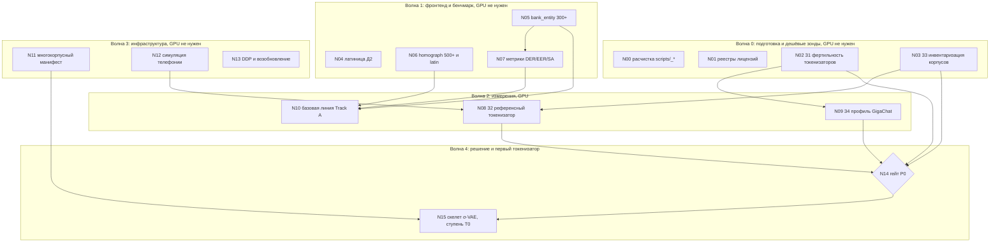

# Track N — фаза P0 (исполняемая версия)

Документ написан так, чтобы его мог выполнить агент, **не участвовавший** в
предыдущей работе. Весь необходимый контекст продублирован здесь.

Читать сверху вниз. Разделы 0–4 обязательны к прочтению **до начала любой
задачи**. Раздел 5 — только своя задача.

---

## 0. Как исполнять этот план

### 0.1. Роли

- **Оркестратор** — читает раздел 4 (волны), запускает субагентов, собирает
  отчёты, обновляет статусы задач. Сам код не пишет.
- **Субагент-исполнитель** — берёт ровно **одну** задачу из раздела 5,
  выполняет её целиком, пишет отчёт по форме из раздела 6.

### 0.2. Правила мультиагентной работы

1. **Один файл — один владелец.** В каждой задаче указан список файлов, которые
   она правит. Две задачи с пересекающимися списками **нельзя** запускать
   параллельно. Это главная причина группировки в волны.
2. **Одна GPU-задача одновременно.** В системе одна RTX 4080 Super 16 ГБ.
   GPU-задачи сериализуются, даже если они в одной волне.
3. **Задача не выполнена без критерия приёмки.** Если критерий не достигнут —
   это провал, а не «частично сделано». Сообщать честно, формулировку не
   подгонять.
4. **Не выходить за границы задачи.** Нашёл соседнюю проблему — запиши в отчёт,
   **не чини**.
5. **Никаких коммитов без явного указания пользователя.**
6. **Если не уверен — остановись и спроси.** Это дешевле, чем сделать неверно и
   заставить переделывать зависимые задачи.

### 0.3. Сквозные запреты

- **Не выдумывать числа.** Любое число в отчёте или документе должно иметь
  путь к породившему его артефакту. Отсутствие результата записывается как
  отсутствие, а не заменяется правдоподобной оценкой.
- **Не обучать кодек VibeVoice.** Энкодинг только с `sample=False`.
- **Не перезапускать латентную ветку** (Talker S4, Flow, LoRA) — заморожена по
  Gate 0 FAIL. И **не перезапускать CFM** из Track A.
- **Не встраивать веса VibeVoice в продуктовый код.** Они допустимы только как
  референс в измерительных зондах, и каждый такой прогон это отмечает.
- **Не мутировать существующие записи в `TARGETS`** (`src/minispeech/constants.py`).
  Только добавление новых.
- **Не скачивать модели** без проверки свободного места и без явного указания в
  отчёте, что и куда скачано.
- **Не удалять и не коммитить** содержимое `data/`, `runs/`, `out/*.wav`, кэши,
  `*.safetensors`.
- **Не запускать обучение из `/mnt/c/...`** — только из `~/projects/tts-self`.
- **Не менять замороженные тестовые наборы** после начала серии измерений.
  Расширение наборов (N05, N06) выполняется **до** N10 и фиксируется хешем.

### 0.4. Обязательное чтение перед началом

Методология проекта лежит в `.cursor/methodology/`. Каждая задача указывает,
какие файлы оттуда прочитать. Минимум для всех:

- [.cursor/methodology/README.md](../methodology/README.md) — карта и якорные числа
- [.cursor/methodology/01_strategy.md](../methodology/01_strategy.md) — зачем Track N

---

## 1. Контекст проекта

### 1.1. Что это

MiniSpeech-RU — исследовательский русский TTS. Текущий production (**Track A**):

```text
русский текст → нормализация чисел → простановка ударений
  → символьные метки CTC-алфавита (с ударениями)
  → MelBaseline (non-AR, FastSpeech-подобная, ~10M параметров)
  → log-mel 80 бинов @ 86.13 Гц → HiFi-GAN → волна 22050 Гц
```

Длительности берутся из forced alignment и таблицы средних, а не выучиваются.

**Track N** (то, к чему идём) — принципиально другая архитектура:

```text
русский текст → фронтенд → текстовые токены + канал просодии
  → LLM-бэкбон → hidden state → diffusion-голова
  → непрерывные латенты → декодер токенизатора → волна
```

Полное описание — [.cursor/methodology/03_architecture.md](../methodology/03_architecture.md).

### 1.2. Как сюда пришли (нужно для понимания запретов)

Проект начинался как `Qwen хиддены → Talker → латенты VibeVoice 64-D @ 7.5 Гц`.
Ветка провалила Gate 0: голова схлопнулась в константу (\(R^2 \approx -0.11\)),
синтез неразборчив (CER около 0.86–0.89), при этом прокси-гейты по длительности
и стопу проходили. Диагностика: [docs/part1_diagnosis.md](../../docs/part1_diagnosis.md).

**Критически важное прочтение этого провала.** В том же Part 1 эксперимент E2
показал: GT-латенты через замороженный декодер VibeVoice дают **CER 0.073** на
русском. То есть токенизатор русский язык держит. Провалилось обучение
последовательностной модели **с нуля** на 15 часах при выброшенном
предобученном приоре. Отсюда Track N — не «ещё одна модель поменьше», а
воспроизведение архитектуры с предобученным бэкбоном.

Track A был построен заново на mel и довёл разборчивость до рабочей.

### 1.3. Текущие числа (база для всех сравнений)

Последний коммит `2426d29` в `master`, запушен.

| Что | Значение | Артефакт |
|-----|---------:|----------|
| Production Track A | `runs/mel_stress_v01_s4/best.pt` | — |
| val100 CER (production) | **0.031** | `out/gate_v4_v5_summary.json` |
| val100 UTMOS (production) | 1.277 | там же |
| val100 CER (baseline mel80 S4) | 0.056 | там же |
| val100 CER (variance, FAIL) | 0.430 | там же |
| Copy-synth topline (GT mel → Griffin-Lim) | 0.027 | `out/eval_mel_suite_s4_baseline_full.json` |
| **Якорь E2**: VibeVoice токенизатор на русском | **0.073** | `out/latent_error_calibration.json` |
| Корпус | RUSLAN, ~15.4 ч clean, 12490 реплик, **1 диктор** | `~/datasets/tts/ruslan/manifest.jsonl` |

### 1.4. Главные смысловые выводы

1. **UTMOS невалиден для русского.** Обучен на английских данных. В Gate V4
   разница составила `delta_utmos = 0.005` при n = 100 — это шум. Решения по
   натуральности принимать **парными предпочтениями**, не абсолютным UTMOS.
2. **Средний CER маскирует критические отказы.** «Тысяча двести тридцать
   четыре» вместо «тридцать пять» — мизерный вклад в CER, катастрофа для
   банковского применения. Отсюда метрики DER/EER (задача N07).
3. **Данные, а не GPU — главное ограничение.** Один диктор и 15 часов
   ограничивают всё. Отсюда приоритет зондов N03 и инфраструктуры N11.

---

## 2. Окружение

### 2.1. Две копии репозитория

- **Windows (авторская копия):** `C:\projects\tts-self`. Здесь пишется код.
  GPU-работы отсюда не запускаются.
- **WSL Ubuntu (GPU-рантайм):** `~/projects/tts-self` (пользователь `adam`,
  то есть `/home/adam/projects/tts-self`). Клон того же репозитория.

Синхронизация: код правится на Windows, коммитится (с разрешения пользователя),
в WSL делается `git pull`. Если коммитить нельзя — копировать **конкретные
файлы** через `/mnt/c/projects/tts-self/...`, но не директорию целиком.

### 2.2. Стандартная преамбула для WSL

```bash
cd ~/projects/tts-self
source .venv/bin/activate
export HF_HOME=$HOME/hf_cache
```

### 2.3. Известные грабли (проверено на практике)

Читать обязательно — каждая из них уже стоила времени.

- **Дистрибутив WSL по умолчанию — не Ubuntu.** Команда `wsl` без флага
  попадает в `docker-desktop`, где репозитория нет. Всегда указывать явно:
  `wsl -d Ubuntu -- bash -lc '...'`.
- **PowerShell не понимает `&&`.** На Windows разделять `;` или делать
  отдельные вызовы.
- **Кавычки и не-ASCII в командах WSL из PowerShell.** Русский текст, тире и
  heredoc через несколько слоёв кавычек ломаются. Надёжный способ: положить
  скрипт в файл и запустить файл, а не передавать код строкой.
- **CRLF ломает запуск скриптов в WSL.** Симптом: `bad interpreter` или
  мгновенный выход. Есть `scripts/_fix_crlf.py`.
- **`sudo` недоступен** (нет пароля). Всё системное ставится user-local — как
  сделано с espeak-ng в `~/local/espeak-ng`.
- **На Windows нет `torchaudio`** — часть тестов там падает по импорту. Полный
  `pytest` гонять в WSL.
- **Обучение может уйти в своп** по RAM. Лечится возобновлением с чекпойнта.
- **Длинные прогоны — в `tmux`** с `2>&1 | tee runs/<name>/console.log`.

### 2.4. Внешние ресурсы на диске (WSL)

| Путь | Что |
|------|-----|
| `~/datasets/tts/ruslan/manifest.jsonl` | Манифест корпуса |
| `~/datasets/tts/ruslan/wavs/` | Аудио |
| `~/datasets/tts/ruslan/mels/` | Mel-кэш, индекс `mels_index.json` |
| `~/datasets/tts/ruslan/align/forced.json` | Forced alignment, char-уровень |
| `~/models/wav2vec2-large-xlsr-53-russian` | CTC-модель для выравнивания |
| `~/models/hifigan/generator.pt` | Вокодер SpeechBrain LibriTTS 22050 |
| `~/hf_cache` | HF-кэш |

Свободного места на домашнем разделе было около 900 ГБ — но **перед каждой
загрузкой проверять заново** (`df -h ~`).

---

## 3. Карта кода

Фронтенд:

- `src/minispeech/frontend/normalize.py` — NFC, аббревиатуры, нормализация под ASR
- `src/minispeech/frontend/verbalize.py` — числа, даты, деньги
- `src/minispeech/frontend/stress.py` — ударения, комбинирующий акут U+0301
- `src/minispeech/frontend/g2p.py` — фонемизация (в Track A не используется)
- `src/minispeech/frontend/phone_vocab.py` — `PhoneVocab`, поле `unit`
- `src/minispeech/frontend/durations.py` — `MeanDurationPredictor`, `SilGapModel`

Данные:

- `src/minispeech/constants.py` — `TargetSpec`, реестр `TARGETS`
- `src/minispeech/data/forced_align.py` — `transcript_for_ctc`,
  `text_to_ctc_char_labels`, `_filter_ctc_chars_keep_stress`
- `src/minispeech/data/frame_projection.py` — `expand_neighbor`, `sil_fill`
- `src/minispeech/data/mel.py`, `mel_dataset.py`

Модель и обучение:

- `src/minispeech/models/mel_baseline.py` — `MelBaseline`
- `src/minispeech/models/mel_cfm.py` — **заморожен, не трогать**
- `src/minispeech/train/mel_trainer.py`

Инференс и оценка:

- `src/minispeech/infer/vocoder.py`, `infer/hifigan.py`
- `src/minispeech/eval/optional_metrics.py`, `eval/utmos.py`, `eval/bootstrap.py`
- `src/minispeech/eval/test_sets.py`, `configs/eval_mel_suite.yaml`
- `configs/eval_sets/*.json` — замороженные наборы

Скрипты (запускать из корня репозитория в WSL):

- `scripts/26_build_forced_align.py`, `27_train_mel.py`, `28_infer_mel.py`
- `scripts/29_cache_mels.py`, `30_mel_copy_synth_eval.py`
- `scripts/32_eval_mel_suite.py` — единая точка входа в оценку
- `scripts/11_phase0_feasibility.py` — методика GO/NO-GO для кодеков
- `scripts/35_paper2_seeds.py` — seeds и доверительные интервалы
- `scripts/39_external_baseline_eval.py` — внешний baseline

---

## 4. Волны и параллелизм



### Владение файлами (проверка на конфликты)

| Волна | Задача | Файлы во владении | Конфликты |
|-------|--------|-------------------|-----------|
| 0 | N00 | `scripts/_*.py`, `scripts/_*.sh` | нет |
| 0 | N01 | `docs/registry_corpora.md`, `docs/registry_components.md` (новые) | нет |
| 0 | N02 | `scripts/40_probe_tokenizers.py` (новый), `out/probe_tokenizer_fertility.json` | нет |
| 0 | N03 | `out/probe_corpus_inventory.json`, `docs/corpus_inventory.md` (новые) | нет |
| 1 | N04 | `src/minispeech/frontend/translit.py` (новый), `frontend/normalize.py` | нет |
| 1 | N05 | `configs/eval_sets/bank_entity.json` | нет |
| 1 | N06 | `configs/eval_sets/homograph.json`, `configs/eval_sets/latin.json` (новый) | нет |
| 1 | N07 | `src/minispeech/eval/critical_spans.py` (новый), `scripts/32_eval_mel_suite.py` | нет |
| 2 | N08 | `scripts/41_probe_ref_tokenizer.py` (новый) | GPU-сериализация |
| 2 | N09 | `scripts/42_probe_backbone.py` (новый) | GPU-сериализация |
| 2 | N10 | `out/baseline_track_a_critical.json`, `docs/frozen_numbers_mel80.md` | GPU-сериализация |
| 3 | N11 | `src/minispeech/data/manifest.py`, `data/corpus_registry.py` (новый) | нет |
| 3 | N12 | `src/minispeech/data/channel.py` (новый) | нет |
| 3 | N13 | `src/minispeech/train/mel_trainer.py`, `train/distributed.py` (новый) | нет |
| 4 | N14 | `.cursor/methodology/11_probes.md` (раздел «Результаты») | нет |
| 4 | N15 | `src/minispeech/models/tokenizer/` (новая директория) | нет |

Волна 0 и волна 1 **не пересекаются по файлам** — при наличии агентов их можно
запускать одновременно. Волна 2 требует завершения N03, N07 и расширенных
наборов.

---

## 5. Задачи

### N00 — Расчистка одноразовых скриптов

- **Волна:** 0. **GPU:** не нужен. **Параллельно с:** N01, N02, N03.
- **Владеет файлами:** `scripts/_*.py`, `scripts/_*.sh`.
- **Зависимости:** нет.

**Зачем.** В `scripts/` около шестидесяти одноразовых помощников от предыдущих
фаз (`_tmp_*`, `_launch_*`, `_probe_*`, `_watch_*`). Они не закоммичены. На
текущем масштабе терпимо, при многокорпусной работе превратятся в шум и
источник ошибок: агент может запустить устаревший скрипт вместо актуального.

**Шаги.**

1. Перечислить все файлы `scripts/_*` и для каждого определить категорию:
   одноразовый запускатель, диагностика, или содержит логику, которой нет в
   основных скриптах.
2. Для файлов третьей категории — перенести логику в соответствующий основной
   скрипт (`scripts/NN_*.py`) либо в `src/minispeech/`, если это переиспользуемая
   функция.
3. Остальные удалить.
4. Записать в отчёт список удалённого и список перенесённого с указанием, куда.

**Критерий приёмки.** `Get-ChildItem scripts/_*` не возвращает файлов; ни один
из основных скриптов не сломан (`pytest -q` в WSL проходит на том же уровне,
что до изменений — зафиксировать число прошедших тестов до и после).

**При провале.** Если непонятно, содержит ли скрипт уникальную логику — **не
удалять**, вынести в отчёт список сомнительных и оставить их на месте.

---

### N01 — Реестры корпусов и компонентов

- **Волна:** 0. **GPU:** не нужен. **Параллельно с:** N00, N02, N03.
- **Владеет файлами:** `docs/registry_corpora.md`, `docs/registry_components.md` (оба новые).
- **Зависимости:** нет.

**Прочитать.** [.cursor/methodology/02_legal.md](../methodology/02_legal.md).

**Зачем.** С 01.03.2027 действуют правила использования результатов
интеллектуальной деятельности при обучении суверенных и национальных моделей.
Реестр происхождения нужен и для соответствия закону, и для воспроизводимости в
статьях. Заводить его надо **до** накопления данных, а не после.

**Шаги.**

1. Создать `docs/registry_corpora.md` с таблицей: название, источник (URL),
   лицензия, дата получения, часы, число дикторов, частота дискретизации,
   наличие транскрипций, допустимость обучения, хеш или способ верификации.
2. Заполнить строкой для RUSLAN — единственного корпуса, который у нас сейчас
   есть. Данные брать из `~/datasets/tts/ruslan/` и из конфигов проекта.
   Лицензию RUSLAN **проверить по первоисточнику**, не по памяти.
3. Создать `docs/registry_components.md` с таблицей: компонент, версия,
   происхождение, лицензия, где используется, хеш весов.
4. Заполнить для: HiFi-GAN SpeechBrain, wav2vec2-large-xlsr-53-russian,
   ASR-модели из `configs/asr.yaml`, espeak-ng.
5. Для каждой строки, где лицензия не установлена достоверно, поставить
   `ПРОВЕРИТЬ` — **не угадывать**.

**Критерий приёмки.** Оба файла существуют; для каждой записи указан либо
конкретный источник лицензии, либо явная пометка `ПРОВЕРИТЬ`; ни одна лицензия
не указана по догадке.

**При провале.** Не блокирует другие задачи. Записать, что не удалось
установить.

---

### N02 — Зонд З1: фертильность токенизаторов

- **Волна:** 0. **GPU:** не нужен. **Параллельно с:** N00, N01, N03.
- **Владеет файлами:** `scripts/40_probe_tokenizers.py` (новый),
  `out/probe_tokenizer_fertility.json`.
- **Зависимости:** нет.

**Прочитать.** [.cursor/methodology/05_backbone.md](../methodology/05_backbone.md),
раздел «Токенизация текста».

**Зачем.** Плохая токенизация кириллицы раздувает последовательность и ухудшает
приор. Отдельно: если токенизатор разрывает ударный гласный `а́` (базовая буква
плюс комбинирующий акут U+0301) на несколько токенов, передача ударения строкой
становится ненадёжной, и нужен отдельный канал признаков. Этот зонд решает,
какой путь выбрать.

**Шаги.**

1. Создать `scripts/40_probe_tokenizers.py`, принимающий список идентификаторов
   моделей и набор текстов.
2. Тексты брать из трёх источников: `configs/eval_sets/bank_entity.json`,
   `configs/eval_sets/homograph.json`, и выборку из
   `~/datasets/tts/ruslan/manifest.jsonl` (200 реплик достаточно).
3. Кандидаты: как минимум GigaChat (организация `ai-sage` на HuggingFace) и
   Qwen3.5. **Перед загрузкой проверить `df -h ~`.** Загружать только
   токенизатор (`AutoTokenizer`), не веса модели.
4. Для каждого кандидата и каждого набора измерить:
   - токенов на слово и токенов на символ;
   - долю слов, разбитых более чем на 2 токена;
   - **целостность ударного гласного**: для текстов с U+0301 проверить,
     остаётся ли `а́` одним токеном или распадается;
   - поведение на латинице (`TTS`, `Google`) и на цифрах;
   - размер словаря и долю токенов, содержащих кириллицу.
5. Записать результат в `out/probe_tokenizer_fertility.json` со структурой
   `{модель: {набор: {метрика: значение}}}`.
6. Кратко изложить вывод в отчёте: какой кандидат эффективнее на русском и
   переживает ли хоть один из них U+0301.

**Критерий приёмки.** JSON содержит все измерения для минимум двух кандидатов
на трёх наборах; для каждого кандидата дан однозначный ответ на вопрос,
сохраняется ли ударный гласный одним токеном.

**При провале.** Если токенизатор не скачивается — записать причину, выполнить
зонд на доступных кандидатах, отметить пропущенные. Не подменять другой моделью
молча.

---

### N03 — Зонд З3: инвентаризация русского аудио

- **Волна:** 0. **GPU:** не нужен. **Параллельно с:** N00, N01, N02.
- **Владеет файлами:** `out/probe_corpus_inventory.json`,
  `docs/corpus_inventory.md` (оба новые).
- **Зависимости:** нет.

**Прочитать.** [.cursor/methodology/07_data.md](../methodology/07_data.md).

**Зачем.** Весь план по обучению токенизатора (ступени T1–T3, от 50 до тысяч
часов) держится на предположении, что русского аудио достаточно. Предположение
надо проверить фактами до того, как на нём построены сроки.

**Шаги.**

1. По каждому кандидату из [07_data.md](../methodology/07_data.md) (Golos,
   Common Voice ru, OpenSTT, SOVA, M-AILABS ru, YODAS ru и любые найденные
   дополнительно) установить **по первоисточнику**:
   - фактический объём в часах;
   - число дикторов;
   - частоту дискретизации и тип канала;
   - лицензию и допустимость обучения коммерческих моделей;
   - наличие и качество транскрипций;
   - способ и объём загрузки.
2. **Не загружать корпуса** в рамках этой задачи. Только инвентаризация.
3. Отдельно отметить, что доступно для **телефонного домена** (8 кГц) — по
   методологии это критичный пробел.
4. Записать в `out/probe_corpus_inventory.json` и человекочитаемую сводку в
   `docs/corpus_inventory.md`.
5. Свести итог: сколько часов реально доступно для ступеней T1 (50 ч),
   T2 (500 ч), T3 (тысячи ч), и что из этого требует собственного сбора.

**Критерий приёмки.** Для каждого кандидата указан источник информации (URL);
итоговая таблица отвечает на вопрос, достижимы ли ступени T1, T2, T3, и чего не
хватает; ни одно число не взято по памяти без ссылки.

**При провале.** Если по корпусу нет достоверной информации — так и записать,
не заполнять оценкой.

---

### N04 — Устранение дефекта латиницы (Д2)

- **Волна:** 1. **GPU:** не нужен. **Параллельно с:** N05, N06, N07.
- **Владеет файлами:** `src/minispeech/frontend/translit.py` (новый),
  `src/minispeech/frontend/normalize.py`, `tests/test_translit.py` (новый).
- **Зависимости:** нет.

**Прочитать.** [.cursor/methodology/06_frontend.md](../methodology/06_frontend.md),
раздел «Д2».

**Зачем.** Модель не может произнести «TTS». Причина точная: фильтр
`_filter_ctc_chars_keep_stress` в `src/minispeech/data/forced_align.py`
пропускает латиницу (`ch.isalpha()` истинно для `a`–`z`), но словарь юнитов
построен на русском корпусе, поэтому `PhoneVocab.encode` отправляет все
латинские буквы в `unk_id = 1`. Три буквы «TTS» превращаются в три одинаковых
unk-эмбеддинга.

**Шаги.**

1. Создать `src/minispeech/frontend/translit.py` с тремя механизмами:
   - **словарь заимствований**: `Google → гугл`, `Apple → эпл` и т. п.;
   - **побуквенное чтение акронимов** русскими названиями латинских букв:
     `TTS → тэ-тэ-э́с`, `HR → эйч-а́р`, `SMS → эс-эм-э́с`, `IT → ай-ти́`,
     `QR → ку-э́р`;
   - **общий fallback**: любая оставшаяся латинская буква транслитерируется,
     чтобы **никогда** не доходить до `<unk>`.
2. Правило выбора между словарём и побуквенным чтением: сначала словарь, затем
   эвристика (все заглавные и длина ≤ 5 → побуквенно, иначе транслитерация).
3. Подключить в `normalize.py` в правильном месте порядка обработки:
   **TN → вербализация → транслитерация → ударение**. Транслитерация должна
   идти до простановки ударений, чтобы результат получил ударение.
4. Написать `tests/test_translit.py` с покрытием: словарные заимствования,
   акронимы разной длины, смешанный текст, одиночные буквы, fallback.
5. Проверить, что существующие тесты не сломались.

**Критерий приёмки.** Для строки `Установите TTS через Google Play` фронтенд
выдаёт полностью кириллический результат без `<unk>`; тесты проходят;
существующие тесты не деградировали (зафиксировать число прошедших до и после).

**При провале.** Если подключение к `normalize.py` ломает существующее
поведение — оставить `translit.py` автономным модулем, подключение вынести в
отчёт как отдельную задачу.

---

### N05 — Расширение bank_entity

- **Волна:** 1. **GPU:** не нужен. **Параллельно с:** N04, N06, N07.
- **Владеет файлами:** `configs/eval_sets/bank_entity.json`.
- **Зависимости:** нет.

**Прочитать.** [.cursor/methodology/06_frontend.md](../methodology/06_frontend.md)
(таблица категорий), [.cursor/methodology/08_evaluation.md](../methodology/08_evaluation.md).

**Зачем.** Набор содержит **8 позиций** — этого недостаточно и для продукта, и
для публикации. Он же становится ядром бенчмарка RU-Critical, главного научного
вклада проекта.

**Шаги.**

1. Изучить текущий формат `configs/eval_sets/bank_entity.json`: поля `id`,
   `description`, `kind`, `n`, `items[]` с `utt_id`, `text`, `note`.
2. **Расширить формат** полем `critical_spans` — списком объектов с полями
   `start`, `end` (индексы в исходном тексте), `type` (одно из: `number`,
   `money`, `date`, `time`, `percent`, `account`, `code`, `entity`, `latin`),
   `expected_spoken` (ожидаемая устная форма).
3. Довести набор до **не менее 300 позиций**, покрывая систематически каждую
   категорию из таблицы в `06_frontend.md`: целые числа, дробные, деньги,
   проценты, даты, время, телефоны, счета и карты, коды (ИНН/КПП/БИК/СНИЛС),
   русские аббревиатуры, латинские аббревиатуры, заимствования, единицы,
   порядковые, диапазоны.
4. На каждую категорию — минимум 15 позиций с вариацией формы и контекста.
5. Обновить поле `n`.
6. Проверить, что файл валиден и загружается существующим кодом
   (`src/minispeech/eval/test_sets.py`).

**Критерий приёмки.** Файл содержит ≥ 300 позиций; каждая категория из таблицы
представлена минимум 15 позициями; у каждой позиции размечен хотя бы один
`critical_span`; файл загружается существующим загрузчиком без ошибок.

**При провале.** Если расширение формата ломает загрузчик — сохранить обратную
совместимость: `critical_spans` опциональное поле, старый код его игнорирует.

---

### N06 — Расширение homograph и новый набор latin

- **Волна:** 1. **GPU:** не нужен. **Параллельно с:** N04, N05, N07.
- **Владеет файлами:** `configs/eval_sets/homograph.json`,
  `configs/eval_sets/latin.json` (новый).
- **Зависимости:** нет.

**Зачем.** Омографы, различимые только ударением, — класс ошибок, почти
отсутствующий в англоязычных бенчмарках TTS. Это языково-специфичный вклад,
который делает бенчмарк цитируемым. Набор `latin` проверяет результат N04.

**Шаги.**

1. Расширить `homograph.json` до **не менее 500 позиций**. Каждая позиция —
   контекст, однозначно задающий ударение, с проставленным U+0301.
2. Добавить в формат поле `stress_target`: позиция ударного гласного и
   ожидаемый вариант лексемы. Это нужно метрике SA из N07.
3. Покрыть основные типы: различие по падежу (`му́ка`/`мука́`), по части речи
   (`сто́ит`/`стои́т`), по числу (`бе́лки`/`белки́`), по значению
   (`за́мок`/`замо́к`, `а́тлас`/`атла́с`).
4. Создать `configs/eval_sets/latin.json` — минимум 100 позиций с латинскими
   аббревиатурами и заимствованиями, с полем `expected_spoken` для каждой.
5. Оба файла должны загружаться существующим кодом.

**Критерий приёмки.** `homograph.json` ≥ 500 позиций с полем `stress_target`;
`latin.json` ≥ 100 позиций с `expected_spoken`; оба загружаются без ошибок.

**При провале.** Если не удаётся набрать 500 омографов — набрать максимум,
записать фактическое число и список покрытых типов. Не дублировать позиции ради
счётчика.

---

### N07 — Метрики DER, EER, SA

- **Волна:** 1. **GPU:** не нужен для реализации. **Параллельно с:** N04, N06.
- **Владеет файлами:** `src/minispeech/eval/critical_spans.py` (новый),
  `scripts/32_eval_mel_suite.py`, `tests/test_critical_spans.py` (новый).
- **Зависимости:** формат `critical_spans` из N05 — согласовать до начала.

**Прочитать.** [.cursor/methodology/08_evaluation.md](../methodology/08_evaluation.md).

**Зачем.** Средний CER маскирует критические отказы: неверная цифра в сумме даёт
мизерный вклад в CER и делает систему непригодной. Нужны метрики по спанам.

**Определения (соблюдать точно).**

- **DER** (digit error rate) — доля неверно произнесённых цифр среди всех цифр
  внутри критических спанов.
- **EER** (entity error rate) — доля критических спанов, распознанных с **любым**
  расхождением. Спан либо совпал полностью, либо считается отказавшим.
- **SA** (stress accuracy) — доля корректно реализованных ударений на наборе
  `homograph`.

**Шаги.**

1. Создать `src/minispeech/eval/critical_spans.py` с функциями подсчёта DER,
   EER и SA.
2. Процедура для DER и EER: взять эталонный текст с разметкой спанов, прогнать
   гипотезу ASR, выровнять гипотезу с эталоном, для каждого спана определить
   полное совпадение.
3. **Нормализация обязательна и одинакова для эталона и гипотезы.** Использовать
   существующий механизм вербализованной нормализации (он уже применялся при
   исправлении скоринга `bank_entity` в Track A) — найти его в коде и
   переиспользовать, не писать заново.
4. Для SA: определить реализованное ударение по акустике невозможно напрямую
   через текстовый ASR. Реализовать через различение лексем: если контекст
   задаёт `за́мок`, а ASR распознал слово, соответствующее `замо́к` — ошибка.
   Если различение по ASR невозможно, метрика возвращает `skipped`, **а не
   выдуманное число**.
5. Подключить к `scripts/32_eval_mel_suite.py` как дополнительные метрики,
   рассчитываемые для наборов, где есть разметка спанов.
6. Написать тесты на синтетических примерах с известным ответом.

**Критерий приёмки.** Тесты проходят; на синтетическом примере с одной неверной
цифрой из десяти DER равен ровно 0.1; `32_eval_mel_suite.py` выдаёт поля DER и
EER для набора с разметкой и не ломается на наборах без неё.

**При провале.** Если выравнивание гипотезы со спанами оказывается ненадёжным —
реализовать более простой вариант (точное вхождение ожидаемой устной формы в
гипотезу), явно описать ограничение в докстринге и в отчёте.

---

### N08 — Зонд З2: референсный токенизатор на разных доменах

- **Волна:** 2. **GPU:** нужен. **Параллельно с:** нет (GPU-сериализация).
- **Владеет файлами:** `scripts/41_probe_ref_tokenizer.py` (новый),
  `out/probe_ref_tokenizer_domains.json`.
- **Зависимости:** N03 (знать, какие данные доступны), N12 (симуляция канала) —
  если N12 не готова, реализовать понижение частоты локально и отметить это.

**Прочитать.** [.cursor/methodology/04_tokenizers.md](../methodology/04_tokenizers.md).

**Зачем.** Якорь E2 (CER 0.073) получен на чтении одного диктора. Неизвестно,
держится ли 7.5 Гц на другом материале и особенно в телефонном канале. От этого
зависит и целевая частота кадров, и приоритет узкополосного варианта.

**Важно.** Здесь допустимо использовать веса VibeVoice — это измерительный
зонд, а не продукт. В отчёте и в JSON явно отметить, что использован
референсный токенизатор.

**Шаги.**

1. Создать `scripts/41_probe_ref_tokenizer.py`, выполняющий copy-synthesis:
   аудио → энкодер → латенты → декодер → аудио → ASR → CER.
2. Энкодинг строго с `sample=False`.
3. Точки замера:
   - RUSLAN, тот же набор, что в E2 — **воспроизведение якоря**, контроль
     корректности процедуры;
   - RUSLAN, набор `bank_entity` — отдельно DER, а не только средний CER;
   - тот же материал, пропущенный через симуляцию телефонного канала
     (понижение до 8 кГц и обратно, кодек G.711 или Opus в узкой полосе);
   - многодикторный материал, **если** он доступен по итогам N03.
4. Записать результат в `out/probe_ref_tokenizer_domains.json`.
5. В отчёте ответить на два вопроса: воспроизвёлся ли якорь 0.073, и насколько
   деградирует качество в телефонном канале.

**Критерий приёмки.** Якорь воспроизведён в пределах разумного допуска (если
нет — это само по себе важный результат, но процедуру надо перепроверить перед
тем, как признать расхождение); есть числа для телефонного канала; есть DER на
`bank_entity`.

**При провале.** Если веса референсного токенизатора недоступны — записать это
как блокер, зонд не выполнен. Не подменять другим кодеком молча: дискретные RVQ
несопоставимы с непрерывным σ-VAE.

---

### N09 — Зонд З4: профиль бэкбона

- **Волна:** 2. **GPU:** нужен. **Параллельно с:** нет (GPU-сериализация).
- **Владеет файлами:** `scripts/42_probe_backbone.py` (новый),
  `out/probe_backbone_profile.json`.
- **Зависимости:** N02.

**Прочитать.** [.cursor/methodology/05_backbone.md](../methodology/05_backbone.md).

**Зачем.** Минимальная открытая модель GigaChat — 10B MoE. Нужно понять, влезает
ли она в 16 ГБ и какова латентность, чтобы решить, реален ли N-Pro на текущем
железе или он целиком уходит на целевое.

**Шаги.**

1. **Перед загрузкой проверить `df -h ~`.** 10B-модель — это десятки гигабайт.
   Если места недостаточно — не загружать, записать это как результат.
2. Создать `scripts/42_probe_backbone.py`, измеряющий для каждого кандидата:
   - пиковую память при загрузке в bf16 и в квантованных вариантах;
   - латентность прямого прохода на типичной длине наших реплик
     (взять распределение длин из `bank_entity` и `val100`);
   - поведение на коротких последовательностях (для MoE это существенно).
3. Кандидаты: GigaChat Lightning 10B, и для сравнения любая небольшая модель
   класса 0.5B, чтобы получить точку отсчёта.
4. Записать в `out/probe_backbone_profile.json`.

**Критерий приёмки.** Есть числа по памяти и латентности хотя бы для одного
кандидата; для каждого не измеренного кандидата указана конкретная причина.

**При провале.** Нехватка места или VRAM — это валидный результат, а не провал.
Записать и двигаться дальше.

---

### N10 — Базовая линия Track A по новым метрикам

- **Волна:** 2. **GPU:** нужен. **Параллельно с:** нет (GPU-сериализация).
- **Владеет файлами:** `out/baseline_track_a_critical.json`,
  `docs/frozen_numbers_mel80.md`.
- **Зависимости:** N05, N06, N07.

**Зачем.** Все будущие сравнения Track N идут против Track A. Нужна база,
измеренная **теми же метриками**, что будут применяться к Track N. Без неё
любое улучшение будет неинтерпретируемым.

**Шаги.**

1. Прогнать `scripts/32_eval_mel_suite.py` на production-чекпойнте
   `runs/mel_stress_v01_s4/best.pt` по расширенным наборам с новыми метриками:

```bash
cd ~/projects/tts-self && source .venv/bin/activate
export HF_HOME=$HOME/hf_cache
python scripts/32_eval_mel_suite.py \
  --ckpt runs/mel_stress_v01_s4/best.pt \
  --sets demo5,val100,bank_entity,homograph,latin \
  --prefer-vocoder neural \
  --copy-synth-topline \
  --out out/baseline_track_a_critical.json
```

2. Обязательно рядом — **copy-synth topline**. Число модели без потолка тракта
   неинтерпретируемо.
3. Зафиксировать хеши расширенных наборов, чтобы будущие сравнения шли на том
   же материале.
4. Дописать результаты в `docs/frozen_numbers_mel80.md` отдельным разделом
   с датой и указанием, что это база для сравнения с Track N.

**Критерий приёмки.** JSON содержит DER, EER, SA и CER для всех перечисленных
наборов; copy-synth topline присутствует; хеши наборов зафиксированы.

**При провале.** Если метрика возвращает `skipped` — это допустимо, но должно
быть явно отражено, а не заменено нулём.

---

### N11 — Многокорпусный манифест

- **Волна:** 3. **GPU:** не нужен. **Параллельно с:** N12, N13.
- **Владеет файлами:** `src/minispeech/data/manifest.py`,
  `src/minispeech/data/corpus_registry.py` (новый), соответствующие тесты.
- **Зависимости:** нет (но полезно знать результат N03).

**Прочитать.** [.cursor/methodology/07_data.md](../methodology/07_data.md),
раздел «Инфраструктура данных».

**Зачем.** Текущий слой данных содержит односкорпусные и однодикторные
допущения. При переходе к тысячам часов из нескольких источников это станет
блокером, а утечка между train и test обесценит все измерения.

**Шаги.**

1. Расширить схему манифеста полями: `corpus`, `speaker_id`, `channel`
   (`studio` / `crowd` / `telephony` / `farfield`), `sample_rate`, `license`,
   `source_url`.
2. Обеспечить **обратную совместимость**: существующий манифест RUSLAN должен
   читаться без переделки, недостающие поля заполняются значениями по умолчанию.
3. Реализовать дедупликацию: детектор пересечений между корпусами по
   нормализованному тексту и по аудио-отпечатку.
4. Реализовать разделение train/test **по контейнерам и по дикторам**, а не по
   случайным репликам. Правило уже действует в проекте для книжных диапазонов —
   распространить на дикторов.
5. Заложить возможность стриминговой загрузки: манифест не должен требовать
   помещения корпуса в память целиком.
6. Тесты: обратная совместимость, дедупликация, отсутствие утечки дикторов
   между train и test.

**Критерий приёмки.** Существующий пайплайн Track A работает без изменений
(проверить прогоном `scripts/32_eval_mel_suite.py` на малом наборе); тесты на
дедупликацию и разделение по дикторам проходят.

**При провале.** Если обратная совместимость недостижима — остановиться и
сообщить, **не** мигрировать существующий манифест самостоятельно.

---

### N12 — Симуляция телефонного канала

- **Волна:** 3. **GPU:** не нужен. **Параллельно с:** N11, N13.
- **Владеет файлами:** `src/minispeech/data/channel.py` (новый),
  `tests/test_channel.py` (новый).
- **Зависимости:** нет.

**Зачем.** Целевой канал N-Lite — телефония (8 кГц, узкая полоса, кодеки).
Реальных телефонных данных в открытом доступе на русском, вероятно, мало.
Симуляция даёт объём для обучения токенизатора и материал для eval-набора.

**Шаги.**

1. Создать `src/minispeech/data/channel.py` с функцией, применяющей к
   широкополосному аудио цепочку: полосовая фильтрация 300–3400 Гц →
   понижение до 8 кГц → кодек → декодирование → при необходимости повышение
   обратно.
2. Поддержать минимум два кодека: G.711 (µ-law или A-law) и Opus в узкой полосе.
   Если библиотека кодека недоступна — реализовать хотя бы µ-law, он
   тривиален, и отметить ограничение.
3. Добавить опциональные искажения: аддитивный шум, дрожание уровня.
   Параметризовать, по умолчанию выключено.
4. Тесты: длина сохраняется, частота корректна, результат отличается от входа,
   повторный прогон детерминирован при фиксированном seed.

**Критерий приёмки.** Функция применяется к файлу из RUSLAN и даёт на слух
телефонное звучание; тесты проходят; детерминизм при фиксированном seed.

**При провале.** Если кодеки недоступны — реализовать только фильтрацию и
ресемплинг, явно описать, что это упрощённая симуляция.

---

### N13 — DDP-совместимость и возобновление

- **Волна:** 3. **GPU:** желателен для проверки. **Параллельно с:** N11, N12.
- **Владеет файлами:** `src/minispeech/train/mel_trainer.py`,
  `src/minispeech/train/distributed.py` (новый).
- **Зависимости:** нет.

**Прочитать.** [.cursor/methodology/10_compute.md](../methodology/10_compute.md).

**Зачем.** Тренер одно-GPU. Обучение токенизатора и второй стадии — это недели;
без устойчивого возобновления с чекпойнта такие прогоны нежизнеспособны, а без
DDP целевое железо будет недоиспользовано.

**Шаги.**

1. Вынести инициализацию распределённого режима в `train/distributed.py`:
   определение ранга, инициализация группы процессов, корректное завершение.
2. Привести `mel_trainer.py` к DDP-совместимости: обёртка модели, распределённый
   сэмплер, логирование и сохранение чекпойнтов **только с нулевого ранга**.
3. Реализовать полноценное возобновление: состояние модели, оптимизатора,
   планировщика, EMA, счётчик шагов, состояние загрузчика данных.
4. **Не ломать однопроцессный режим.** Он остаётся режимом по умолчанию.
5. Проверить: запустить короткое обучение, прервать, возобновить, убедиться, что
   лосс продолжается с того же уровня, а не скачет.

**Критерий приёмки.** Однопроцессное обучение работает как раньше (сравнить
кривую лосса на 200 шагах); прерывание и возобновление даёт непрерывную кривую;
DDP-путь хотя бы инициализируется без ошибок.

**При провале.** Если DDP не проверить на одной карте — реализовать и отметить,
что путь не протестирован. Возобновление проверить обязательно.

---

### N14 — Гейт P0

- **Волна:** 4. **GPU:** не нужен. **Параллельно с:** нет.
- **Владеет файлами:** `.cursor/methodology/11_probes.md` (раздел «Результаты»),
  `.cursor/methodology/05_backbone.md` (раздел решений).
- **Зависимости:** N02, N03, N08, N09.

**Зачем.** Точка принятия решений. Дальнейшие фазы (токенизаторы, вторая стадия)
стоят недель работы, и запускать их без явного решения по бэкбону и частоте
кадров — значит переделывать.

**Шаги.**

1. Собрать результаты всех зондов из `out/probe_*.json`.
2. Заполнить таблицу «Результаты» в `11_probes.md`: дата, зонд, ключевое число,
   артефакт, принятое решение.
3. Принять и записать **три решения**:
   - **Бэкбон.** Свой 0.5B с нуля, GigaChat, или отложено с указанием блокера.
     Опираться на N02 (фертильность) и N09 (профиль).
   - **Форма передачи ударения.** Строкой или отдельным каналом признаков.
     Опираться на N02 (целостность U+0301).
   - **Частота кадров для первого токенизатора.** Опираться на N08.
4. Оценить реалистичность ступеней T1–T3 по итогам N03 и записать, чего не
   хватает по данным.
5. Если какой-то зонд не выполнен — **не принимать зависящее от него решение**.
   Записать как блокер.

**Критерий приёмки.** Таблица результатов заполнена по всем выполненным зондам;
три решения приняты либо явно отложены с указанием конкретного блокера; ни одно
решение не обосновано отсутствующим измерением.

**При провале.** Отсутствие данных для решения — валидный исход. Записать, какой
зонд надо доделать.

---

### N15 — Скелет σ-VAE и ступень T0

- **Волна:** 4. **GPU:** нужен. **Параллельно с:** нет.
- **Владеет файлами:** `src/minispeech/models/tokenizer/` (новая директория),
  `configs/tokenizer_t0.yaml` (новый), `scripts/43_train_tokenizer.py` (новый).
- **Зависимости:** N14 (решение по частоте кадров), N11 (манифест).

**Прочитать.** [.cursor/methodology/04_tokenizers.md](../methodology/04_tokenizers.md)
целиком.

**Зачем.** Первая ступень лесенки обучения токенизатора. Цель ступени T0 —
**не качество, а работоспособность пайплайна**: убедиться, что модель
сходится на одном часе одного диктора. Это прямой аналог правила Track A
«переобучиться на малом перед масштабированием».

**Шаги.**

1. Создать пакет `src/minispeech/models/tokenizer/` с модулями энкодера,
   декодера и лоссов.
2. Реализовать σ-VAE энкодер-декодер зеркально-симметричной структуры.
   Блоки — модифицированные трансформерные с **1D depth-wise каузальными
   свёртками** вместо self-attention. Каузальность обязательна: от неё зависит
   стриминг.
3. Число стадий даунсемплинга — по решению N14. Для T0 использовать
   **уменьшенный размер** (примерно вчетверо меньше целевых 340M на компонент).
4. Реализовать лоссы по образцу DAC, включая дискриминаторы. Если полный набор
   дискриминаторов на T0 избыточен — начать с реконструкционных лоссов и
   отметить это, но заложить интерфейс под дискриминаторы.
5. Зарегистрировать геометрию нового токенизатора в `TARGETS`
   (`src/minispeech/constants.py`) — **добавлением**, не изменением существующих.
6. Создать `configs/tokenizer_t0.yaml` и `scripts/43_train_tokenizer.py`.
7. Обучить на **одном часе** RUSLAN до сходимости реконструкции.
8. Измерить copy-synthesis CER на этом же часе (переобучение ожидаемо и
   допустимо на T0).

**Критерий приёмки.** Обучение сходится (лосс реконструкции монотонно падает и
выходит на плато); copy-synthesis на обучающем часе даёт разборчивую речь;
геометрия зарегистрирована в `TARGETS`; `run_manifest.json` записан.

**Что НЕ является критерием.** Качество на held-out данных. T0 — проверка
пайплайна, а не модели. Не пытаться улучшать качество на этой ступени.

**При провале.** Если реконструкция не сходится — это ошибка в пайплайне, а не
повод менять гиперпараметры. Диагностировать по порядку: форма тензоров,
маскирование, нормализация входа, целевая функция. Сообщить о найденной причине.

---

## 6. Формат отчёта субагента

Каждый субагент по завершении задачи выдаёт отчёт строго по этой форме.

1. **Идентификатор задачи** и одна строка о том, что сделано.
2. **Критерий приёмки** — процитировать дословно и написать, достигнут или нет,
   **с числами**. Не «выполнено», а «DER на синтетическом примере = 0.1, что
   соответствует критерию».
3. **Изменённые и созданные файлы** — полный список путей.
4. **Артефакты** — пути к созданным `out/*.json`, документам, чекпойнтам.
5. **Команды для воспроизведения** — что именно запускалось.
6. **Найдено попутно** — проблемы за границами задачи, которые агент **не чинил**.
7. **Блокеры** — что помешало, если критерий не достигнут.

Запрещено: подгонять формулировку критерия под полученный результат, заменять
отсутствующее измерение оценкой, объявлять задачу выполненной частично.

---

## 7. Что дальше (за границами этого плана)

После прохождения гейта P0 и ступени T0 план продолжается фазами P1–P5 из
[.cursor/methodology/09_roadmap.md](../methodology/09_roadmap.md):

- **P1** — сбор и подготовка корпусов, псевдоразметка
- **P2** — ступени токенизатора T1–T3, семантический токенизатор, гейты N0 и N1
- **P3** — вторая стадия: LLM и diffusion-голова, гейты N2 и N3
- **P4** — русская специфика: канал ударения, критические спаны, гейты N4 и N5
- **P5** — продукт, релиз, гейты N6–N8

Отдельный поток, идущий параллельно всему и не входящий в этот план: доведение
статьи 1 до сабмита (внешний baseline, пилот P.808, фигуры) —
[.cursor/methodology/12_publications.md](../methodology/12_publications.md).
