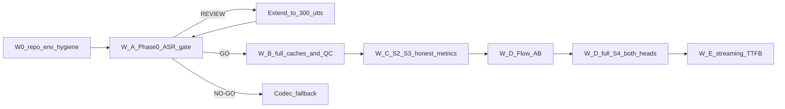

# Следующие работы: Phase 0 ASR → полный кеш → лестница S2+

Ревизия **v2** — учтены все 7 правок ревью плюс блокеры, найденные при чтении кода.

Цель: закрыть **реальный** codec go/no-go по разборчивости на русском, затем масштабировать данные и обучение без пропуска гейтов и с метриками, пригодными для статьи. Отправная точка: структурный Phase 0 GO, S1 text-usage формально пройден на direct head (`runs/v01_regression_direct`), но **впритык**: `text_mask.relative_rise = 0.205` при пороге `0.20`, `attention_diagonality = 0.165`.



---

## Что изменилось относительно v1

Принятые правки ревью:

1. Гейт Phase 0 — трёхуровневый (GO / REVIEW / NO-GO) с paired bootstrap CI по utterance; считаем WER **и** CER; худшие примеры ранжируем по CER и абсолютному числу ошибок.
2. ASR-бэкенд сделан сменным (`openai_whisper` сейчас, `faster_whisper` для корпуса и регулярных евалов); код перед первым гейтом не переписываем.
3. Проект переезжает с `/mnt/c` в Linux FS: **Windows-копия остаётся авторской, в WSL — `git clone`, синхронизация через push/pull** (выбранный вариант).
4. Полная ASR-проверка корпуса — обязательный шаг, не опция; трёхуровневые теги `clean / review / exclude`, порог фиксируется после просмотра распределения и 50–100 примеров.
5. Free-running L1 понижен до диагностики; гейт S3 — DTW-aligned L1 + duration ratio + ASR CER/WER + доля успешных остановок + отсутствие NaN/silence/runaway + деградация по длине.
6. Перед S2 — ремонт stop-лосса (`pos_weight` из статистики / focal / положительное окно) и три контрфактических теста на использование текста.
7. После выбора head — **полный S4 для обоих** вариантов (regression и flow) и итоговое A/B на одном замороженном test set; `freeze_talker_steps` → `freeze_talker_fraction: 0.05`.

Дополнительно найдено в коде (детали в разделе «Дополнительно» ниже): git-ignore съедает пакет `minispeech.data`; Phase 0 может выдать GO без ASR; `utt_id` содержит индекс перечисления и «поедет» при добавлении part002/003; в `generate()` нет KV-кеша; `measure_ttfb` возвращает оценку, а не измерение; `ShardWriter` не умеет resume; `preload=True` захардкожен в тренере.

---

## Workstream 0 — Repo/env гигиена (блокер, ~40 мин)

Без этого шага любой `git clone` в WSL даёт нерабочее дерево.

### 0.1 Фикс git-ignore и коммит пропавшего пакета

`git check-ignore -v src/minispeech/data/dataset.py` → `.gitignore:23:data/`. Незаякоренный паттерн `data/` игнорирует **`src/minispeech/data/`**, поэтому `dataset.py`, `manifest.py`, `shards.py`, `alignment.py`, `__init__.py` никогда не попадали в git. На GitHub лежит дерево, которое не запускает обучение.

- В [.gitignore](.gitignore): `data/` → `/data/`, `!data/.gitkeep` → `!/data/.gitkeep`. Заякорить также `out/`, `runs/`, `hf_cache/`, `.cache/` (`/out/`, `/runs/`, …), чтобы не поймать ту же ошибку с `src/**/out` в будущем.
- `git add -f src/minispeech/data && git commit` — коммит «fix(gitignore): unignore src/minispeech/data package».
- Проверка: `git ls-files src/minispeech/data` возвращает 5 файлов; `git status --porcelain` чист.

### 0.2 Клон в Linux FS и venv

```bash
git -C /mnt/c/projects/tts-self push
mkdir -p ~/projects && cd ~/projects
git clone https://github.com/AdamCage/tts-self.git tts-self
cd ~/projects/tts-self
uv venv .venv && source .venv/bin/activate
uv pip install -e ".[dev,eval,stress]"
export HF_HOME=$HOME/hf_cache
python scripts/00_env_check.py && pytest -q
```

Пути в конфигах менять не нужно: [configs/data_ruslan_local.yaml](configs/data_ruslan_local.yaml) использует `~/datasets/tts/...`, [configs/qwen_local.yaml](configs/qwen_local.yaml) — абсолютный `/home/adam/datasets/tts/models/Qwen3.5-0.8B-Base`. Данные уже в Linux FS (`~/datasets/tts/ruslan` 2.2 ГБ, `~/datasets/tts/models` 3.0 ГБ, 800 wav извлечено).

Диск: `/` — 938 ГБ свободно, `C:` — 151 ГБ. Ещё один аргумент держать tar-архивы, латенты и text_hidden только в Linux FS.

### 0.3 Протокол синхронизации (важно при выбранном git-варианте)

- Правки кода/конфигов делаются на Windows (Cursor) → `git push` → `git pull` в WSL перед прогоном. Никогда не редактировать файлы в WSL-клоне вручную.
- Артефакты прогонов рождаются в WSL. `runs/` в git не попадает, поэтому **числа обязаны переезжать в `docs/*.md`**: `docs/phase0_report.md`, `docs/corpus_qc.md`, `docs/phase3_ab.md`, `docs/phase4_latency.md` коммитятся из WSL и подтягиваются на Windows через `git pull`.
- Перед каждым прогоном в WSL: `git rev-parse --short HEAD` записывается в лог; `run_manifest.json` уже пишет `git_sha` ([utils.py](src/minispeech/utils.py)).
- Длинные прогоны — под `tmux` с `2>&1 | tee runs/<name>/console.log`.
- Deliverable: короткий раздел «WSL sync» в [AGENTS.md](AGENTS.md) вместо текущей строки «project at `/mnt/c/projects/tts-self`».

---

## Workstream A — Phase 0 с ASR (блокер масштаба)

**Зачем:** ΔWER roundtrip задаёт потолок WER любой будущей TTS на этих латентах.

### A.0 Сменный ASR-слой (делаем до прогона, ~1–2 ч)

Новый модуль `src/minispeech/eval/asr.py` + `configs/asr.yaml`:

```yaml
asr:
  backend: openai_whisper   # позже faster_whisper
  model: large-v3
  language: ru
  temperature: 0.0          # ОБЯЗАТЕЛЬНО: гасит temperature-fallback openai-whisper
  beam_size: null           # greedy
  condition_on_previous_text: false
  compute_type: float16     # только faster_whisper
  batch_size: 8             # только faster_whisper (BatchedInferencePipeline)
  vad_filter: false         # фиксируем, чтобы orig и roundtrip обрабатывались одинаково
  cache_dir: ~/datasets/tts/asr_cache
```

- Интерфейс: `transcribe(audio: np.ndarray, sr: int) -> str` и `transcribe_many(...)`; ресемпл к 16 кГц внутри.
- **Важно:** у `openai-whisper` дефолт `temperature=(0.0, 0.2, …, 1.0)` с fallback по `compression_ratio_threshold`/`logprob_threshold` — без явного `temperature=0.0` результат не детерминирован. Сейчас в [scripts/11_phase0_feasibility.py](scripts/11_phase0_feasibility.py) вызывается `asr.transcribe(..., language="ru", fp16=...)` без этих параметров.
- Единая нормализация: `normalize_for_asr(text)` в [src/minispeech/frontend/normalize.py](src/minispeech/frontend/normalize.py) — NFC, lower, снятие ударений (`strip_stress`), удаление пунктуации, `ё→е`, схлопывание пробелов; применяется **одинаково** к reference и к обеим гипотезам. Сейчас есть только `strip_stress(text)` для ref, гипотезы Whisper идут с пунктуацией и регистром → абсолютный WER завышен, а порог CER для QC корпуса без этого бессмысленен.
- Кеш транскриптов: ключ `sha1(audio_bytes) + backend + model + params_hash` в `asr_cache/`. Экономит повторную транскрипцию оригиналов при расширении 120 → 300 и при QC корпуса.

Ремонт самого скрипта Phase 0 ([scripts/11_phase0_feasibility.py](scripts/11_phase0_feasibility.py)):

- Тексты: для пар без `.txt` подтягивать из `metadata.csv` (сейчас читаются только `.txt`/`.lab` рядом с wav).
- **Гейт-баг:** `wer_ok = dwer is None or dwer <= …` → если Whisper не загрузился, `dwer=None`, `go=True` и exit `0`. Исправить: без `--skip-asr` недоступность ASR = ошибка (exit `3`), а в отчёте `wer_status: unavailable`, не GO.
- Sensitivity-sweep: `entry["wer"] = compute_wer(refs[:1], [hyp])` — WER по **одной** фразе. Считать sweep на `--sweep-n 8..10` utterance, добавить CER. 9 сигм × 2 вида шума × 10 фраз ≈ 180 транскрипций — приемлемо.
- Писать per-utterance записи в `docs/phase0_asr_records.jsonl`: `utt_id, dur_s, ref_norm, hyp_orig, hyp_codec, n_ref_words, n_ref_chars, edits_orig{sub,del,ins,hits}, edits_codec{...}` (через `jiwer.process_words` / `process_characters`). Это даёт: пересчёт CI без повторного ASR, инкрементальное расширение до 300 фраз, и список худших примеров.
- Отчёт: `wer_orig`, `wer_codec`, `delta_wer_pp`, `cer_orig`, `cer_codec`, `delta_cer_pp`, CI, `n_with_text`, топ-10 худших по CER и по абсолютному числу ошибок.

### A.1 Paired bootstrap CI

`src/minispeech/eval/bootstrap.py`:

- Corpus-level WER на ресэмпле = `sum(edits) / sum(ref_words)` (не среднее per-utt WER).
- 1000 ресэмплов utterance с возвращением, **paired** — в каждом ресэмпле берём одну и ту же выборку для orig и codec, ΔWER считаем внутри ресэмпла.
- Возвращаем `delta_wer_pp`, `ci95_low`, `ci95_high`, `p_delta_gt_4pp`; то же для CER.
- Юнит-тест: на синтетических записях с нулевой разницей CI должен накрывать 0.

### A.2 Прогон

```bash
cd ~/projects/tts-self && source .venv/bin/activate
export HF_HOME=$HOME/hf_cache
python scripts/11_phase0_feasibility.py \
  --config configs/codec.yaml \
  --data configs/data_ruslan_local.yaml \
  --asr-config configs/asr.yaml \
  --ruslan-dir $HOME/datasets/tts/ruslan \
  --n 120 --sweep-n 10 \
  --report docs/phase0_report.md
```

Без `--skip-asr`. Оценка: загрузка large-v3 + ~120×2 транскрипта ≈ 30–90 мин.

### A.3 Трёхуровневый гейт

Структурные условия (все обязательны): `sample=False` детерминизм PASS; `cache abs diff < 1e-2` (bf16); decoder RTF < 0.3.

Решение по разборчивости (exit-коды скрипта):

- **GO — exit 0:** `ΔWER ≤ 2 п.п.` и верхняя граница 95% CI `≤ 4 п.п.`
- **REVIEW — exit 3:** `ΔWER` в диапазоне 2–4 п.п. **или** CI пересекает 4 п.п. → расширить выборку до 300 фраз (транскрипции первых 120 берутся из кеша), пересчитать; повторный REVIEW разбирается вручную с прослушиванием 20 худших примеров.
- **NO-GO — exit 2:** `ΔWER > 4 п.п.` и нижняя граница CI `> 4 п.п.` → **стоп масштаба**, документируем в [docs/phase0_report.md](docs/phase0_report.md), разбираем fallback codec отдельной задачей; полный encode RUSLAN не начинаем.

ΔCER — вспомогательный критерий: если ΔWER пограничный, но ΔCER < 1 п.п., это скорее словарные замены Whisper, чем деградация кодека; фиксируем это в отчёте как аргумент для REVIEW→GO.

---

## Workstream B — Данные, QC и полный offline cache

Только после GO из A.

### B.1 Стабильные utt_id (сделать **до** полного билда манифеста)

В [scripts/02_build_manifest.py](scripts/02_build_manifest.py): `utt_id=f"ruslan_{i:06d}_{wp.stem}"`. `i` — индекс перечисления `pairs`, поэтому добавление part002/003 сдвигает все id → инвалидируются ключи `latents_index.json` / `text_hidden_index.json` и меняется `test_set_sha256`. Заморозить схему без индекса: `utt_id = f"ruslan_{wp.stem}"`, проверить уникальность stem и упасть с ошибкой при коллизии. Существующие 200-utt кеши всё равно перестраиваются под полный корпус.

Заодно в том же скрипте:

- Логировать счётчики отбрасывания: по `min_dur_s`/`max_dur_s`, по нечитаемому wav, по дедупликации текста (`seen` по `text_raw.lower()` может выкинуть легитимные повторы — нужно число в `manifest.meta.json`).
- Пересмотреть `max_dur_s: 10.0` в [configs/data_ruslan_local.yaml](configs/data_ruslan_local.yaml) после гистограммы длительностей: при T = 15 с это всего 113 фреймов, VRAM не проблема, а длинные фразы нужны для метрики «деградация по длине».
- `write_manifest` → атомарная запись (`tmp` + `os.replace`) в [src/minispeech/data/manifest.py](src/minispeech/data/manifest.py): манифест перезаписывается ещё и из `04_encode_latents.py`/`05_cache_text_hidden.py`, обрыв на записи убьёт источник истины с замороженным test-хешем.
- `pick_challenge`: `rest = [r for r in rows if r not in chosen]` — O(n·|chosen|) со сравнением dataclass по всем полям; заменить на сравнение по `utt_id` (мелочь, но на 22k строках заметно).

### B.2 Загрузка и идемпотентное извлечение

```bash
hf download stilletto/ruslan-stressed --repo-type dataset \
  --include "wavs_part_002.tar" --include "wavs_part_003.tar" \
  --local-dir $HOME/datasets/tts/ruslan
```

Расширить [scripts/16_extract_ruslan_subset.py](scripts/16_extract_ruslan_subset.py) на все `wavs_part_*.tar` (флаг `--all`, без `--max-wavs`): пропуск уже существующих файлов (сейчас уже есть `if not target.exists()`), тексты из `metadata.csv` рядом с wav, итоговый отчёт «extracted / skipped / без текста». Прогон повторяемый.

### B.3 Полная QC корпуса (обязательный шаг, ~1.5–2 ч)

Phase 0 отвечает, портит ли аудио кодек. Он не отвечает, чист ли корпус. 31 час — небольшой объём, прогоняем целиком **до** фиксации финального манифеста.

Переписать [scripts/03_verify_text_asr.py](scripts/03_verify_text_asr.py) на неразрушающий режим. Сейчас он `write_manifest(cfg["manifest"], kept)` — то есть **перезаписывает манифест, безвозвратно выкидывая строки** с `CER > 0.25`, без резюмируемости.

Новое поведение:

- Backend по умолчанию `faster_whisper` (batched, `float16`), из [configs/asr.yaml](configs/asr.yaml). Оценка на 4080: RTF ≈ 0.02–0.03 → 31 ч аудио ≈ 40–70 мин.
- Результат — **sidecar** `~/datasets/tts/ruslan/corpus_qc.jsonl`, по строке на utterance, ключ `utt_id`. Манифест не трогаем.
- Резюмируемость: при старте читаем уже посчитанные `utt_id` и досчитываем остаток; запись флашится каждые N строк.
- Поля на utterance: `asr_cer`, `asr_wer`, `hyp`, `ref_norm`, `dur_s`, `rms`, `peak`, `clip_frac` (доля |x| > 0.99), `lead_sil_s`, `trail_sil_s`, `silence_ratio` (энергетический VAD), `chars_per_sec` (детектор обрезанного/лишнего текста), `has_digits`, `has_latin`, `has_stress_marks`.
- Отдельный шаг `scripts/03b_apply_qc.py`: читает `corpus_qc.jsonl`, ставит в манифест `qc_tag` и `asr_cer`, ничего не удаляет:
  - `CER ≤ 0.15` → `clean`
  - `0.15 < CER ≤ 0.25` → `review` (в train с пониженным весом либо исключение — решается после прослушивания)
  - `CER > 0.25` → `exclude` (в train не идёт, из манифеста не удаляется)
- Порог фиксируем **после** просмотра распределения (перцентили 50/75/90/95/99) и прослушивания 50–100 примеров из зоны 0.15–0.35, иначе выкинем хорошие записи из-за чисел, `ё`, пунктуации и нормализации.
- `docs/corpus_qc.md`: перцентили CER/WER/длительности/тишины/клиппинга, число в каждом теге, топ-50 худших с путями; wav худших копируются в `/mnt/c/projects/tts-self/out/listen_qc/` для прослушивания с Windows (единственный легитимный трафик в `/mnt/c`).
- В [src/minispeech/data/dataset.py](src/minispeech/data/dataset.py) — фильтр `exclude_tags=("exclude",)` и опциональный `sample_weight` для `review`.

### B.4 Кеши

```bash
python scripts/04_encode_latents.py --config configs/data_ruslan_local.yaml
python scripts/05_cache_text_hidden.py --config configs/data_ruslan_local.yaml \
  --qwen-config configs/qwen_local.yaml --batch-size 8
python scripts/06_align.py --config configs/data_ruslan_local.yaml --level C
```

Правки перед прогоном:

- **Resume в [src/minispeech/data/shards.py](src/minispeech/data/shards.py):** сейчас `ShardWriter` всегда начинает с `latents_00000.safetensors` и пишет `*_index.json` только в `close()` — обрыв на 80% полного корпуса означает полный повтор. Добавить: чтение существующего индекса, продолжение нумерации шардов, флаш индекса при каждом `flush()`, пропуск уже записанных `utt_id`.
- Не вызывать encode/cache с `--max-utts` (обрезает манифест — известный баг).
- `preload=True` захардкожен в `make_loaders` ([src/minispeech/train/trainer.py](src/minispeech/train/trainer.py)), а `preload_all()` тянет **все** шарды в RAM. Оценка text_hidden: 3 слоя × ~40 токенов × 1024 × 2 байта ≈ 0.25 МБ на utterance → ~5–6 ГБ на полный корпус (латенты ~0.3 ГБ). Вынести `preload` в `train.data.preload` и для S4 ставить `false` (ленивое чтение шардов + LRU на 2–3 шарда).
- `05_cache_text_hidden.py` пишет `input_ids` в манифест — оставляем, но с атомарной записью из B.1.

### B.5 Гейт B

- 100% строк с `qc_tag != exclude` имеют и latent, и text_hidden (сверка по индексам, а не по числу файлов).
- `stats.safetensors` пересчитан только по train-строкам; `ac1_mean` залогирован.
- align C для всех; уровень зафиксирован в meta.
- `manifest.meta.json` содержит `test_set_sha256`, часы по сплитам, счётчики отбрасывания и число в каждом `qc_tag`. **После этого test hash не меняется** — все дальнейшие сравнения на нём.

---

## Workstream C — Лестница S2→S3 с честными метриками

Конфиг-база: [configs/talker_v01_direct.yaml](configs/talker_v01_direct.yaml) (`residual: false`, `acoustic_dropout: 0.35`).

### C.1 Ремонт stop head (до длинного обучения)

В [src/minispeech/data/dataset.py](src/minispeech/data/dataset.py) `stop_target[i, t - 1] = 1.0` — ровно одна единица на утверждение, то есть баланс ~1:45 при среднем 6 с речи, а `positive_weight: 10.0` в конфиге заведомо ниже реального дисбаланса. `focal_stop_loss` в [src/minispeech/train/losses.py](src/minispeech/train/losses.py) написан, но **не подключён**: `total_regression_loss` всегда вызывает `stop_bce`, а `stop_head.loss: bce` из конфига не читается.

- Положительное окно: последние `stop_window: 3` фрейма как позитив (или мягкие метки 0.5/0.8/1.0) вместо одной единицы.
- `stop_pos_weight: auto` — считать из статистики манифеста (`mean_frames / stop_window`), значение писать в `run_manifest.json`.
- Подключить `stop_head.loss: bce | focal` в трейнер (focal уже реализован).
- Метрики stop в логах: precision/recall позитивного фрейма, `median |t_stop_pred − t_stop_true|` в фреймах, доля runaway (уход в `max_frac` кап), доля преждевременных остановок.
- Согласовать правило остановки: AGENTS.md обещает triple stop rule, а в [configs/infer.yaml](configs/infer.yaml) и в `generate()` стоит `consecutive: 2` → привести к 3 в обоих местах.

### C.2 KV-кеш в генерации (иначе честный евал слишком дорог)

`MiniSpeech.generate()` ([src/minispeech/models/minispeech.py](src/minispeech/models/minispeech.py)) на каждом шаге пересобирает весь префикс и прогоняет Talker целиком — O(T²) по вычислениям; там же висит мёртвая переменная `z_in`. Free-running евал по 32 val-фразам × каждые N шагов, DTW и ASR синтеза упираются именно в это, а Phase 4 без инкрементального декода вообще нельзя измерять.

- Инкрементальный шаг с KV-кешем self-attention Talker (cross-attention память текста считается один раз).
- Батчевая free-running генерация (несколько фраз параллельно) для евала.
- Тест эквивалентности: кешированный и полный декод дают одинаковые латенты (atol 1e-4 в fp32).

### C.3 Метрики free-running (замена raw L1)

Новый `src/minispeech/eval/free_running.py` + `src/minispeech/eval/dtw.py`:

- **DTW-aligned latent L1**: банд-ограниченный DTW (Sakoe-Chiba ±20%) по нормализованным латентам, стоимость L1 или `1 − cos`; возвращает средний L1 на пути, наклон пути и его отклонение от 1.
- **duration ratio** = `n_frames_pred / n_frames_gt`, целевой диапазон 0.8–1.2.
- **ASR CER/WER синтеза** через тот же сменный бэкенд и ту же нормализацию.
- **Стабильность:** доля успешных остановок, доля NaN/Inf, доля «тишины» (RMS ниже порога), доля runaway.
- **Деградация по длине:** бакеты 0–2 / 2–4 / 4–6 / 6–10 с, CER на бакет; сигнал тревоги, если CER(6–10 с) > 2× CER(2–4 с).
- Raw free-running L1 продолжаем логировать, но **только как диагностику** — при свободной генерации сдвиг на один фрейм ломает поэлементное сравнение.
- Писать в `runs/<run>/val_metrics.jsonl` (fixed 32 val utt, тот же набор на всех стадиях) + `eval_free_running.json` рядом с чекпоинтом.

### C.4 Контрфактические тесты text-usage

В [src/minispeech/eval/text_usage.py](src/minispeech/eval/text_usage.py) уже есть shuffle и mask (teacher-forced). Добавить третий и вынести все три в [scripts/09_eval.py](scripts/09_eval.py):

1. Правильные латенты + перемешанный текст (`text_shuffle_test`, есть) — относительный рост loss ≥ 0.20.
2. Правильный текст + обнулённая text memory (`text_mask_test`, есть) — рост ≥ 0.20. Сейчас 0.205 при пороге 0.20, то есть по факту на грани; после S2 требовать ≥ 0.35.
3. **Новый:** один и тот же акустический префикс (k = 8 GT-фреймов) + два разных текста → free-running продолжение. Метрика: L1-расхождение двух продолжений, нормированное на расхождение контроля (тот же текст дважды); требуем ratio ≥ 3. Дополнительно — ASR двух декодов должен давать разные строки (CER между ними > 0.3).

Плюс `attention_diagonality` (сейчас 0.165) логируем как тренд, гейтом не делаем: у cross-attention 8 голов, диагональность размывается усреднением.

### C.5 Стадии и прогоны

Добавить стадии в [configs/talker_v01_direct.yaml](configs/talker_v01_direct.yaml) (сейчас только S1):

- S1 — 32 utt, есть; на полном кеше короткий reconfirm 500–1000 шагов + `09_eval`.
- S2 — `max_hours: 1.0`, 8k–15k шагов.
- S3 — `max_hours: 5.0`, 15k–25k шагов.
- S4 — full, только после решения по head (Workstream D).

```bash
python scripts/07_train.py --config configs/talker_v01_direct.yaml \
  --data configs/data_ruslan_local.yaml --mode regression --stage S2
python scripts/09_eval.py --ckpt runs/v01_regression_direct/best.pt \
  --data configs/data_ruslan_local.yaml
```

### C.6 Гейты C

Гейт S2 (жёсткие):

- Все три контрфактических теста пройдены (mask-тест ≥ 0.35, prefix-тест ratio ≥ 3).
- Stop срабатывает: доля успешных остановок ≥ 95%, runaway ≤ 2%.
- Нет схлопывания в тишину и NaN на 8 listen-фразах.

Гейт S3 (жёсткие + сравнительные):

- Стабильность: NaN = 0, silence-collapse = 0, runaway ≤ 2%, успешные остановки ≥ 95%.
- `duration ratio` в 0.8–1.2 на ≥ 90% val-фраз.
- DTW-aligned L1 ≤ 1.5× teacher-forced L1. **Абсолютный порог калибруется на S2**: сначала фиксируем наблюдённое значение как baseline, гейт применяем как «не хуже S2».
- CER синтеза монотонно улучшается S2 → S3 и не растёт с длиной быстрее, чем ×2 между бакетами 2–4 с и 6–10 с.
- Аварийный сценарий: если DTW L1 > 3× TF и речь разваливается после ~3 с — включаем non-AR (`scripts/14_enable_nonar_fallback.py`) и **не идём в flow на сломанном AR**.

---

## Workstream D — Flow A/B и полный S4

### D.1 Подготовка flow-конфига

В [configs/flow_v02.yaml](configs/flow_v02.yaml):

- `init_from: runs/v01_regression/best.pt` → `runs/v01_regression_direct/best.pt` (direct head — наш живой baseline).
- `freeze_talker_steps: 2000` → `freeze_talker_fraction: 0.05` (для короткого S2-прогона 2000 шагов — слишком большая доля обучения). В трейнере: `freeze_steps = int(fraction * total_steps)`, замораживаем Talker + text_proj + layer_mix, размораживаем с пониженным LR.
- `load_checkpoint` использует `strict=False` молча ([src/minispeech/infer/generate.py](src/minispeech/infer/generate.py)) — логировать число загруженных/пропущенных/неожиданных ключей и падать, если ключи Talker не загрузились (иначе «flow из regression» окажется случайной инициализацией).

### D.2 Порядок (правка ревью)

1. **D1** — Flow A/B на S3-подвыборке (1–5 ч): одинаковый бюджет шагов, одинаковый оптимизатор, тот же замороженный test set.
2. **D2** — выбор гиперпараметров: CFG sweep `{1.0, 1.3, 1.6}` при Heun 4; при близких результатах проверить Heun 2 и 8 (это же вход в TTFB Workstream E).
3. **D3** — Regression S4 на полном корпусе.
4. **D4** — Flow S4 на полном корпусе.
5. **D5** — итоговое A/B **обоих** S4 на одном test set. Без этого full-data baseline отсутствует, а сравнение зависит от малого subset — для инженерного MVP терпимо, для статьи нет.

Протокол A/B (пишется в `docs/phase3_ab.md`):

- Объективно: CER/WER синтеза, DTW-aligned L1, duration ratio, RTF, TTFB.
- Субъективно: 30 пар с рандомизированным порядком и скрытыми метками (простой скрипт-генератор пар + CSV для ответов), считаем предпочтения и биномиальный CI.
- Дешёвая проверка устойчивости: 3 сида на S3-подвыборке; для S4 — один сид, но с зафиксированным `run_manifest.json`.

---

## Workstream E — Streaming TTFB (Phase 4)

После выбора head:

1. `measure_ttfb` в [src/minispeech/infer/stream.py](src/minispeech/infer/stream.py) сейчас **не измеряет, а оценивает**: `first_latent_ms = total_ms / n_frames`, `ttfb = first_latent_ms + FRAME_MS`. Заменить на реальные метки времени: `t_norm_done`, `t_text_hidden`, `t_first_latent`, `t_first_pcm` (первый буфер ≥ 40 мс), плюс джиттер между чанками и глубина буфера.
2. Декомпозиция: Qwen text-hidden / Talker prefill / первый шаг головы (для flow — сэмплер) / codec decode chunk.
3. Cold-start и warm-start отдельно (первый вызов включает загрузку и CUDA-разогрев; для отчёта нужны оба числа).
4. Cached decode `chunks=4`; OLA не включаем без слышимых швов.
5. RTF и стабильность длинной генерации: 30–60 с непрерывного синтеза, дрейф `duration ratio`, отсутствие runaway.
6. Числа в `docs/phase4_latency.md`.

---

## Дополнительно (мои добавления к ревью)

Блокеры:

- **`.gitignore` съедает `src/minispeech/data/`** — 5 файлов никогда не коммитились; при выбранном git-варианте синхронизации это стоп-блокер (W0.1).
- **Phase 0 может выдать GO без ASR** — `wer_ok = dwer is None or …`; при недоступности Whisper скрипт вернёт exit 0 и план «exit 0 → продолжаем» уведёт нас в масштаб без гейта (A.0).
- **`utt_id` содержит индекс перечисления** — добавление part002/003 переименует все utterance, инвалидирует кеши и сломает замороженный test hash (B.1).

Важно:

- Единая ASR-нормализация ref/hyp — без неё абсолютный WER завышен, а порог CER для QC корпуса не имеет смысла (A.0).
- `temperature=0.0` для `openai-whisper` — иначе temperature-fallback делает прогон нерепродуцируемым (A.0).
- Атомарная запись манифеста + resume в `ShardWriter` — манифест перезаписывают три скрипта, кеши корпуса пишутся часами (B.1, B.4).
- `preload=True` захардкожен → ~6 ГБ RAM на полном корпусе; вынести в конфиг (B.4).
- Нет KV-кеша в `generate()` → O(T²); упирается весь честный евал и Phase 4 (C.2).
- `measure_ttfb` возвращает оценку, а не измерение (E.1).
- `focal_stop_loss` и `stop_head.loss` не подключены; `stop_consecutive` = 2 против «triple stop rule» в AGENTS.md (C.1).
- Кеш ASR-транскриптов — окупается на расширении 120 → 300 и на регулярных евалах чекпоинтов (A.0).
- Sweep-WER по одной фразе → по 8–10 фразам (A.0).

Желательно (задел под статью):

- `docs/experiment_protocol.md`: замороженный `test_set_sha256`, конфиг ASR и его хеш, определения всех метрик, таблица гейтов и их результатов по датам. Один документ, на который ссылаются все отчёты.
- Расширить `write_run_manifest`: хеш манифеста данных, `qc_tag`-состав train-выборки, `git dirty` флаг, хеш конфига ASR, версия драйвера CUDA.
- Pytest на новую математику (быстрые, без GPU): paired bootstrap на синтетике накрывает 0; DTW на сдвинутой копии даёт ~0 стоимости и наклон 1; positive-window stop-таргет имеет ровно `stop_window` единиц; `normalize_for_asr` идемпотентна; кешированный декод == полный.
- Zero-shot оценка «потолка»: прогнать через codec roundtrip уже синтезированные фразы и сравнить CER с CER оригиналов — даёт вторую точку на кривой «сколько теряет кодек, а сколько модель».
- Фиксированный listening-set (challenge 40 фраз) с версионированием: одни и те же фразы на всех стадиях, wav складывать в `/mnt/c/projects/tts-self/out/listen/<stage>/`.

---

## Рекомендуемый финальный порядок

```text
W0. .gitignore + коммит minispeech.data → клон в ~/projects/tts-self → venv → pytest

A0. Сменный ASR-бэкенд, нормализация, bootstrap, ремонт гейт-бага
A1. Phase 0 ASR на 120 фразах
A2. При пограничном результате расширение до 300 (транскрипции из кеша)
A3. GO / REVIEW / NO-GO

B1. Стабильные utt_id, atomic manifest, счётчики фильтров
B2. Загрузка part002/003 + идемпотентное извлечение
B3. Полная QC корпуса (ASR + DSP) → corpus_qc.jsonl + docs/corpus_qc.md
B4. Просмотр распределения, фиксация порогов, qc_tag в манифест
B5. Фиксация manifest и test hash (дальше не меняется)
B6. Latent cache (resume)
B7. Text-hidden cache (resume)
B8. Alignment cache

C1. Ремонт stop head (окно + focal/pos_weight + метрики)
C2. KV-кеш в generate() + тест эквивалентности
C3. Модуль free-running метрик (DTW / duration / ASR / стабильность)
C4. S1 reconfirm
C5. S2
C6. Контрфактический text-usage тест (3 проверки)
C7. S3
C8. DTW / ASR / duration / стабильность / деградация по длине

D1. Flow A/B на S3 subset
D2. Выбор базовых гиперпараметров (CFG, шаги сэмплера)
D3. Regression S4
D4. Flow S4
D5. Полное A/B на одном test set (объективно + слепое прослушивание)

E1. Реальная инструментализация TTFB
E2. Cold-start и warm-start
E3. Декомпозиция Qwen / Talker / sampler / codec
E4. RTF и стабильность длинной генерации
```

---

## Вне следующего цикла (не начинать сейчас)

- Phase 5 LoRA / `causal_conv1d` + `fla`
- Phase 6 диалоги / клонирование
- Любые S4-прогоны до закрытия D1–D2

---

## Коммиты

- W0 — отдельный коммит с фиксом `.gitignore` и пакетом `minispeech.data` (без него остальное не воспроизводится).
- A — код ASR-слоя и bootstrap + `docs/phase0_report.md` + `docs/phase0_asr_records.jsonl`.
- B — код extract/manifest/QC/shards + `docs/corpus_qc.md`; данные, wav и `corpus_qc.jsonl` из `~/datasets` не коммитить.
- C/D/E — код метрик и конфиги стадий + `docs/phase3_ab.md`, `docs/phase4_latency.md`, `docs/experiment_protocol.md`.
- `data/`, `runs/`, `*.safetensors`, аудио и HF-кеши не коммитим. Отчёты коммитятся из WSL, на Windows подтягиваются `git pull`.
