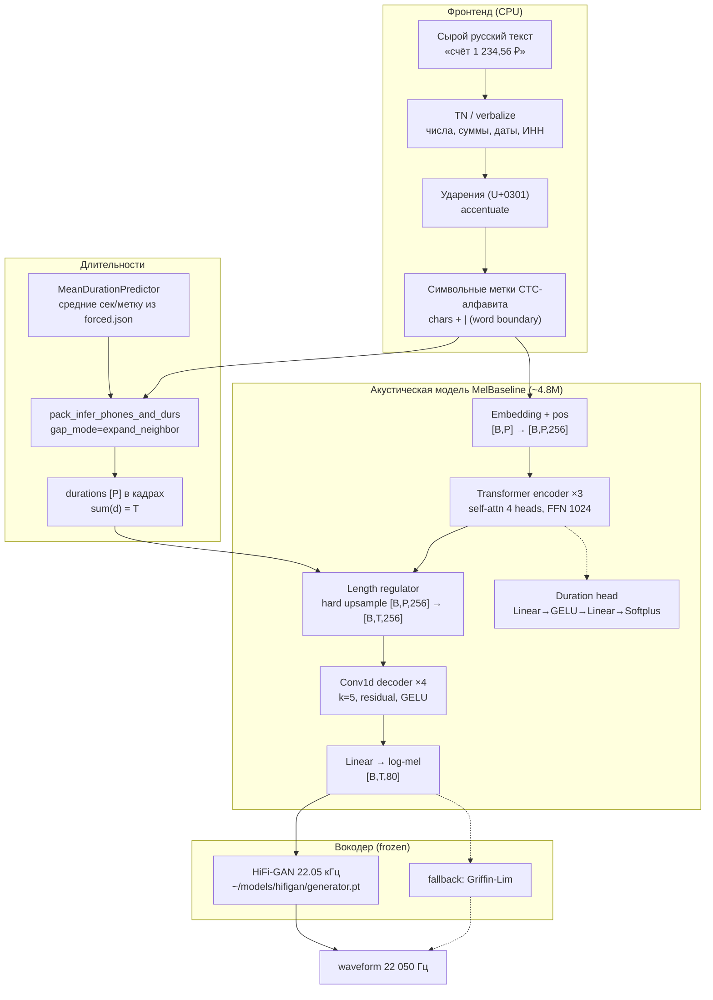
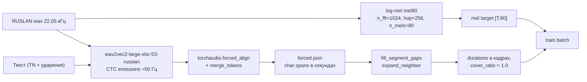

# Архитектура MiniSpeech-RU (Track A, production)

Актуальная production-модель — **duration-aware non-AR mel acoustic model**
(`runs/mel_baseline_v01_s4/best.pt`). Latent-ветка (Qwen → Talker → VibeVoice)
остаётся в репозитории как research-путь, но **не входит** в production-пайплайн
до прохождения Gate 0 (см. [part1_diagnosis.md](part1_diagnosis.md)).

---

## 1. Полный пайплайн



Ключевое отличие от прежней latent-схемы: **длительности заданы явно**, декодер
не авторегрессионный, выравнивание не выучивается cross-attention'ом, а берётся
из forced alignment.

---

## 2. Подготовка данных (offline)



**Критичная деталь.** Сырые CTC-спаны покрывают только ≈38 % длительности
реплики (остальное — blank). Без ремонта таймлайна модель училась на обрезанном
mel и синтез был неразборчивым (CER ≈ 0.86). Два режима починки:

| Режим | Что делает | Где используется |
|-------|------------|------------------|
| `expand_neighbor` | раздаёт пробелы соседним меткам по середине разрыва, новых токенов нет | **production** (S1e → S4) |
| `sil_fill` | вставляет явный `sil` в разрывы | ablation S1d |

`expand_neighbor` выбран потому, что на инференсе не нужно предсказывать, где
именно стоят паузы: свободный синтез — это только контентные метки + длительности.

---

## 3. Геометрия целей

Реестр в [`src/minispeech/constants.py`](../src/minispeech/constants.py):

| Target | kind | dim | sr | frame_rate | hop | Статус |
|--------|------|----:|---:|-----------:|----:|--------|
| `mel80` | mel | 80 | 22 050 | 86.1328125 Гц | 256 | **production** |
| `vibevoice64` | latent | 64 | 24 000 | 7.5 Гц | 3200 | research (Gate 0 FAIL) |

`frame_rate = 22050 / 256`. Проекция «метка → кадр» (`frame_projection.py`)
параметризована частотой кадров, поэтому одинаково работает и для 7.5 Гц, и для
86 Гц.

Mel — натуральный логарифм мощности (`log(max(mel, 1e-5))`), `fmin=0`,
`fmax=sr/2`, `power=1.0`. Пер-корпусная нормализация **не применяется**.

---

## 4. Модель `MelBaseline`

FastSpeech-подобная схема без авторегрессии
([`src/minispeech/models/mel_baseline.py`](../src/minispeech/models/mel_baseline.py)).

### Тензоры

```
phone_ids   [B, P]            int64, pad_id=0
    ↓ Embedding(V, 256) + Embedding(4096, 256) позиции
phone_h     [B, P, 256]
    ↓ 3 × EncoderBlock (MHA 4 heads → LN → FFN 1024 → LN, pre-residual)
phone_h     [B, P, 256]  ──→ dur_head ──→ dur_pred [B, P]  (кадры, Softplus)
    ↓ length regulator: повтор состояния durations[p] раз
frames      [B, T, 256]  (+ frame_mask [B, T])
    ↓ 4 × Conv1d(256→256, k=5, pad=2) + GELU, residual, финальный LayerNorm
h           [B, T, 256]
    ↓ Linear(256 → 80)
mel_pred    [B, T, 80]
```

### Компоненты

| Блок | Реализация | Назначение |
|------|-----------|-----------|
| Embedding | `nn.Embedding(vocab, 256, padding_idx=0)` + обучаемые позиции | символы CTC-алфавита (`unit="char"`, vocab ≈ 39) |
| Encoder | 3 × self-attention (4 головы) + FFN 1024, dropout 0.1 | контекст внутри последовательности меток |
| Duration head | `Linear(256,128) → GELU → Linear(128,1) → Softplus` | длительность каждой метки в кадрах |
| Length regulator | `hard_upsample` (повтор) либо `soft_upsample` (`W [B,P,T]`) | явное растяжение P → T |
| Decoder | 4 residual-блока `Conv1d(k=5)` + GELU (альтернатива: transformer) | локальная динамика спектра во времени |
| Projection | `Linear(256, 80)` | выход log-mel |

Параметров ≈ **4.8 млн** при `d_model=256`, `vocab=39` (основная масса — таблица
позиционных эмбеддингов 4096×256 и три блока энкодера).

### Режимы выравнивания

- `upsample: hard` (production) — целочисленные длительности, повтор состояний.
- `upsample: soft` — умножение на матрицу перекрытия `W [B,P,T]` из
  `soft_overlap_projection`, где `W[p,t] = overlap(p,t) / frame_dur`.

### Функция потерь

```
L = 1.0 · mel_l1 + 0.1 · duration_l1
```

- `mel_l1_loss` — masked L1 по кадрам и бинам, с опциональным `sample_weight`
  на реплику (вес QC).
- `phone_duration_loss` — L1 в `log1p`-домене между `dur_pred` и длительностями
  из forced alignment.

`acoustic_dropout` в mel-ветке **не используется** (это был костыль latent-Talker'а
против residual-головы, игнорирующей текст).

---

## 5. Обучение

Конфиг: [`configs/mel_baseline_v01.yaml`](../configs/mel_baseline_v01.yaml).

| Параметр | Значение |
|----------|----------|
| Оптимизация | AdamW, lr 2e-4, cosine, warmup 200, min_lr_ratio 0.05 |
| Регуляризация | weight_decay 0.01, grad_clip 1.0, dropout 0.1 |
| Точность | bf16 autocast (CUDA), EMA 0.999 |
| Батч | fixed 8 |
| Данные | lazy `ShardReader` (без preload), `exclude` фильтруется по QC |

Лестница (warm start на каждой ступени):

| Стадия | Данные | Шаги | val mel_l1 | Free CER (демо) |
|--------|--------|-----:|-----------:|----------------:|
| S1e | 32 реплики | 3 000 | 2.069 | 0.690 |
| S2 | 1 236 / ~1 ч | 12 000 | 1.381 | 0.079 |
| S3 | 5 645 / 5 ч | 20 000 | 1.128 | 0.041 |
| **S4** | 12 490 / 15.4 ч | 40 000 | **1.049** | 0.048 |

Отбор чекпоинта — по валидационному mel L1 с интерфейсом под CER-селекцию.

---

## 6. Инференс

```
текст → normalize_for_tts → accentuate → text_to_ctc_char_labels
      → pack_infer_phones_and_durs(mode=mean_stats, gap_mode=expand_neighbor)
      → MelBaseline.infer(phone_ids, durations)
      → HiFi-GAN (или Griffin-Lim) → wav 22.05 кГц
```

Режимы длительностей (`scripts/28_infer_mel.py --duration-mode`):

| Режим | Источник длительностей | Применение |
|-------|------------------------|-----------|
| `mean_stats` | средние по метке из forced.json | **свободный синтез** |
| `pred` | `dur_head` модели | ablation |
| `oracle_forced` | реальный forced-таймлайн реплики | верхняя граница (CER ≈ 0.03) |
| `uniform` | равные кадры на метку | отладка |

---

## 7. Что вне production

| Компонент | Статус | Причина |
|-----------|--------|---------|
| Qwen3.5-0.8B text hidden | не используется в mel-ветке | mel-модель работает от символов; вклад Qwen подлежит отдельному ablation |
| VibeVoice Talker + 64-D латенты | заморожено | Gate 0 FAIL: R² ≈ −0.11, синтез CER ≈ 0.89 |
| CFM / rectified flow по mel | реализовано, отложено | A/B на S2: CER 0.699 против 0.079 у регрессии |
| Streaming / TTFB | latent-ветка | будет переизмерено после стабилизации mel-пути |

### 7.1. Где был Qwen3.5-0.8B и почему сейчас не используется

В **production mel-модели Qwen нет**. Он относился к *старой* latent-схеме, не к Track A.

Исходный стек:

```text
stressed RU text → offline Qwen3.5-0.8B text hiddens
  → Talker (causal + cross-attn) → head
  → VibeVoice latents [64] @ 7.5 Hz → frozen decoder
```

Qwen работал как **текстовый энкодер**: скрытые состояния кэшировались offline
(`scripts/05_cache_text_hidden.py`) и подавались в Talker через cross-attention.
Сам Qwen в train loop обычно не крутился (LoRA — только после измеримого win,
Phase 5 в протоколе).

После Part 1 выяснилось, что latent-Talker **не выучил text→acoustic**
(Gate 0 FAIL: \(R^2 \approx -0.11\), synth CER ≈ 0.89). Узкое место было не в
«нехватке мощности LLM», а в отсутствии реального forced alignment, collapse
головы к константе и proxy-гейтах, пропускавших бессодержательный синтез
(см. [part1_diagnosis.md](part1_diagnosis.md)).

Поэтому Track A упрощён:

```text
текст → TN → ударения → символы (CTC-алфавит)
  → MelBaseline (embedding + encoder)
  → log-mel → HiFi-GAN
```

Текстовое условие здесь — **символьные эмбеддинги**, не Qwen-хиддены. Так проще
контролировать выравнивание и длительности; именно этот путь дал разборчивость
(val100 CER ≈ 0.048).

**Когда Qwen может вернуться**

- как опциональный канал поверх уже работающего mel-пайплайна
  (ablation: символы vs символы+Qwen);
- либо если снова оживят latent-ветку *после* прохождения Gate 0.

Сейчас для production это не нужно: mel-модель уже читает текст через свой
vocab/encoder.

---

## 8. Файлы

| Слой | Путь |
|------|------|
| Геометрия целей | `src/minispeech/constants.py` |
| TN / ударения / G2P | `src/minispeech/frontend/{normalize,verbalize,stress,g2p}.py` |
| CTC forced align | `src/minispeech/data/forced_align.py`, `scripts/26_build_forced_align.py` |
| Проекция и разрывы | `src/minispeech/data/frame_projection.py` |
| Длительности | `src/minispeech/frontend/durations.py` |
| Датасет mel | `src/minispeech/data/{mel,mel_dataset}.py`, `scripts/29_cache_mels.py` |
| Модель | `src/minispeech/models/mel_baseline.py` |
| Тренер | `src/minispeech/train/mel_trainer.py`, `scripts/27_train_mel.py` |
| Инференс и вокодер | `scripts/28_infer_mel.py`, `src/minispeech/infer/{vocoder,hifigan}.py` |
| Оценка | `scripts/32_eval_mel_suite.py`, `src/minispeech/eval/` |
